# CEE Model Exam Set 4

**CEE MD/MS Entrance Examination — MCQs based on the latest PG CEE syllabus**

Source: *CEE MDMS Bhadra 24.pdf* (Hamro Reading Home), Bhadra 24, 2083.

| | |
|---|---|
| Questions | 200 |
| Subjects | 19 |
| Source pages | 3–78 |
| Format | Single best answer, 4 options |
| Figures | 45 across 40 questions |
| Answer key | Source key, with explanations |

---

## Contents

1. Anatomy (13 questions)
2. Biochemistry (5 questions)
3. Community Medicine (7 questions)
4. Microbiology (6 questions)
5. Pathology (6 questions)
6. Pharmacology (13 questions)
7. Physiology (13 questions)
8. Forensic Medicine (6 questions)
9. Medicine (28 questions)
10. Surgery (18 questions)
11. Obstetrics & Gynecology (15 questions)
12. Pediatrics (12 questions)
13. Dermatology (4 questions)
14. ENT (11 questions)
15. Ophthalmology (8 questions)
16. Orthopedics (12 questions)
17. Anesthesia (8 questions)
18. Psychiatry (3 questions)
19. Radiology (12 questions)

---

## Questions

### 1. Anatomy

**1.** What is the blood supply of sigmoid colon?

- **A.** Superior mesenteric artery
- **B.** Inferior mesenteric artery
- **C.** Internal pudendal artery
- **D.** Celiac artery

Source page 3

**2.** Which of the following blood vessels is most likely involved in fracture of surgical neck of humerus?

- **A.** Anterior circumflex humeral
- **B.** Posterior circumflex humeral
- **C.** Axillary artery
- **D.** Subscapular artery

Source page 3

**3.** Which part of the brain controls emotions?

- **A.** Hippocampus
- **B.** Cerebellum
- **C.** Internal capsule
- **D.** Medulla

Source page 4

**4.** Femoral triangle boundary isn't formed by

- **A.** Sartorius muscle
- **B.** Inguinal ligament
- **C.** Adductor longus
- **D.** Adductor magnus

Source page 4

**5.** A 35 years old male presented with complain of swelling in inguinal region, which increases while coughing. USG was done and Indirect inguinal hernia was diagnosed. The origin of Indirect Inguinal hernia is through

- **A.** Medial to inferior epigastric vessels
- **B.** Lateral to inferior epigastric vessels
- **C.** Femoral canal
- **D.** Rectus abdominis muscle

Source page 5

**6.** Each hepatic segment consists of

- **A.** Hepatic artery and hepatic vein
- **B.** Hepatic artery, portal branch and bile duct
- **C.** Portal branch and bile duct
- **D.** Portal branch and hepatic vein

Source page 5

**7.** A 45-year-old male presents to the emergency department with a sudden onset of severe headache, nausea, vomiting, and loss of consciousness. The patient's family history is positive for hemorrhagic stroke, as his mother had a similar episode in her late forties. A non-contrast CT scan of the brain shows subarachnoid hemorrhage, and further workup reveals the presence of a cerebral aneurysm. Which of the following is the most common site of aneurysm location in patients with a positive family history of hemorrhagic stroke?

- **A.** Anterior communicating artery
- **B.** Middle cerebral artery
- **C.** Posterior communicating artery
- **D.** Vertebral artery

Source page 5

**8.** A 50-year-old man presents to the emergency room with acute onset epigastric pain. His past medical history includes hyperlipidemia, hypertriglyceridemia, diabetes, and alcohol abuse. His last drink was this morning and he drinks 20 beers a day. He denies any fevers or chills but reports nausea and 2 episodes of non-bloody, nonbilious vomiting. Physical exam is notable for tenderness to palpation of the epigastrium. Laboratory evaluation shows significantly elevated amylase and lipase. He is started on aggressive fluid resuscitation. What is the nerve supply of the organ involved?

- **A.** Celiac plexus
- **B.** Superior mesenteric plexus
- **C.** Inferior mesenteric plexus
- **D.** Suprarenal plexus

Source page 6

**9.** Which part of the pancreas is actually an intraperitoneal structure?

- **A.** Head
- **B.** Body
- **C.** Tail
- **D.** Uncinate process

Source page 6

**10.** Meissner's plexus is located in

- **A.** Between the mucosa and inner circular muscle layer
- **B.** Between inner circular layer and outer longitudinal layer
- **C.** Between outer longitudinal layer and serosa
- **D.** Mucosa

Source page 6

**11.** A 60-year-old male patient presents to the clinic with a persistent cough and shortness of breath. A chest X-ray is ordered, and the radiologist notes that there is a mass in the right lung that is obstructing the right bronchus. The doctor is explaining the anatomy of the lungs to the patient and asks which structure makes up the right hilum. Which of the following best describes the structures that make up the right hilum?

- **A.** Right main bronchus and pulmonary artery
- **B.** Right main bronchus and pulmonary vein
- **C.** Left main bronchus and pulmonary artery
- **D.** Left main bronchus and pulmonary vein

Source page 7

**12.** Posterior retromandibular vein drains into

- **A.** Facial vein
- **B.** External jugular vein
- **C.** Internal jugular vein
- **D.** Subclavian vein

Source page 7

**13.** The free border of the lesser omentum between the porta hepatis and the duodenum does not contains

- **A.** Hepatic artery
- **B.** Portal vein
- **C.** Common bile duct
- **D.** Right hepatic duct

Source page 7

### 2. Biochemistry

**14.** Rate limiting enzyme in glycolysis is?

- **A.** Glucokinase
- **B.** Hexokinase
- **C.** Phosphofructokinase-1
- **D.** Pyruvate kinase

Source page 7

**15.** Ochronosis is due to the accumulation of?

- **A.** Homogentisic acid
- **B.** Phenylpyruvate
- **C.** Xanthurenate
- **D.** Glyoxylate

Source page 8

**16.** Cork screw hair is seen in

- **A.** Vitamin C deficiency
- **B.** Vitamin A deficiency
- **C.** Vitamin D deficiency
- **D.** Vitamin B12 deficiency

Source page 8

**17.** Which of the following is used by brain for energy when glucose is not available?

- **A.** Betahydroxy butyrate
- **B.** Acetone
- **C.** Glucagon
- **D.** Fatty acids

Source page 9

**18.** The activity of AP endonuclease is involved in ________.

- **A.** Base excision repair
- **B.** Nucleotide excision repair
- **C.** Mismatch repair
- **D.** Double strand break repair

Source page 9

### 7. Physiology

**19.** Regarding Golgi tendon organ true is __________?

- **A.** Senses dynamic length of muscle
- **B.** Involved in reciprocal innervation
- **C.** Alpha motor neuron stimulation
- **D.** Sense muscle tension

Source page 9

### 3. Community Medicine

**20.** The duration of quarantine is

- **A.** Longest incubation period
- **B.** Shortest incubation period
- **C.** Infective period
- **D.** None

Source page 10

**21.** A man was admitted to hospital in the ICU ward, he developed fever after 2 days of admission. Most likely mode of transmission in this patient is

- **A.** Indirect transmission
- **B.** Vector borne
- **C.** Water borne
- **D.** Air borne

Source page 10

**22.** Which of the following chemical is used to disinfect the blood spilled areas?

- **A.** Sodium hypochlorite
- **B.** Ethanol
- **C.** Chlorhexidine
- **D.** Betadine

Source page 11

**23.** The duration of time between the detection of a disease and its usual clinical presentation and diagnosis is called

- **A.** Lead time
- **B.** Incubation period
- **C.** Screening time
- **D.** Serial interval

Source page 11

**24.** In a positively skewed distribution

- **A.** Mean > median > mode
- **B.** Mean < median < mode
- **C.** Mean > median < mode
- **D.** None of these

Source page 11

**25.** A study is done to determine the risk factor associated with breast carcinoma. 200 patients with breast carcinoma are taken and they are matched with 200 people with similar age and exposure to hormonal therapy is looked at. What is the type of study?

- **A.** Ecologic study
- **B.** Cross-sectional study
- **C.** Case-control study
- **D.** Cohort study

Source page 11

**26.** In hypothesis testing, a Type 2 error occurs when

- **A.** The null hypothesis is not rejected when the null hypothesis is true.
- **B.** The null hypothesis is rejected when the null hypothesis is true.
- **C.** The null hypothesis is not rejected when the alternative hypothesis is true.
- **D.** The null hypothesis is rejected when the alternative hypothesis is true.

Source page 12

### 4. Microbiology

**27.** Which of the following agar is the culture media for the proper growth of Hemophilus influenzae?

- **A.** Sheep blood agar
- **B.** Charcoal horse blood agar
- **C.** Potato dextrose agar
- **D.** Chocolate agar

Source page 13

**28.** What is the reason for decolourisation in gram negative bacilli in gram staining

- **A.** Due to two dyes used in staining
- **B.** Lipid content
- **C.** Cell membrane integrity
- **D.** Teichoic acid

Source page 13

**29.** What is the method of sterilization of culture media?

- **A.** Autoclave
- **B.** Hot air oven
- **C.** UV light
- **D.** Gamma ray

Source page 14

**30.** All are examples of dimorphic fungi EXCEPT

- **A.** Histoplasma capsulatum
- **B.** Blastomyces dermatitidis
- **C.** Cryptococcus neoformans
- **D.** Coccidioides immitis

Source page 14

**31.** Hypersensitivity reaction seen in SLE is:

- **A.** Type I
- **B.** Type II
- **C.** Type III
- **D.** Type IV

Source page 14

**32.** A 45-year-old woman presents to the emergency department for severe pain of her left foot. She states that this has never happened before. Her symptom is accompanied by fever and generalized myalgias. Medical history is significant for type II diabetes mellitus. On physical exam, there is exquisite tenderness to palpation, erythema, palpable crepitus, and tense bullae. Which of the following is responsible for the above manifestation?

- **A.** Exotoxin of Clostridium
- **B.** Endotoxin of E. coli
- **C.** TSST of S. aureus
- **D.** Cyst of Entamoeba histolytica

Source page 14

### 5. Pathology

**33.** Radiation induced cell death is caused due to

- **A.** Apoptosis
- **B.** Necrosis
- **C.** Necroptosis
- **D.** None

Source page 15

**34.** A 50-year-old female patient with breast cancer has been treated with radiotherapy. She asks her doctor about the mechanism of action of radiotherapy on cancer cells. The doctor explains that one of the mechanisms is induction of apoptosis. Which of the following best describes apoptosis?

- **A.** A form of cell death that is associated with inflammation and tissue damage
- **B.** A form of cell death that is associated with the release of cellular contents
- **C.** A form of cell death that is programmed and controlled by the cell itself
- **D.** A form of cell death that is caused by physical trauma

Source page 15

**35.** Which of the following is responsible for benign prostate hyperplasia

- **A.** Testosterone
- **B.** Dihydrotestosterone
- **C.** Estrogen
- **D.** Progesterone

Source page 15

**36.** Which virus does not causes diarrhea

- **A.** Adenovirus
- **B.** Rotavirus
- **C.** Calicivirus
- **D.** Rhabdo virus

Source page 16

**37.** A 68 years old man had left sided chest pain radiating to back of the shoulder, arms, jaw. Gross findings of his heart were dark mottling and microscopically there were hyper contraction of myofibrils. At which time does these changes are seen in myocardial infraction?

- **A.** Within 24 hours
- **B.** 2-3 days
- **C.** 3-7 days
- **D.** 10-14 days

Source page 16

**38.** Alfa 1 antitrypsin is associated with

- **A.** Centriacinar emphysema
- **B.** Panacinar emphysema
- **C.** Irregular emphysema
- **D.** Paraseptal emphysema

Source page 17

### 6. Pharmacology

**39.** A 47 years old patient, known case of Schizophrenia under treatment, presented to your clinic with uncontrollable, abnormal, and repetitive movements of the face, torso, and/or other body parts. What is the likely diagnosis?

- **A.** Tardive dyskinesia
- **B.** Acute dystonia
- **C.** Parkinsonism
- **D.** Huntington's chorea

Source page 18

**40.** Which one of the following statements regarding paracetamol overdose is false?

- **A.** The toxic metabolite in paracetamol overdose is NAPQI
- **B.** Kidney injury occurs by metabolite other than NAPQI
- **C.** Patients getting anticonvulsant like phenytoin is high risk of liver injury from paracetamol overdose
- **D.** NAC is the antidote to paracetamol overdose

Source page 18

**41.** For Chemotherapy vomiting an agent is used and it acts by inhibiting which of the following receptors?

- **A.** 5HT1
- **B.** 5HT2
- **C.** 5HT3
- **D.** 5HT4

Source page 19

**42.** Which of the following symptoms are present in opioid withdrawal

- **A.** Piloerection
- **B.** Miosis
- **C.** Constipation
- **D.** Respiratory depression

Source page 19

**43.** Drug resistance is preventable through which of the following actions:

- **A.** Use of antibiotics in any illness
- **B.** Broad prescription of antibiotics by all health care providers
- **C.** Judicious use of antibiotics in select cases
- **D.** Use of probiotics along with antibiotics

Source page 20

**44.** A 65 years old patient with known case of COPD presented with history of shortness of breath, fever of 102 F, and cough with purulent sputum. He has shortness of breath while changing his cloths. He has been taking salbutamol during the sob only. What will you prescribe this patient along with long-acting beta blockers?

- **A.** Steroid and antibiotics
- **B.** Only steroids
- **C.** Only antibiotics
- **D.** None

Source page 20

**45.** C-peptide seen in?

- **A.** In Pre-proinsulin
- **B.** In Proinsulin
- **C.** As a combined entity with insulin after secretion
- **D.** A gastrointestinal proactive molecule

Source page 20

**46.** Which of the following enzymes inhibits the OCP

- **A.** Ketoconazole
- **B.** Phenytoin
- **C.** Rifampicin
- **D.** Carbamazepine

Source page 21

**47.** Which of the following drugs has immune modulatory and anti-helminthic action?

- **A.** Albendazole
- **B.** Praziquantel
- **C.** Levamisole
- **D.** Pyrantel pamoate

Source page 21

**48.** A patient was undergoing treatment for Sepsis for last 5 days. Patient was recovering but had sudden onset multiple spikes of fever. Patient was managed with Injectable antibiotics and fluid through central line. Blood culture was sent and showed growth of Staphylococcus aureus, resistant to Vancomycin. Drug of choice for vancomycin resistant staphylococcus aureus would be

- **A.** Linezolid
- **B.** Piperacillin tazobactam
- **C.** Ciprofloxacin
- **D.** Ceftriaxone

Source page 21

**49.** Which of the following are major factors of Irrational drug use?

- **A.** Dispensing practices by pharmacists and drug sellers.
- **B.** Drug pricing policies and promotional activities of the pharmaceutical industry.
- **C.** Insufficient information, education, and communication about rational drug use for healthcare providers and consumers.
- **D.** All of the above.

Source page 22

**50.** A patient of heart failure with reduced ejection fraction and Type 2 DM under Enalapril, Metoprolol, Aspirin, Glimepiride and Metformin presents to OPD with 7 days of intractable cough with no sputum production. Which of the following drugs may be responsible for the cough in this patient?

- **A.** Enalapril
- **B.** Metoprolol
- **C.** Aspirin
- **D.** Metformin

Source page 22

**51.** Basanti devi, 45 years old women presents with hot flushes after stopping of menstruation. Hot flush can be relieved by administration of following agents

- **A.** Testosterone
- **B.** Ethinyl estradiol
- **C.** Danazol
- **D.** Fluoxymesterone

Source page 22

### 7. Physiology

**52.** Primary hyperaldosteronism is characterized by?

- **A.** Peripheral oedema
- **B.** Decrease in plasma potassium
- **C.** Metabolic acidosis
- **D.** Decrease in plasma sodium concentration

Source page 23

**53.** The Formula (Systolic Pressure + Diastolic Pressure) gives

- **A.** Mean arterial pressure
- **B.** Cardiac Index
- **C.** Stroke volume
- **D.** Systemic vascular resistance

Source page 23

**54.** Uteroplacental circulation is fully established by

- **A.** 3rd week
- **B.** 4th week
- **C.** 9th week
- **D.** 10th week

Source page 23

**55.** Mr. Lakpa Sherpa, is on his fourth expedition to Mt. Everest, feeling confident. He has decided to climb solo this time. While returning, He lost for one whole day and brought back by guides of another company. What is the organ responsible for regulating his temperature?

- **A.** Cerebrum
- **B.** Cerebellum
- **C.** Hypothalamus
- **D.** Medulla oblongata

Source page 24

**56.** False regarding hormone levels in polycystic ovarian disease?

- **A.** Increased Androgen
- **B.** Increased Prolactin
- **C.** Increased LH
- **D.** Increased LH/FSH ratio

Source page 24

**57.** Which maintains the shape of RBC?

- **A.** Ankyrin
- **B.** Band 4
- **C.** Band 3
- **D.** Spectrin

Source page 25

**58.** The rate of drug transport across a cell membrane by lipid diffusion depends on all of the following except:

- **A.** Drug size (diffusion constant)
- **B.** Surface area of absorption
- **C.** Lipid partition coefficient
- **D.** Density of transporters

Source page 25

**59.** A 60 years old woman has a resting heart rate of 70 beats/min, arterial pressure is 130/85 mmHg and body temperature is normal. Her stroke volume is 100ml and ejection fraction is 66.6%. What is the End diastolic volume of the patient?

- **A.** 92 ml
- **B.** 150 ml
- **C.** 300 ml
- **D.** 100 ml

Source page 25

**60.** Osmotic pressure due to plasma protein is

- **A.** 30 mmHg
- **B.** 40 mmHg
- **C.** 50 mmHg
- **D.** 60 mmHg

Source page 26

**61.** A 43-year-old male patient presents to the hospital with complaints of abdominal discomfort and blood in his urine. Upon further evaluation, multiple cysts are identified in both of his kidneys, and he also reports a history of subarachnoid hemorrhage. The physician suspects a genetic disorder and orders genetic testing to determine the underlying cause. In which chromosome would the likely abnormality be present in?

- **A.** 13
- **B.** 14
- **C.** 15
- **D.** 16

Source page 26

**62.** Which is a risk factor for the development of hyperkalemia?

- **A.** Rhabdomyolysis
- **B.** Elevated hemoglobin concentrations
- **C.** High hemoglobin concentrations
- **D.** Higher estimated glomerular filtration rate

Source page 26

**63.** A 75-year-old patient with history of MI 6 months back has shortness of breath. Catheter placed on the right atrium and ventricle shows increased right atrial and ventricular pressure. Which of the following will be decreased in the patient?

- **A.** ADH
- **B.** BNP
- **C.** Renin
- **D.** Potassium

Source page 27

### 8. Forensic Medicine

**64.** The way/design/fashion in which the cause of death comes into being is known as

- **A.** Manner of death
- **B.** Modes of death
- **C.** Mechanism of death
- **D.** Cause of death

Source page 27

**65.** As a healthcare provider, you encounter a patient who is distraught and in tears after receiving a difficult diagnosis. You sit with the patient and listen to their concerns and fears, while also acknowledging their emotions and providing support. What is this action an example of?

- **A.** Compassion
- **B.** Empathy
- **C.** Sympathy
- **D.** Passion

Source page 27

**66.** A man was found dead with the ligature marks inferior to level of thyroid cartilage around the neck along with dribbling of saliva from mouth, cyanosis of face, lips and ears and swelling and protusion of tongue. What could be the cause of death

- **A.** Ligature strangulation
- **B.** Manual strangulation
- **C.** Throttling
- **D.** Hanging

Source page 27

**67.** A person presented to police station with multiple contusions presented over the extensor surface of forearm and laceration over right palm. What type of wounds are these?

- **A.** Defensive injury
- **B.** Self-inflicted injury
- **C.** Homicidal injury
- **D.** Accidental injury

Source page 28

**68.** Red velvety appearance of gastric mucosa is seen in poisoning with

- **A.** Abrus precatorius
- **B.** Lead
- **C.** Arsenic
- **D.** Copper

Source page 28

**69.** A 14-year-old boy presented to OPD for poor performance in school. On examination he had a long and narrow face, large ears, a prominent jaw and forehead and enlarged testicles. What is the likely diagnosis?

- **A.** Klinefelter Syndrome
- **B.** Fragile X Syndrome
- **C.** Turner Syndrome
- **D.** Edward Syndrome

Source page 29

### 9. Medicine

**70.** A 39 year old woman presents to OPD with complaints by her husband of snoring which is hampering his sleep. The woman has BMI of 41 and BP is 160/90. What is the preferred method of diagnosis of her condition:

- **A.** Electroencephalogram.
- **B.** In-laboratory polysomnography.
- **C.** 24 hour ambulatory BP monitor
- **D.** Holter ECG

Source page 29

**71.** A patient with known case of diabetes presented with history of abdominal pain, malaise, weakness, increased thirst and urination. On laboratory investigations his blood sugar was 300 mg/dl and blood pH were 7.3. what will you give to this patient

- **A.** Regular insulin
- **B.** Lispro
- **C.** Glargine
- **D.** Metformin

Source page 30

**72.** What is given in the patient with von Willebrand factor deficiency

- **A.** Whole blood
- **B.** Packed RBC
- **C.** Fresh frozen plasma
- **D.** Desmopressin

Source page 31

**73.** Mode of transmission of Enteric fever is

- **A.** Fecooral
- **B.** Droplet
- **C.** Airborne
- **D.** Vectorborne

Source page 32

**74.** After the road traffic accident a person could not remember any of the events from the accidents and so on. He is suffering from

- **A.** Anterograde amnesia
- **B.** Retrograde amnesia
- **C.** Functional fixedness
- **D.** Dyslexia

Source page 32

**75.** HTN, Hypokalemia, Weakness, Na=145, K= 3.3, Sugar=104 mg/dl, DX is:

- **A.** Conn's syndrome
- **B.** Cushing syndrome
- **C.** Pheochromocytoma
- **D.** Nelson syndrome

Source page 32

**76.** 25 years old IV drug user presented with fever for 3 weeks. After work up in a tertiary certer, Infective endocarditis was suspected. According to Duke's criteria, sample should be collected atleast

- **A.** 3 samples in 24 hours apart
- **B.** 2 samples in 12 hours apart
- **C.** 3 samples in 6 hours apart
- **D.** 1 sample in 24 hours apart

Source page 33

**77.** Which of the following is primary indication of CPAP?

- **A.** CHF with Pulmonary edema
- **B.** Acute MI
- **C.** COPD, prior to the use of bronchodilators
- **D.** Unconscious Asthma

Source page 34

**78.** Which of the following is not associated with Hepatitis C?

- **A.** Cryoglobulinemic vasculitis
- **B.** Polyarteritis nodosa
- **C.** Membranoproliferative glomerulonephritis
- **D.** Lichen planus

Source page 34

**79.** Nutcracker esophagus, the correct statement is

- **A.** There is extremely forceful peristaltic activity leading to episodes of chest pain and dysphagia
- **B.** There is no medical t/t available
- **C.** Type of esophageal Malignancy
- **D.** None

Source page 35

**80.** Which of the following antibiotics is used as prophylaxis for malaria treatment

- **A.** Azithromycin
- **B.** Doxycycline
- **C.** Penicillin
- **D.** Ciprofloxacin

Source page 35

**81.** Hyperlipidemia is associated with all of the following except

- **A.** Hyperthyroidism
- **B.** Hypothyroidism
- **C.** Nephrotic syndrome
- **D.** Diabetes mellitus

Source page 35

**82.** Acute Kidney Injury with Fractional excretion of Sodium (FeNa) <1% denotes the cause of AKI is likely to be:

- **A.** Prerenal
- **B.** Intrarenal
- **C.** Postrenal
- **D.** BPH

Source page 35

**83.** 25 years old lady with past history of SLE now presented with complain of recurrent abortions. What may be associated condition?

- **A.** Antiphopholipid antibody syndrome
- **B.** Down syndrome
- **C.** Klinefelter syndrome
- **D.** Ciliary dyskinesia

Source page 36

**84.** A patient presented after a traumatic injury to the spinal cord following which there is loss of pain and temperature over the right lower limb while there is weakness of movement of left lower limb with decreased sensation of fine touch and vibration. What is the likely diagnosis?

- **A.** Central Cord Syndrome
- **B.** Anterior Cord Syndrome
- **C.** Syringomyelia
- **D.** Brown-Sequard Syndrome

Source page 36

**85.** 49-year-old woman is evaluated for a 6-month history of exertional dyspnea and nonproductive cough that had an insidious onset. She has not noticed any particular triggers for her cough. On Chest Xray, there is bilateral hilar lymphadenopathy. Which of the following symptoms is most common in men and older patients with this disease?

- **A.** Erythema nodosum
- **B.** Hypercalcemia
- **C.** Peripheral neuropathy
- **D.** Uveitis

Source page 37

**86.** Which of the following laboratory markers has been most closely associated with COVID-19?

- **A.** Lymphocytosis
- **B.** Lymphopenia
- **C.** Neutropenia
- **D.** Neutrophilia

Source page 37

**87.** A 30-year-old female presents with a persistent fever, night sweats, and weight loss for the past 2 months. She also reports having a chronic cough and occasional chest pain. Upon further evaluation, a chest x-ray is normal, but a tuberculin skin test is positive. A CT scan of the abdomen reveals enlarged lymph nodes in the mesentery, and a biopsy confirms the presence of acid-fast bacilli. Which of the following is the most common site of extrapulmonary tuberculosis (TB)?

- **A.** Lymph nodes
- **B.** Kidneys
- **C.** Bones and joints
- **D.** Central nervous system

Source page 37

**88.** A 65-year-old man with a 55-pack a year history of smoking gets pain in his left calf on walking for 200m. Pain goes away when he stops and then he can walk further, but at the same distance, the pain again starts at the same 200m. What is the underlying cause of the symptoms?

- **A.** Angina
- **B.** Arterial Insufficiency
- **C.** Osteoarthritis of the ankle
- **D.** Lumbar radiculopathy

Source page 38

**89.** Which of the following is contraindicated in non-ST elevated myocardial infraction

- **A.** Thrombolytic agent
- **B.** Immediate angiography and revascularization
- **C.** Morphine
- **D.** Aspirin

Source page 38

**90.** A 25 years old male presented with episodic headache, sweating, palpitation, polyuria and abdominal pain. On examination he has pallor and high BP. On investigation, he has high blood sugar. He is probably having

- **A.** Type I DM
- **B.** Type II DM
- **C.** Hyperthyroidism
- **D.** Pheochromocytoma

Source page 39

**91.** Female presented with heavy menstrual bleeding. She is most likely to have

- **A.** Iron deficiency anemia
- **B.** Megaloblastic anemia
- **C.** Anemia of chronic disease
- **D.** Pernicious anemia

Source page 40

**92.** Which of the following drugs doesn't decrease K+ levels?

- **A.** Calcium gluconate
- **B.** Insulin
- **C.** Salbutamol
- **D.** Diuretics

Source page 40

**93.** In dementia, which of the following terms refers to an inability to recognize objects or people?

- **A.** Apraxia
- **B.** Alogia
- **C.** Agnosia
- **D.** Aphasia

Source page 40

**94.** Which of the following is causes of normal anion gap metabolic acidosis

- **A.** Methanol poisoning
- **B.** Diabetic ketoacidosis
- **C.** Renal tubular acidosis
- **D.** Lactic acidosis

Source page 40

**95.** Which is most accurate regarding the differences between COVID-19 and Community Acquired Pneumonia?

- **A.** Fever is typically higher and cough more severe in patients with CAP than in patients with COVID-19
- **B.** Liver function damage is more common in patients with CAP than in patients with COVID-19
- **C.** Patients with CAP typically have higher lymphocyte counts than patients with COVID-19
- **D.** Pulmonary consolidation on CT is commonly associated with CAP, whereas ground-glass opacity is a typical feature of COVID-19

Source page 41

**96.** Signs and symptoms of right sided heart failure except

- **A.** Hepatomegaly
- **B.** Raised JVP
- **C.** Dyspnea
- **D.** Ascites

Source page 41

**97.** All of the following may be seen in patients of cardiac tamponade except:

- **A.** Kussmaul's sign
- **B.** Pulsus paradoxus
- **C.** Electrical alternans
- **D.** Right ventricular diastolic collapse in echocardiography

Source page 41

### 10. Surgery

**98.** A 30-year-old motorcycle rider presented to ER after a motor vehicle accident with loss of consciousness. CT scan of head done at ER showed right sided lens shaped hyperdense lesion over Right Parietal lobe. What will be the treatment of choice in this patient?

- **A.** Burr hole
- **B.** Craniotomy
- **C.** Craniectomy
- **D.** Observation

Source page 42

**99.** Hirschsprung disease is best diagnosed by/ Investigation of choice for Hirschsprung's disease is

- **A.** Rectal biopsy
- **B.** Anal manometry
- **C.** CT
- **D.** MRI

Source page 42

**100.** Alleged history of road traffic accident presented to the emergency department with an open fracture of the right lower leg. What are the initial steps in management of the cases?

- **A.** Suturing of wound
- **B.** Wound irrigation and debridement
- **C.** Open reduction and internal fixation
- **D.** Closed reduction and applying cast

Source page 43

**101.** A 30-year-old male presents to the clinic with complaints of pain in his tailbone region. The pain started a few days ago and is worse when he sits down. On examination, tenderness is noted over the coccyx. Which of the following is a common cause of coccyx pain in this patient?

- **A.** Lumbar disc herniation
- **B.** Sacroiliac joint dysfunction
- **C.** Pilonidal cyst
- **D.** Hip arthritis

Source page 43

**102.** A 25-year-old male presents to the emergency department with sudden onset chest pain that radiates to his back. He also reports difficulty breathing and a feeling of tightness in his chest. On physical examination, the physician hears a crunching sound synchronous with the patient's heartbeat. What condition is associated with the crunching sound heard on physical examination?

- **A.** Diaphragmatic paralysis
- **B.** Pneumomediastinum
- **C.** Kyphoscoliosis
- **D.** Tension pneumothorax

Source page 44

**103.** A patient presents to ER with pain over his right hand. On examination the hand is cold and pale, with feeble pulse. There is a pulsatile mass over the proximal aspect of same arm. What is the likely diagnosis?

- **A.** Subclavian aneurysm
- **B.** Glomus tumor
- **C.** Brachial neuroma
- **D.** Cystic hygroma

Source page 44

**104.** According to the Goldman classification, which of the following features describes a grade III urethral injury?

- **A.** Anterior urethral injury (isolated)
- **B.** Bladder base injury involving bladder neck extending into the proximal urethra
- **C.** Injury to the membranous urethra, extending into the proximal bulbous urethra
- **D.** Posterior urethral injury above urogenital diaphragm

Source page 44

**105.** What percentage burn does a patient have who has suffered burns to one leg (circumferential), one arm (circumferential), and the anterior trunk

- **A.** 18%
- **B.** 27%
- **C.** 36%
- **D.** 45%

Source page 45

**106.** Which of the following is not true about flail chest?

- **A.** At least two sites of fractures on each of three or more consecutive ribs
- **B.** Paradoxical respiratory movement
- **C.** Associated with underlying atelectasis/pneumonia
- **D.** At least two sites of fractures on each of two consecutive ribs

Source page 45

**107.** Malti, a 45-years female patient with a family history of breast carcinoma, showed diffuse microcalcification on mammography. Intraductal carcinoma in situ was seen on biopsy. Most appropriate management is:

- **A.** Quadrantectomy
- **B.** Radical mastectomy
- **C.** Simple mastectomy
- **D.** Chemotherapy

Source page 46

**108.** A 10-year-old boy is brought to the emergency department via ambulance after he was involved in a motor vehicle collision. The patient is unconscious on arrival. Glasgow Coma Scale (GCS) score is 8. CT scan does not show any specific lesion. The patient remains unconscious for the next 7 hours. Based on these findings, which of the following is the most likely diagnosis?

- **A.** Subdural hematoma
- **B.** Diffuse axonal injury
- **C.** Epidural hematoma
- **D.** Subarachnoid hemorrhage

Source page 46

**109.** Healing of scalp wound occurs fast because

- **A.** High vascularity
- **B.** Opposition is good
- **C.** Less chance of infection
- **D.** Hair acts as foreign body

Source page 47

**110.** What is the most common site of penile carcinoma?

- **A.** Glans penis
- **B.** Shaft of penis
- **C.** Prepuce
- **D.** Coronal sulcus

Source page 47

**111.** A teenage boy presents with left testicular pain. On examination, the left testis is higher than the right and pain persists on elevation of the testis. Which of the following options is more likely?

- **A.** Orchitis
- **B.** Epididymitis
- **C.** Torsion of epididymal appendage
- **D.** Testicular torsion

Source page 47

**112.** A 60-year-old male presents to the emergency department with severe abdominal pain, bloating, and constipation. On physical examination, the abdomen is distended, and there is tenderness on palpation. A plain abdominal x-ray shows dilated bowel loops suggestive of bowel obstruction. Further evaluation reveals the presence of volvulus. Which of the following statement about volvulus is false?

- **A.** Sigmoid volvulus is more common than caecal volvulus.
- **B.** More common in psychiatric patients
- **C.** Volvulus of caecum is managed by conservative methods.
- **D.** Lower GI endoscopy is contraindicated in sigmoid volvulus.

Source page 48

**113.** A 30-year-old man presented with history of bloody diarrhea for one week. On colonoscopy, there are areas of inflammation in ileum with normal appearing mucosa in between. What is the likely diagnosis?

- **A.** Ulcerative Colitis
- **B.** Crohn's disease
- **C.** Irritable bowel syndrome
- **D.** Celiac disease

Source page 48

**114.** What is the incision used for exploratory laparotomy?

- **A.** Midline
- **B.** Hockey stick
- **C.** Paramedian
- **D.** Rutherford Morris

Source page 49

**115.** A 45-year-old man presented to the emergency department with colicky abdominal pain and vomiting for 6 hours. On further inquiry, he has not passed stool since the last 3 days. On examination he had a pulse of 110 beats/min and temperature of 37.8 degrees C. There was marked abdominal distension, high pitched bowel sounds. A plain abdominal radiograph was taken in the emergency department which showed multiple air fluid levels. What is the likely diagnosis?

- **A.** Small bowel obstruction
- **B.** Large bowel obstruction
- **C.** Intestinal perforation
- **D.** GERD

Source page 49

### 11. Obstetrics & Gynecology

**116.** A sexually active female with the profuse frothy foul-smelling discharge with intense itching. Strawberry cervix revealed on examination. What will be the diagnosis?

- **A.** Trichomonas vaginalis
- **B.** Bacterial vaginosis
- **C.** Candidiasis
- **D.** None

Source page 50

**117.** A 35-year-old woman presents with history of being unable to conceive since she has been married 3 years back. She has regular unprotected sexual intercourse with her husband. Her husband's sperm testing showed no abnormalities. She had past history of PID multiple times in the past. Hysterosalpingography was done. What finding may be seen?

- **A.** Dye reaching the peritoneum
- **B.** Dye does not reach the peritoneum
- **C.** Dye does not reach the uterus
- **D.** Dye does not reach the cervix

Source page 50

**118.** Which of the following type of fibroid will lead to heavy menstruation?

- **A.** Submucosal
- **B.** Intramural
- **C.** Subserosal
- **D.** All of the above

Source page 51

**119.** All are non-contraceptive benefits of OCP except

- **A.** Decrease risk of atherosclerosis
- **B.** Prevent infertility
- **C.** Reduce Benign breast disease
- **D.** Diminution of dysmenorrhea

Source page 51

**120.** A 19-year-old woman with an ovarian mass is thought to have a dermoid or teratoma based on ultrasound findings and gross examination at removal by laparoscopy. At her postoperative visit, the pathology returns with the finding of an immature teratoma. Which of the following statements reflects current knowledge about immature teratomas?

- **A.** They are the most common malignant germ cell tumor.
- **B.** They are commonly bilateral.
- **C.** They produce alpha-fetoprotein.
- **D.** They commonly occur during the first two decades of life.

Source page 51

**121.** Partograph is

- **A.** A chart for recording cervical dilatation only
- **B.** An observation chart to record the clinical findings during the antenatal period
- **C.** A machine to record fetal heart rate
- **D.** A chart to record the progress of labour together with the maternal and fetal conditions

Source page 51

**122.** A woman presents with amenorrhea of 2 months duration; lower abdominal pain, facial pallor, fainting and shock. Diagnosis is

- **A.** Ruptured ovarian cyst
- **B.** Ruptured Ectopic pregnancy
- **C.** Threatened abortion
- **D.** Septic abortion

Source page 51

**123.** DCDA twins, 38wks, first twin breech. mother has BP 140/96, 1+ proteinuria. what's the management?

- **A.** Immediate LSCS
- **B.** Induction at 40 weeks
- **C.** Immediate induction and delivery
- **D.** Induction if signs of preeclampsia

Source page 52

**124.** A 25-year-old multiparous woman is in active labor and the fetal head is at +2 station. The obstetrician notes that the perineum is bulging and there is an impending tear. The patient is otherwise healthy, and fetal heart rate monitoring is normal. Which of the following management options is the most appropriate in this patient?

- **A.** Cesarean section
- **B.** Forceps delivery
- **C.** Observation
- **D.** Episiotomy

Source page 52

**125.** A 25-year-old sexually active woman presents to your clinic with complaints of vaginal discharge and discomfort during urination. On examination, you note cervical tenderness and mild cervical discharge. A nucleic acid amplification test confirms the diagnosis of genital chlamydial infection. What is the treatment of choice for this patient?

- **A.** Amoxicillin
- **B.** Azithromycin
- **C.** Doxycycline
- **D.** Ofloxacin

Source page 52

**126.** Most estrone and estriol are formed from estradiol in this organ:

- **A.** Ovary
- **B.** Liver
- **C.** Adrenal
- **D.** Lung

Source page 53

**127.** A 25 years old female with 32 weeks of gestation presented with history of per vaginal leakage 24 hours back and fever, offensive vaginal discharge. On examination there was uterine tenderness along with fetal tachycardia. What is your diagnosis?

- **A.** Chorioamnionitis
- **B.** Cervicitis
- **C.** Vaginitis
- **D.** Urinary tract infection

Source page 53

**128.** Which of the following types of cysts most commonly ruptures?

- **A.** Endometriomas
- **B.** Corpus luteum cysts
- **C.** Dermoid cysts
- **D.** Cystadenomas

Source page 53

**129.** A 15-year-old female presents with primary amenorrhea. Her breasts are Tanner 4 but she has no axillary or pubic hair. The most likely diagnosis is:

- **A.** Turner's syndrome
- **B.** Mullerian agenesis
- **C.** Testicular feminization syndrome
- **D.** Premature ovarian failure

Source page 53

**130.** A 35-year-old female patient presents to the clinic requesting a long-acting contraceptive method. She has a history of heavy menstrual bleeding and dysmenorrhea. The doctor recommends a progestogen-releasing intrauterine contraceptive device (IUCD). Which of the following best describes the mechanism of action of progestogen-releasing IUCD?

- **A.** Inhibition of ovulation
- **B.** Thickening of cervical mucus
- **C.** Thin endometrial lining
- **D.** Promotion of endometrial atrophy

Source page 54

### 12. Pediatrics

**131.** Fraying and cupping of metaphysis of long bones in a child does not occur in

- **A.** Lead poisoning
- **B.** Rickets
- **C.** Hypophosphatasia
- **D.** Metaphyseal dysplasia

Source page 55

**132.** A child presented with hematuria, hearing loss and ocular changes

- **A.** Alport syndrome
- **B.** IgA Nephropathy
- **C.** PSGN
- **D.** Medullary cystic disease

Source page 55

**133.** A child recognizes his mother by

- **A.** 3 months
- **B.** 6 months
- **C.** 9 months
- **D.** 12 months

Source page 55

**134.** A 4-year-old boy presents to the urgent care clinic for a new rash. His mother reports that the rash started on both his cheeks yesterday, but since then he has developed a rash on his trunk. On physical exam, he has a slapped cheeks appearance and has a maculopapular rash on his trunk with some areas having a lacy or reticular appearance. What is your diagnosis?

- **A.** Erythema infectiosum
- **B.** Measles
- **C.** Rubella
- **D.** Chicken pox

Source page 56

**135.** Which drug is the first-line treatment for febrile seizures in this child?

- **A.** Diazepam
- **B.** Phenobarbitone
- **C.** Valproate
- **D.** Carbamazepine

Source page 56

**136.** A 13 years old boy presented to your OPD with complain of Rashes and abdominal pain and joint pain for 1 months. He also gives history of blood in urine 2 episode. On assessment, palpable purpuric rash present on the lower extremities; The most likely diagnosis is

- **A.** Henoch-schonlein purpura
- **B.** Glomerulonephritis
- **C.** Hemophilia
- **D.** Vitamin c deficiency

Source page 56

**137.** A child presented with mild fever, rashes, swollen and pink colored eyes, stuffy nose and swelling of the lymph nodes behind the ears and occipital region. Cause is

- **A.** Measles
- **B.** Rubella
- **C.** Chicken pox
- **D.** Roseola infantum

Source page 57

**138.** A two-day old female born at 35 week's gestation is current in neonatal intensive care unit (NICU) with bloody stools. Pneumatosis intestinalis is seen on X ray. What is the likely diagnosis?

- **A.** Cow milk protein allergy
- **B.** Necrotizing enterocolitis
- **C.** Neonatal sepsis
- **D.** Hemorrhagic disease of newborn

Source page 57

**139.** A 12 months old child has been getting high grade fever, fever subsided after 4 days then rashes develop all over the body. The child has been suffering from

- **A.** Chicken pox
- **B.** Roseola infantum
- **C.** Measles
- **D.** Rubella

Source page 58

**140.** A boy comes from dinner, he complained about diarrhea, vomiting after 4 hours of meal. Most likely causative agent:

- **A.** Salmonella typhi
- **B.** Vibrio cholerae
- **C.** E. coli
- **D.** Staphylococcus aureus

Source page 58

**141.** A child presented with 3 days of diarrhea mixed with blood and mucus. On examination, the child is dehydrated and IV fluids is started. What is the likely cause of diarrhea?

- **A.** E. coli
- **B.** Shigella
- **C.** Staphylococcus
- **D.** Salmonella

Source page 59

**142.** A 3-year-old child is admitted to the emergency department with severe headache, high fever, malaise, and confusion. Radiographic and physical examinations reveal that the patient suffers from meningitis. A lumbar puncture is ordered. Which vertebral level is the most appropriate location for the lumbar puncture?

- **A.** T12-L1
- **B.** L1-2
- **C.** L2-3
- **D.** L4-L5

Source page 59

### 13. Dermatology

**143.** A man suffering from fungal nail infection. Which of the following is done?

- **A.** Gram staining
- **B.** Indian ink stain
- **C.** Dermoscopy
- **D.** KOH mount

Source page 59

**144.** A 35 years old male presented with extremely pruritic lesion around the ankle. The most likely diagnosis is

- **A.** Lichen planus
- **B.** Psoriasis
- **C.** Seborroeic dermatitis
- **D.** Anaphylaxis

Source page 60

**145.** Which of the following is not cardinal signs of Leprosy?

- **A.** Hypopigmented patched
- **B.** Loss of Sensation in affected area
- **C.** Presence of enlarged (thickened peripheral nerve)
- **D.** Fever for more than 2 weeks with family history of leprosy

Source page 60

**146.** A 10-year-old child is brought to the dermatology clinic by their parents with complaints of multiple skin lesions and increased sensitivity to sunlight. The child's medical history reveals that they have had recurrent skin infections and that their skin has become increasingly fragile over time. The parents also report that the child has had difficulty seeing and hearing in recent months. On examination, the child is noted to have numerous pigmented lesions and freckles on their skin, as well as areas of hyperpigmentation and atrophy. Which of the following conditions is NOT associated with a defect in nucleotide excision repair (NER)?

- **A.** Hereditary hemorrhagic telangiectasia
- **B.** Xeroderma pigmentosum
- **C.** Cockayne syndrome
- **D.** Photosensitive trichothiodystrophy

Source page 60

### 14. ENT

**147.** Bilateral recurrent laryngeal nerve injury can cause

- **A.** Stridor
- **B.** Hoarseness of voice
- **C.** Wheezing
- **D.** Cough

Source page 61

**148.** A 16 years old boy presented with profuse, recurrent epistaxis along with symptoms of nasal blockage, hearing loss and there is broadening of nasal bridge with selling of cheeks. Which of the following is false regarding the above condition?

- **A.** Associated with EBV
- **B.** Predominantly seen in adolescent males in the second decade of life, it is thought to be testosterone dependent
- **C.** Believed to arise from the posterior part of nasal cavity close to the superior margin of sphenopalatine foramen
- **D.** Is made up of vascular and fibrous tissues

Source page 62

**149.** Nasopharyngeal carcinoma is caused due to

- **A.** Ebstein-barr virus
- **B.** Adenovirus
- **C.** Human papilloma virus
- **D.** Herpes simplex virus

Source page 62

**150.** A 42-year-old female presents to the emergency department with complaints of a sudden onset of profuse, bright red bleeding from her nose that has persisted for 20 minutes. On examination, a small bleeding point is identified in the anterior nasal septum. Which of the following is an appropriate management option for this patient?

- **A.** Observation
- **B.** Posterior nasal packing
- **C.** Endoscopic sinus surgery
- **D.** Anterior nasal packing

Source page 62

**151.** Rhinitis medicamentosa or rebound rhinitis is due to the prolonged use of:

- **A.** Sodium cromoglycate.
- **B.** Corticosteroids.
- **C.** Antihistamines.
- **D.** Nasal decongestants.

Source page 63

**152.** A 30-year-old male is having Attic cholesteatoma of left ear with lateral sinus thrombophlebitis. Which of the following will be the operation of choice?

- **A.** Intact canal wall mastoidectomy
- **B.** Simple mastoidectomy with Tympanoplasty
- **C.** Modified radical mastoidectomy
- **D.** Mastoidectomy with cavity obliteration

Source page 63

**153.** A 40-year-old man has an isotope scan of his thyroid gland, which shows a cold nodule. This nodule is removed and, histologically, it is found to be composed of small follicular structures, with normal appearing nuclei, surrounded by an intact fibrous capsule; there is no evidence of vascular penetration.

- **A.** Follicular adenoma
- **B.** Follicular carcinoma
- **C.** Papillary carcinoma
- **D.** Hashimoto thyroiditis

Source page 63

**154.** A patient present with history of acute onset of vertigo associated with nausea and vomiting with a history of running nose and cough few days prior to the onset of symptoms. Most likely cause is

- **A.** Labyrinthitis
- **B.** BPPV
- **C.** Menier disease
- **D.** Migraine

Source page 63

**155.** Tulio phenomenon is

- **A.** Dizziness due to loud noise
- **B.** Dizziness on movement of head
- **C.** Dizziness due to strenuous exercise
- **D.** Nystagmus on movement of head

Source page 64

**156.** The 53 year old woman presented with mass below her left ear which is growing in size since past 3 months. On examination there is facial paralysis on the same side. What is the likely diagnosis?

- **A.** Parotid duct stone
- **B.** Adenoid cystic carcinoma
- **C.** Mucoepidermoid carcinoma
- **D.** Adeno lymphoma

Source page 64

**157.** Cricothyroid muscle is supplied by

- **A.** Recurrent laryngeal nerve
- **B.** Superior laryngeal nerve
- **C.** Inferior laryngeal nerve
- **D.** Hypoglossal nerve

Source page 65

### 15. Ophthalmology

**158.** The parasympathetic innervation to the eye is carried by

- **A.** Lacrimal nerve
- **B.** Long ciliary nerve
- **C.** Short ciliary nerve
- **D.** Nasociliary nerve

Source page 65

**159.** A lesion of the pituitary gland will most likely cause which of the following visual field defects?

- **A.** Right homonymous hemianopia
- **B.** Left homonymous hemianopia
- **C.** Bitemporal hemianopia
- **D.** Left homonymous superior quadrantanopia

Source page 65

**160.** The most common ophthalmologic symptom of MS is

- **A.** Astigmatism.
- **B.** Optic neuritis.
- **C.** Upbeat nystagmus.
- **D.** Intranuclear ophthalmoplegia.

Source page 65

**161.** Two months old child presented with epiphora and regurgitation. What is the treatment of choice?

- **A.** Massage
- **B.** Probing
- **C.** Antibiotics
- **D.** No treatment is needed

Source page 65

**162.** What is the most common mechanism of cataract formation in lens?

- **A.** Protein clumping
- **B.** Enzymatic glycosylation
- **C.** Trauma
- **D.** Infection

Source page 66

**163.** A 60-year-old male patient presents with sudden loss of vision in his right eye. Examination reveals a flame-shaped hemorrhage in the retina of the affected eye. What is the most likely diagnosis?

- **A.** Retinal detachment
- **B.** Macular degeneration
- **C.** Central retinal vein occlusion
- **D.** Central retinal artery occlusion

Source page 66

**164.** All are cause of Painful Red eye except

- **A.** Vitreous hemorrhage
- **B.** Blepharitis
- **C.** Iridocyclitis
- **D.** Acute congestive glaucoma

Source page 66

**165.** A recurrent bilateral conjunctivitis occurring with the onset of hot weather in young boys with symptoms of burning, itching, and lacrimation with large flat topped cobble stone papillae raised areas in the palpebral conjunctiva is:

- **A.** Trachoma
- **B.** Phlyctenular conjunctivitis
- **C.** Mucopurulent conjunctivitis
- **D.** Vernal keratoconjunctivitis

Source page 66

### 16. Orthopedics

**166.** A patient presents with tingling and burning sensation which radiating down the back of the leg into the sole of the foot. What is the nerve root involved?

- **A.** L4
- **B.** L5
- **C.** S1
- **D.** S2

Source page 67

**167.** Ape thumb deformity is due to injury of

- **A.** Ulnar nerve
- **B.** Median nerve
- **C.** Radial nerve
- **D.** Both B & C.

Source page 67

**168.** A neonate on examination had tuft of hair at the lower back. Otherwise, the child is stable and moving his legs. What is the diagnosis?

- **A.** Meningocele
- **B.** Meningomyelocele
- **C.** Spina bifida occulta
- **D.** Encephalocele

Source page 67

**169.** A 24 year old footballer, had a twisting right knee injury while tackling the other player. On examination the knee joint, his knee joint is swollen and tender over the medial aspect. Varus and valgus tests are negative but McMurray's test is positive. The most likely diagnosis is

- **A.** Medial Meniscal tear
- **B.** Medial collateral ligament injury
- **C.** Lateral collateral ligament injury
- **D.** Cruciate ligament injury

Source page 68

**170.** A 32 year old cyclist presents with decreased sensation and tingling over the little finger area. What is the likely diagnosis?

- **A.** Carpal tunnel syndrome
- **B.** Cubital tunnel syndrome
- **C.** Guyon canal syndrome
- **D.** Tarsal tunnel syndrome

Source page 68

**171.** Meralgia paresthetica is due to involvement of

- **A.** Medical cutaneous nerve of thigh
- **B.** Lateral cutaneous nerve of thigh
- **C.** Sural nerve
- **D.** Femoral nerve

Source page 68

**172.** A 4 years old male complaints of high grade fever, decreased appetite and pain right hip. On examination he has dehydration/tenderness in scarpas triangle/swelling in right hip region/absent movements in right hip region. on x-ray there is mild increase in medial joint space. Diagnosis is

- **A.** Septic arthritis
- **B.** Transient synovitis
- **C.** Tubercular arthritis
- **D.** Dislocation hip

Source page 68

**173.** Cauda equina syndrome may occur due to fracture of:

- **A.** Cervical Vertebra
- **B.** Thoracic Vertebra
- **C.** Lumbar Vertebra
- **D.** Sacral Vertebra

Source page 69

**174.** Which of the following is the most frequent initial manifestation of ankylosing spondylitis?

- **A.** Acute iritis
- **B.** Hemoptysis
- **C.** Hip arthritis
- **D.** Inflammatory back pain

Source page 69

**175.** Froment sign is a physical examination to test palsy of

- **A.** Ulnar nerve
- **B.** Median nerve
- **C.** Radial nerve
- **D.** Femoral nerve

Source page 69

**176.** Which test is used in the diagnosis of De Quervain's tenosynovitis?

- **A.** Adson's test
- **B.** Dugas' test
- **C.** Finkelstein's test
- **D.** Thomas test

Source page 70

**177.** Russell's traction is used for:

- **A.** Fracture of shaft of femur in children < 2 years
- **B.** Trochanteric fractures
- **C.** Scoliosis
- **D.** Cervical spine injuries

Source page 70

### 17. Anesthesia

**178.** Which of the following devices provides fixed O2 concentration?

- **A.** Nasal prongs
- **B.** Face mask
- **C.** Venturi device
- **D.** None of the above

Source page 70

**179.** Which among the following will be the induction agent of choice in an asthmatic patient?

- **A.** Ketamine
- **B.** Propofol
- **C.** Etomidate
- **D.** Thiopental

Source page 71

**180.** Contraindications to using succinylcholine include the following except?

- **A.** More than 24 hours post burns
- **B.** Spinal cord injury
- **C.** Paralytic ileus
- **D.** Hyperkalemia

Source page 71

**181.** Which among the following is used for the reversal of a non-depolarizing neuromuscular blocking agent?

- **A.** Atropine
- **B.** Neostigmine
- **C.** Dantrolene
- **D.** Acetylcholine

Source page 71

**182.** A 60-year-old male patient with a history of chronic kidney disease is undergoing a urological procedure under general anesthesia. The anesthesiologist decides to use a neuromuscular blocking agent to facilitate endotracheal intubation and to achieve muscle relaxation during the surgical procedure. Which of the following is a commonly used non-depolarizing neuromuscular blocking agent with minimal renal excretion and is suitable for use in patients with renal impairment?

- **A.** Succinylcholine
- **B.** Rocuronium
- **C.** Cisatracurium
- **D.** Vecuronium

Source page 71

**183.** Which of the following is not a definite airway?

- **A.** ET tube
- **B.** Tracheostomy
- **C.** LMA
- **D.** Cricothyroidotomy

Source page 72

**184.** Inhalation agent of choice for induction is:

- **A.** Isoflurane
- **B.** Sevoflurane
- **C.** Desflurane
- **D.** Halothane

Source page 72

**185.** The position used for intubation with flexion of atlanto-occipital extension and cervical vertebral flexion is known as:

- **A.** Rose position
- **B.** Inverted rose position
- **C.** Sniffing position
- **D.** Trendelenburg position

Source page 72

### 18. Psychiatry

**186.** A 29-year-old female patient complains of depression, poor sleep quality, and breast tenderness. These symptoms occur on a monthly basis, about 2 weeks before menstruation. Her symptoms greatly improve with menses. What is the treatment of choice for this condition?

- **A.** SSRI
- **B.** Atypical Antipsychotics
- **C.** Lithium
- **D.** SNRI

Source page 72

**187.** A 33-year-old woman presents to OPD with history of sudden attacks of anxiety and dread and thus began to avoid public situations. Which is the likely diagnosis?

- **A.** Panic disorder
- **B.** Mood disorder
- **C.** Specific phobic disorder
- **D.** Avoidance disorder

Source page 73

**188.** Three years back a woman suffered during an earthquake and she was successfully saved. After recovery she has nightmares about the episode and she also gets up in the night and feels terrified. The most probable diagnosis is:

- **A.** Major depression
- **B.** Post-traumatic stress disorder
- **C.** Mania
- **D.** Schizophrenia

Source page 73

### 19. Radiology

**189.** Bone within bone appearance on Xray is seen in:

- **A.** Osteoporosis
- **B.** Rickets
- **C.** Osteomalacia
- **D.** Osteopetrosis

Source page 74

**190.** A 60-year-old female patient with a history of renal impairment is scheduled for a coronary angiogram with intravenous contrast dye. The physician is concerned about the potential risk of contrast-induced nephropathy (CIN) and wants to take measures to prevent its occurrence. Which of the following is a pre-procedural measure that can be taken to prevent CIN in this patient?

- **A.** Administering a high dose of contrast media
- **B.** Discontinuing all medications prior to the procedure
- **C.** Administering intravenous fluids
- **D.** Withholding food and fluids for 12 hours prior to the procedure

Source page 74

**191.** You witness a 50-year-old man suddenly collapse at a restaurant. You approach him and confirm that he is unresponsive and not breathing. What is the appropriate compression to ventilation ratio for this individual when giving CPR?

- **A.** 30:1
- **B.** 30:2
- **C.** 15:1
- **D.** 15:2

Source page 74

**192.** Which of the following is not a component of Basic Life Support?

- **A.** CPR
- **B.** Rescue breaths
- **C.** AED
- **D.** Intubation

Source page 74

**193.** A 23-year-old patient was brought to the ER after he underwent a motor vehicle accident. On arrival, pulse was 120/min, BP=80/60 mm Hg, RR=6/min and GCS was 4/15. What will be the next best step in management?

- **A.** IV crystalloid
- **B.** CPR
- **C.** Intubation
- **D.** IV colloid

Source page 75

**194.** A 65-year-old man with a history of hypertension and coronary artery disease is brought to the emergency department after collapsing at home. On arrival, he is found to be unresponsive, pulseless, and not breathing. The emergency medical team initiates cardiopulmonary resuscitation (CPR) and administers advanced cardiac life support (ACLS) measures. After several minutes of resuscitative efforts, the patient's pulse returns, and he starts to breathe spontaneously. The team continues to monitor his vital signs closely for signs of ROSC.

- **A.** Moving
- **B.** Coughing and breathing
- **C.** Palpable pulse
- **D.** Seizure

Source page 75

**195.** A man is suffering from covid-19. The classification of COVID according to CORADS is done based on

- **A.** X-ray
- **B.** CT scan
- **C.** USG
- **D.** MRI

Source page 75

**196.** Lethal triad of trauma consists of all of the following except:

- **A.** Metabolic Acidosis
- **B.** Coagulopathy
- **C.** Hypothermia
- **D.** Respiratory Alkalosis

Source page 76

**197.** Hospices is

- **A.** Place for chemotherapy
- **B.** Place for end-of-life care
- **C.** Place for geriatric care
- **D.** Place for neonatal care

Source page 76

**198.** The capacity to think, decide and act on the bases of thought and decision freely & independently (without let or hindrance) best describes

- **A.** Autonomy
- **B.** Confidentiality
- **C.** Beneficence
- **D.** Justice

Source page 76

**199.** Which of the following conditions require violation of confidentiality:

- **A.** Rare disease
- **B.** Disease of public concern
- **C.** Pregnancy
- **D.** Financial constrains

Source page 78

**200.** A 70-year-old male patient presents to the emergency department with a witnessed cardiac arrest. The patient received prompt cardiopulmonary resuscitation (CPR) and defibrillation. After several rounds of CPR, the patient regains a pulse and blood pressure. The doctor explains to the team that the patient has achieved Return of Spontaneous Circulation (ROSC). Which of the following best describes the next steps in management?

- **A.** Continue CPR until the patient is fully awake and responsive
- **B.** Begin immediate cooling to prevent brain damage
- **C.** Administer epinephrine to maintain blood pressure
- **D.** Initiate a targeted temperature management protocol

Source page 78

---

## Answer key

| Q | Ans | Q | Ans | Q | Ans | Q | Ans |
|---|---|---|---|---|---|---|---|
| 1 | B | 2 | B | 3 | A | 4 | D |
| 5 | B | 6 | B | 7 | A | 8 | A |
| 9 | C | 10 | A | 11 | A | 12 | B |
| 13 | D | 14 | C | 15 | A | 16 | A |
| 17 | A | 18 | A | 19 | D | 20 | A |
| 21 | A | 22 | A | 23 | A | 24 | A |
| 25 | C | 26 | C | 27 | D | 28 | B |
| 29 | A | 30 | C | 31 | C | 32 | A |
| 33 | A | 34 | C | 35 | B | 36 | D |
| 37 | A | 38 | B | 39 | A | 40 | B |
| 41 | C | 42 | A | 43 | C | 44 | A |
| 45 | B | 46 | A | 47 | C | 48 | A |
| 49 | D | 50 | A | 51 | B | 52 | B |
| 53 | A | 54 | D | 55 | C | 56 | B |
| 57 | D | 58 | D | 59 | B | 60 | A |
| 61 | D | 62 | A | 63 | D | 64 | A |
| 65 | B | 66 | A | 67 | A | 68 | C |
| 69 | B | 70 | B | 71 | A | 72 | D |
| 73 | A | 74 | B | 75 | A | 76 | B |
| 77 | A | 78 | B | 79 | A | 80 | B |
| 81 | A | 82 | A | 83 | A | 84 | D |
| 85 | B | 86 | B | 87 | A | 88 | B |
| 89 | A | 90 | D | 91 | A | 92 | A |
| 93 | C | 94 | C | 95 | D | 96 | C |
| 97 | A | 98 | B | 99 | A | 100 | B |
| 101 | C | 102 | B | 103 | A | 104 | C |
| 105 | D | 106 | D | 107 | C | 108 | B |
| 109 | A | 110 | A | 111 | D | 112 | C |
| 113 | B | 114 | A | 115 | A | 116 | A |
| 117 | B | 118 | A | 119 | B | 120 | D |
| 121 | D | 122 | B | 123 | A | 124 | D |
| 125 | B | 126 | B | 127 | A | 128 | B |
| 129 | C | 130 | D | 131 | A | 132 | A |
| 133 | A | 134 | A | 135 | A | 136 | A |
| 137 | B | 138 | B | 139 | B | 140 | D |
| 141 | B | 142 | D | 143 | D | 144 | B |
| 145 | D | 146 | A | 147 | A | 148 | A |
| 149 | A | 150 | D | 151 | D | 152 | C |
| 153 | A | 154 | A | 155 | A | 156 | B |
| 157 | B | 158 | C | 159 | C | 160 | B |
| 161 | A | 162 | A | 163 | D | 164 | A |
| 165 | D | 166 | C | 167 | B | 168 | C |
| 169 | A | 170 | C | 171 | B | 172 | A |
| 173 | C | 174 | D | 175 | A | 176 | C |
| 177 | B | 178 | C | 179 | B | 180 | C |
| 181 | B | 182 | C | 183 | C | 184 | B |
| 185 | C | 186 | A | 187 | A | 188 | B |
| 189 | D | 190 | C | 191 | B | 192 | D |
| 193 | C | 194 | D | 195 | B | 196 | D |
| 197 | B | 198 | A | 199 | B | 200 | D |

---

## Explanations

### 1. Anatomy

**1. What is the blood supply of sigmoid colon?**

*Answer: B — Inferior mesenteric artery*

The sigmoid colon develops as a hindgut structure, so it is supplied by the inferior mesenteric artery, specifically its sigmoidal branches. As a general rule midgut derivatives take the superior mesenteric artery and hindgut derivatives the inferior mesenteric artery. The marginal artery of Drummond anastomoses the terminal branches of both and keeps the colon perfused if one is occluded. The sigmoid veins drain into the inferior mesenteric vein and then the portal vein.

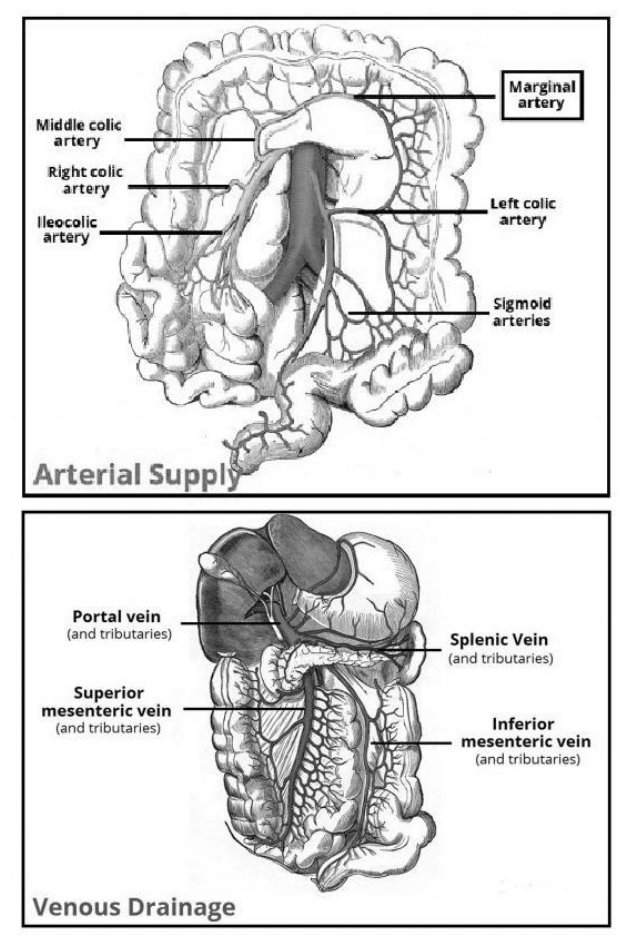

Source page 3

**2. Which of the following blood vessels is most likely involved in fracture of surgical neck of humerus?**

*Answer: B — Posterior circumflex humeral*

The axillary nerve and the posterior circumflex humeral artery pass through the quadrangular space together, wrapping the surgical neck of the humerus. A fracture at that site therefore threatens both, giving deltoid paralysis and a patch of numbness over the lateral shoulder. The anterior circumflex humeral artery runs more medially and is not the structure at risk.

Source page 3

**3. Which part of the brain controls emotions?**

*Answer: A — Hippocampus*

The hippocampus sits in the medial temporal lobe and forms part of the limbic system, which regulates emotional responses. It also has a central role in memory and in spatial processing and navigation. It receives and sends output through the entorhinal cortex, and its formation includes the cornu ammonis (CA1-4), the dentate gyrus and the subiculum.

Source page 4

**4. Femoral triangle boundary isn't formed by**

*Answer: D — Adductor magnus*

The femoral triangle has three borders: the inguinal ligament superiorly, the medial border of sartorius laterally and the medial border of adductor longus medially. Its floor is pectineus, iliopsoas and adductor longus, and its roof is fascia lata. Adductor magnus forms no part of the boundary. Contents from lateral to medial are nerve, artery, vein, empty space and lymph nodes (NAVEL).

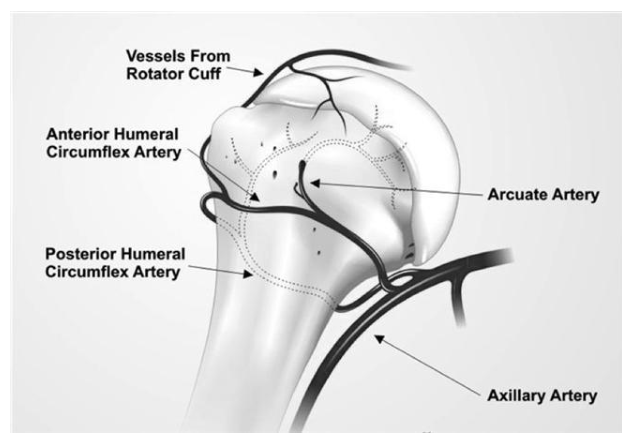
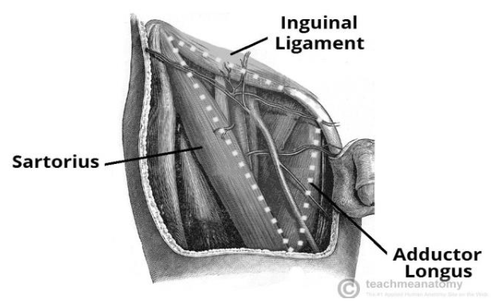
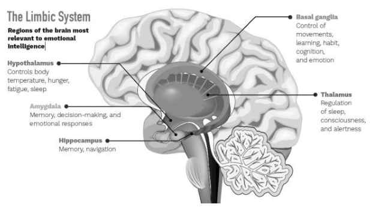

Source page 4

**5. A 35 years old male presented with complain of swelling in inguinal region, which increases while coughing. USG was done and Indirect inguinal hernia was diagnosed. The origin of Indirect Inguinal hernia is through**

*Answer: B — Lateral to inferior epigastric vessels*

An indirect inguinal hernia leaves the abdomen through the deep inguinal ring, which lies lateral to the inferior epigastric vessels. A direct hernia pushes through the posterior wall medial to those vessels. Clinically the distinction is made by reducing the hernia and pressing on the deep ring at the mid-inguinal point: if coughing no longer produces the swelling, the hernia is indirect. Even experienced surgeons find the two hard to separate with certainty on examination alone.

Source page 5

**6. Each hepatic segment consists of**

*Answer: B — Hepatic artery, portal branch and bile duct*

In the Couinaud classification the liver is divided into eight functionally independent segments. At the centre of each segment lies a branch of the portal vein together with a hepatic artery branch and a bile duct, the portal triad. The hepatic veins run at the periphery of the segments and provide the outflow, which is why each segment can be resected on its own.

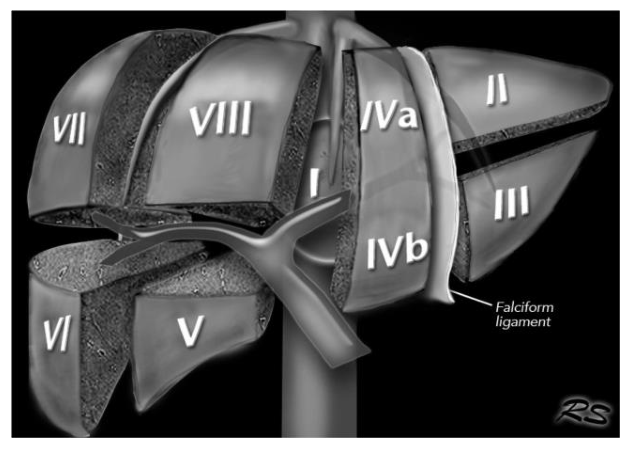

Source page 5

**7. A 45-year-old male presents to the emergency department with a sudden onset of severe headache, nausea, vomiting, and loss of consciousness. The patient's family history is positive for hemorrhagic stroke, as his mother had a similar episode in her late forties. A non-contrast CT scan of the brain shows subarachnoid hemorrhage, and further workup reveals the presence of a cerebral aneurysm. Which of the following is the most common site of aneurysm location in patients with a positive family history of hemorrhagic stroke?**

*Answer: A — Anterior communicating artery*

Saccular berry aneurysms arise at bifurcations in the circle of Willis, and the commonest site is the junction of the anterior communicating artery with the anterior cerebral artery. They are associated with autosomal dominant polycystic kidney disease and Ehlers-Danlos syndrome, and with advanced age, hypertension and smoking. Rupture causes subarachnoid haemorrhage with a thunderclap headache; an ACom aneurysm may also compress the optic chiasm to give bitemporal hemianopia.

Source page 5

**8. A 50-year-old man presents to the emergency room with acute onset epigastric pain. His past medical history includes hyperlipidemia, hypertriglyceridemia, diabetes, and alcohol abuse. His last drink was this morning and he drinks 20 beers a day. He denies any fevers or chills but reports nausea and 2 episodes of non-bloody, nonbilious vomiting. Physical exam is notable for tenderness to palpation of the epigastrium. Laboratory evaluation shows significantly elevated amylase and lipase. He is started on aggressive fluid resuscitation. What is the nerve supply of the organ involved?**

*Answer: A — Celiac plexus*

The clinical picture is acute pancreatitis, and the pancreas is supplied by the celiac plexus. The celiac plexus, also called the solar plexus, lies behind the stomach and in front of the crura of the diaphragm at the level of the first lumbar vertebra. It is formed by the greater and lesser splanchnic nerves of both sides with fibres from the anterior and posterior vagal trunks, and it gives off the hepatic, splenic, gastric, pancreatic and suprarenal plexuses.

Source page 6

**9. Which part of the pancreas is actually an intraperitoneal structure?**

*Answer: C — Tail*

The pancreas is a retroperitoneal organ. The head, including the uncinate process, and the body lie behind the peritoneum, but the tail is intraperitoneal because it runs in the splenorenal ligament. That is why the tail is the part that moves with the spleen and is reached through the lesser sac.

Source page 6

**10. Meissner's plexus is located in**

*Answer: A — Between the mucosa and inner circular muscle layer*

The submucous or Meissner plexus lies between the circular muscle layer and the mucosa. The myenteric or Auerbach plexus lies between the inner circular and outer longitudinal layers. The myenteric plexus controls motor activity while the submucous plexus supplies the glandular epithelium, endocrine cells and submucosal vessels and governs secretion. Together they form the enteric nervous system, some 100 million neurons that can work without central input.

Source page 6

**11. A 60-year-old male patient presents to the clinic with a persistent cough and shortness of breath. A chest X-ray is ordered, and the radiologist notes that there is a mass in the right lung that is obstructing the right bronchus. The doctor is explaining the anatomy of the lungs to the patient and asks which structure makes up the right hilum. Which of the following best describes the structures that make up the right hilum?**

*Answer: A — Right main bronchus and pulmonary artery*

The hilum is the area on the medial surface of the lung where bronchi, pulmonary vessels and lymphatics enter and leave. The right hilum is formed by the right main bronchus and the pulmonary artery; the right pulmonary vein lies in the hilum but does not form it. On the left the hilum is made up of the left main bronchus, pulmonary artery and pulmonary vein.

Source page 7

**12. Posterior retromandibular vein drains into**

*Answer: B — External jugular vein*

The retromandibular vein is formed by the union of the superficial temporal and maxillary veins and runs within the parotid gland behind the ramus of the mandible. At the lower pole of the gland it divides: the anterior branch joins the facial vein to form the common facial vein, and the posterior branch joins the posterior auricular veins to form the external jugular vein. It drains the jaw, lateral skull and parotid gland.

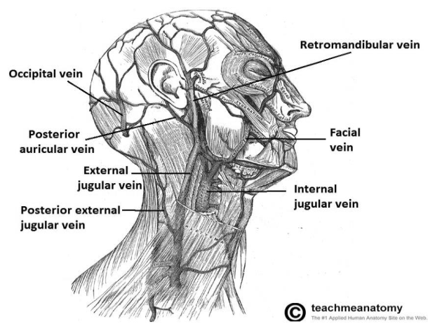

Source page 7

**13. The free border of the lesser omentum between the porta hepatis and the duodenum does not contains**

*Answer: D — Right hepatic duct*

The free border of the lesser omentum between the porta hepatis and the duodenum contains the hepatic artery, the portal vein, the common bile duct, lymph glands and vessels and nerves, forming the hepatic hilum. The right hepatic duct lies within the liver substance above the hilum and is not part of this free border.

Source page 7

### 2. Biochemistry

**14. Rate limiting enzyme in glycolysis is?**

*Answer: C — Phosphofructokinase-1*

Phosphofructokinase-1 is the rate-determining enzyme of glycolysis. It is activated by AMP and fructose-2,6-bisphosphate and inhibited by ATP and citrate. For comparison, the rate-limiting enzymes elsewhere are fructose-1,6-bisphosphatase in gluconeogenesis, isocitrate dehydrogenase in the TCA cycle, glycogen synthase in glycogenesis, glycogen phosphorylase in glycogenolysis, G6PD in the HMP shunt, carbamoyl phosphate synthetase I in the urea cycle, acetyl-CoA carboxylase in fatty acid synthesis, carnitine acyltransferase I in fatty acid oxidation and HMG-CoA reductase in cholesterol synthesis.

Source page 7

**15. Ochronosis is due to the accumulation of?**

*Answer: A — Homogentisic acid*

Alkaptonuria is an autosomal recessive deficiency of homogentisate 1,2-dioxygenase, so homogentisic acid accumulates and is excreted in urine. The only early abnormality is blackening of urine on standing. Homogentisic acid is oxidised by polyphenol oxidase to benzoquinone acetate and then polymerised into black alkapton bodies, and by the third or fourth decade these deposit in intervertebral discs, nasal cartilage and the pinna to produce ochronosis and arthritis. No specific treatment is needed, though a low phenylalanine intake is advised.

Source page 8

**16. Cork screw hair is seen in**

*Answer: A — Vitamin C deficiency*

Perifollicular haemorrhage with corkscrew hair deformity from follicular hyperkeratosis is pathognomonic of scurvy, that is, ascorbic acid deficiency. Vitamin C deficiency causes defective collagen formation with impaired wound healing, capillary haemorrhage and reduced platelet adhesiveness. Swollen bleeding gums, petechiae, ecchymoses and haemarthrosis are the other features. A dose of 250 mg vitamin C eight-hourly saturates the tissues quickly.

Source page 8

**17. Which of the following is used by brain for energy when glucose is not available?**

*Answer: A — Betahydroxy butyrate*

Under normal conditions the brain runs on glucose. When glucose is sparse, as in prolonged fasting, ketone bodies become an important fuel, and beta-hydroxybutyrate is the one taken up in quantity. Brain ketone use depends mainly on the blood concentration, which is why ketogenic diets and exogenous ketones shift cerebral metabolism. Ketone bodies and lactate cross the blood-brain barrier through monocarboxylate transporters in endothelial cells and astroglia. Fatty acids do not cross that barrier, and acetone is a minor breakdown product rather than a fuel.

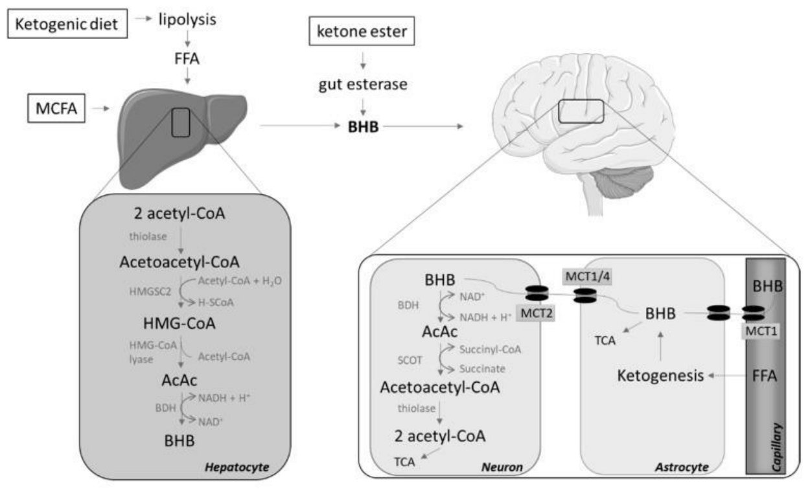

Source page 9

**18. The activity of AP endonuclease is involved in ________.**

*Answer: A — Base excision repair*

Human apurinic/apyrimidinic endonuclease 1 (APE1) is a key participant in base excision repair. It hydrolyses DNA adjacent to the 5' end of an apurinic/apyrimidinic site, producing a nick with a 3'-hydroxyl group and a 5'-deoxyribose phosphate moiety. APE1 also has 3'-phosphodiesterase, 3'-5'-exonuclease and 3'-phosphatase activity.

Source page 9

### 7. Physiology

**19. Regarding Golgi tendon organ true is __________?**

*Answer: D — Sense muscle tension*

Golgi tendon organs are proprioceptors at the myotendinous junction, supplied by Ib afferents. They lie in series with skeletal muscle fibres, so they discharge both on passive stretch and when the tendon is stretched by muscle contraction, which makes them muscle tension receptors rather than stretch receptors. Muscle spindles are the ones that transduce length. Ten to twenty muscle fibres connect to a single tendon organ.

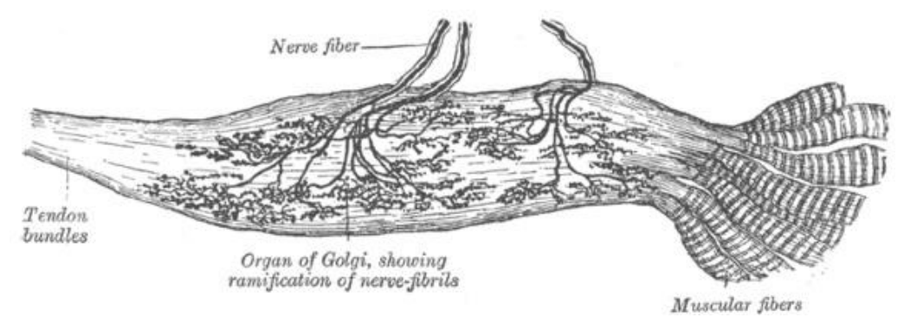

Source page 9

### 3. Community Medicine

**20. The duration of quarantine is**

*Answer: A — Longest incubation period*

Quarantine separates and restricts the movement of people who have been exposed to a contagious disease, to see whether they become sick. It is continued for the longest incubation period of that disease, so that anyone who is going to develop illness will have done so. Isolation is different: it separates people who are already sick. The infective period is the interval during which a host can transmit the pathogen.

Source page 10

**21. A man was admitted to hospital in the ICU ward, he developed fever after 2 days of admission. Most likely mode of transmission in this patient is**

*Answer: A — Indirect transmission*

Fever developing two days into an ICU admission points to a hospital-acquired infection spread by indirect contact, through contaminated hands, instruments, surfaces or droplets from staff and other patients. Indirect contact infections spread when an infected person sneezes or coughs and a susceptible person inhales the droplets or the droplets land on the eyes, nose or mouth. Vector-borne and water-borne transmission do not fit this setting.

Source page 10

**22. Which of the following chemical is used to disinfect the blood spilled areas?**

*Answer: A — Sodium hypochlorite*

Sodium hypochlorite is the standard agent for disinfecting hard surfaces and blood spillages that may carry HIV or hepatitis B. It is an intermediate-level disinfectant classed among chlorine-releasing agents. Chlorine as hypochlorous acid has rapid microbicidal activity; the caustic soda in the preparation keeps the pH high so free chlorine is not released as toxic gas. It is also used for decontaminating sharps, laundry and dialysis water.

Source page 11

**23. The duration of time between the detection of a disease and its usual clinical presentation and diagnosis is called**

*Answer: A — Lead time*

Lead time is the interval between detection of a disease, usually by screening or imaging, and its usual clinical presentation. Lead time bias arises when survival appears longer only because diagnosis came earlier, irrespective of whether the patient actually lived longer. The incubation period runs from exposure to first symptoms, and the serial interval is the gap between successive cases in a chain of transmission.

Source page 11

**24. In a positively skewed distribution**

*Answer: A — Mean > median > mode*

In a positively skewed distribution the long tail runs to the right, so the mean is pulled furthest out, the median sits next, and the mode stays at the peak: mean > median > mode. In a negatively skewed distribution the order reverses. This is why median is preferred for skewed data such as income or length of stay.

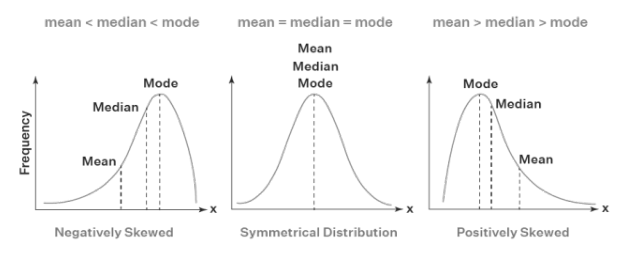

Source page 11

**25. A study is done to determine the risk factor associated with breast carcinoma. 200 patients with breast carcinoma are taken and they are matched with 200 people with similar age and exposure to hormonal therapy is looked at. What is the type of study?**

*Answer: C — Case-control study*

The study starts with people who already have the disease and compares their past exposure with matched controls, so it proceeds from effect to cause: that is a case-control study. Cohort studies run the other way, starting with exposure and following forward for disease. Case-control studies suit rare diseases, involve fewer subjects and yield an odds ratio, but cannot give incidence rates.

Source page 11

**26. In hypothesis testing, a Type 2 error occurs when**

*Answer: C — The null hypothesis is not rejected when the alternative hypothesis is true.*

A type II error is failing to reject the null hypothesis when it is in fact false, that is, saying there is no effect when one exists. It is a false-negative error, and its probability is beta. Power is 1 minus beta, and it rises with a larger sample size, a larger expected effect size and more precise measurement. Rejecting a true null hypothesis is a type I error, alpha, the false-positive error.

Source page 12

### 4. Microbiology

**27. Which of the following agar is the culture media for the proper growth of Hemophilus influenzae?**

*Answer: D — Chocolate agar*

Chocolate agar is blood agar in which the red cells are lysed while being added to molten base, releasing haemoglobin, hemin (X factor) and NAD (V factor) into the medium. Haemophilus influenzae requires both X and V factors, so it grows on chocolate agar and not on plain sheep blood agar. The lysed cells give the medium its chocolate-brown colour. Neisseria gonorrhoeae also needs this enriched medium.

Source page 13

**28. What is the reason for decolourisation in gram negative bacilli in gram staining**

*Answer: B — Lipid content*

The decolouriser dehydrates the cell wall and acts as a solvent that rinses out the dye-iodine complex. Gram-negative cells have a thin peptidoglycan layer under a lipid-rich outer membrane, and the alcohol dissolves that outer membrane and penetrates readily, removing the crystal violet-iodine complex. Gram-positive cells have a thick, relatively impermeable peptidoglycan wall with teichoic acids that resists decolourisation and keeps the purple.

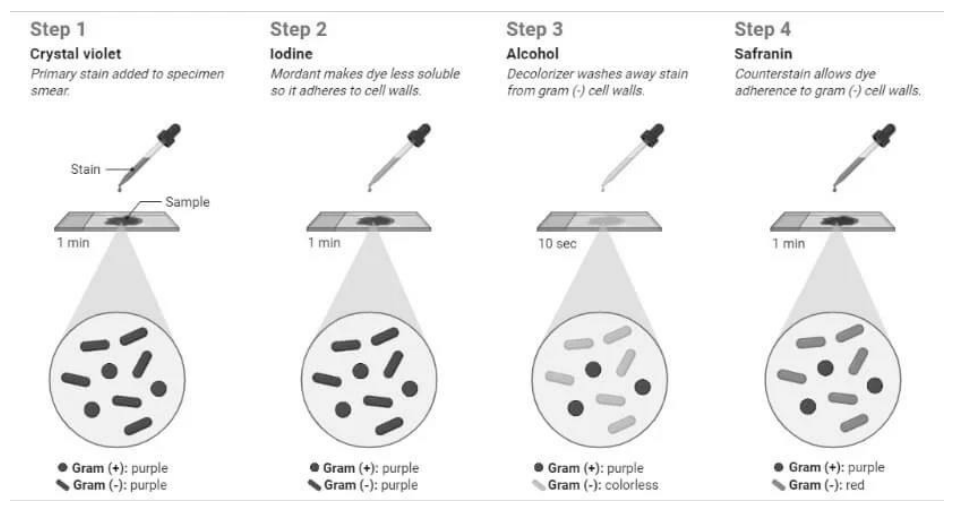

Source page 13

**29. What is the method of sterilization of culture media?**

*Answer: A — Autoclave*

Most culture media are sterilised in an autoclave at 121 degrees Celsius for 20 minutes. The manufacturer adjusts the pH of the dehydrated medium so that the final pH after preparation matches the label specification once cooled to 25 degrees. Hot air ovens are for dry glassware and instruments, and UV light is for surface disinfection only.

Source page 14

**30. All are examples of dimorphic fungi EXCEPT**

*Answer: C — Cryptococcus neoformans*

Dimorphic fungi grow as moulds at 25 to 30 degrees and as yeasts at 35 to 37 degrees. The pathogens in this group are Blastomyces dermatitidis, Histoplasma capsulatum, Coccidioides immitis, Paracoccidioides brasiliensis and Sporothrix schenckii. Cryptococcus neoformans is a yeast and not dimorphic. Note that Coccidioides immitis is the exception that is not thermally dimorphic, yet it is still classed with this group.

Source page 14

**31. Hypersensitivity reaction seen in SLE is:**

*Answer: C — Type III*

Systemic lupus erythematosus is the prototype type III hypersensitivity reaction. Local deposition of antinuclear antibody in complex with released chromatin triggers inflammation through complement activation. Type II reactions are antibody against fixed antigen, as in autoimmune haemolysis, and type IV is cell-mediated.

Source page 14

**32. A 45-year-old woman presents to the emergency department for severe pain of her left foot. She states that this has never happened before. Her symptom is accompanied by fever and generalized myalgias. Medical history is significant for type II diabetes mellitus. On physical exam, there is exquisite tenderness to palpation, erythema, palpable crepitus, and tense bullae. Which of the following is responsible for the above manifestation?**

*Answer: A — Exotoxin of Clostridium*

This is gas gangrene, or clostridial myonecrosis, most often caused by Clostridium perfringens and driven by its exotoxins. It usually follows a deep penetrating injury that creates an anaerobic environment. Severe pain progresses over 18 to 24 hours, the skin turns from pallor to bronze or purple, and crepitus from tissue gas appears with systemic toxicity. Treatment is high-dose intravenous penicillin with clindamycin plus aggressive surgical debridement.

Source page 14

### 5. Pathology

**33. Radiation induced cell death is caused due to**

*Answer: A — Apoptosis*

Radiation kills cells largely by inducing apoptosis, the programmed form of cell death. Apoptosis shows cell shrinkage, chromatin condensation, cytoplasmic blebs and apoptotic bodies with phagocytosis by macrophages, and it does not provoke inflammation. Its biochemical marks are caspase-mediated protein cleavage, protein cross-linking, endonuclease DNA breakdown and phosphatidylserine-mediated phagocytic recognition. Necrosis, by contrast, follows lethal injury with enzyme digestion and inflammation.

Source page 15

**34. A 50-year-old female patient with breast cancer has been treated with radiotherapy. She asks her doctor about the mechanism of action of radiotherapy on cancer cells. The doctor explains that one of the mechanisms is induction of apoptosis. Which of the following best describes apoptosis?**

*Answer: C — A form of cell death that is programmed and controlled by the cell itself*

Apoptosis is programmed cell death controlled by the cell itself, occurring normally in development and tissue homeostasis. Unlike necrosis it is non-inflammatory and does not release cellular contents. Physical trauma causes necrosis, not apoptosis. Radiotherapy induces apoptosis in cancer cells, which is one of the ways it kills them.

Source page 15

**35. Which of the following is responsible for benign prostate hyperplasia**

*Answer: B — Dihydrotestosterone*

Prostatic enlargement depends on dihydrotestosterone. Type II 5-alpha-reductase in the prostate converts circulating testosterone to DHT, which acts locally and binds androgen receptors in cell nuclei to drive hyperplasia. Castrated males, who cannot make testosterone, do not develop BPH. Serum testosterone falls with age while BPH rises, so metabolic syndrome, hyperinsulinaemia and growth factors are also implicated.

Source page 15

**36. Which virus does not causes diarrhea**

*Answer: D — Rhabdo virus*

Rhabdoviruses, of which Lyssavirus is the type, are enveloped negative-sense single-stranded RNA viruses with a helical capsid, and they cause rabies, not gastroenteritis. Adenovirus causes gastroenteritis among its many syndromes, rotavirus is the leading cause of infantile gastroenteritis, and caliciviruses such as norovirus cause viral gastroenteritis.

Source page 16

**37. A 68 years old man had left sided chest pain radiating to back of the shoulder, arms, jaw. Gross findings of his heart were dark mottling and microscopically there were hyper contraction of myofibrils. At which time does these changes are seen in myocardial infraction?**

*Answer: A — Within 24 hours*

Gross dark mottling appears after about 12 hours, and the earliest histological change is coagulative necrosis with hypercontraction of myofibrils at 6 to 12 hours, so these findings date the infarct to within 24 hours. Neutrophilic influx follows at 12 to 24 hours, loss of nuclei on days 1 to 3, macrophage phagocytosis on days 3 to 7 with granulation tissue at the margins, and the scar is complete at about two months.

Source page 16

**38. Alfa 1 antitrypsin is associated with**

*Answer: B — Panacinar emphysema*

Panacinar emphysema is rare and its most common cause is hereditary alpha-1 antitrypsin deficiency. Alpha-1 antitrypsin deficiency allows unopposed neutrophil elastase activity in the pulmonary interstitium, destroying connective tissue. Centriacinar emphysema is the commonest type and is caused mainly by smoking, also coal dust and advanced age. Panacinar disease affects the whole acinus uniformly, centriacinar mainly the respiratory bronchioles.

Source page 17

### 6. Pharmacology

**39. A 47 years old patient, known case of Schizophrenia under treatment, presented to your clinic with uncontrollable, abnormal, and repetitive movements of the face, torso, and/or other body parts. What is the likely diagnosis?**

*Answer: A — Tardive dyskinesia*

Tardive dyskinesia appears late in neuroleptic therapy, sometimes even after the drug is withdrawn, and shows purposeless involuntary facial and limb movements such as constant chewing, pouting, puffing of the cheeks, lip licking and choreoathetoid movements. Acute dystonia comes within hours of a single dose with bizarre muscle spasms and torticollis. Parkinsonism appears in 1 to 4 weeks with rigidity, tremor and mask-like facies. Akathisia is motor restlessness at 1 to 8 weeks.

Source page 18

**40. Which one of the following statements regarding paracetamol overdose is false?**

*Answer: B — Kidney injury occurs by metabolite other than NAPQI*

The false statement is that renal injury comes from a metabolite other than NAPQI. A fraction of paracetamol is oxidised by hepatic cytochrome P450 to N-acetyl-p-benzoquinoneimine, which is normally conjugated with glutathione; in overdose that conjugation saturates and NAPQI causes the injury, and the mechanism of renal damage is the same as the hepatic one. Enzyme inducers such as phenytoin, rifampicin, carbamazepine and barbiturates raise the risk, as do malnutrition and chronic heavy alcohol use. N-acetylcysteine is the antidote because it replenishes glutathione.

Source page 18

**41. For Chemotherapy vomiting an agent is used and it acts by inhibiting which of the following receptors?**

*Answer: C — 5HT3*

Ondansetron is the prototype 5-HT3 antagonist, developed to control chemotherapy and radiotherapy induced vomiting and later found effective in postoperative nausea and vomiting. It blocks the depolarising action of 5-HT at 5-HT3 receptors on vagal afferents in the gut and in the nucleus tractus solitarius and chemoreceptor trigger zone. Cytotoxic drugs release 5-HT from intestinal mucosa, so blocking both the peripheral origin and the central relay prevents the emesis. It does not block dopamine receptors, so apomorphine-induced vomiting is not suppressed.

Source page 19

**42. Which of the following symptoms are present in opioid withdrawal**

*Answer: A — Piloerection*

Opioid withdrawal begins within about 12 hours of the last dose with intense craving, rhinorrhoea, lacrimation, yawning, perspiration, shivering, piloerection, vomiting, diarrhoea and abdominal cramps, and examination shows tachycardia, hypertension, mydriasis and facial flushing. Miosis, constipation and respiratory depression are effects of opioid intoxication, not withdrawal. Withdrawal from opiates is very unpleasant but not usually dangerous, unlike benzodiazepine and barbiturate withdrawal, which can cause seizures.

Source page 19

**43. Drug resistance is preventable through which of the following actions:**

*Answer: C — Judicious use of antibiotics in select cases*

Preventing resistance means using antibiotics judiciously and only where they are needed: prescribing for bacterial rather than viral infection, choosing the narrowest effective spectrum, and completing the prescribed course. Probiotics may reduce antibiotic-associated diarrhoea but do not prevent resistance. Blanket or broad prescribing does the opposite of preventing resistance.

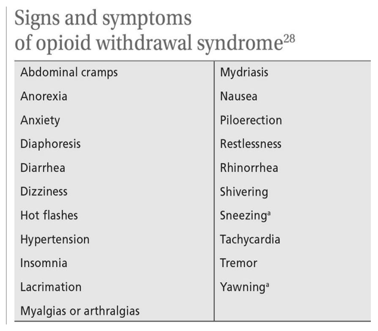

Source page 20

**44. A 65 years old patient with known case of COPD presented with history of shortness of breath, fever of 102 F, and cough with purulent sputum. He has shortness of breath while changing his cloths. He has been taking salbutamol during the sob only. What will you prescribe this patient along with long-acting beta blockers?**

*Answer: A — Steroid and antibiotics*

This is an acute exacerbation of COPD with fever and purulent sputum, so the patient needs both antibiotics for the infective component and systemic steroids, on top of long-acting bronchodilators. Salbutamol alone as needed is inadequate for a patient this breathless. Antibiotics without steroids, or steroids alone, undertreat one half of the problem.

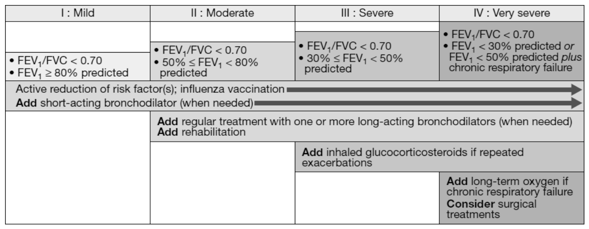

Source page 20

**45. C-peptide seen in?**

*Answer: B — In Proinsulin*

Insulin is synthesised as preproinsulin, which enters the endoplasmic reticulum where a 23 amino acid signal peptide is removed to give proinsulin. Proinsulin consists of the A and B chains connected by the C-peptide. The C-peptide is detached from the granule before secretion, so insulin is released together with equimolar amounts of C-peptide, not as a combined entity.

Source page 20

**46. Which of the following enzymes inhibits the OCP**

*Answer: A — Ketoconazole*

Ketoconazole is the enzyme inhibitor among these options. It is a potent inhibitor of cytochrome P450, whereas phenytoin, rifampicin and carbamazepine are inducers, and enzyme induction is what reduces the effectiveness of oral contraceptives. Note that the source item is worded loosely; the clinically important interaction with the pill is induction by the three inducers, not inhibition by ketoconazole.

Source page 21

**47. Which of the following drugs has immune modulatory and anti-helminthic action?**

*Answer: C — Levamisole*

Levamisole is both an effective antihelminthic and an immunomodulator that restores depressed T cell function. It was used as a disease-modifying drug in rheumatoid arthritis and as an adjunct in malignancy, aphthous ulcers and recurrent herpes, but repeated doses cause severe reactions and it is no longer used for those indications. Its immunoregulatory action is thought to mimic thymic hormone thymopoietin, stimulating phagocytosis and regulatory T cells.

Source page 21

**48. A patient was undergoing treatment for Sepsis for last 5 days. Patient was recovering but had sudden onset multiple spikes of fever. Patient was managed with Injectable antibiotics and fluid through central line. Blood culture was sent and showed growth of Staphylococcus aureus, resistant to Vancomycin. Drug of choice for vancomycin resistant staphylococcus aureus would be**

*Answer: A — Linezolid*

Linezolid, an oxazolidinone, is active against MRSA and some VRSA and VRE. It binds the 23S fraction (P site) of the 50S ribosome and blocks formation of the initiation complex, so there is no cross resistance with other antibiotic classes. It is mainly bacteriostatic, which makes it unsuitable for enterococcal endocarditis. Prolonged use brings myelosuppression and optic neuropathy, and it is a weak MAO inhibitor, so serotonergic interactions matter.

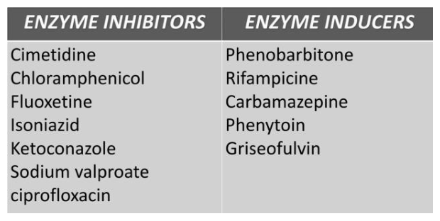

Source page 21

**49. Which of the following are major factors of Irrational drug use?**

*Answer: D — All of the above.*

All three listed factors drive irrational drug use. The full list of causes also includes irrational prescribing practices of doctors, lack of effective control and regulatory mechanisms on drug use, and lack of political will and leadership to promote rational use. Any single measure that addresses only one of these will not fix the problem.

Source page 22

**50. A patient of heart failure with reduced ejection fraction and Type 2 DM under Enalapril, Metoprolol, Aspirin, Glimepiride and Metformin presents to OPD with 7 days of intractable cough with no sputum production. Which of the following drugs may be responsible for the cough in this patient?**

*Answer: A — Enalapril*

Enalapril is the culprit. ACE inhibitors prevent the inactivation of bradykinin, and the resulting bradykinin accumulation causes the dry cough and angioedema. The cough is a class effect of ACE inhibitors and typically settles on switching to an angiotensin receptor blocker such as losartan, which does not raise bradykinin. Metoprolol, aspirin and metformin do not cause this cough.

Source page 22

**51. Basanti devi, 45 years old women presents with hot flushes after stopping of menstruation. Hot flush can be relieved by administration of following agents**

*Answer: B — Ethinyl estradiol*

Vasomotor symptoms of the perimenopause respond best to oestrogen, here ethinyl estradiol, with a progestin added where the uterus is intact. Oestrogen plus progestin menopausal hormone therapy is highly effective for hot flushes, psychological disturbance and atrophic changes, and it also protects bone. Testosterone, danazol and fluoxymesterone are androgens and would worsen virilising symptoms rather than relieve flushing.

Source page 22

### 7. Physiology

**52. Primary hyperaldosteronism is characterized by?**

*Answer: B — Decrease in plasma potassium*

Primary hyperaldosteronism is characterised by a marked fall in plasma potassium, metabolic alkalosis and absence of peripheral oedema. Plasma sodium rises, while the sodium content of sweat, saliva and gastrointestinal secretions falls. Only about half of patients with primary aldosteronism actually show hypokalaemia, and serum sodium is often normal because of concurrent fluid retention.

Source page 23

**53. The Formula (Systolic Pressure + Diastolic Pressure) gives**

*Answer: A — Mean arterial pressure*

Mean arterial pressure is calculated as systolic plus twice diastolic, divided by three, with a reference range of 70 to 100 mmHg. The other haemodynamic formulas are cardiac index equals cardiac output divided by body surface area (2.5 to 4 L/min/m2), stroke volume equals cardiac output divided by heart rate (60 to 120 mL/beat), and systemic vascular resistance equals mean arterial pressure minus mean right atrial pressure, times 80, divided by cardiac output (800 to 1200 dynes sec/cm5).

Source page 23

**54. Uteroplacental circulation is fully established by**

*Answer: D — 10th week*

Fetal and maternal vascularisation of the placenta is complete by the 17th to 20th day, and true placental circulation is established around the 17th day, but the source keys the answer to the 10th week, by which time the placental circulation is fully established and the placenta has grown in thickness and circumference until the end of the fourth month. Maternal spiral arterioles are eroded on day 14 to 15 and fetal vessels form in the villous cores to make tertiary villi. Answer the key as printed: 10th week.

Source page 23

**55. Mr. Lakpa Sherpa, is on his fourth expedition to Mt. Everest, feeling confident. He has decided to climb solo this time. While returning, He lost for one whole day and brought back by guides of another company. What is the organ responsible for regulating his temperature?**

*Answer: C — Hypothalamus*

The hypothalamus regulates body temperature. When internal temperature changes slightly, central sensors signal the hypothalamus, which then drives the appropriate response. To warm the body it causes vasoconstriction, thermogenesis and hormonal thermogenesis through thyroid hormone; to cool it causes sweating and vasodilatation. The cerebrum, cerebellum and medulla have no such role.

Source page 24

**56. False regarding hormone levels in polycystic ovarian disease?**

*Answer: B — Increased Prolactin*

Prolactin is not characteristically raised in polycystic ovarian disease, so that is the false statement. Insulin resistance alters hypothalamic feedback, giving a raised LH to FSH ratio, increased theca interna androgen production and arrested follicular maturation with unruptured cysts and anovulation. Diagnosis needs two of cystic or enlarged ovaries, oligo-ovulation or anovulation, and hyperandrogenism.

Source page 24

**57. Which maintains the shape of RBC?**

*Answer: D — Spectrin*

Spectrin is the cytoskeletal protein that maintains the stability and structure of the cell membrane and the shape of the red cell. It is a heterodimer of alpha and beta subunits with spectrin repeats, and it also contributes to adhesion, spreading and cell cycle functions. Mutations cause hereditary haemolytic anaemia and type 5 spinocerebellar ataxia. Ankyrin, band 3 and band 4.1 anchor the cytoskeleton but spectrin is the shape-determining element.

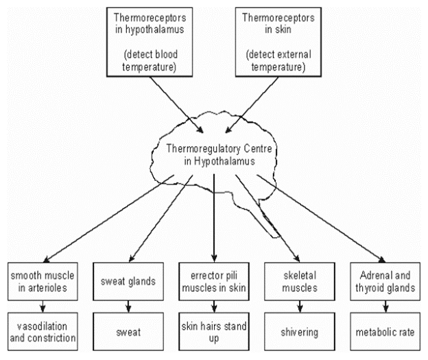

Source page 25

**58. The rate of drug transport across a cell membrane by lipid diffusion depends on all of the following except:**

*Answer: D — Density of transporters*

Lipid diffusion needs no transporters, so transporter density is irrelevant to it. Because the membrane is lipoid, lipid-soluble drugs diffuse most rapidly, and the rate depends on the concentration gradient, lipid solubility, molecular size, degree of ionisation and the area of absorptive surface. Transporter density matters only for carrier-mediated transport.

Source page 25

**59. A 60 years old woman has a resting heart rate of 70 beats/min, arterial pressure is 130/85 mmHg and body temperature is normal. Her stroke volume is 100ml and ejection fraction is 66.6%. What is the End diastolic volume of the patient?**

*Answer: B — 150 ml*

Ejection fraction is stroke volume divided by end diastolic volume. With a stroke volume of 100 mL and an ejection fraction of about 67 percent, end diastolic volume is 100 divided by 0.666, which is 150 mL. The source explanation muddles the wording by calling 150 mL the end systolic volume, but the arithmetic and the key both give 150 mL as the end diastolic volume.

Source page 25

**60. Osmotic pressure due to plasma protein is**

*Answer: A — 30 mmHg*

The colloid osmotic, or oncotic, pressure exerted by plasma proteins is about 30 mmHg. Proteins are largely confined to the plasma compartment, which makes them effective osmotic agents that draw water from the interstitial space into plasma. Sodium and chloride move freely between plasma and interstitium and so are ineffective osmotic agents.

Source page 26

**61. A 43-year-old male patient presents to the hospital with complaints of abdominal discomfort and blood in his urine. Upon further evaluation, multiple cysts are identified in both of his kidneys, and he also reports a history of subarachnoid hemorrhage. The physician suspects a genetic disorder and orders genetic testing to determine the underlying cause. In which chromosome would the likely abnormality be present in?**

*Answer: D — 16*

This is autosomal dominant polycystic kidney disease, caused by mutations in PKD1 or PKD2. PKD1 lies on chromosome 16p13.3 and PKD2 on chromosome 4q21, and the two loci segregate independently. The commoner and more severe form is PKD1, which is why chromosome 16 is the expected answer. Berry aneurysms and subarachnoid haemorrhage are a recognised association.

Source page 26

**62. Which is a risk factor for the development of hyperkalemia?**

*Answer: A — Rhabdomyolysis*

Rhabdomyolysis, as in major soft tissue trauma, releases potassium from damaged muscle and is a risk factor for hyperkalaemia. Other risks are a lower estimated glomerular filtration rate, a higher baseline potassium, and diabetes, heart failure and coronary disease. Hyperkalaemia has also been linked with low haemoglobin, electrical burns and strenuous exercise. A higher eGFR is protective, not a risk.

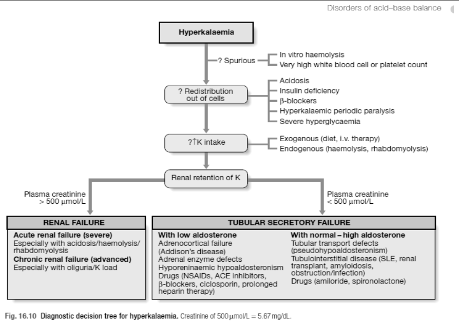

Source page 26

**63. A 75-year-old patient with history of MI 6 months back has shortness of breath. Catheter placed on the right atrium and ventricle shows increased right atrial and ventricular pressure. Which of the following will be decreased in the patient?**

*Answer: D — Potassium*

This is heart failure after myocardial infarction with raised right atrial and ventricular pressures. Potassium falls: renin-angiotensin-aldosterone activation retains sodium while increasing potassium excretion, and diuretic use adds to the loss, giving hypokalaemia. BNP is elevated by the raised ventricular pressure, and both ADH and renin rise because of reduced renal perfusion.

Source page 27

### 8. Forensic Medicine

**64. The way/design/fashion in which the cause of death comes into being is known as**

*Answer: A — Manner of death*

The manner of death is how the death came about, classified as natural, accident, suicide, homicide or undetermined. The cause of death is the specific injury or disease that led to death. The mechanism of death is the physiological derangement, such as exsanguination or arrhythmia, by which the cause produced death. The question's wording is loose but the key is manner of death.

Source page 27

**65. As a healthcare provider, you encounter a patient who is distraught and in tears after receiving a difficult diagnosis. You sit with the patient and listen to their concerns and fears, while also acknowledging their emotions and providing support. What is this action an example of?**

*Answer: B — Empathy*

Understanding and sharing the feelings of the patient, putting oneself in their position, is empathy. It is a core component of patient-centred care and builds trust and rapport, improving communication and satisfaction. Sympathy is feeling pity for the patient's situation without the shared perspective, and compassion is the motivation to act on suffering.

Source page 27

**66. A man was found dead with the ligature marks inferior to level of thyroid cartilage around the neck along with dribbling of saliva from mouth, cyanosis of face, lips and ears and swelling and protusion of tongue. What could be the cause of death**

*Answer: A — Ligature strangulation*

Ligature marks below the thyroid cartilage, running transversely and completely encircling the neck, indicate strangulation by ligature rather than hanging. In hanging the mark is oblique, does not completely encircle the neck and lies above the thyroid cartilage, with the constricting force being the weight of the body. Abrasion, bruising of neck muscle and thyroid cartilage fracture are commoner in strangulation, and the signs of struggle are present.

Source page 27

**67. A person presented to police station with multiple contusions presented over the extensor surface of forearm and laceration over right palm. What type of wounds are these?**

*Answer: A — Defensive injury*

These are defence wounds, received while trying to fend off an attack. They are typically on the hands and forearms where the victim raised them to protect the head and face, and a laceration of the palm or partial amputation of fingers results from grasping the blade. Defence wounds are highly indicative of homicide and prove the victim was conscious and able to resist, at least initially. They may be active, as in grasping the blade, or passive, on the back of the hand.

Source page 28

**68. Red velvety appearance of gastric mucosa is seen in poisoning with**

*Answer: C — Arsenic*

Arsenic poisoning produces a red velvety or brick red gastric mucosa from severe haemorrhage, seen at post mortem. Arsenic inhibits the pyruvate dehydrogenase complex, disrupts cellular energy production, raises lactate and stimulates hydrogen peroxide formation. It also causes prolonged QT, neutropenia and hypertension, and chronic exposure accelerates atherosclerosis. The source note that the mucosa is brick red from haemorrhage is the key finding.

Source page 28

**69. A 14-year-old boy presented to OPD for poor performance in school. On examination he had a long and narrow face, large ears, a prominent jaw and forehead and enlarged testicles. What is the likely diagnosis?**

*Answer: B — Fragile X Syndrome*

Fragile X syndrome gives a long narrow face, large ears, prominent jaw and forehead, macro-orchism, attention deficit and joint hypermobility, with a non-staining gap on the X chromosome. It is caused by a CGG triplet repeat expansion outside the coding region, and methylation of the expanded repeat silences FMR1, which encodes an RNA-binding protein. Klinefelter syndrome would give small testes, not enlarged ones.

Source page 29

### 9. Medicine

**70. A 39 year old woman presents to OPD with complaints by her husband of snoring which is hampering his sleep. The woman has BMI of 41 and BP is 160/90. What is the preferred method of diagnosis of her condition:**

*Answer: B — In-laboratory polysomnography.*

This is obstructive sleep apnoea, and the diagnostic test is overnight polysomnography, ideally in a laboratory. The threshold for the sleep apnoea/hypopnoea syndrome is 15 apnoeas or hypopnoeas per hour of sleep, an apnoea being a breathing pause of 10 seconds or more. Obesity, male sex, nasal obstruction, acromegaly, hypothyroidism, alcohol and sedatives all predispose. Untreated, it raises the risk of road traffic accidents threefold.

Source page 29

**71. A patient with known case of diabetes presented with history of abdominal pain, malaise, weakness, increased thirst and urination. On laboratory investigations his blood sugar was 300 mg/dl and blood pH were 7.3. what will you give to this patient**

*Answer: A — Regular insulin*

This is diabetic ketoacidosis, and the insulin of choice is short-acting soluble regular insulin, given as an intravenous infusion, along with fluid and potassium replacement and antibiotics if infection is present. Blood glucose should fall by 3 to 6 mmol/L per hour, and a faster fall risks hypoglycaemia and cerebral oedema. Lispro is a rapid analogue used only where an infusion is impossible, glargine is a basal insulin, and metformin has no place in DKA.

Source page 30

**72. What is given in the patient with von Willebrand factor deficiency**

*Answer: D — Desmopressin*

Desmopressin (DDAVP) is the treatment for most mild bleeding in von Willebrand disease because it raises von Willebrand factor and secondarily factor VIII. Tranexamic acid helps mucosal bleeding. For serious or persistent bleeds, factor VIII concentrates that also contain von Willebrand factor are used. DDAVP should be avoided in young children and in severe arterial disease, and it can cause troublesome thrombocytopenia in type 2B disease.

Source page 31

**73. Mode of transmission of Enteric fever is**

*Answer: A — Fecooral*

Typhoid and paratyphoid fevers are transmitted by the faecal-oral route, which is why they remain important in India, sub-Saharan Africa and Latin America where sanitation is poor. Salmonella typhi and S. paratyphi A and B localise in the Peyer's patches of the small intestine after a few days of bacteraemia. About 5 percent of patients become chronic carriers with bacilli persisting in the gallbladder.

Source page 32

**74. After the road traffic accident a person could not remember any of the events from the accidents and so on. He is suffering from**

*Answer: B — Retrograde amnesia*

Retrograde amnesia is loss of information acquired before the onset of amnesia, which is exactly the inability to recall the accident itself. Anterograde amnesia is impaired capacity for new learning after the event. Functional fixedness is a cognitive bias in problem solving and dyslexia is a reading disorder.

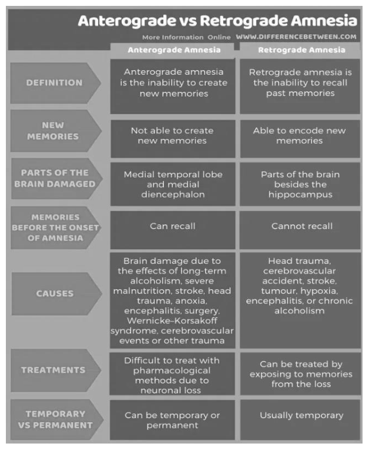

Source page 32

**75. HTN, Hypokalemia, Weakness, Na=145, K= 3.3, Sugar=104 mg/dl, DX is:**

*Answer: A — Conn's syndrome*

Hypertension with hypokalaemia and muscle weakness is the classic picture of primary hyperaldosteronism, Conn's syndrome. The clinical hallmark of mineralocorticoid excess is hypokalaemic hypertension, though only about half of patients show hypokalaemia. Sodium tends to be normal because of concurrent fluid retention, and hypomagnesaemia is common. Severe hypokalaemia can cause proximal myopathy or hypokalaemic paralysis.

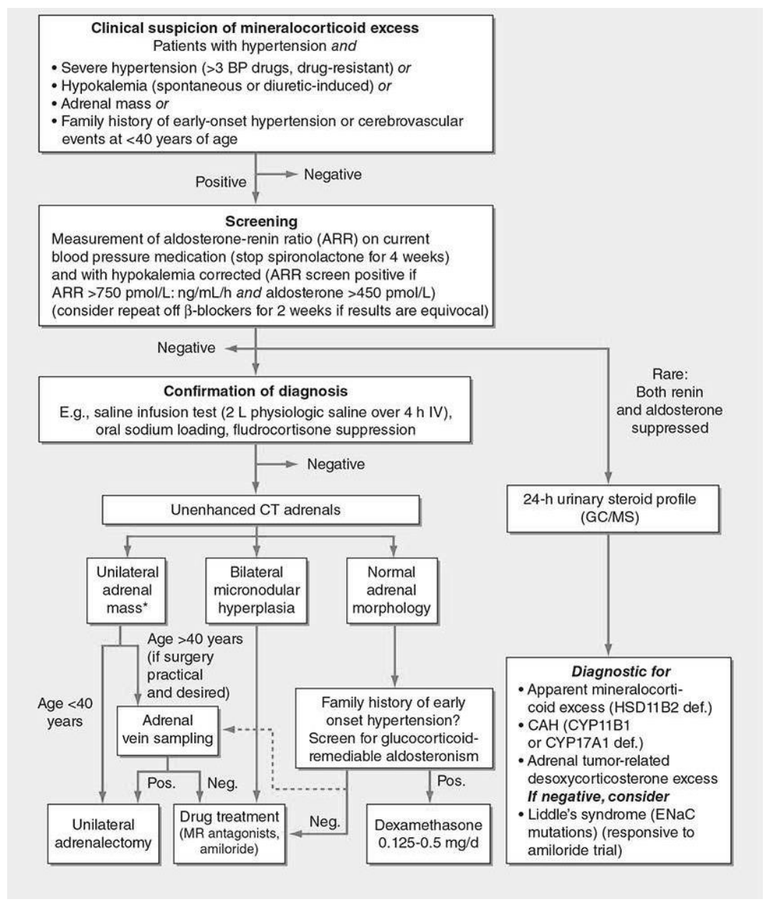

Source page 32

**76. 25 years old IV drug user presented with fever for 3 weeks. After work up in a tertiary certer, Infective endocarditis was suspected. According to Duke's criteria, sample should be collected atleast**

*Answer: B — 2 samples in 12 hours apart*

For suspected infective endocarditis, blood cultures should be taken as at least two sets from separate venepuncture sites, and the source keys the interval as 12 hours apart. Three to six sets are recommended before starting antibiotics and one should not wait for a spike of fever, since the first two specimens detect bacteraemia in 90 percent of culture-positive cases. An indwelling line must not be used, and both aerobic and anaerobic bottles are needed.

Source page 33

**77. Which of the following is primary indication of CPAP?**

*Answer: A — CHF with Pulmonary edema*

Non-invasive ventilation is best suited to cardiogenic pulmonary oedema, where respiratory failure is potentially rapidly reversible, and CPAP is the primary indication. Both CPAP and BiPAP work, with CPAP possibly more effective, and the greatest benefit is relief of breathlessness. Patients with hypercapnic respiratory acidosis may gain the most. Unconscious asthma is a contraindication, not an indication.

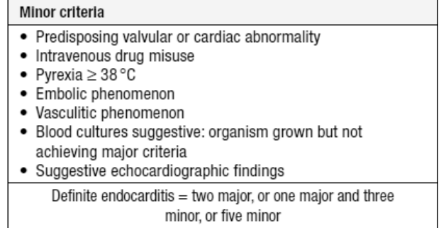
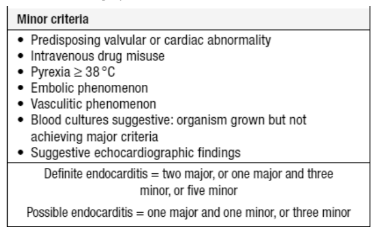

Source page 34

**78. Which of the following is not associated with Hepatitis C?**

*Answer: B — Polyarteritis nodosa*

Classical polyarteritis nodosa is a medium to large vessel vasculitis and is associated with hepatitis B, not hepatitis C, so it is the exception here. Chronic hepatitis C is associated with cryoglobulinaemia, membranoproliferative glomerulonephritis and lichen planus. The renal lesion in hepatitis C relates to glomerular deposition of immune complexes containing HCV, anti-HCV IgG and IgM rheumatoid factor.

Source page 34

**79. Nutcracker esophagus, the correct statement is**

*Answer: A — There is extremely forceful peristaltic activity leading to episodes of chest pain and dysphagia*

Nutcracker oesophagus is a hypermotility disorder with high amplitude peristalsis, in which extremely forceful peristaltic activity causes episodic chest pain and dysphagia. It is not a malignancy and medical treatment is available, with nitrates or nifedipine. It is one of the oesophageal motility disorders to distinguish from achalasia and diffuse oesophageal spasm.

Source page 35

**80. Which of the following antibiotics is used as prophylaxis for malaria treatment**

*Answer: B — Doxycycline*

Malaria chemoprophylaxis can be given with chloroquine, atovaquone plus proguanil (Malarone), doxycycline or mefloquine, so doxycycline is the answer here. Azithromycin, penicillin and ciprofloxacin have no role in malaria prophylaxis. The choice depends on the resistance pattern of the area visited and on patient factors such as pregnancy.

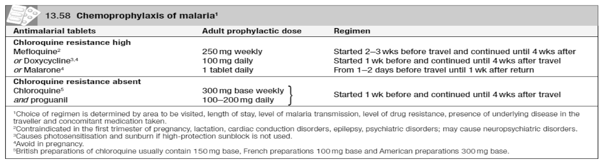

Source page 35

**81. Hyperlipidemia is associated with all of the following except**

*Answer: A — Hyperthyroidism*

Hyperthyroidism is the exception: thyroid hormone increases HMG-CoA reductase expression and cholesterol synthesis, so hyperthyroidism lowers rather than raises lipids. Hypothyroidism raises them. In type 2 diabetes hypertriglyceridaemia and low HDL are the usual abnormalities, and in nephrotic syndrome hyperlipidaemia follows increased hepatic lipogenesis in response to the fall in oncotic pressure from hypoalbuminaemia.

Source page 35

**82. Acute Kidney Injury with Fractional excretion of Sodium (FeNa) <1% denotes the cause of AKI is likely to be:**

*Answer: A — Prerenal*

A fractional excretion of sodium below 1 percent indicates prerenal injury, where the tubules are intact and avidly reabsorb sodium. In intrinsic renal injury FeNa is above 2 percent, with urine osmolality below 350 mosm/kg and urinary sodium above 40 mEq/L. Prerenal injury shows urine osmolality above 500 mosm/kg, urinary sodium below 20 mEq/L and a BUN to creatinine ratio above 20:1.

Source page 35

**83. 25 years old lady with past history of SLE now presented with complain of recurrent abortions. What may be associated condition?**

*Answer: A — Antiphopholipid antibody syndrome*

Recurrent abortion in a patient with SLE points to antiphospholipid syndrome. Classification needs one clinical and one laboratory criterion. The clinical criteria are vascular thrombosis and pregnancy morbidity, the latter including one or more late-term spontaneous abortions after 10 weeks, premature birth before 34 weeks for severe pre-eclampsia or placental insufficiency, or three or more unexplained consecutive abortions before 10 weeks. Laboratory criteria are anticardiolipin or anti-beta-2 glycoprotein I antibodies or lupus anticoagulant on two occasions at least 12 weeks apart.

Source page 36

**84. A patient presented after a traumatic injury to the spinal cord following which there is loss of pain and temperature over the right lower limb while there is weakness of movement of left lower limb with decreased sensation of fine touch and vibration. What is the likely diagnosis?**

*Answer: D — Brown-Sequard Syndrome*

This is Brown-Sequard syndrome, a hemisection of the cord. Interruption of the lateral corticospinal tract gives ipsilateral spastic paralysis below the lesion, interruption of the posterior columns gives ipsilateral loss of tactile discrimination, vibration and position sense, and interruption of the lateral spinothalamic tract gives contralateral loss of pain and temperature starting two to three segments below the level. Ipsilateral Horner syndrome may occur from loss of autonomic function.

Source page 36

**85. 49-year-old woman is evaluated for a 6-month history of exertional dyspnea and nonproductive cough that had an insidious onset. She has not noticed any particular triggers for her cough. On Chest Xray, there is bilateral hilar lymphadenopathy. Which of the following symptoms is most common in men and older patients with this disease?**

*Answer: B — Hypercalcemia*

This is sarcoidosis, a multisystem granulomatous disorder with non-caseating granulomas and bilateral hilar lymphadenopathy in over 90 percent of cases. Hypercalcaemia is the feature more common in men and older patients, reflecting increased calcitriol formation by alveolar macrophages, particularly with strong sunlight exposure, and it may lead to nephrocalcinosis. Erythema nodosum and uveitis belong to Lofgren's syndrome, which is typically seen in young adults.

Source page 37

**86. Which of the following laboratory markers has been most closely associated with COVID-19?**

*Answer: B — Lymphopenia*

Lymphopenia is the laboratory marker most closely associated with COVID-19. In a meta-analysis of 66 studies in children, lymphocytopenia was seen in about 19 percent while lymphocytosis appeared in only 8 percent, alongside raised CRP in 54 percent, ferritin in 47 percent, LDH in 37 percent and D-dimers in 35 percent.

Source page 37

**87. A 30-year-old female presents with a persistent fever, night sweats, and weight loss for the past 2 months. She also reports having a chronic cough and occasional chest pain. Upon further evaluation, a chest x-ray is normal, but a tuberculin skin test is positive. A CT scan of the abdomen reveals enlarged lymph nodes in the mesentery, and a biopsy confirms the presence of acid-fast bacilli. Which of the following is the most common site of extrapulmonary tuberculosis (TB)?**

*Answer: A — Lymph nodes*

Lymph nodes are the commonest site of extrapulmonary tuberculosis, accounting for about 50 percent of cases. The kidneys account for roughly 25 percent, bones and joints 15 percent and the central nervous system 5 percent. Extrapulmonary tuberculosis should be considered when symptoms suggest tuberculosis but the chest radiograph is normal or the patient does not respond to standard treatment.

Source page 37

**88. A 65-year-old man with a 55-pack a year history of smoking gets pain in his left calf on walking for 200m. Pain goes away when he stops and then he can walk further, but at the same distance, the pain again starts at the same 200m. What is the underlying cause of the symptoms?**

*Answer: B — Arterial Insufficiency*

Reproducible calf pain that comes on at a fixed walking distance and is relieved by rest is intermittent claudication, the hallmark of peripheral arterial insufficiency in a heavy smoker. The fixed claudication distance reflects a critical stenosis that cannot meet the oxygen demand of exercising muscle. Angina is the same physiology in the coronary circulation; the source explanation discusses stable angina, but the site here is the leg.

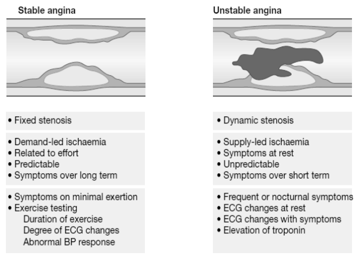
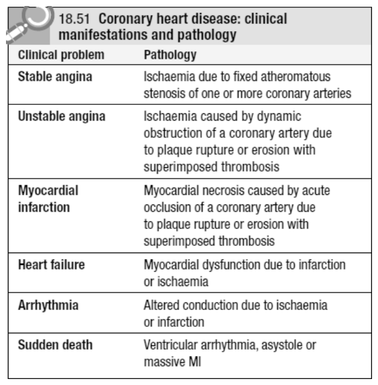

Source page 38

**89. Which of the following is contraindicated in non-ST elevated myocardial infraction**

*Answer: A — Thrombolytic agent*

Thrombolysis should not be used in NSTEMI because the benefit is reduced and the haemorrhagic risk is possibly increased. Thrombolytic therapy is for ST elevation myocardial infarction or bundle branch block within 12 hours of symptom onset. Immediate angiography with revascularisation, morphine and aspirin all have a place in NSTEMI management.

Source page 38

**90. A 25 years old male presented with episodic headache, sweating, palpitation, polyuria and abdominal pain. On examination he has pallor and high BP. On investigation, he has high blood sugar. He is probably having**

*Answer: D — Pheochromocytoma*

Episodic headache, sweating, palpitations and hypertension with hyperglycaemia is the classic paroxysmal picture of phaeochromocytoma, from episodic catecholamine release. Polyuria and abdominal pain fit the same surge, and the pallor reflects peripheral vasoconstriction. Diabetes and hyperthyroidism do not produce discrete attacks of this kind.

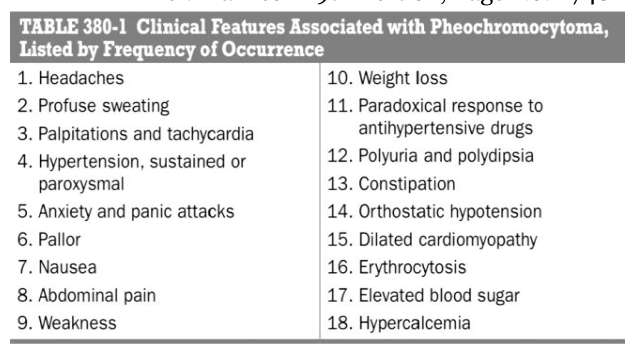

Source page 39

**91. Female presented with heavy menstrual bleeding. She is most likely to have**

*Answer: A — Iron deficiency anemia*

Heavy menstrual bleeding causes iron deficiency anaemia through chronic blood loss. In women of child-bearing age, menstrual loss, pregnancy and breastfeeding deplete iron stores; in developed countries a third of premenopausal women have low iron stores though only 3 percent show iron-deficient haematopoiesis. In men and postmenopausal women the equivalent cause is gastrointestinal blood loss and must be investigated.

Source page 40

**92. Which of the following drugs doesn't decrease K+ levels?**

*Answer: A — Calcium gluconate*

Calcium gluconate does not lower potassium. It protects the heart in hyperkalaemia by restoring the difference between resting and threshold potentials, without changing the resting membrane potential or shifting potassium into cells. Insulin and salbutamol both drive potassium intracellularly, and diuretics increase renal potassium loss. The recommended dose of calcium gluconate is 10 mL of 10 percent solution over 2 to 3 minutes with cardiac monitoring.

Source page 40

**93. In dementia, which of the following terms refers to an inability to recognize objects or people?**

*Answer: C — Agnosia*

Agnosia is the inability to recognise and identify objects or persons using one or more of the senses. Apraxia is loss of the ability to carry out skilled movement despite having the physical ability and the desire. Alogia is poverty of speech, and aphasia is a language disorder from damage to the language areas of the brain.

Source page 40

**94. Which of the following is causes of normal anion gap metabolic acidosis**

*Answer: C — Renal tubular acidosis*

Normal anion gap metabolic acidosis is caused by excess bicarbonate loss from the gut, as in diarrhoea, or from the kidney, as in renal tubular acidosis. Bicarbonate is lost and replaced by chloride, so the anion gap stays normal. Methanol poisoning, diabetic ketoacidosis and lactic acidosis all add unmeasured anions and produce a raised anion gap.

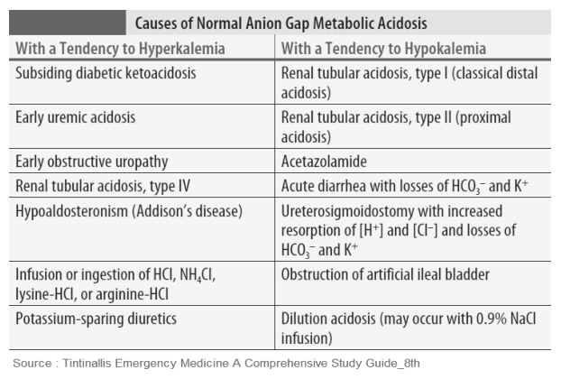

Source page 40

**95. Which is most accurate regarding the differences between COVID-19 and Community Acquired Pneumonia?**

*Answer: D — Pulmonary consolidation on CT is commonly associated with CAP, whereas ground-glass opacity is a typical feature of COVID-19*

The accurate statement is the CT pattern: consolidation is the classic CAP finding, while ground-glass opacity, ground-glass with consolidation, or grid-like change typifies COVID-19. The other statements are reversed. Temperature rise may actually be more notable in COVID-19, liver function damage is more common with COVID-19, and lymphocyte counts are lower, not higher, in COVID-19.

Source page 41

**96. Signs and symptoms of right sided heart failure except**

*Answer: C — Dyspnea*

Dyspnoea is the exception because it belongs to left-sided heart failure, where raised left atrial and pulmonary venous pressure causes pulmonary congestion or oedema. Right-sided failure reduces right ventricular output for a given right atrial pressure and produces hepatomegaly, raised jugular venous pressure, ascites and peripheral oedema. Isolated right heart failure comes from chronic lung disease, multiple pulmonary emboli or pulmonary valve stenosis.

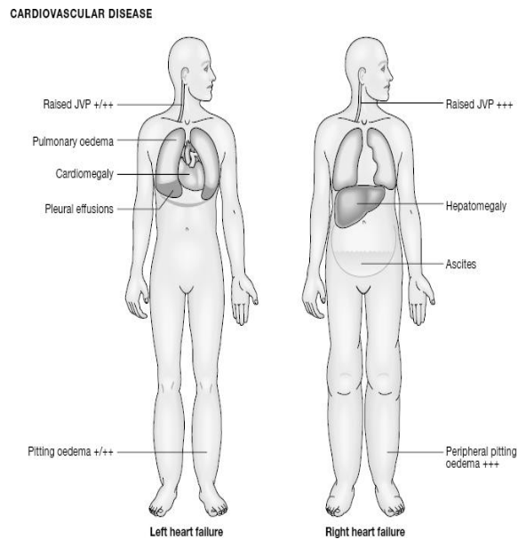

Source page 41

**97. All of the following may be seen in patients of cardiac tamponade except:**

*Answer: A — Kussmaul's sign*

Kussmaul's sign, the paradoxical rise in right atrial pressure during inspiration, is seen in constrictive pericarditis, not tamponade. In tamponade you expect pulsus paradoxus, electrical alternans from the heart swinging in the pericardial fluid, and right ventricular diastolic collapse on echocardiography, which is the best way to confirm the diagnosis. Percutaneous pericardiocentesis usually produces a dramatic response.

Source page 41

### 10. Surgery

**98. A 30-year-old motorcycle rider presented to ER after a motor vehicle accident with loss of consciousness. CT scan of head done at ER showed right sided lens shaped hyperdense lesion over Right Parietal lobe. What will be the treatment of choice in this patient?**

*Answer: B — Craniotomy*

A lens-shaped hyperdense lesion is an extradural haematoma, and the treatment is craniotomy for evacuation. Indications include a supratentorial haematoma over 40 mL or infratentorial over 10 mL, midline shift over 1 cm, intracranial pressure above 2.7 kPa, or progressively worsening consciousness even when the volume criteria are not met. Burr hole is not adequate for a clotted extradural collection.

Source page 42

**99. Hirschsprung disease is best diagnosed by/ Investigation of choice for Hirschsprung's disease is**

*Answer: A — Rectal biopsy*

Full-thickness rectal biopsy demonstrating absence of ganglion cells is the investigation of choice. Histochemical staining for acetylcholinesterase is also used. Barium enema shows a small rectum with colonic dilatation above the narrowed segment, and anorectal manometry shows failure of the rectum to relax with balloon distension, but neither is confirmatory. The disease results from failure of neuroblast migration, most often involving a short segment of rectum or sigmoid.

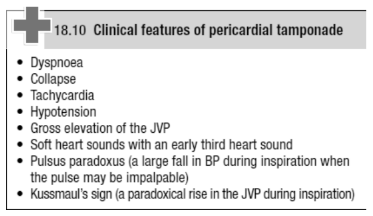

Source page 42

**100. Alleged history of road traffic accident presented to the emergency department with an open fracture of the right lower leg. What are the initial steps in management of the cases?**

*Answer: B — Wound irrigation and debridement*

All open fractures must be assumed contaminated, and urgent wound and fracture debridement is the key early step, alongside antibiotic prophylaxis, fracture stabilisation and early definitive wound cover. The wound is irrigated with copious physiological saline, often 6 to 12 litres for a long bone, and all doubtfully viable tissue is removed. Suturing the wound primarily, or internal fixation before debridement, invites infection.

Source page 43

**101. A 30-year-old male presents to the clinic with complaints of pain in his tailbone region. The pain started a few days ago and is worse when he sits down. On examination, tenderness is noted over the coccyx. Which of the following is a common cause of coccyx pain in this patient?**

*Answer: C — Pilonidal cyst*

A pilonidal cyst at the base of the tailbone is a common cause of coccydynia, giving pain and tenderness over the coccyx that is worse on sitting. Lumbar disc herniation and sacroiliac dysfunction cause lower back pain rather than isolated coccyx pain, and hip arthritis causes hip joint pain. The site and the sitting-related aggravation are the discriminators.

Source page 43

**102. A 25-year-old male presents to the emergency department with sudden onset chest pain that radiates to his back. He also reports difficulty breathing and a feeling of tightness in his chest. On physical examination, the physician hears a crunching sound synchronous with the patient's heartbeat. What condition is associated with the crunching sound heard on physical examination?**

*Answer: B — Pneumomediastinum*

A crunching sound synchronous with the heartbeat is Hamman's sign, characteristic of pneumomediastinum, air in the mediastinum from trauma, oesophageal rupture or spontaneous pneumothorax. Diaphragmatic paralysis, kyphoscoliosis and tension pneumothorax cause respiratory difficulty but not this sound. Tension pneumothorax is a separate emergency with mediastinal shift.

Source page 44

**103. A patient presents to ER with pain over his right hand. On examination the hand is cold and pale, with feeble pulse. There is a pulsatile mass over the proximal aspect of same arm. What is the likely diagnosis?**

*Answer: A — Subclavian aneurysm*

A pulsatile mass in the proximal arm with a cold, pale hand and feeble pulse indicates a subclavian aneurysm with distal embolisation or compromise of flow. Subclavian aneurysms may follow atherosclerosis, thoracic outlet syndrome, trauma or connective tissue disease such as Marfan syndrome. Clots from the aneurysm can cause stroke or loss of fingers, the hand or rarely the whole arm.

Source page 44

**104. According to the Goldman classification, which of the following features describes a grade III urethral injury?**

*Answer: C — Injury to the membranous urethra, extending into the proximal bulbous urethra*

In the Goldman classification, grade III is injury to the membranous urethra extending into the proximal bulbous urethra. Grade I is contusion, grade II is a pure bulbar injury, grade IV involves the bladder base and bladder neck, and grade V extends into the prostate or vagina. The distinction matters because the level of injury determines whether suprapubic or urethral drainage is safe.

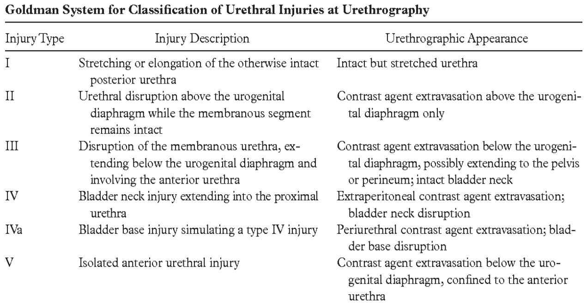

Source page 44

**105. What percentage burn does a patient have who has suffered burns to one leg (circumferential), one arm (circumferential), and the anterior trunk**

*Answer: D — 45%*

Using the rule of nines, one whole leg is 18 percent, one whole arm is 9 percent and the anterior trunk is 18 percent, giving 45 percent in total. The Lund-Browder chart is more accurate for children, who have proportionally larger heads and smaller lower limbs. The palm method approximates small or patchy burns, the patient's palm excluding fingers being about 0.5 percent of body surface area.

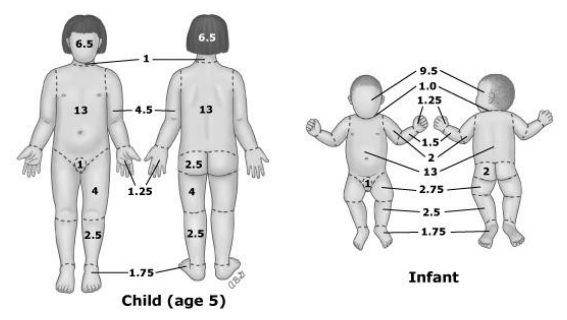
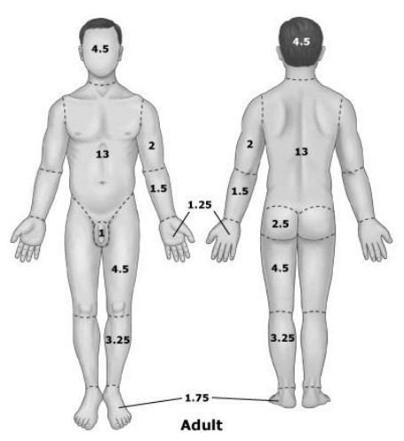

Source page 45

**106. Which of the following is not true about flail chest?**

*Answer: D — At least two sites of fractures on each of two consecutive ribs*

Flail chest requires three or more consecutive ribs broken in at least two places each, so the statement about two consecutive ribs is false. The unstable segment moves paradoxically, inward on inspiration and outward on expiration, causing difficulty in breathing. It is associated with underlying atelectasis or pneumonia, though that association is not a defining feature.

Source page 45

**107. Malti, a 45-years female patient with a family history of breast carcinoma, showed diffuse microcalcification on mammography. Intraductal carcinoma in situ was seen on biopsy. Most appropriate management is:**

*Answer: C — Simple mastectomy*

Diffuse microcalcification from ductal carcinoma in situ that cannot be cleared with a cosmetically acceptable margin is treated by simple mastectomy, as keyed here. Breast-conserving surgery with adjuvant radiotherapy is preferred where negative margins can be achieved, and mastectomy is chosen when they cannot. Endocrine therapy depends on receptor status. Radical mastectomy and chemotherapy are not the primary local treatment for DCIS.

Source page 46

**108. A 10-year-old boy is brought to the emergency department via ambulance after he was involved in a motor vehicle collision. The patient is unconscious on arrival. Glasgow Coma Scale (GCS) score is 8. CT scan does not show any specific lesion. The patient remains unconscious for the next 7 hours. Based on these findings, which of the following is the most likely diagnosis?**

*Answer: B — Diffuse axonal injury*

A low GCS, unconsciousness lasting more than 6 hours and an initial CT with no large haemorrhage indicate diffuse axonal injury, and MRI may later show small microhaemorrhages. A subdural haematoma would show a crescent-shaped hyperdensity, an epidural a lentiform hyperdensity, and subarachnoid haemorrhage hyperdensity in the subarachnoid space. The absence of any of those on CT is what points to diffuse axonal injury.

Source page 46

**109. Healing of scalp wound occurs fast because**

*Answer: A — High vascularity*

Scalp wounds bleed profusely but heal quickly, and the reason is the rich vascularity of the scalp. All the arteries supplying the scalp enter from below at the periphery, which is why craniotomy flaps are cut centrally and reflected peripherally to preserve blood supply. Life-threatening scalp haemorrhage can be controlled as first aid by encircling the head just above the ears and eyebrows.

Source page 47

**110. What is the most common site of penile carcinoma?**

*Answer: A — Glans penis*

Penile tumours can arise anywhere on the penis, but most are found on the glans (48 percent) and the prepuce (21 percent). They may present as a hyperaemic area on the glans or near the urethral meatus, and itching or burning under the foreskin or ulceration of the glans are the commonest symptoms, with pain rarely present. Phimosis may conceal the cancer and allow it to progress.

Source page 47

**111. A teenage boy presents with left testicular pain. On examination, the left testis is higher than the right and pain persists on elevation of the testis. Which of the following options is more likely?**

*Answer: D — Testicular torsion*

A high-lying testis with a thickened tender cord, and pain that persists or worsens on elevation, indicates testicular torsion. Elevation of the testis relieves the pain of epididymo-orchitis but makes torsion worse. Torsion is commonest between 10 and 25 years, presents with sudden agonising pain in the groin and lower abdomen with vomiting, and if there is any doubt the scrotum should be explored without delay.

Source page 47

**112. A 60-year-old male presents to the emergency department with severe abdominal pain, bloating, and constipation. On physical examination, the abdomen is distended, and there is tenderness on palpation. A plain abdominal x-ray shows dilated bowel loops suggestive of bowel obstruction. Further evaluation reveals the presence of volvulus. Which of the following statement about volvulus is false?**

*Answer: C — Volvulus of caecum is managed by conservative methods.*

The false statement is that caecal volvulus is managed conservatively: caecal volvulus is usually managed surgically, while sigmoid volvulus can initially be managed conservatively by endoscopic detorsion or rectal tube decompression. Sigmoid volvulus accounts for about two-thirds of all volvulus and 4 percent of large bowel obstruction. Risk factors include institutionalisation, neuropsychiatric conditions needing psychotropic medication, chronic constipation and ageing.

Source page 48

**113. A 30-year-old man presented with history of bloody diarrhea for one week. On colonoscopy, there are areas of inflammation in ileum with normal appearing mucosa in between. What is the likely diagnosis?**

*Answer: B — Crohn's disease*

Patchy inflammation with normal mucosa in between, described as skip lesions with a cobblestone appearance, is Crohn's disease. Rectal sparing and perianal disease also favour Crohn's over ulcerative colitis, which is continuous from the rectum. The sites most often involved are terminal ileum and right colon, and at least half of patients have perianal skin tags, fissures or fistulas.

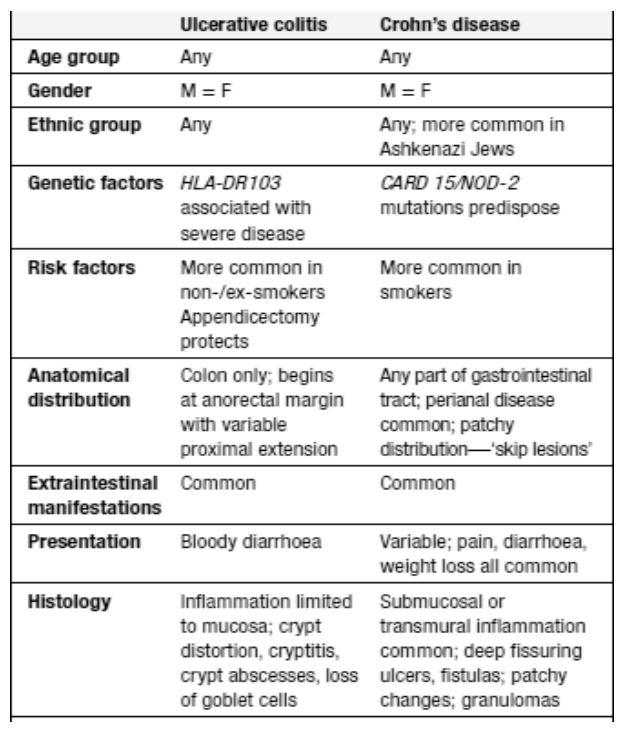

Source page 48

**114. What is the incision used for exploratory laparotomy?**

*Answer: A — Midline*

A vertical midline incision is the best choice for exploratory laparotomy: it gives rapid entry to the peritoneum, is relatively bloodless and safe, and can be extended in either direction. Exposure should never be compromised to keep the incision small. The linea alba is identified as a glistening layer deep to the subcutaneous fat after the skin and fat are divided.

Source page 49

**115. A 45-year-old man presented to the emergency department with colicky abdominal pain and vomiting for 6 hours. On further inquiry, he has not passed stool since the last 3 days. On examination he had a pulse of 110 beats/min and temperature of 37.8 degrees C. There was marked abdominal distension, high pitched bowel sounds. A plain abdominal radiograph was taken in the emergency department which showed multiple air fluid levels. What is the likely diagnosis?**

*Answer: A — Small bowel obstruction*

Colicky periumbilical pain, vomiting, obstipation and distension with high-pitched bowel sounds and multiple air-fluid levels indicate small bowel obstruction. The four cardinal symptoms are pain, vomiting, obstipation and distension. Tachycardia points to dehydration. In large bowel obstruction obstipation and distension dominate, and a sudden onset of severe constant pain would suggest perforation.

Source page 49

### 11. Obstetrics & Gynecology

**116. A sexually active female with the profuse frothy foul-smelling discharge with intense itching. Strawberry cervix revealed on examination. What will be the diagnosis?**

*Answer: A — Trichomonas vaginalis*

A profuse frothy offensive greenish-yellow discharge with intense itching and a strawberry cervix is trichomoniasis. The vaginal walls are red and inflamed with multiple punctate haemorrhagic spots, and similar spots on the portio vaginalis give the strawberry appearance on speculum examination. Dysuria and frequency are common. Bacterial vaginosis gives a thin grey discharge with a fishy odour but no strawberry cervix.

Source page 50

**117. A 35-year-old woman presents with history of being unable to conceive since she has been married 3 years back. She has regular unprotected sexual intercourse with her husband. Her husband's sperm testing showed no abnormalities. She had past history of PID multiple times in the past. Hysterosalpingography was done. What finding may be seen?**

*Answer: B — Dye does not reach the peritoneum*

Repeated pelvic inflammatory disease causes tubal blockage, so on hysterosalpingography the dye fills the uterine cavity but fails to spill through the tubes into the peritoneal cavity. Free spill into the peritoneum is the normal finding and indicates patent tubes. Dye failing to reach the uterus would suggest a cervical or uterine problem, not the tubal disease this history points to.

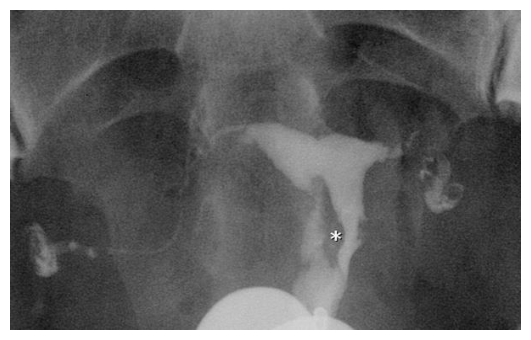

Source page 50

**118. Which of the following type of fibroid will lead to heavy menstruation?**

*Answer: A — Submucosal*

Submucosal myomas that protrude into the uterine cavity are most frequently related to significant heavy menstrual bleeding, and patients with submucosal myomas are significantly more likely to be anaemic than those with myomas elsewhere. Intramural myomas are also commonly associated with heavy or prolonged bleeding. Subserosal fibroids are not a major risk for heavy menstrual bleeding.

Source page 51

**119. All are non-contraceptive benefits of OCP except**

*Answer: B — Prevent infertility*

Oral contraceptives do not prevent infertility, so that is the exception. Their non-contraceptive benefits include regulation of the cycle with diminution of dysmenorrhoea, menstrual pain, flow and anaemia, reduced risk of pelvic inflammatory disease, endometrial and ovarian cancer, benign breast pathology, acne and hirsutism, and reduced risk of osteoporosis, ectopic pregnancy, atherosclerosis, uterine myomas and ovarian cysts.

Source page 51

**120. A 19-year-old woman with an ovarian mass is thought to have a dermoid or teratoma based on ultrasound findings and gross examination at removal by laparoscopy. At her postoperative visit, the pathology returns with the finding of an immature teratoma. Which of the following statements reflects current knowledge about immature teratomas?**

*Answer: D — They commonly occur during the first two decades of life.*

Seventy-five percent of immature teratomas are discovered during the first two decades of life. They are the second commonest malignant germ cell tumour, dysgerminoma being first, and bilaterality is rare though 5 percent have a mature teratoma in the other ovary. Pure immature teratomas do not produce alpha-fetoprotein or hCG. Grade is based on the maturity of the ectodermal neural tissue.

Source page 51

**121. Partograph is**

*Answer: D — A chart to record the progress of labour together with the maternal and fetal conditions*

The partograph is a graphical record of the progress of labour together with the fetal and maternal condition during labour. It is the best tool for detecting whether labour is progressing normally or abnormally, and it warns as soon as there are signs of fetal distress or the mother's vital signs deviate from normal. It is not limited to cervical dilatation and is not an antenatal chart.

Source page 51

**122. A woman presents with amenorrhea of 2 months duration; lower abdominal pain, facial pallor, fainting and shock. Diagnosis is**

*Answer: B — Ruptured Ectopic pregnancy*

Amenorrhoea of two months with lower abdominal pain, pallor, fainting and shock is a ruptured ectopic pregnancy. The classic triad is pain, amenorrhoea and vaginal bleeding, though only about half of patients have all three. Rupture should be suspected with sudden severe persistent abdominal or pelvic pain, shoulder tip pain from diaphragmatic irritation by blood, and haemodynamic compromise. It is a life-threatening haemorrhage.

Source page 51

**123. DCDA twins, 38wks, first twin breech. mother has BP 140/96, 1+ proteinuria. what's the management?**

*Answer: A — Immediate LSCS*

This is mild pre-eclampsia with a blood pressure of 140/96 and 1+ proteinuria, for which the time of delivery is 37 weeks; at 38 weeks immediate termination is required. Because the first twin is breech, the mode of delivery is lower segment caesarean section. Caesarean is indicated in twins when the first fetus is non-cephalic, and also for IUGR, conjoined or monoamniotic twins, TTTS and locked heads.

Source page 52

**124. A 25-year-old multiparous woman is in active labor and the fetal head is at +2 station. The obstetrician notes that the perineum is bulging and there is an impending tear. The patient is otherwise healthy, and fetal heart rate monitoring is normal. Which of the following management options is the most appropriate in this patient?**

*Answer: D — Episiotomy*

A bulging perineum with an impending tear is the indication for episiotomy, a surgical incision that enlarges the vaginal opening and reduces the risk of severe perineal tears. Caesarean and forceps delivery are not indicated without other obstetric reasons or fetal distress. Observation alone would allow a severe tear to occur.

Source page 52

**125. A 25-year-old sexually active woman presents to your clinic with complaints of vaginal discharge and discomfort during urination. On examination, you note cervical tenderness and mild cervical discharge. A nucleic acid amplification test confirms the diagnosis of genital chlamydial infection. What is the treatment of choice for this patient?**

*Answer: B — Azithromycin*

Azithromycin is the treatment of choice for uncomplicated genital chlamydial infection, given as a single 1 g dose, with doxycycline as the alternative where a single dose is unsuitable. Amoxicillin and ofloxacin are not first-line here. Cervical tenderness and discharge with dysuria are the usual presentation, and partners must be treated as well.

Source page 52

**126. Most estrone and estriol are formed from estradiol in this organ:**

*Answer: B — Liver*

The liver is the primary site of oestrogen metabolism and the main place where estradiol is converted to estrone. After the menopause ovarian oestrogen production falls, and estrone becomes the major circulating oestrogen, formed by peripheral conversion. Estriol is produced mainly by the placenta during pregnancy and is a marker of fetal wellbeing.

Source page 53

**127. A 25 years old female with 32 weeks of gestation presented with history of per vaginal leakage 24 hours back and fever, offensive vaginal discharge. On examination there was uterine tenderness along with fetal tachycardia. What is your diagnosis?**

*Answer: A — Chorioamnionitis*

Prolonged rupture of membranes with fever, offensive discharge, uterine tenderness and fetal tachycardia is chorioamnionitis, infection of the amnion and chorion. The characteristic signs are maternal fever above 38 degrees, baseline fetal tachycardia above 160 beats per minute for 10 minutes or more, maternal leucocytosis above 15,000 per microlitre, and purulent fluid from the cervical os. Maternal tachycardia and uterine tenderness are supportive but non-specific.

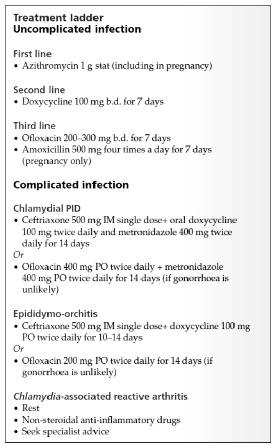

Source page 53

**128. Which of the following types of cysts most commonly ruptures?**

*Answer: B — Corpus luteum cysts*

Corpus luteum cysts tend to be larger and more symptomatic than follicular cysts and are more prone to haemorrhage and rupture. Most ovarian cysts are benign, and a ruptured cyst can range from asymptomatic to mimicking an acute abdomen, rarely with significant intraperitoneal haemorrhage. Follicular cysts are usually smaller and bleed internally less often.

Source page 53

**129. A 15-year-old female presents with primary amenorrhea. Her breasts are Tanner 4 but she has no axillary or pubic hair. The most likely diagnosis is:**

*Answer: C — Testicular feminization syndrome*

Well-developed breasts with absent axillary and pubic hair and primary amenorrhoea in a 46 XY individual is androgen insensitivity, originally described as testicular feminization syndrome. There is an androgen receptor defect with testes and normal testosterone, absent uterus, normal female external genitalia and an absent or shallow vagina. In Turner syndrome all secondary sexual characteristics are absent. Karyotype and imaging settle the diagnosis, and the gonads are removed after sexual maturity because of malignancy risk.

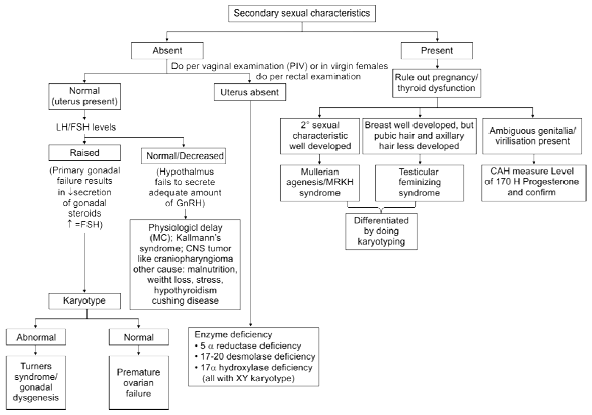

Source page 53

**130. A 35-year-old female patient presents to the clinic requesting a long-acting contraceptive method. She has a history of heavy menstrual bleeding and dysmenorrhea. The doctor recommends a progestogen-releasing intrauterine contraceptive device (IUCD). Which of the following best describes the mechanism of action of progestogen-releasing IUCD?**

*Answer: D — Promotion of endometrial atrophy*

A progestogen-releasing intrauterine device works mainly by promoting endometrial atrophy, which makes the endometrium unreceptive to implantation. It also thickens cervical mucus, but that is not the primary mechanism. Unlike combined hormonal contraceptives it does not consistently suppress ovulation, though it may occasionally do so as a secondary effect. A thin endometrial lining is the consequence of atrophy rather than the stated mechanism.

Source page 54

### 12. Pediatrics

**131. Fraying and cupping of metaphysis of long bones in a child does not occur in**

*Answer: A — Lead poisoning*

Fraying, splaying and cupping of the metaphysis are the radiographic features of rickets, where excess non-mineralised osteoid widens the growth plate. They also occur in hypophosphatasia and in metaphyseal dysplasia, where the flared metaphyses are relatively lucent. Lead poisoning does not produce them; its features are abdominal pain, microcytic anaemia with basophilic stippling, encephalopathy, motor neuropathy, nephrotoxicity and hypertension.

Source page 55

**132. A child presented with hematuria, hearing loss and ocular changes**

*Answer: A — Alport syndrome*

Haematuria with sensorineural deafness and ocular abnormalities is Alport syndrome. Most cases come from mutation or deletion of COL4A5 on the X chromosome, encoding type IV collagen, with COL4A3 or COL4A4 mutations causing the autosomal recessive form. Abnormal collagen causes progressive glomerular basement membrane degeneration, and patients progress from haematuria to end-stage renal disease in their late teens or twenties. The cochlea is affected because it contains the same collagen isoforms.

Source page 55

**133. A child recognizes his mother by**

*Answer: A — 3 months*

A child recognises his mother by 3 months. Social smiling and visual recognition of the primary caregiver are early developmental milestones, and by 6 to 9 months the infant additionally shows stranger anxiety and object permanence. The source keys this to 3 months.

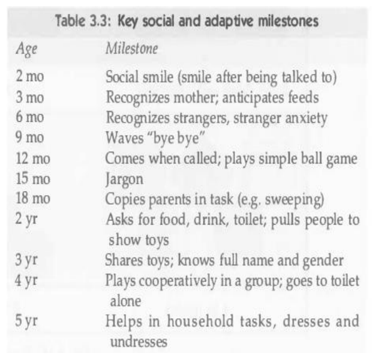

Source page 55

**134. A 4-year-old boy presents to the urgent care clinic for a new rash. His mother reports that the rash started on both his cheeks yesterday, but since then he has developed a rash on his trunk. On physical exam, he has a slapped cheeks appearance and has a maculopapular rash on his trunk with some areas having a lacy or reticular appearance. What is your diagnosis?**

*Answer: A — Erythema infectiosum*

A slapped cheek rash spreading to the trunk as a diffuse erythematous macular rash with central clearing, giving a lacy or reticular pattern, is erythema infectiosum, or fifth disease, caused by parvovirus B19. The virus targets erythroid lineage cells at the pronormoblast stage. Peak age is 5 to 15 years, and complications include arthropathy, idiopathic thrombocytopenic purpura, transient aplastic crisis in chronic haemolytic anaemia and hydrops fetalis in pregnancy.

Source page 56

**135. Which drug is the first-line treatment for febrile seizures in this child?**

*Answer: A — Diazepam*

The first step in a febrile seizure is to lower the temperature with an antipyretic such as paracetamol or ibuprofen. If the seizure persists, the drug of choice is diazepam, given rectally, orally or intravenously; it acts by enhancing GABA activity. Phenobarbitone, valproate and carbamazepine are used for epilepsy but not as first-line treatment for febrile seizures, and they have a slower onset.

Source page 56

**136. A 13 years old boy presented to your OPD with complain of Rashes and abdominal pain and joint pain for 1 months. He also gives history of blood in urine 2 episode. On assessment, palpable purpuric rash present on the lower extremities; The most likely diagnosis is**

*Answer: A — Henoch-schonlein purpura*

Palpable purpura over the lower extremities with abdominal pain, joint pain and haematuria is Henoch-Schonlein purpura, the commonest childhood vasculitis. The rash is non-thrombocytopenic and most prominent over the extensor aspects of the lower limbs and buttocks. Glomerulonephritis occurs in about a third but only 10 percent have azotaemia or nephrotic-range proteinuria, and it is the only long-term complication. Gastrointestinal symptoms come in the first 7 to 10 days and can mimic a surgical abdomen.

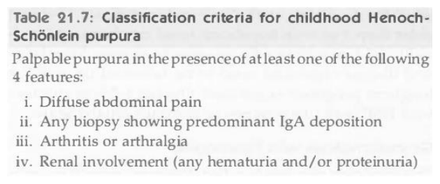

Source page 56

**137. A child presented with mild fever, rashes, swollen and pink colored eyes, stuffy nose and swelling of the lymph nodes behind the ears and occipital region. Cause is**

*Answer: B — Rubella*

Mild fever with rash, conjunctival redness, coryza and suboccipital lymphadenopathy is rubella, caused by the rubella virus, a Rubivirus of the Togaviridae family. Nearly half of infections are asymptomatic. In older children and adults it may be complicated by arthralgia, arthritis and thrombocytopenic purpura. The major concern is teratogenicity when a pregnant woman is infected early in gestation.

Source page 57

**138. A two-day old female born at 35 week's gestation is current in neonatal intensive care unit (NICU) with bloody stools. Pneumatosis intestinalis is seen on X ray. What is the likely diagnosis?**

*Answer: B — Necrotizing enterocolitis*

Pneumatosis intestinalis with bloody stools in a preterm infant is necrotizing enterocolitis. It occurs mainly in infants under 32 weeks and mimics neonatal septicaemia with abdominal distension, apnoea, bradycardia, temperature instability and lethargy. It arises from gut immaturity, mucosal ischaemia, milk feeding and infection; antenatal steroids and breastfeeding protect, while delaying enteral feeding does not prevent it. Mortality is around 40 to 50 percent.

Source page 57

**139. A 12 months old child has been getting high grade fever, fever subsided after 4 days then rashes develop all over the body. The child has been suffering from**

*Answer: B — Roseola infantum*

High fever for 3 to 4 days that falls abruptly and is followed within 12 to 24 hours by a maculopapular rash starting on the trunk is roseola infantum, or sixth disease, caused by HHV-6 and less often HHV-7. Peak age is 6 months to 3 years, and febrile seizures occur in 5 to 10 percent. The rash is non-pruritic and fades in 3 to 4 days, and the prognosis is excellent.

Source page 58

**140. A boy comes from dinner, he complained about diarrhea, vomiting after 4 hours of meal. Most likely causative agent:**

*Answer: D — Staphylococcus aureus*

Vomiting and diarrhoea within 1 to 6 hours of a meal points to Staphylococcus aureus food poisoning. Food handlers transmit the organism to foods such as dairy products and cooked meats, and poor storage allows growth and production of heat-stable enterotoxins. Profuse vomiting dominates and diarrhoea may be slight. The toxins act as superantigens and can produce a misleading neutrophil leucocytosis.

Source page 58

**141. A child presented with 3 days of diarrhea mixed with blood and mucus. On examination, the child is dehydrated and IV fluids is started. What is the likely cause of diarrhea?**

*Answer: B — Shigella*

Bloody diarrhoea with mucus and tenesmus is bacillary dysentery, most often caused by Shigella. Other causes of bloody diarrhoea include Campylobacter jejuni, E. coli O157:H7 and other Shiga toxin-producing E. coli, Salmonella and Yersinia, with Entamoeba histolytica as a parasitic cause. Dehydration is treated with intravenous fluids, and the choice of antibiotic depends on local resistance.

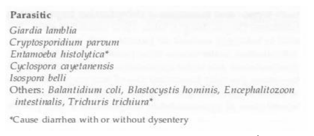

Source page 59

**142. A 3-year-old child is admitted to the emergency department with severe headache, high fever, malaise, and confusion. Radiographic and physical examinations reveal that the patient suffers from meningitis. A lumbar puncture is ordered. Which vertebral level is the most appropriate location for the lumbar puncture?**

*Answer: D — L4-L5*

Lumbar puncture is performed at L4-L5, or sometimes L3-L4. The spinal cord ends at L1 to L2 and the dural sac at S2, so the space between is the lumbar cistern and the safest place to sample cerebrospinal fluid without risking the cord. A lower level is chosen in children for the same reason.

Source page 59

### 13. Dermatology

**143. A man suffering from fungal nail infection. Which of the following is done?**

*Answer: D — KOH mount*

A potassium hydroxide mount is the bedside test for suspected fungal infection. The sample is placed on a glass slide with 20 percent aqueous potassium hydroxide, covered, and after 20 to 30 minutes (60 to 90 minutes for nail clippings) examined with the condenser lowered to enhance contrast. Fungal hyphae, pseudohyphae or spores are looked for. Indian ink is for Cryptococcus and Gram stain for bacteria.

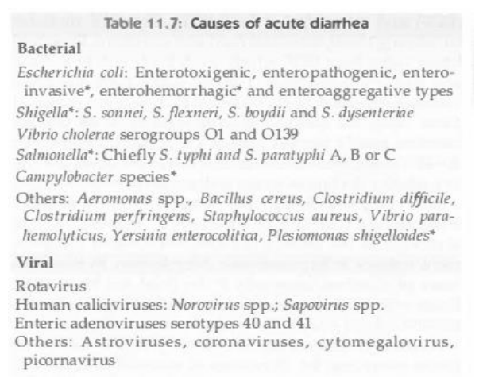

Source page 59

**144. A 35 years old male presented with extremely pruritic lesion around the ankle. The most likely diagnosis is**

*Answer: B — Psoriasis*

The source keys this to psoriasis, whose plaques are well demarcated, indurated, erythematous and surmounted by silvery white lamellar scales, and which favour pressure points such as the elbows and knees. Note that psoriasis is usually only mildly itchy, and an intensely pruritic lesion at the ankle would also raise lichen planus or a localized eczema; answer the key as printed. Auspitz sign and the isomorphic (Koebner) phenomenon support psoriasis.

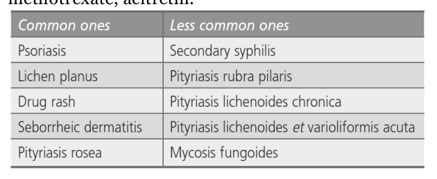

Source page 60

**145. Which of the following is not cardinal signs of Leprosy?**

*Answer: D — Fever for more than 2 weeks with family history of leprosy*

The cardinal signs of leprosy are a hypopigmented or erythematous patch with loss of sensation, and thickened peripheral nerves. Prolonged fever with a family history is not one of them. Fever belongs instead to lepra reactions: type 1 reversal reaction gives sudden redness and new lesions, and type 2 erythema nodosum leprosum gives nodules, fever, red eyes and joint pain in lepromatous disease.

Source page 60

**146. A 10-year-old child is brought to the dermatology clinic by their parents with complaints of multiple skin lesions and increased sensitivity to sunlight. The child's medical history reveals that they have had recurrent skin infections and that their skin has become increasingly fragile over time. The parents also report that the child has had difficulty seeing and hearing in recent months. On examination, the child is noted to have numerous pigmented lesions and freckles on their skin, as well as areas of hyperpigmentation and atrophy. Which of the following conditions is NOT associated with a defect in nucleotide excision repair (NER)?**

*Answer: A — Hereditary hemorrhagic telangiectasia*

Hereditary haemorrhagic telangiectasia is not a nucleotide excision repair defect; it is an autosomal dominant vascular disorder from mutations in endoglin or ACVRL1. Xeroderma pigmentosum, Cockayne syndrome and photosensitive trichothiodystrophy are all NER defects. Xeroderma pigmentosum gives extreme ultraviolet sensitivity of sun-exposed tissue with multiple skin and eye cancers and sometimes neurodegeneration.

Source page 60

### 14. ENT

**147. Bilateral recurrent laryngeal nerve injury can cause**

*Answer: A — Stridor*

In bilateral abductor paralysis all intrinsic laryngeal muscles are paralysed and the cords lie in the median or paramedian position, so the airway is inadequate and causes dyspnoea and stridor, but the voice is good. Hoarseness is the feature of unilateral cord palsy. The commonest causes are neuritis and surgical trauma, especially thyroidectomy, and many cases need tracheostomy.

Source page 61

**148. A 16 years old boy presented with profuse, recurrent epistaxis along with symptoms of nasal blockage, hearing loss and there is broadening of nasal bridge with selling of cheeks. Which of the following is false regarding the above condition?**

*Answer: A — Associated with EBV*

This is juvenile nasopharyngeal angiofibroma, and the false statement is the association with Epstein-Barr virus. EBV is linked to nasopharyngeal carcinoma, not to angiofibroma. The tumour occurs predominantly in adolescent males in the second decade and is thought to be testosterone dependent, arises from the posterior nasal cavity near the superior margin of the sphenopalatine foramen, and is composed of vascular and fibrous tissue. Its vessels lack a contractile coat, which is why bleeding is so profuse.

Source page 62

**149. Nasopharyngeal carcinoma is caused due to**

*Answer: A — Ebstein-barr virus*

Epstein-Barr virus is closely associated with nasopharyngeal carcinoma. IgA antibodies to early antigen are highly specific but only 70 to 80 percent sensitive, while IgA to viral capsid antigen is more sensitive and less specific, so both are tested for screening in high-incidence areas. Genetic susceptibility is high in Chinese populations, and environmental factors include air pollution, smoking of tobacco and opium, nitrosamines from dry salted fish and incense smoke.

Source page 62

**150. A 42-year-old female presents to the emergency department with complaints of a sudden onset of profuse, bright red bleeding from her nose that has persisted for 20 minutes. On examination, a small bleeding point is identified in the anterior nasal septum. Which of the following is an appropriate management option for this patient?**

*Answer: D — Anterior nasal packing*

This is anterior epistaxis, the commonest type. Initial management is direct pressure with or without chemical cautery, and if bleeding persists, anterior nasal packing with gauze or cotton applies pressure to the bleeding point. Observation is inappropriate with 20 minutes of profuse bleeding, posterior packing is for posterior bleeding, and endoscopic sinus surgery has no role in a localized anterior septal bleed.

Source page 62

**151. Rhinitis medicamentosa or rebound rhinitis is due to the prolonged use of:**

*Answer: D — Nasal decongestants.*

Rhinitis medicamentosa, or rebound congestion, is inflammation of the nasal mucosa caused by overuse of topical nasal decongestants, and intranasal cocaine can do the same. Some patients develop it within 3 days of regular use, others not for 4 to 6 weeks. Management is withdrawal of the decongestant, a short course of systemic steroid and treatment of the underlying rhinitis or structural cause.

Source page 63

**152. A 30-year-old male is having Attic cholesteatoma of left ear with lateral sinus thrombophlebitis. Which of the following will be the operation of choice?**

*Answer: C — Modified radical mastoidectomy*

Modified radical mastoidectomy is indicated for cholesteatoma confined to the attic and antrum, and for localized chronic otitis media. Irreversibly damaged tissue is removed while the rest is preserved to conserve or reconstruct hearing. With lateral sinus thrombophlebitis the diseased mastoid must be exteriorised, which is why the modified radical procedure is chosen over an intact canal wall approach.

Source page 63

**153. A 40-year-old man has an isotope scan of his thyroid gland, which shows a cold nodule. This nodule is removed and, histologically, it is found to be composed of small follicular structures, with normal appearing nuclei, surrounded by an intact fibrous capsule; there is no evidence of vascular penetration.**

*Answer: A — Follicular adenoma*

An encapsulated follicular lesion with normal nuclei and no capsular or vascular invasion is a follicular adenoma. Follicular carcinoma is diagnosed by the presence of capsular or vascular invasion, because the nuclear features of adenoma and carcinoma do not differ, which is why fine needle aspiration cannot separate them. Carcinomas with only capsular invasion have a very low risk of metastasis and lobectomy suffices, whereas angioinvasive tumours are more aggressive.

Source page 63

**154. A patient present with history of acute onset of vertigo associated with nausea and vomiting with a history of running nose and cough few days prior to the onset of symptoms. Most likely cause is**

*Answer: A — Labyrinthitis*

Acute vertigo with nausea and vomiting a few days after an upper respiratory infection is labyrinthitis, usually viral. Viruses reach the inner ear by the bloodstream and affect the stria vascularis, endolymph and organ of Corti; measles, mumps and cytomegalovirus are documented causes. BPPV is positional and brief, Meniere disease is episodic with fluctuating hearing loss and tinnitus, and migraine has different associated features.

Source page 63

**155. Tulio phenomenon is**

*Answer: A — Dizziness due to loud noise*

The Tullio phenomenon is vertigo produced by loud sound. It is seen in congenital syphilis, or when three functioning windows are present in the ear, such as a semicircular canal fistula or a fenestration operation with a mobile stapes footplate. Dizziness on head movement describes BPPV, and positional nystagmus is a different sign.

Source page 64

**156. The 53 year old woman presented with mass below her left ear which is growing in size since past 3 months. On examination there is facial paralysis on the same side. What is the likely diagnosis?**

*Answer: B — Adenoid cystic carcinoma*

A rapidly growing parotid mass with facial nerve palsy in this age group points to a high-grade malignancy, and the source keys adenoid cystic carcinoma, which is notorious for perineural invasion and facial palsy. Mucoepidermoid carcinoma is the commonest malignant salivary tumour and the parotid is its commonest site, but facial paralysis is less typical of it. Any parotid mass with facial palsy needs urgent investigation.

Source page 64

**157. Cricothyroid muscle is supplied by**

*Answer: B — Superior laryngeal nerve*

The cricothyroid is the one intrinsic laryngeal muscle supplied by the external branch of the superior laryngeal nerve. All the other intrinsic muscles are supplied by the recurrent laryngeal nerve. Sensory supply is by the internal laryngeal nerve above the vocal cords and the recurrent laryngeal nerve below them.

Source page 65

### 15. Ophthalmology

**158. The parasympathetic innervation to the eye is carried by**

*Answer: C — Short ciliary nerve*

Parasympathetic fibres to the eye travel from the parasympathetic nucleus of the oculomotor nerve as preganglionic fibres in the oculomotor nerve, synapse in the ciliary ganglion in the orbit, and reach the eye as short ciliary nerves. They supply the pupillary constrictor and ciliary muscle. Long ciliary nerves carry sympathetic fibres, and the lacrimal and nasociliary nerves are branches of the ophthalmic division of the trigeminal.

Source page 65

**159. A lesion of the pituitary gland will most likely cause which of the following visual field defects?**

*Answer: C — Bitemporal hemianopia*

A pituitary lesion compresses the optic chiasm, where the crossing nasal fibres from each retina run, producing a bitemporal hemianopia. Adenoma, meningioma, craniopharyngioma, glioma and aneurysm can all do this. The onset is insidious and often goes unnoticed unless each eye is tested separately.

Source page 65

**160. The most common ophthalmologic symptom of MS is**

*Answer: B — Optic neuritis.*

Optic neuritis is the commonest ophthalmological manifestation of multiple sclerosis, presenting with painful subacute visual loss in one eye. Internuclear ophthalmoplegia is a classic sign of MS but is less common than optic neuritis. Upbeat nystagmus and astigmatism are not characteristic of the disease.

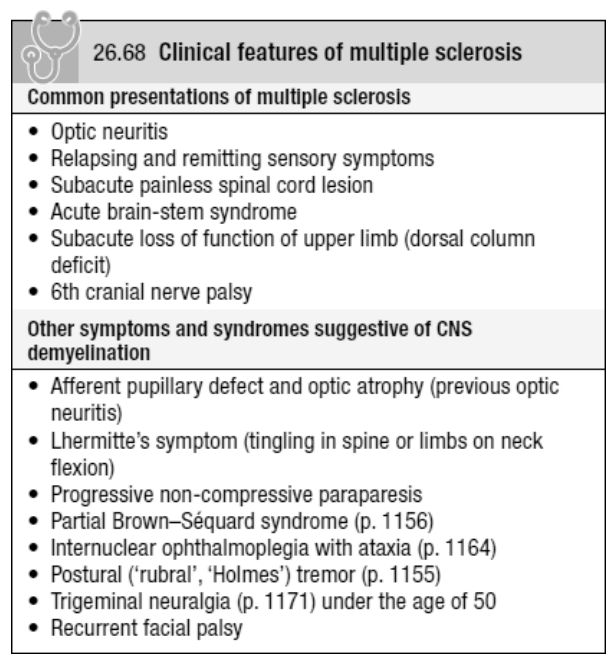

Source page 65

**161. Two months old child presented with epiphora and regurgitation. What is the treatment of choice?**

*Answer: A — Massage*

This is congenital nasolacrimal duct obstruction, and external digital massage of the lacrimal sac is the first-line treatment. Massage raises hydrostatic pressure enough to force open the obstructed distal membrane. Caregivers apply moderate downward pressure over the sac for two to three seconds, two to three times a day until symptoms resolve. Probing is reserved for cases that fail conservative management.

Source page 65

**162. What is the most common mechanism of cataract formation in lens?**

*Answer: A — Protein clumping*

Degenerative processes denature and coagulate the lens proteins in the lens fibres, and this protein clumping is the commonest mechanism of cataract formation. The other mechanisms are disturbance at any level of lens growth for congenital cataract, fibrous metaplasia of lens epithelium for subcapsular cataract, cortical hydration between fibres for cortical cataract, and pigment deposition such as urochrome for nuclear cataract.

Source page 66

**163. A 60-year-old male patient presents with sudden loss of vision in his right eye. Examination reveals a flame-shaped hemorrhage in the retina of the affected eye. What is the most likely diagnosis?**

*Answer: D — Central retinal artery occlusion*

The source keys sudden loss of vision with a flame-shaped haemorrhage to central retinal artery occlusion. Clinically, a flame-shaped haemorrhage is more typical of venous occlusion or hypertensive retinopathy, and central retinal vein occlusion is classically described as a blood and thunder fundus. Answer the key as printed, but note the discrepancy: arterial occlusion usually gives a pale retina with a cherry-red spot rather than flame haemorrhages.

Source page 66

**164. All are cause of Painful Red eye except**

*Answer: A — Vitreous hemorrhage*

Vitreous haemorrhage causes loss of vision, not a painful red eye. The painful red eye causes are keratitis, corneal ulcer, scleritis, acute congestive glaucoma, acute iridocyclitis, endophthalmitis, trauma, corneal foreign bodies and chemical injury. The painless red eye causes include conjunctivitis, subconjunctival haemorrhage, episcleritis, dry eye, dacryocystitis and blepharitis.

Source page 66

**165. A recurrent bilateral conjunctivitis occurring with the onset of hot weather in young boys with symptoms of burning, itching, and lacrimation with large flat topped cobble stone papillae raised areas in the palpebral conjunctiva is:**

*Answer: D — Vernal keratoconjunctivitis*

Vernal keratoconjunctivitis occurs in young boys in warm, dry, subtropical climates, with itching, photophobia, thick mucus discharge, tearing and giant cobblestone papillae on the upper tarsal conjunctiva. Bilateral involvement is nearly universal. Topical antihistamines and mast cell stabilizers are first-line, and topical steroids should be supervised by an ophthalmologist.

Source page 66

### 16. Orthopedics

**166. A patient presents with tingling and burning sensation which radiating down the back of the leg into the sole of the foot. What is the nerve root involved?**

*Answer: C — S1*

Radicular pain running down the back of the leg into the sole of the foot follows the S1 root. L5 pain runs down the lateral leg into the dorsum of the foot and the big toe, and L4 pain runs down the medial leg. S1 compression also reduces the ankle jerk.

Source page 67

**167. Ape thumb deformity is due to injury of**

*Answer: B — Median nerve*

Ape thumb deformity follows median nerve injury. Loss of thenar muscle and opponens pollicis function means the thumb cannot abduct or oppose, so it lies flat alongside the palm. The term is misleading because apes have opposable hands, but the appearance is what gave it the name. Splinting and physiotherapy may help, and surgery is reserved for severe deformity.

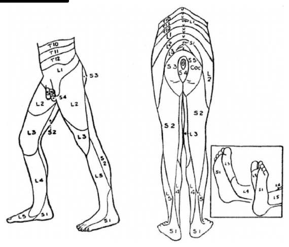

Source page 67

**168. A neonate on examination had tuft of hair at the lower back. Otherwise, the child is stable and moving his legs. What is the diagnosis?**

*Answer: C — Spina bifida occulta*

A tuft of hair over the lower back with a stable, normally moving infant is spina bifida occulta, the mildest form of dysraphism, in which there is a midline defect between the laminae and nothing more. Most cases are found incidentally on spine radiographs, usually at L5. Cutaneous markers include a dimple, a pit or a tuft of hair, and there may be associated tethering of the conus below L1 or diastematomyelia.

Source page 67

**169. A 24 year old footballer, had a twisting right knee injury while tackling the other player. On examination the knee joint, his knee joint is swollen and tender over the medial aspect. Varus and valgus tests are negative but McMurray's test is positive. The most likely diagnosis is**

*Answer: A — Medial Meniscal tear*

A positive McMurray test after a twisting injury is diagnostic of a meniscal tear, and medial meniscal injury is far commoner than lateral because the medial meniscus is less mobile and thinner anteriorly. Negative varus and valgus tests make collateral ligament injury unlikely. Healing is slow if the tear involves the inner two-thirds, which has poor blood supply.

Source page 68

**170. A 32 year old cyclist presents with decreased sensation and tingling over the little finger area. What is the likely diagnosis?**

*Answer: C — Guyon canal syndrome*

Compression of the distal ulnar nerve at the wrist in Guyon canal gives numbness and tingling over the little finger, and in cyclists it is known as handlebar palsy. The canal runs between the pisiform and the hook of the hamate. Cubital tunnel syndrome compresses the ulnar nerve at the elbow, and carpal tunnel syndrome affects the median nerve distribution.

Source page 68

**171. Meralgia paresthetica is due to involvement of**

*Answer: B — Lateral cutaneous nerve of thigh*

Meralgia paresthetica is pain, tingling and numbness over the lateral aspect of the thigh from involvement of the lateral cutaneous nerve of the thigh, with no motor deficit. Weight loss and loose clothing help, and a focal nerve block at the inguinal ligament with lidocaine and steroid gives temporary relief. Neuropathic drugs such as carbamazepine or gabapentin are less helpful.

Source page 68

**172. A 4 years old male complaints of high grade fever, decreased appetite and pain right hip. On examination he has dehydration/tenderness in scarpas triangle/swelling in right hip region/absent movements in right hip region. on x-ray there is mild increase in medial joint space. Diagnosis is**

*Answer: A — Septic arthritis*

High fever, refusal to move the hip, tenderness in Scarpa's triangle and widened medial joint space indicate acute septic arthritis of the hip, a surgical emergency. The organism is usually Staphylococcus aureus. Treatment is systemic antibiotics with drainage, ideally by arthroscopy with irrigation and synovectomy, and weight bearing is deferred for 4 to 6 weeks. Transient synovitis is afebrile and self-limiting.

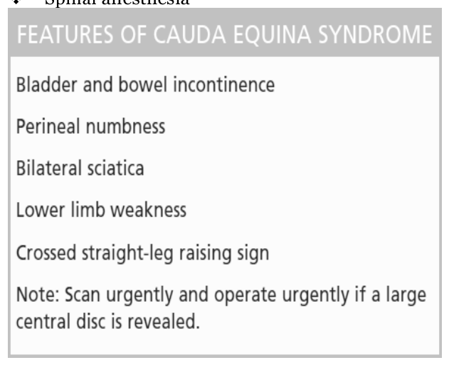

Source page 68

**173. Cauda equina syndrome may occur due to fracture of:**

*Answer: C — Lumbar Vertebra*

Cauda equina syndrome most often results from a massive lumbar disc herniation, and a lumbar vertebral fracture can also compress the cauda. The cord ends at L1 to L2, so below that level the nerve roots of the cauda are at risk. Other causes include spinal tumours, infection, lumbar stenosis, violent injuries to the lower back, spinal AVMs and postoperative complications. It is an orthopaedic emergency.

Source page 69

**174. Which of the following is the most frequent initial manifestation of ankylosing spondylitis?**

*Answer: D — Inflammatory back pain*

Inflammatory back pain is the usual initial manifestation of ankylosing spondylitis, with neck pain and stiffness coming years later. Acute iritis is a recognised association but not the presenting feature. The ankylosed spine is osteoporotic and prone to fracture, so new neck pain must be treated as a fracture until excluded.

Source page 69

**175. Froment sign is a physical examination to test palsy of**

*Answer: A — Ulnar nerve*

Froment's sign tests for ulnar nerve palsy. The patient pinches a piece of paper between thumb and index finger; with a weak adductor pollicis the flexor pollicis longus, supplied by the median nerve, substitutes and the thumb interphalangeal joint flexes. Ulnar nerve palsy may arise at the cervical spine, the elbow in cubital tunnel syndrome, or the wrist in Guyon canal syndrome.

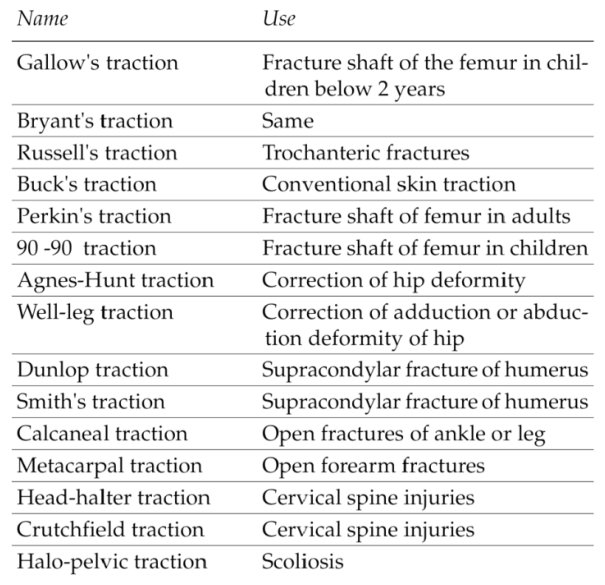

Source page 69

**176. Which test is used in the diagnosis of De Quervain's tenosynovitis?**

*Answer: C — Finkelstein's test*

Finkelstein's test, in which the thumb is adducted across the palm and the wrist ulnar deviated, reproduces the pain of De Quervain's tenosynovitis. The condition affects the common sheath of abductor pollicis longus and extensor pollicis brevis, with tenderness over the radial styloid. Adson's test is for thoracic outlet syndrome, Dugas' for anterior shoulder dislocation and Thomas' for hip flexion deformity.

Source page 70

**177. Russell's traction is used for:**

*Answer: B — Trochanteric fractures*

The source keys Russell's traction to trochanteric fractures. Skin traction such as Gallows is used for femoral shaft fractures in young children, and cervical spine injuries are managed with skeletal traction such as Crutchfield tongs or halo. Russell traction combines a sling under the knee with longitudinal pull to align the femur.

Source page 70

### 17. Anesthesia

**178. Which of the following devices provides fixed O2 concentration?**

*Answer: C — Venturi device*

The Venturi mask delivers a fixed oxygen concentration. It works on the Venturi principle: gas passed through a narrow orifice at high pressure creates shearing forces that entrain room air in a specific ratio, and the colour coding sets the fraction delivered, blue giving 24 percent and green 60 percent. Nasal prongs and simple face masks deliver variable concentrations. High flow systems include the Venturi mask, special nebulizers and high airflow blenders.

Source page 70

**179. Which among the following will be the induction agent of choice in an asthmatic patient?**

*Answer: B — Propofol*

Propofol is a reasonable bronchodilator without the side effects of ketamine, so it is the preferred induction agent in asthma. Ketamine has the best bronchodilator property but is avoided because of vivid reactions and increased tracheobronchial secretions, and is reserved for active wheezing in life-threatening emergency surgery. Thiopentone can cause bronchoconstriction and should be avoided. Sevoflurane is the maintenance agent of choice.

Source page 71

**180. Contraindications to using succinylcholine include the following except?**

*Answer: C — Paralytic ileus*

Paralytic ileus is not a contraindication to suxamethonium, so it is the exception. Contraindications include hyperkalaemia, raised intracranial pressure, glaucoma and eye injuries, renal failure, prolonged intra-abdominal infection, shock, atypical or low pseudocholinesterase, muscular dystrophies, and burns, spinal cord injury, paraplegia or tetanus, where the risk is greatest from one week to two months after burns. The danger in all of these is an exaggerated potassium release.

Source page 71

**181. Which among the following is used for the reversal of a non-depolarizing neuromuscular blocking agent?**

*Answer: B — Neostigmine*

Neostigmine reverses non-depolarizing neuromuscular blockade by reversibly inhibiting acetylcholinesterase. A dose of 0.5 to 2 mg intravenously, preceded by atropine or glycopyrrolate to block muscarinic effects, rapidly reverses paralysis from competitive blockers. Atropine alone only blocks muscarinic effects, dantrolene is for malignant hyperthermia, and acetylcholine is the transmitter, not a reversing agent.

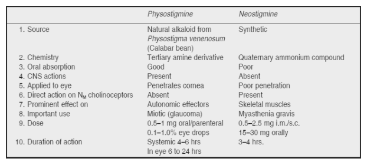

Source page 71

**182. A 60-year-old male patient with a history of chronic kidney disease is undergoing a urological procedure under general anesthesia. The anesthesiologist decides to use a neuromuscular blocking agent to facilitate endotracheal intubation and to achieve muscle relaxation during the surgical procedure. Which of the following is a commonly used non-depolarizing neuromuscular blocking agent with minimal renal excretion and is suitable for use in patients with renal impairment?**

*Answer: C — Cisatracurium*

Cisatracurium is the non-depolarizing blocker with minimal renal excretion, because it undergoes Hofmann elimination, so it is suitable in renal impairment. Succinylcholine is depolarizing and is contraindicated in renal failure because of the potassium rise. Rocuronium and vecuronium are non-depolarizing but are significantly renally excreted, so their action is prolonged in renal impairment.

Source page 71

**183. Which of the following is not a definite airway?**

*Answer: C — LMA*

A definitive airway is a cuffed tube placed in the trachea, secured and connected to assisted ventilation: orotracheal or nasotracheal tube, tracheostomy or cricothyroidotomy. The laryngeal mask airway is a supraglottic device that does not protect against aspiration, so it is not a definitive airway.

Source page 72

**184. Inhalation agent of choice for induction is:**

*Answer: B — Sevoflurane*

Sevoflurane is the inhalational agent of choice for induction because it is non-irritant and well tolerated, and it does not produce trifluoroacetic acid on metabolism, avoiding any risk of hepatitis. Desflurane and isoflurane are alternatives but are irritating to the airway. Halothane must be avoided because it can cause hepatitis and reduces hepatic and portal blood flow.

Source page 72

**185. The position used for intubation with flexion of atlanto-occipital extension and cervical vertebral flexion is known as:**

*Answer: C — Sniffing position*

The sniffing position combines flexion of the neck with extension of the head and is the standard position for endotracheal intubation. It is achieved by placing a pillow under the patient's occiput to align the oral, pharyngeal and laryngeal axes.

Source page 72

### 18. Psychiatry

**186. A 29-year-old female patient complains of depression, poor sleep quality, and breast tenderness. These symptoms occur on a monthly basis, about 2 weeks before menstruation. Her symptoms greatly improve with menses. What is the treatment of choice for this condition?**

*Answer: A — SSRI*

Symptoms confined to the luteal phase that resolve with menstruation are premenstrual dysphoric disorder, for which SSRIs are first choice. SSRIs are also first choice for OCD, panic disorder, social phobia, eating disorders and PTSD. Atypical antipsychotics and lithium are mood stabilisers with no role here, and SNRIs are an alternative rather than the first choice.

Source page 72

**187. A 33-year-old woman presents to OPD with history of sudden attacks of anxiety and dread and thus began to avoid public situations. Which is the likely diagnosis?**

*Answer: A — Panic disorder*

Repeated attacks of severe anxiety not restricted to any particular situation, with chest pain, palpitations and paraesthesia of the lips and fingers from hyperventilation, is panic disorder. Patients often fear a heart attack or stroke and seek emergency care. It is frequently associated with agoraphobia, which explains the avoidance of public situations.

Source page 73

**188. Three years back a woman suffered during an earthquake and she was successfully saved. After recovery she has nightmares about the episode and she also gets up in the night and feels terrified. The most probable diagnosis is:**

*Answer: B — Post-traumatic stress disorder*

A traumatic event followed by intrusive thoughts, nightmares, sleep disturbance, flashbacks, hypervigilance and avoidance is post-traumatic stress disorder. Onset is more than one month after the event with symptoms persisting more than a month. Acute stress disorder has the same picture but occurs from 3 days to 1 month after exposure.

Source page 73

### 19. Radiology

**189. Bone within bone appearance on Xray is seen in:**

*Answer: D — Osteopetrosis*

Bone within a bone is a classic appearance of autosomal dominant osteopetrosis, or marble bone disease, an uncommon hereditary disorder of defective osteoclasts. Bones become sclerotic and thick but are weak and brittle. Other features are Erlenmeyer flask deformity of the tubular bones, sandwich vertebrae with endplate sclerosis and a lucent centre, and alternating radiolucent metaphyseal bands.

Source page 74

**190. A 60-year-old female patient with a history of renal impairment is scheduled for a coronary angiogram with intravenous contrast dye. The physician is concerned about the potential risk of contrast-induced nephropathy (CIN) and wants to take measures to prevent its occurrence. Which of the following is a pre-procedural measure that can be taken to prevent CIN in this patient?**

*Answer: C — Administering intravenous fluids*

Intravenous fluid administration before the procedure is the key preventive measure for contrast-induced nephropathy: it increases renal perfusion and prevents the dehydration that contributes to injury. Other measures are low-osmolar or iso-osmolar contrast, limiting contrast volume, and avoiding nephrotoxic drugs around the procedure. A high contrast dose does the opposite, and withholding fluids for 12 hours would worsen the risk.

Source page 74

**191. You witness a 50-year-old man suddenly collapse at a restaurant. You approach him and confirm that he is unresponsive and not breathing. What is the appropriate compression to ventilation ratio for this individual when giving CPR?**

*Answer: B — 30:2*

For adult CPR the compression to ventilation ratio is 30:2. Compressions should be at least 2 inches deep at a rate of 100 to 120 per minute with full chest recoil between compressions. CPR should begin as soon as possible and emergency medical services called immediately.

Source page 74

**192. Which of the following is not a component of Basic Life Support?**

*Answer: D — Intubation*

Intubation is an advanced airway skill and belongs to advanced life support, not basic life support. BLS covers recognition of collapse, calling for help, opening the airway, rescue breathing, chest compressions and use of an automated external defibrillator, aiming to maintain circulation until definitive treatment is available.

Source page 74

**193. A 23-year-old patient was brought to the ER after he underwent a motor vehicle accident. On arrival, pulse was 120/min, BP=80/60 mm Hg, RR=6/min and GCS was 4/15. What will be the next best step in management?**

*Answer: C — Intubation*

With a respiratory rate of 6 and a GCS of 4 the patient cannot protect his airway, so intubation is the next step, alongside resuscitation of the circulation. Fluids alone leave the airway unprotected and the hypoventilation uncorrected. This is a trauma patient with a depressed level of consciousness and inadequate breathing.

Source page 75

**194. A 65-year-old man with a history of hypertension and coronary artery disease is brought to the emergency department after collapsing at home. On arrival, he is found to be unresponsive, pulseless, and not breathing. The emergency medical team initiates cardiopulmonary resuscitation (CPR) and administers advanced cardiac life support (ACLS) measures. After several minutes of resuscitative efforts, the patient's pulse returns, and he starts to breathe spontaneously. The team continues to monitor his vital signs closely for signs of ROSC.**

*Answer: D — Seizure*

Return of spontaneous circulation is shown by movement, coughing or breathing together with a palpable pulse or measurable blood pressure. A seizure is not a sign of ROSC. ROSC is a favourable sign but does not predict a good long-term outcome, and it can be delayed well after resuscitation has stopped, the Lazarus phenomenon, which is why passive monitoring for 10 minutes is recommended.

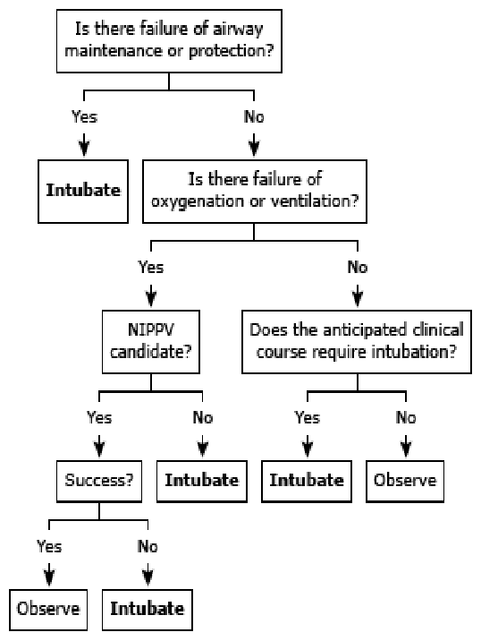

Source page 75

**195. A man is suffering from covid-19. The classification of COVID according to CORADS is done based on**

*Answer: B — CT scan*

CO-RADS categorises a non-enhanced chest CT scan according to the likelihood of COVID-19 with lung involvement. There are seven categories, from CO-RADS 1 for very low risk to CO-RADS 6 for proven infection by a positive RT-PCR assay. The scheme was developed and tested in patients with moderate to severe disease.

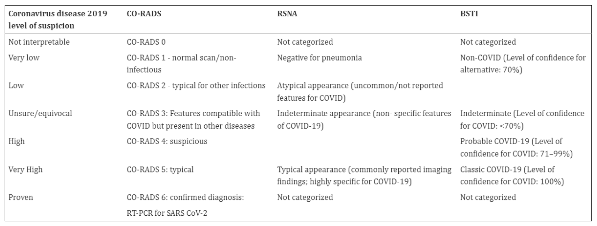

Source page 75

**196. Lethal triad of trauma consists of all of the following except:**

*Answer: D — Respiratory Alkalosis*

The lethal triad of trauma is coagulopathy, acidosis and hypothermia, so respiratory alkalosis is the exception. Hypothermia inhibits fibrinogen synthesis while acidosis accelerates fibrinogen degradation, creating a deficit in fibrinogen availability. Coagulation problems from acidosis cannot be corrected by pH neutralisation alone.

Source page 76

**197. Hospices is**

*Answer: B — Place for end-of-life care*

Hospice care provides compassionate end-of-life care for people with an advanced, life-limiting illness, treating the person and their symptoms rather than the disease itself. It is used when a disease such as advanced cancer can no longer be cured or controlled, generally when life expectancy is about 6 months or less. It is family-centred and affirms life without hastening or postponing death.

Source page 76

**198. The capacity to think, decide and act on the bases of thought and decision freely & independently (without let or hindrance) best describes**

*Answer: A — Autonomy*

This describes autonomy, the power or right of self-determination. Respect for autonomy includes the patient's right to refuse therapy, and it underpins truth-telling, informed consent and confidentiality. Beneficence is acting in the patient's best interests, non-maleficence is doing no harm, and justice concerns fair distribution of care.

Source page 76

**199. Which of the following conditions require violation of confidentiality:**

*Answer: B — Disease of public concern*

A disease of public health concern requires disclosure to public health officials, and is one of the recognised exceptions to confidentiality, along with injuries that could prompt a criminal investigation, danger to self or others, a communicable disease such as HIV, and health insurance complications. Rare disease, pregnancy and financial difficulty are not exceptions. Otherwise information may be disclosed only with consent or when required by law.

Source page 78

**200. A 70-year-old male patient presents to the emergency department with a witnessed cardiac arrest. The patient received prompt cardiopulmonary resuscitation (CPR) and defibrillation. After several rounds of CPR, the patient regains a pulse and blood pressure. The doctor explains to the team that the patient has achieved Return of Spontaneous Circulation (ROSC). Which of the following best describes the next steps in management?**

*Answer: D — Initiate a targeted temperature management protocol*

After ROSC the focus shifts to optimising neurological outcome, which means initiating a targeted temperature management protocol along with adequate oxygenation and blood pressure control. Continuing CPR is unnecessary once circulation has returned. Epinephrine may have been used during CPR but is not a long-term strategy, and immediate uncontrolled cooling is replaced by the controlled targeted temperature protocol.

Source page 78

---

## Blueprint

| Subject | Questions | Share |
|---|---|---|
| Anatomy | 13 | 6% |
| Biochemistry | 5 | 2% |
| Community Medicine | 7 | 4% |
| Microbiology | 6 | 3% |
| Pathology | 6 | 3% |
| Pharmacology | 13 | 6% |
| Physiology | 13 | 6% |
| Forensic Medicine | 6 | 3% |
| Medicine | 28 | 14% |
| Surgery | 18 | 9% |
| Obstetrics & Gynecology | 15 | 8% |
| Pediatrics | 12 | 6% |
| Dermatology | 4 | 2% |
| ENT | 11 | 6% |
| Ophthalmology | 8 | 4% |
| Orthopedics | 12 | 6% |
| Anesthesia | 8 | 4% |
| Psychiatry | 3 | 2% |
| Radiology | 12 | 6% |
| **Total** | **200** | **100%** |

Answer key spread: A 75, B 54, C 35, D 36.

---

## Notes on the source

Four items in the source needed a call, and each is flagged in the explanation above:

1. **Q46** asks which enzyme *inhibits* the OCP and lists ketoconazole alongside three inducers. Ketoconazole is the only inhibitor, so it is keyed, with a note that the clinically dangerous interaction with the pill is induction by phenytoin, rifampicin and carbamazepine.
2. **Q54** keys uteroplacental circulation as fully established by the 10th week. True placental circulation begins around day 17, so the explanation gives both dates and answers the key as printed.
3. **Q144** keys an intensely pruritic ankle lesion to psoriasis, which is usually only mildly itchy. The key is followed and the discrepancy is stated.
4. **Q163** keys sudden visual loss with a flame-shaped haemorrhage to central retinal artery occlusion, though flame haemorrhages are more typical of venous occlusion. The key is followed and the classical arterial picture is described.

Two further items are internally inconsistent in the source and are noted in place: **Q59** calls 150 mL the end systolic volume while the arithmetic and key both make it the end diastolic volume, and **Q30** lists Coccidioides immitis with the dimorphic fungi even though it is not thermally dimorphic.

---

## Files

- Bank id `cee4`, registered in `surgery-practice.html` under **CEE MD/MS** as *CEE Model Exam Set 4*.
- Figures: 45 PNG crops in `cee-img/`, named `cee4-qNNN-n.png`.
- Runs as five timed blocks of 40, with all 19 chapter sources available.
