# CEE Model Exam Set 5

**193 questions · 19 subjects · CEE MD/MS entrance practice**

Source: `CEE MDMS Bhadra 20.pdf` (PDF pages 3–110). Every question below is carried over from that paper with its answer key and explanation; page citations point back to the PDF.

---

## Contents

| Subject | Questions | Range |
| --- | --- | --- |
| Medicine | 20 | Q1–Q20 |
| Surgery | 20 | Q21–Q40 |
| Obstetrics & Gynecology | 10 | Q41–Q50 |
| Pediatrics | 15 | Q51–Q65 |
| Orthopedics | 10 | Q66–Q75 |
| ENT | 10 | Q76–Q85 |
| Anesthesia | 7 | Q86–Q92 |
| Ophthalmology | 8 | Q93–Q100 |
| Dermatology | 4 | Q101–Q104 |
| Psychiatry | 7 | Q105–Q111 |
| Radiology | 5 | Q112–Q116 |
| Anatomy | 13 | Q117–Q129 |
| Physiology | 11 | Q130–Q140 |
| Pathology | 10 | Q141–Q150 |
| Pharmacology | 9 | Q151–Q159 |
| Forensic Medicine | 6 | Q160–Q165 |
| Microbiology | 8 | Q166–Q173 |
| Biochemistry | 7 | Q174–Q180 |
| Community Medicine | 13 | Q181–Q193 |

---

## Questions

### 1. Examination findings such as a tapping apex beat, loud S1, and a mid-diastolic murmur accentuated with pre-systolic accentuation are seen in?

*Medicine · PDF p.3*

- **A.** Mitral regurgitation
- **B.** Mitral stenosis
- **C.** Aortic regurgitation
- **D.** Aortic stenosis

### 2. Which organism is most likely responsible for the development of prosthetic valve endocarditis in a patient following valve replacement surgery?

*Medicine · PDF p.3*

- **A.** Staphylococcus epidermidis
- **B.** Staphylococcus aureus
- **C.** Coagulase negative staphylococci
- **D.** HACEK organisms

### 3. During cardiopulmonary resuscitation (CPR), what is the most commonly injured solid organ?

*Medicine · PDF p.4*

- **A.** Kidneys
- **B.** Spleen
- **C.** Liver
- **D.** Lungs

### 4. Which of the following is the earliest feature of Grave’s Ophthalmopathy?

*Medicine · PDF p.4*

- **A.** Proptosis
- **B.** Lid lag
- **C.** Exposure keratitis
- **D.** Diplopia

### 5. What is not observed in Tumor Lysis Syndrome?

*Medicine · PDF p.5*

- **A.** Hypophosphatemia
- **B.** Hypocalcemia
- **C.** Hyperuricemia
- **D.** Hyperkalemia

### 6. A kidney biopsy showed a starry sky appearance in an immunofluorescence study is seen in?

*Medicine · PDF p.5*

- **A.** PSGN
- **B.** Bergers disease
- **C.** IgA nephropathy
- **D.** FSGS

### 7. Urinary tract infections in a patient with triple phosphate stones is caused by?

*Medicine · PDF p.7*

- **A.** Escherichia coli
- **B.** Klebsiella pneumoniae
- **C.** Enterococcus faecalis
- **D.** Proteus mirabilis

### 8. Which preparation of the drug of choice for a 12-year-old female with symptoms of hyperglycemia,dehydration, and positive urine glucose and ketones has the shortest duration of action?

*Medicine · PDF p.8*

- **A.** Regular
- **B.** NPH
- **C.** Glargine
- **D.** Lispro

### 9. Which of the following is associated with the presence of c-ANCA antibodies?

*Medicine · PDF p.9*

- **A.** Granulomatosis with polyangiitis (Wegener’s granulomatosis)
- **B.** Microscopic polyangiitis
- **C.** Polyarteritis nodosa
- **D.** Churg-Strauss syndrome

### 10. Which of the following condition leads to the development of wing beating tremor?

*Medicine · PDF p.10*

- **A.** Wilson’s disease
- **B.** Huntington’s chorea
- **C.** Parkinsonism
- **D.** Sydenham’s chorea

### 11. Which of the following is not a parameter used in the MELD score?

*Medicine · PDF p.11*

- **A.** Serum bilirubin
- **B.** Albumin
- **C.** INR
- **D.** Serum creatinine

### 12. A 30-year-old man who has been studying the ecological changes at Mount Everest base camp for the past 2 weeks gets a blood gas analysis done. His ABG analysis shows: pH = 7.51 PCO2 = 25 mmHg HCO3 = 19 mEq/L. What is the diagnosis?

*Medicine · PDF p.11*

- **A.** Uncompensated respiratory acidosis
- **B.** Partially compensated respiratory acidosis
- **C.** Uncompensated respiratory alkalosis
- **D.** Partially compensated respiratory alkalosis

### 13. Friedlander Pneumonia refers to pneumonia caused by?

*Medicine · PDF p.12*

- **A.** Klebsiella
- **B.** Streptococcus Pneumonia
- **C.** Haemophilus Influenzae
- **D.** Staphylococcus

### 14. According to the Berlin definition, which of the following is not a characteristic of moderate ARDS?

*Medicine · PDF p.13*

- **A.** 200 < PaO2/FiO2 =<300mm/Hg with PEEP is moderate
- **B.** Bilateral interstitial infiltrates
- **C.** Symptom onset within a week
- **D.** No cardiac failure in echocardiography

### 15. A 48-year-old male came complaining of odynophagia. On endoscopy, shallow punched-out ulcers with a few vesicles are seen on the lower 1/3rd of the esophagus. Which of the following is the likely diagnosis?

*Medicine · PDF p.13*

- **A.** CMV esophagitis
- **B.** Candida esophagitis
- **C.** Corrosive esophagitis
- **D.** Herpes simplex esophagitis

### 16. What is the probable diagnosis characterized by Auer rods on the peripheral blood smear?

*Medicine · PDF p.14*

- **A.** M3-AML
- **B.** M4-AML
- **C.** M2-AML
- **D.** M5-AML

### 17. A female is diagnosed with the alpha-thalassemia trait. Which of the following will be found in this patient’s electrophoresis study?

*Medicine · PDF p.14*

- **A.** Increased HbF & normal HbA2
- **B.** Normal HbF & normal HbA2
- **C.** Normal HbF & decreased HbA2
- **D.** Decreased HbF & normal HbA2

### 18. A 28-year-old patient presents with chronic abdominal pain, diarrhea, and weight loss. A colonoscopy reveals a cobblestone pattern of the mucosa in the terminal ileum. What is the most likely diagnosis based on this clinical scenario?

*Medicine · PDF p.16*

- **A.** Ulcerative colitis
- **B.** Irritable bowel syndrome (IBS)
- **C.** Crohn’s disease
- **D.** Diverticulitis

### 19. Which of the following is not a condition where the Lhermitte sign is seen?

*Medicine · PDF p.17*

- **A.** Tabes dorsalis
- **B.** Cervical spondylosis
- **C.** Multiple sclerosis
- **D.** Neuromyelitis Optica

### 20. Which of the following is not associated with tuberculous meningitis?

*Medicine · PDF p.17*

- **A.** Basal exudates on NCCT
- **B.** Crackpot sign
- **C.** Sutural diastasis
- **D.** Obstructive hydrocephalus

### 21. Which structure is preserved during Patey’s modified radical mastectomy for invasive ductal carcinoma in a 65-year-old female?

*Surgery · PDF p.17*

- **A.** Intercostobrachial nerve
- **B.** Pectoralis major
- **C.** Pectoralis minor
- **D.** Axillary fascia

### 22. A 45-year-old man presented with a headache and flushing. He had a brother who had died of medullary carcinoma of the thyroid. Which of the following investigations would be required to diagnose this patient?

*Surgery · PDF p.18*

- **A.** Chest X-ray
- **B.** Measurement of 5-HIAA
- **C.** Fractionated plasma metanephrines
- **D.** Intravenous pyelography

### 23. A 50-year-old man presented to the physician due to neck swelling and difficulty swallowing. Examination revealed a 5 cm, mobile thyroid nodule. Which of the following is not true about the thyroid nodule?

*Surgery · PDF p.19*

- **A.** FNAC is the investigation of choice
- **B.** FNAC cannot distinguish follicular adenoma from carcinoma
- **C.** Managed by total thyroidectomy
- **D.** Cold nodules are diagnostic of malignancy

### 24. What is used preoperatively to control blood pressure during surgery in a 50-year-old male presenting with paroxysms of headache, vomiting, and palpitations with elevated urinary catecholamines?

*Surgery · PDF p.20*

- **A.** Beta-blocker
- **B.** Diuretic
- **C.** Irreversible alpha blocker
- **D.** None of the above

### 25. Which of the following statement is correct regarding the treatment of hydatid cysts?

*Surgery · PDF p.21*

- **A.** Drug of choice for hydatid cyst is mebendazole
- **B.** PAIR is the most preferred treatment, optionally
- **C.** Surgery is the most effective treatment for small cysts
- **D.** 3% hypertonic saline is most commonly used for PAIR

### 26. Which of the following is the initial investigation of choice for biliary obstruction?

*Surgery · PDF p.21*

- **A.** CT Abdomen
- **B.** Magnetic resonance cholangiopancreatography(MRCP)
- **C.** Endoscopic retrograde cholangiopancreatography (ERCP)
- **D.** Ultrasound (USG)

### 27. Which part of pancreatic cancer has best prognosis?

*Surgery · PDF p.22*

- **A.** Head
- **B.** Tail
- **C.** Body
- **D.** Periampullary

### 28. What is the gold standard of investigation for diagnosing gastroesophageal reflux disease (GERD)?

*Surgery · PDF p.22*

- **A.** Barium swallow
- **B.** Endoscopy
- **C.** 24-hour pH monitoring
- **D.** Esophageal manometry

### 29. Which vessel requires ligation to control bleeding in a bleeding peptic ulcer in the proximal duodenum?

*Surgery · PDF p.22*

- **A.** Gastroduodenal artery
- **B.** Superior pancreaticoduodenal artery
- **C.** Left gastric artery
- **D.** Left gastroepiploic artery

### 30. Mucinous cystic tumor of which of the following organs is most likely to be associated with pseudomyxoma peritonei?

*Surgery · PDF p.23*

- **A.** Pancreas
- **B.** Kidney
- **C.** Ovary
- **D.** Testis

### 31. Which of the following is the most common electrolyte imbalance that causes paralytic ileus?

*Surgery · PDF p.23*

- **A.** Hyponatremia
- **B.** Hypernatremia
- **C.** Hypokalemia
- **D.** Hyperkalemia

### 32. The appendicular artery arises from which of the following arteries?

*Surgery · PDF p.24*

- **A.** Right colic artery
- **B.** Ileocolic artery
- **C.** Posterior cecal artery
- **D.** Superior mesenteric artery

### 33. What is the management of hydrocele of the hernial sac in 3-year-old child?

*Surgery · PDF p.24*

- **A.** Herniotomy
- **B.** Herniorrhaphy
- **C.** Observation only
- **D.** Operate after 5 years of age

### 34. Positive Kehr sign is seen in which of the following?

*Surgery · PDF p.25*

- **A.** Splenic injury
- **B.** Liver injury
- **C.** Renal injury
- **D.** Mesenteric hematoma

### 35. Among the options provided, which one is NOT acknowledged as a potential complication resulting from a significant blood transfusion?

*Surgery · PDF p.26*

- **A.** Hypocalcemia
- **B.** Hypokalemia
- **C.** Hypothermia
- **D.** Hypernatremia

### 36. Which test should be performed before using a radial artery for grafting in a patient undergoing coronary artery bypass graft (CABG)?

*Surgery · PDF p.26*

- **A.** Tinel’s test
- **B.** Allen’s test
- **C.** Phalen’s test
- **D.** Froment’s test

### 37. A 50-year-old woman presents with persistent cough, fatigue, and generalized muscle weakness. On examination, she has proximal muscle weakness and diminished reflexes. Laboratory tests show elevated levels of serum calcium. Imaging reveals a lung mass, and biopsy confirms Small Cell Lung Carcinoma. Which of the following paraneoplastic syndromes is most likely associated with this patient’s presentation?

*Surgery · PDF p.27*

- **A.** Acanthosis Nigricans
- **B.** SIADH
- **C.** Lambert-Eaton Syndrome
- **D.** Cushing Syndrome

### 38. Which one of the following cases is considered a clean-contaminated wound?

*Surgery · PDF p.28*

- **A.** Open cholecystectomy for cholelithiasis
- **B.** Herniorrhaphy with mesh repair
- **C.** Lumpectomy with axillary node dissection
- **D.** Appendectomy with walled-off abscess

### 39. Which structure prevents Horse-shoe kidneys from ascending?

*Surgery · PDF p.28*

- **A.** Superior mesenteric artery
- **B.** Superior mesenteric vein
- **C.** Inferior mesenteric artery
- **D.** Inferior mesenteric vein

### 40. Which of the following is the best guide for managing fluid resuscitation?

*Surgery · PDF p.29*

- **A.** Central venous pressure
- **B.** Urine output
- **C.** Blood pressure
- **D.** Saturation of Oxygen

### 41. A 25-year-old female trying to conceive has a normal inhibin level. What is the primary action of Inhibin?

*Obstetrics & Gynecology · PDF p.29*

- **A.** It inhibits the secretion of prolactin
- **B.** It stimulates the synthesis of estradiol.
- **C.** It stimulates the secretion of TSH
- **D.** It inhibits the secretion of FSH

### 42. A 20-year-old woman gives a history of sharp pain in the lower abdomen for 2-3 days every month approximately 2 weeks before the menses. The most probable etiology for her pain is

*Obstetrics & Gynecology · PDF p.30*

- **A.** Ovarian cyst rupture
- **B.** Dysmenorrhea
- **C.** Endometriosis
- **D.** Mittelschmerz

### 43. What is the most common site of endometriosis?

*Obstetrics & Gynecology · PDF p.31*

- **A.** Fallopian tube
- **B.** Uterus
- **C.** Ovary
- **D.** Pouch of Douglas

### 44. A 28-year-old woman underwent a fertility-sparing surgery for a 6x6 cm granulosa cell ovarian tumor. Which one of the following will you monitor for detection of recurrence?

*Obstetrics & Gynecology · PDF p.31*

- **A.** CA 125
- **B.** LDH
- **C.** Inhibin B
- **D.** Placental Alkaline phosphatase (PLAP)

### 45. What condition represents an absolute contraindication for the insertion of an intrauterine contraceptive device (IUCD)?

*Obstetrics & Gynecology · PDF p.33*

- **A.** Past history of treated PID
- **B.** Unexplained vaginal bleeding
- **C.** Previous ectopic
- **D.** Patient with HIV

### 46. A 21-year-old woman presents with complaints of primary amenorrhea. Her height is 153 cm, weight is 51 kg. She has well-developed breasts. She has no pubic or axillary hair and no hirsutism. Which of the following is the most probable diagnosis?

*Obstetrics & Gynecology · PDF p.33*

- **A.** Turner syndrome
- **B.** Stein-Leventhal syndrome
- **C.** Complete androgen insensitivity syndrome
- **D.** Premature ovarian failure

### 47. Which of the following is not a risk factor for the development of carcinoma cervix?

*Obstetrics & Gynecology · PDF p.34*

- **A.** HPV 16
- **B.** Hypertension and IUCD use
- **C.** Multiparity and low socio-economic status
- **D.** Multiparity and smoking

### 48. Following the management of a complete mole, how long does it typically take for human chorionic gonadotropin (hCG) levels to normalize?

*Obstetrics & Gynecology · PDF p.35*

- **A.** 6 weeks
- **B.** 12 weeks
- **C.** 8 weeks
- **D.** 9 weeks

### 49. A 33-year-old pregnant lady presents for a routine checkup at 34 weeks of gestation. She is found to be HBsAg positive. Which of the following is the best way to prevent infection in a child?

*Obstetrics & Gynecology · PDF p.36*

- **A.** Hepatitis B vaccine to the child
- **B.** Full course of Hepatitis B vaccine and immunoglobulin to the child
- **C.** Antiviral therapy after baby tests positive
- **D.** No management required for a healthy neonate

### 50. What fetal anomalies are associated with lithium treatment during pregnancy?

*Obstetrics & Gynecology · PDF p.36*

- **A.** Neural tube defects
- **B.** Facial defects
- **C.** Urogenital defects
- **D.** Cardiac defect

### 51. Which of the following is the typical sequence of eruption of milk teeth?

*Pediatrics · PDF p.37*

- **A.** Lower central incisor →Lateral incisor →canine →1st molar →2 molar
- **B.** Lower central incisor →Lateral incisor →1st molar→ canine →2 molar
- **C.** Lower central incisor →Lateral incisor →1st molar→2nd molar →canine
- **D.** Lateral incisor →Lower central incisor →1st molar→2nd molar →canine

### 52. A child with IQ of 55 comes under:

*Pediatrics · PDF p.38*

- **A.** Mild MR
- **B.** Moderate MR
- **C.** Severe MR
- **D.** Profound MR

### 53. Which is the most specific neurological abnormality in infants of diabetic mothers?

*Pediatrics · PDF p.38*

- **A.** Sacral agenesis
- **B.** Neural tube defects
- **C.** Hydrocephalus
- **D.** Dilated large ventricle

### 54. Which of the following is the best initial feeding method for a baby born at 27 weeks of gestation?

*Pediatrics · PDF p.39*

- **A.** Orogastric tube feeding [gavage feeding]
- **B.** Katori spoon paladai feeding
- **C.** IV fluids ± TPN (total parenteral nutrition)
- **D.** Direct breastfeeding

### 55. What is the definition of hypoglycemia in cases of severe acute malnutrition?

*Pediatrics · PDF p.39*

- **A.** Blood glucose level < 60 mg/dl
- **B.** Blood glucose level < 75 mg/dl
- **C.** Blood glucose level < 190 mg/dl
- **D.** Blood glucose level <54 mg/dl

### 56. Which of the following options shows the correct characteristic finding of the disease?

*Pediatrics · PDF p.39*

- **A.** Forchheimer spotsspot: Erythema infectiosum
- **B.** Koplik spots: Rubeola
- **C.** Slapped cheek appearance: Molluscum contagiosum
- **D.** Nodular rash: Rubella

### 57. What is the first-line treatment for an otherwise healthy child presenting with multiple daily episodes of sudden blank staring, unresponsiveness, and eye fluttering, lasting for a few seconds?

*Pediatrics · PDF p.40*

- **A.** Phenytoin
- **B.** Valproic acid
- **C.** Ethosuximide
- **D.** Levetiracetam

### 58. Select the characteristic feature of a disease in a 54-year-old man presenting with hemoptysis, hematuria, and anemia.

*Pediatrics · PDF p.40*

- **A.** Lumpy-bumpy deposits on immunofluorescence
- **B.** Serum antibodies against alpha 3 NC 1 domain of collagen-IV
- **C.** Serum antibodies against alpha 3 NC 1 domain of collagen-VI
- **D.** Anti-DNase antibodies positive

### 59. Which one of the following is not a component of essential newborn care?

*Pediatrics · PDF p.41*

- **A.** Thorough drying
- **B.** Assessment of heart rate
- **C.** Skin to skin contact
- **D.** Early initiation of breastfeeding

### 60. Which of the following is a major criterion used to assess the presence of congenital heart diseases?

*Pediatrics · PDF p.41*

- **A.** Systolic murmur < Grade 3
- **B.** Abnormal S2
- **C.** Abnormal BP
- **D.** Any diastolic murmur

### 61. What is the dose of zinc in a 5-month-old child who presented with episodes of loose stools?

*Pediatrics · PDF p.42*

- **A.** 10 mg/day for 14 days
- **B.** 20 mg/day for 14 days
- **C.** 15 mg/day for 14 days
- **D.** 25 mg/day for 14 days

### 62. Which of the following inhalation treatment method is preferred for younger children aged from 1 to 3 years old?

*Pediatrics · PDF p.42*

- **A.** MDI with spacer with face mask
- **B.** MDI with spacer preferred
- **C.** Only MDI directly
- **D.** Rotacap

### 63. How many domains of development are involved in global developmental delay?

*Pediatrics · PDF p.43*

- **A.** Five or more domains
- **B.** Four or more domains
- **C.** Two or more domains
- **D.** Six or more domains

### 64. What is the most sensitive antenatal USG finding of Trisomy 21?

*Pediatrics · PDF p.43*

- **A.** Absent nasal bone
- **B.** Thickened nuchal fold
- **C.** Short femur
- **D.** Echogenic bowel

### 65. Which of the following vaccines is contraindicated for persons who are allergic to eggs?

*Pediatrics · PDF p.44*

- **A.** MMR
- **B.** Yellow Fever
- **C.** DPT
- **D.** BCG

### 66. Ring sequestrum is seen in?

*Orthopedics · PDF p.45*

- **A.** Fungal infection
- **B.** Septic arthritis
- **C.** Pin tract infections
- **D.** Acute osteomyelitis

### 67. The earliest radiological sign in Pott’s disease is:

*Orthopedics · PDF p.45*

- **A.** Erosion of vertebral bodies
- **B.** Collapse and destruction of vertebra
- **C.** Narrowing of intervertebral disc space
- **D.** Paraspinal soft tissue shadow

### 68. Osteoblastic secondaries are seen in:

*Orthopedics · PDF p.46*

- **A.** Prostate metastasis
- **B.** Lung metastasis
- **C.** Bladder metastasis
- **D.** Stomach metastasis

### 69. A patient with gunshot wound in tibia presents with comminuted fracture tibia with 2 cm wound. This belongs to what grade of Gustilo-Anderson classification of open fractures:

*Orthopedics · PDF p.46*

- **A.** Grade 1
- **B.** Grade 2
- **C.** Grade 3a
- **D.** Grade 3b

### 70. Three bony point relationship is maintained in:

*Orthopedics · PDF p.47*

- **A.** Supracondylar Fracture humerus
- **B.** Dislocation of elbow
- **C.** Fracture Lateral condyle
- **D.** Intercondylar Fracture

### 71. A patient presented with Saddle anaesthesia, bladder and bowel are normal and muscle power is normal. The diagnosis is:

*Orthopedics · PDF p.47*

- **A.** Cauda equina syndrome
- **B.** L3-L4 root involvement
- **C.** Conus medullaris lesion
- **D.** L4-L5 disc prolapsed

### 72. Part of spine, involved in Rheumatoid arthritis is:

*Orthopedics · PDF p.47*

- **A.** Sacral
- **B.** Lumbar
- **C.** Thoracic
- **D.** Cervical

### 73. Rickets in infancy is characterized by the following except:

*Orthopedics · PDF p.48*

- **A.** Craniotabes
- **B.** Rachitic rosary
- **C.** Wide open fontanelles
- **D.** Bow legs

### 74. Compression of a nerve within the carpal tunnel produces inability to:

*Orthopedics · PDF p.48*

- **A.** Abduct the thumb
- **B.** Adduct the thumb
- **C.** Flex the distal phalanx of the thumb
- **D.** Oppose the thumb

### 75. Cotton’s fracture:

*Orthopedics · PDF p.48*

- **A.** Bimalleolar fracture
- **B.** Trimalleolar fracture
- **C.** Wrist subluxation
- **D.** Knee subluxation

### 76. What is the most likely causative organism for extreme pain, swelling, and purulent discharge with a positive Tragal sign in the right ear of a 35-year-old diabetic patient?

*ENT · PDF p.49*

- **A.** Pseudomonas aeruginosa
- **B.** Staphylococcus aureus
- **C.** Candida albicans
- **D.** Aspergillus niger

### 77. What is the neurosensory epithelium that covers the Saccule and the Utricle?

*ENT · PDF p.50*

- **A.** Cristae
- **B.** Cupula
- **C.** Macula
- **D.** Ampulla

### 78. In a 25-year-old patient with tubotympanic CSOM, which part of the middle ear is most commonly affected?

*ENT · PDF p.50*

- **A.** Postero-inferior region
- **B.** Postero-superior region
- **C.** Antero-inferior region
- **D.** Antero-superior region

### 79. Which branch of the facial nerve is responsible for lacrimation?

*ENT · PDF p.50*

- **A.** Greater superficial petrosal nerve
- **B.** Nerve to stapedius
- **C.** Chorda tympani nerve
- **D.** Nerve of Wrisberg

### 80. What is the diagnostic maneuver performed by an ENT surgeon when a patient presents with vertigo but no hearing loss?

*ENT · PDF p.51*

- **A.** Hampton’s maneuver
- **B.** Dix-Hallpike maneuver
- **C.** Epley’s maneuver
- **D.** Simon’s maneuver

### 81. Which sinus is absent at birth and the last to develop?

*ENT · PDF p.51*

- **A.** Frontal sinus
- **B.** Ethmoidal sinus
- **C.** Maxillary sinus
- **D.** Sphenoid sinus

### 82. Pott’s puffy tumor is

*ENT · PDF p.52*

- **A.** Subperiosteal abscess of frontal bone
- **B.** Subperiosteal abscess of ethmoid bone
- **C.** Mucocele of frontal bone
- **D.** Mucocele of ethmoid bone

### 83. Where is the most common site of origin for nasopharyngeal cancer?

*ENT · PDF p.52*

- **A.** Fossa of Rosenmuller
- **B.** Sphenopalatine foramen
- **C.** Eustachian tube opening
- **D.** Roof of the nasopharynx

### 84. Which of the following is not an elastic cartilage of the larynx?

*ENT · PDF p.52*

- **A.** Epiglottis
- **B.** Arytenoid cartilage
- **C.** Cuneiform cartilage
- **D.** Corniculate cartilage

### 85. Which nerve injury is responsible for anesthesia over the cheek region presenting with periorbital ecchymosis and step deformity following a motor vehicle accident?

*ENT · PDF p.53*

- **A.** Infra-orbital nerve
- **B.** Buccal nerve
- **C.** Infratrochlear nerve
- **D.** Mental nerve

### 86. What dosage of lignocaine with adrenaline would be suitable for the patient to achieve adequate nerve blockade?

*Anesthesia · PDF p.53*

- **A.** 7 mg/kg Body weight
- **B.** 4.5 mg/kg Body weight
- **C.** 2 mg/ kg Body weight
- **D.** 3 mg/kg Body weight

### 87. What is the appropriate preoperative fasting recommendation?

*Anesthesia · PDF p.53*

- **A.** 4 hours for solids in adults
- **B.** 2 hours for liquids in adults
- **C.** 2 hours for breast milk in infants
- **D.** 4 hours for solids in infants

### 88. What is the recommended position for inserting a Ryle’s tube?

*Anesthesia · PDF p.54*

- **A.** Supine with neck flexed
- **B.** Sitting with neck flexed
- **C.** Supine with neck extended
- **D.** Sitting with neck extended

### 89. Which local anesthetic can be administered via the intravenous route?

*Anesthesia · PDF p.55*

- **A.** Bupivacaine
- **B.** Lidocaine
- **C.** Ropivacaine
- **D.** Tetracaine

### 90. Which inducing agent is most likely accountable for the patient’s hallucinations and vivid dreams during the recuperation phase following anesthesia?

*Anesthesia · PDF p.55*

- **A.** Ketamine
- **B.** Propofol
- **C.** Thiopentone
- **D.** Etomidate

### 91. Which of the following inhalational anesthetic is a potent coronary artery vasodilator and known to cause coronary steal phenomenon?

*Anesthesia · PDF p.55*

- **A.** Isoflurane
- **B.** Sevoflurane
- **C.** Desflurane
- **D.** Halothane

### 92. Which device in conventional oxygen therapy will provide the highest FiO2?

*Anesthesia · PDF p.56*

- **A.** Venturi mask
- **B.** Hudson mask
- **C.** Non rebreathing mask
- **D.** High Flow Nasal Cannula

### 93. What is the name of the curved, self-sealing sutureless incision made during Small Incision Cataract Surgery (SICS)?

*Ophthalmology · PDF p.57*

- **A.** Linear incision
- **B.** Radial incision
- **C.** Sclerocorneal tunnel incision
- **D.** Clear corneal incision

### 94. Which of the following anti glaucoma drugs are being contraindicated in a person with sulfa allergies?

*Ophthalmology · PDF p.58*

- **A.** Latanoprost
- **B.** Dorzolamide
- **C.** Brimonidine
- **D.** Pilocarpine

### 95. Which type of corneal opacity involves <1/3 of the stroma and appears as a faint white color?

*Ophthalmology · PDF p.58*

- **A.** Nebular
- **B.** Macular
- **C.** Leucoma
- **D.** Chlorpromazine deposits

### 96. Arlt’s line is seen in

*Ophthalmology · PDF p.59*

- **A.** Vernal keratoconjunctivitis
- **B.** Phyctenular keratoconjunctivitis
- **C.** Trachoma
- **D.** Pterygium

### 97. What will be observed in a patient who has a confirmed diagnosis of sympathetic ophthalmitis, and a history of penetrating eye injury?

*Ophthalmology · PDF p.59*

- **A.** Acute anterior uveitis
- **B.** Pars planitis
- **C.** Panuveitis
- **D.** Chronic anterior uveitis

### 98. Which of the following is the most dangerous intraocular foreign body?

*Ophthalmology · PDF p.60*

- **A.** Iron
- **B.** Copper
- **C.** Nickel
- **D.** Aluminium

### 99. What is the diagnosis of a 50 year old male with thickened, yellowish discoloration, subungual hyperkeratosis, onycholysis without any inflammation and pain?

*Ophthalmology · PDF p.60*

- **A.** Onychogryphosis
- **B.** Paronychia
- **C.** Nail psoriasis
- **D.** Tinea unguium

### 100. Which cranial nerves are affected in “Ramsay Hunt Syndrome”?

*Ophthalmology · PDF p.61*

- **A.** CN VII and IX
- **B.** CN V and VIII
- **C.** CN VII and V
- **D.** CN IX and VIII

### 101. What is the probable diagnosis for a 30-year-old patient who has presented with flaccid bullae on her skin that are prone to easy rupture, with the biopsy showing a suprabasal split?

*Dermatology · PDF p.62*

- **A.** Pemphigus vulgaris
- **B.** Pemphigus foliaceus
- **C.** Pemphigus vegetans
- **D.** Erythema multiforme

### 102. Which of the following is causative organism for causing granuloma venereum?

*Dermatology · PDF p.62*

- **A.** Treponema pallidum
- **B.** Haemophilus ducreyi
- **C.** Chlamydia trachomatis
- **D.** Calymmatobacterium granulomatis

### 103. What is the diagnosis of a 28 year old female with vaginal discharge and itching, wet smear reveals numerous white blood cells, clue cells and lack of lactobacilli?

*Dermatology · PDF p.63*

- **A.** Candidiasis
- **B.** Trichomoniasis
- **C.** Bacterial vaginosis
- **D.** Atrophic vaginitis

### 104. Characteristic feature associated with skin of preterm babies is:

*Dermatology · PDF p.63*

- **A.** Absence of Stratum Basale
- **B.** Absence of Stratum Granulosum
- **C.** Absence of Stratum Corneum
- **D.** Absence of Stratum Lucidum

### 105. A 35-year-old woman is convinced that her colleagues at work are constantly plotting against her and trying to harm her. Despite reassurances from her colleagues and evidence to the contrary, she firmly holds onto this belief. This scenario is an example of:

*Psychiatry · PDF p.64*

- **A.** Delusion of Persecution
- **B.** Delusion of Grandiosity
- **C.** Delusion of Reference
- **D.** Delusion of Nihilism

### 106. What is the most likely diagnosis for a patient with a history of chronic schizophrenia, on high-dose typical antipsychotic medication for the past 10 years, and presenting with abnormal involuntary movements involving lip smacking, tongue protrusion, and choreiform hand movements that worsen during periods of stress?

*Psychiatry · PDF p.64*

- **A.** Akathisia
- **B.** Acute Dystonia
- **C.** Tardive dyskinesia
- **D.** Parkinsonism

### 107. Which of the following endocrine effects is associated with the use of lithium?

*Psychiatry · PDF p.65*

- **A.** Hypothyroidism
- **B.** Hyperglycemia
- **C.** Hypernatremia
- **D.** Hypercalcemia

### 108. Which psychological therapy is considered the first-line treatment for Obsessive-Compulsive Disorder (OCD)?

*Psychiatry · PDF p.65*

- **A.** Cognitive Behavioural Therapy (CBT)
- **B.** Psychodynamic Psychotherapy
- **C.** Family Therapy
- **D.** Thought-stopping

### 109. Jet black pigmentation of the tongue with tactile hallucinations is a feature of:

*Psychiatry · PDF p.66*

- **A.** Heroin
- **B.** Opium
- **C.** Alcohol
- **D.** Cocaine

### 110. What is the most common indication for Electroconvulsive Therapy (ECT)?

*Psychiatry · PDF p.66*

- **A.** Schizophrenia
- **B.** Manic episodes
- **C.** Major Depressive Disorder
- **D.** Intractable seizure disorder

### 111. Which personality disorder is most likely to be diagnosed in a 30-year-old woman, Sarah who avoids social interactions, shows limited emotional expression, and lacks interest in close relationships or sexual activities?

*Psychiatry · PDF p.66*

- **A.** Schizoid personality disorder
- **B.** Borderline personality disorder
- **C.** Antisocial personality disorder
- **D.** Avoidant personality disorder

### 112. A 68-year-old patient presents with gait disturbances, cognitive decline, and urinary incontinence, raising suspicion of normal pressure hydrocephalus. What MRI finding is most likely associated with these clinical symptoms?

*Radiology · PDF p.67*

- **A.** Narrowing of the ventricles
- **B.** Dilated sulci
- **C.** Disproportionately enlarged subarachnoid space
- **D.** Hyperintense lesions in the periventricular white matter

### 113. In a 65-year-old male with COPD presenting with worsening dyspnea, pleuritic chest pain, and decreased breath sounds on the right side, the most sensitive X-ray view for evaluation is:

*Radiology · PDF p.67*

- **A.** PA view
- **B.** Lateral view
- **C.** AP view
- **D.** Lateral decubitus

### 114. Which of the options below represents a characteristic observed in cases of large bowel obstruction?

*Radiology · PDF p.68*

- **A.** Dilated loops of the intestine with plica circulars
- **B.** Dilated loops with haustrations
- **C.** String of pearls sign
- **D.** Central dilated bowel loops

### 115. A Scottie dog appearance is found on an oblique view of the lumbar vertebrae in an X-ray. Which part of the vertebra corresponds to the front leg of the Scottie dog?

*Radiology · PDF p.68*

- **A.** Superior articular process
- **B.** Transverse process
- **C.** Inferior articular process
- **D.** Pars interarticularis

### 116. Mark the correct appearance of the substances in T1 weighted MRI:

*Radiology · PDF p.69*

- **A.** CSF – Bright
- **B.** Fat – Dark
- **C.** White matter – Bright
- **D.** Inflammation – Bright

### 117. Among the following bones, which one is the skeletal derivative of the 2nd pharyngeal arch?

*Anatomy · PDF p.69*

- **A.** Malleus
- **B.** Maxilla
- **C.** Incus
- **D.** Stapes

### 118. The inner layer of the fallopian tube is covered by.

*Anatomy · PDF p.70*

- **A.** Simple columnar epithelium
- **B.** Pseudostratified ciliated columnar epithelium
- **C.** Ciliated columnar epithelium
- **D.** Cuboidal epithelium with microvilli

### 119. Which bone does not form the wrist joint?

*Anatomy · PDF p.70*

- **A.** Scaphoid
- **B.** Ulna
- **C.** Radius
- **D.** Triquetral

### 120. Which nucleus injury can lead to diabetic insipidus?

*Anatomy · PDF p.71*

- **A.** Paraventricular nucleus
- **B.** Supraoptic nucleus
- **C.** Preoptic nucleus
- **D.** Suprachiasmatic nucleus

### 121. The patient presented with ipsilateral loss of pain and temperature sensation in the face, Horner’s syndrome, and Contralateral loss of pain and temperature sensation in the body. Which artery is involved in the syndrome based on clinical features?

*Anatomy · PDF p.71*

- **A.** Posterior inferior cerebellar artery
- **B.** Superior cerebellar artery
- **C.** Basilar artery.
- **D.** Anterior inferior cerebellar artery

### 122. A middle-aged man presents to the emergency department with chest discomfort and drooling after eating a chicken steak. He has a history of ingesting a caustic solution 5 years ago. Physical examination shows he can talk and breathe without effort, with vague and constant chest pain. Chest X-ray reveals no subcutaneous emphysema. Endoscopy confirms a retained meat bolus 25 cm from the upper incisors. Which structure is located at this site?

*Anatomy · PDF p.72*

- **A.** Cricopharyngeal sphincter
- **B.** Left aortic arch
- **C.** Esophageal hiatus
- **D.** Left principal bronchus

### 123. Which of the following vessels most likely has the highest incidence of involvement in the triple vessel disease?

*Anatomy · PDF p.72*

- **A.** Right coronary artery
- **B.** Left anterior descending artery
- **C.** Left circumflex artery
- **D.** Posterior descending artery

### 124. Which of the brachial plexus structures would most likely be damaged in a case of “winged scapula”?

*Anatomy · PDF p.72*

- **A.** Medial cord
- **B.** Posterior cord
- **C.** Lower trunk
- **D.** C5, C6 and C7 nerve roots

### 125. Which of the following nerves innervates the adductor pollicis muscle?

*Anatomy · PDF p.73*

- **A.** Intercostobrachial nerve
- **B.** Radial nerve
- **C.** Ulnar nerve
- **D.** Median nerve

### 126. Which of the following is the most appropriate statement regarding the umbilical cord??

*Anatomy · PDF p.74*

- **A.** One artery, two veins, and an umbilical artery going to the fetus
- **B.** One artery, two veins, and an umbilical vein going to the placenta
- **C.** Two arteries and one vein, umbilical artery supplying towards the fetus
- **D.** Two arteries and one vein, the umbilical vein supplying the fetus

### 127. Which of the following does not form the boundary of Calot’s triangle?

*Anatomy · PDF p.74*

- **A.** Common Hepatic duct
- **B.** Cystic lymph node
- **C.** Superior border of cystic artery
- **D.** Cystic duct

### 128. Which of the following is an analog of the prostate gland in females?

*Anatomy · PDF p.75*

- **A.** Skene’s glands
- **B.** Bulbourethral glands
- **C.** Ovaries
- **D.** Bartholin’s glands

### 129. A 34-year-old woman presents to the emergency department with severe thigh pain. A mass is palpated below the inguinal ligament, diagnosing a strangulated femoral hernia. What structure would be immediately lateral to the herniated structures?

*Anatomy · PDF p.75*

- **A.** Femoral Vein
- **B.** Femoral Artery
- **C.** Pectineus Muscle
- **D.** Femoral Nerve

### 130. Which nerve fiber type conveys dull aching and throbbing sensations in suspected varicose ulcer- related chronic pain?

*Physiology · PDF p.76*

- **A.** A-delta fibers
- **B.** B-fibers
- **C.** C-fibers
- **D.** A-alpha fibers

### 131. How many regulatory calcium binding sites does troponin have to aid in muscle contraction, and which subunit of troponin is responsible for monitoring the unwinding of tropomyosin from the actin molecule?

*Physiology · PDF p.76*

- **A.** 1, troponin T
- **B.** 2, troponin I
- **C.** 3, troponin T
- **D.** 4, troponin I

### 132. In a patient with an identified inferior myocardial infarction, which among the following leads would display no ST segment changes on the ECG?

*Physiology · PDF p.77*

- **A.** Lead II
- **B.** Lead III
- **C.** Lead aVL
- **D.** Lead aVF

### 133. In the extrinsic pathway of coagulation, which clotting factor takes part?

*Physiology · PDF p.77*

- **A.** Factor VIII
- **B.** Factor VII
- **C.** Factor XI
- **D.** Factor IX

### 134. The permeability of a substance across the Glomerular Filtration Barrier depends on the size of the molecule and its charge. Which of the following options correctly orders selectively permeable substances from greatest to least permeable?

*Physiology · PDF p.78*

- **A.** Neutral charged >> Positively charged >> Negatively charged
- **B.** Negatively charged >> Neutral charged >> Positively charged
- **C.** Positively charged >> Neutral charged >> Negatively charged
- **D.** The permeability is not affected by the charge on the molecule.

### 135. Which of the following does not shift the O2 dissociation curve to the left?

*Physiology · PDF p.79*

- **A.** Alkalosis
- **B.** Hypercapnia
- **C.** Fetal Hb
- **D.** CO poisoning

### 136. If the ileum of a patient is removed, which component of their stool will increase?

*Physiology · PDF p.80*

- **A.** Bile salts
- **B.** Folic Acid
- **C.** Iron
- **D.** Calcium

### 137. In Brown-Sequard syndrome, what sensations are lost on the opposite side of the lesion?

*Physiology · PDF p.80*

- **A.** Pain and temperature
- **B.** Proprioception and vibration
- **C.** Crude touch and pressure
- **D.** Tactile discrimination

### 138. Which hormone stimulates the conversion of cholesterol to progesterone in granulosa cells during the luteal phase?

*Physiology · PDF p.81*

- **A.** Follicle-stimulating hormone (FSH)
- **B.** Luteinizing hormone (LH)
- **C.** Estrogen
- **D.** Pregnenolone

### 139. Which hormone utilizes the JAK-STAT signaling pathway for transmitting signals and activating gene transcription?

*Physiology · PDF p.81*

- **A.** Growth hormone
- **B.** Thyroid hormone
- **C.** Insulin
- **D.** Glucocorticoids

### 140. Which cells of the retina generate action potentials?

*Physiology · PDF p.82*

- **A.** Rods and cones
- **B.** Bipolar cells
- **C.** Ganglion cells
- **D.** Horizontal cells

### 141. What type of necrosis is indicated by a wedge-shaped infarct in the right adrenal gland with aninvisible nucleus on histopathology but intact cellular outlines?

*Pathology · PDF p.82*

- **A.** Coagulative
- **B.** Liquefactive
- **C.** Fibrinoid
- **D.** Caseous

### 142. What histological finding is most likely in the biopsy of a 62-year-old male with occupational asbestos exposure, presenting with shortness of breath, pleuritic chest pain, and imaging showing pleural thickening with calcified nodules and microscopy showing spindle-shaped cells forming papillary structures with focal areas of calcification?

*Pathology · PDF p.83*

- **A.** Auer rods
- **B.** Lewy bodies
- **C.** Psammoma bodies
- **D.** Call-Exner bodies

### 143. Which of the following is not an opsonin?

*Pathology · PDF p.84*

- **A.** C3b
- **B.** IgG
- **C.** Mannose binding lectin
- **D.** C5a

### 144. What’s the likely cause of infection in a 20-year-old military trainee with fever, nausea, vomiting, headache, neck rigidity, TLC- 15x109cells/L with neutrophilic predominance, and a previous history of lack of membrane attack complex (MAC)?

*Pathology · PDF p.84*

- **A.** Streptococcus pneumoniae
- **B.** Neisseria meningitidis
- **C.** Pseudomonas aeruginosa
- **D.** Staphylococcus aureus

### 145. An excisional lymph node biopsy reveals Reed-Sternberg cells and the presence of a particular viral genome. Which of the following viruses is most likely associated with this patient’s condition?

*Pathology · PDF p.84*

- **A.** Herpes simplex
- **B.** EBV
- **C.** CMV
- **D.** Hepatitis C virus

### 146. Which of the following is likely responsible for the M-spike seen on serum electrophoresis in a patient with multiple myeloma?

*Pathology · PDF p.85*

- **A.** IgM
- **B.** IgA
- **C.** IgG
- **D.** IgD

### 147. Which antibodies are more specific for Sjogren’s syndrome?

*Pathology · PDF p.86*

- **A.** Anti-Ro
- **B.** Anti La
- **C.** Anti-Scl 70
- **D.** Anti-U1 RNP

### 148. Which anatomical location may harbor metastatic gastric adenocarcinoma, presenting as a Krukenberg tumor?

*Pathology · PDF p.87*

- **A.** Ovary
- **B.** Liver
- **C.** Lung
- **D.** Breast

### 149. What are pathological changes seen in diabetic nephropathy?

*Pathology · PDF p.88*

- **A.** Kimmelstiel-Wilson nodules
- **B.** Immune complex deposition
- **C.** Normal basement membrane
- **D.** Focal glomerular sclerosis

### 150. CD-59 is involved in:

*Pathology · PDF p.88*

- **A.** Paroxysmal nocturnal hemoglobinuria
- **B.** Chediak-Higashi syndrome
- **C.** Essential thrombocythemia
- **D.** Primary myelofibrosis

### 151. Which of the following is a phase 1 reaction of drug metabolism?

*Pharmacology · PDF p.89*

- **A.** Hydroxylation
- **B.** Methylation
- **C.** Conjugation
- **D.** Acetylation

### 152. A group of pharmacists found that 2 different drugs act on 2 different sites in the same cell, and their response is opposite. This drug reaction may be seen in which type of antagonism?

*Pharmacology · PDF p.89*

- **A.** Chemical antagonism
- **B.** Physiological antagonism
- **C.** Competitive antagonism
- **D.** Reversible antagonism

### 153. In case of myasthenia gravis which of the following justifies the preference of neostigmine over physostigmine?

*Pharmacology · PDF p.90*

- **A.** It is better absorbed orally
- **B.** It has a longer duration of action
- **C.** It doesn’t cross BBB effectively and has no central action
- **D.** It is a tertiary amine

### 154. Which of the following actions or effects of aspirin is manifested at its lowest dose?

*Pharmacology · PDF p.91*

- **A.** Analgesic
- **B.** Antipyretic
- **C.** Anti-inflammatory
- **D.** Antiplatelet aggregatory

### 155. Which of the following is the mechanism of action (MOA) of colchicine?

*Pharmacology · PDF p.91*

- **A.** Colchicine inhibits uric acid production by competitively inhibiting xanthine oxidase
- **B.** Colchicine inhibits the release of inflammatory mediators by blocking the formation of microtubules
- **C.** Colchicine directly reduces serum uric acid levels by promoting uric acid excretion in the kidneys
- **D.** Colchicine acts by reducing the synthesis of cyclooxygenase-2 (COX-2) and prostaglandins, leading to pain relief

### 156. The drug ‘prednisolone’ achieves its anti-inflammatory action by acting on which of the following enzymes?

*Pharmacology · PDF p.92*

- **A.** Adenylyl Cyclase
- **B.** Lipoxygenase
- **C.** Phospholipase A2
- **D.** Phosphodiesterase

### 157. Which of the following is NOT a likely adverse effect of salbutamol?

*Pharmacology · PDF p.93*

- **A.** Tremor
- **B.** Tachycardia
- **C.** Hypoglycemia
- **D.** Hypokalemia

### 158. Use of which of the following drugs is associated with ‘gray baby syndrome’?

*Pharmacology · PDF p.93*

- **A.** Amikacin
- **B.** Tetracycline
- **C.** Vancomycin
- **D.** Chloramphenicol

### 159. Which of the following antiarrhythmic drugs decreases the slope of Phase 0 and prolongs the action potential duration (APD)?

*Pharmacology · PDF p.94*

- **A.** Lignocaine
- **B.** Propanolol
- **C.** Quinidine
- **D.** Adenosine

### 160. Which of the following differentiate female skull from male skull?

*Forensic Medicine · PDF p.94*

- **A.** Mastoid process bigger
- **B.** Prominent frontal eminence
- **C.** Orbit square with round edges
- **D.** Prominent Zygomatic arch

### 161. What component of the fired shot causes tattooing in a gunshot wound?

*Forensic Medicine · PDF p.95*

- **A.** Burns
- **B.** Smoke
- **C.** Gunpowder
- **D.** Wads

### 162. Which of the following is false regarding ante mortem drowning?

*Forensic Medicine · PDF p.95*

- **A.** Water in the stomach
- **B.** Froth on nose and mouth
- **C.** No Mud and vegetation in respiratory tract
- **D.** Cadaveric spasm in hand muscle

### 163. What is the likely cause of sparrow foot marks?

*Forensic Medicine · PDF p.95*

- **A.** Motor cyclist’s fracture
- **B.** Under-running or tail gating
- **C.** Steering wheel impact
- **D.** Wind screen impact

### 164. Battered baby syndrome can be diagnosed by all of the following , Except ?

*Forensic Medicine · PDF p.96*

- **A.** Subdural haemorrhage occurs in 40% of fatal cases
- **B.** Nobbing fractures on the anterior angles of the ribs
- **C.** Vitreous and subhyaloid hemorrhages in the eyes
- **D.** Torn frenulum on the lower lip is a characteristic lesion

### 165. What type of antigen-antibody reaction is observed in the Coomb’s test?

*Forensic Medicine · PDF p.96*

- **A.** Precipitation test
- **B.** Agglutination test
- **C.** Complement fixation test
- **D.** Neutralization test

### 166. A male patient exhibited symptoms of fever and chills. The rapid test indicated a positive result for a specific antigen, HRP-2. Based on this information, which species of Plasmodium is most likely responsible for causing the infection?

*Microbiology · PDF p.97*

- **A.** Plasmodium falciparum
- **B.** Plasmodium malariae
- **C.** Plasmodium vivax
- **D.** Plasmodium ovale

### 167. What is the most likely organism responsible for the symptoms in a 30-year-old male with fever, headache, vomiting, and motile unicellular microorganism in the cerebrospinal fluid after recent diving during vacation?

*Microbiology · PDF p.97*

- **A.** Naegleria fowleri
- **B.** Acanthamoeba castellani
- **C.** Toxoplasma gondii infection
- **D.** Entamoeba. Coli

### 168. In patients with diabetic ketoacidosis, which type of fungus is frequently linked to orbital cellulitis?

*Microbiology · PDF p.98*

- **A.** Candida
- **B.** Rhizopus
- **C.** Aspergillus
- **D.** Trichophyton

### 169. Subacute sclerosing panencephalitis (SSPE) is a complication of

*Microbiology · PDF p.98*

- **A.** Measles
- **B.** Mumps
- **C.** Rubella
- **D.** Rabies

### 170. Which of the following statements is accurate regarding antigenic drift?

*Microbiology · PDF p.98*

- **A.** There is a gradual sequential change in antigenic structure
- **B.** Causes a sudden increase in the number of cases
- **C.** The new antigens thus formed are totally unrelated to the previous antigens
- **D.** Antibodies to the predecessor viruses do not neutralize the new variants

### 171. Which of the following is not a virulent factor for Neisseria gonorrhoeae?

*Microbiology · PDF p.99*

- **A.** Outer membrane proteins
- **B.** IgA protease
- **C.** M protein
- **D.** Pilli

### 172. What is the most likely cause of a 8-month-old infant’s failure to thrive, progressive muscular weakness, and poor head control, who has been fed soy-based formula sweetened with honey?

*Microbiology · PDF p.99*

- **A.** Clostridium botulinum
- **B.** Clostridium difficile
- **C.** Clostridium perfringen
- **D.** Clostridium tetani

### 173. A 3-week-old male newborn is diagnosed with biliary atresia. This newborn is more prone to the deficiency of which of the following vitamins?

*Microbiology · PDF p.100*

- **A.** Vit B12
- **B.** Vit K
- **C.** Vit C
- **D.** Niacin

### 174. Which of the following molecules deliver iron to the tissues by binding to specific cell surface receptors?

*Biochemistry · PDF p.100*

- **A.** Ferritin
- **B.** Hepcidin
- **C.** Hemosiderin
- **D.** Transferrin

### 175. Which of the statements below accurately describes the characteristics of the Michaelis-Menten graph?

*Biochemistry · PDF p.101*

- **A.** Km is directly proportional to substrate concentration
- **B.** Km doesn’t vary with the enzyme concentration
- **C.** Km is indirectly proportional to substrate concentration
- **D.** Km has no relation to substrate concentration

### 176. In the context of wound healing, which of the subsequent types of collagens are implicated?

*Biochemistry · PDF p.101*

- **A.** Type II
- **B.** Type III
- **C.** Type IV
- **D.** Type V

### 177. Steps of PCR in sequence are?

*Biochemistry · PDF p.102*

- **A.** Extend DNA, anneal primers, Denture DNA
- **B.** Anneal primers, extend DNA, Denature DNA
- **C.** Denature DNA, anneal primers, Extends DNA
- **D.** Denature DNA, Extend DNA, Anneal primers

### 178. Which of the following statements correctly describes the structural arrangement of proteins?

*Biochemistry · PDF p.102*

- **A.** Tertiary structure is three-dimensional
- **B.** Primary, secondary, and tertiary structures are destroyed by denaturation
- **C.** The secondary structure is stabilized by disulfide bonds
- **D.** The secondary and tertiary structure depends upon amino acid sequence

### 179. Which of the following enzymes of the urea cycle is/are associated with reactions occurring in the mitochondria?

*Biochemistry · PDF p.103*

- **A.** Arginase
- **B.** Ornithine transcarbamoylase
- **C.** Argininosuccinate lyase
- **D.** Argininosuccinate synthetase

### 180. Which of the following is the major source of NADPH for fatty acid synthesis?

*Biochemistry · PDF p.103*

- **A.** HMP shunt
- **B.** TCA cycle
- **C.** Glycolysis
- **D.** Uronic acid pathway

### 181. Which distribution of diseases is characterized by infection beginning early in childhood, increasing, and attaining an equilibrium level such that fewer adults suffer from infections?

*Community Medicine · PDF p.104*

- **A.** Exotic
- **B.** Sporadic
- **C.** Holoendemic
- **D.** Hyperendemic

### 182. Arrange the steps of investigation of an epidemic in order:

*Community Medicine · PDF p.104*

- **A.** Define population at risk → Verification of diagnosis → Data analysis → Confirmation of existence of epidemic → Formulate a hypothesis
- **B.** Verification of diagnosis → Formulate a hypothesis →Data analysis →Testing the hypothesis
- **C.** Verification of diagnosis →Confirmation of epidemic →Data analysis → Formulating and testing a hypothesis
- **D.** Define population at risk →Verification of diagnosis→ Data analysis→ Formulating and testing a Hypothesis

### 183. Which of the following studies is used for determining the prevalence of a disease?

*Community Medicine · PDF p.105*

- **A.** Ecological study
- **B.** Cohort study
- **C.** Case-control study
- **D.** Cross-sectional study

### 184. In Sustainable Development Goal 3, the target 3.1 aims to reduce the Maternal Mortality Ratio by 2030 to_____ (per 1 lakh live births)?

*Community Medicine · PDF p.105*

- **A.** <70
- **B.** < 100
- **C.** < 50
- **D.** <130

### 185. Which of the following tests would be suitable for evaluating the blood pressure after treatment in a clinical trial conducted between two groups?

*Community Medicine · PDF p.106*

- **A.** Paired t test
- **B.** Unpaired t test
- **C.** ANOVA
- **D.** Chi-square test

### 186. Which of the options below is the most sensitive indicator for evaluating the accessibility, usage, and efficacy of healthcare within a community?

*Community Medicine · PDF p.106*

- **A.** Infant mortality rate
- **B.** Maternal mortality rate
- **C.** Immunization coverage
- **D.** Disability-adjusted life years

### 187. At which stage of disease progression are secondary prevention measures typically applied?

*Community Medicine · PDF p.106*

- **A.** Stage of Susceptibility
- **B.** Stage of Subclinical Disease
- **C.** Stage of Clinical Disease
- **D.** Stage of Recovery, Disability, or Death

### 188. What is the recommended time gap between administering two live vaccines?

*Community Medicine · PDF p.107*

- **A.** 2 weeks
- **B.** 4 weeks
- **C.** 8 weeks
- **D.** 12 weeks

### 189. Which of the following is not an example of snowball sampling?

*Community Medicine · PDF p.108*

- **A.** Homeless people
- **B.** Migrants
- **C.** Commercial sex workers
- **D.** Selecting houses in a village where a pneumonia case was found

### 190. What does a correlation coefficient of less than 0.5 signify?

*Community Medicine · PDF p.108*

- **A.** Confidence interval of 95%
- **B.** Weak correlation
- **C.** Not statistically significant
- **D.** Strong correlation

### 191. Which of the following statements given below is incorrect regarding CPR in adults?

*Community Medicine · PDF p.109*

- **A.** Depth of chest compression up to 5-6 cm
- **B.** Allow adequate chest recoil
- **C.** Ventilation: 22-25 breaths/ min
- **D.** Chest compression rate 100-120/min

### 192. Which protocol is commonly used for breaking bad news to patients?

*Community Medicine · PDF p.109*

- **A.** HOPE protocol
- **B.** SPIKES protocol
- **C.** SOAP protocol
- **D.** FAST protocol

### 193. A 59-year-old man comes to the office for follow-up. The patient had an acute myocardial infarction 1 month ago, and a drug-eluting stent was placed successfully. He has no cardiovascular symptoms, but he does have hypertension and hyperlipidemia and a 40-pack-year smoking history. Blood pressure is 132/86 mm Hg and pulse is 68/min. BMI is 30.8 kg/m2. Physical examination is unremarkable. The patient says, “I can’t wait to get back to work, but at the same time, I’m concerned about having another heart attack. I have a high-pressure job, but I need to find time to exercise. Plus, I know I should stop smoking and lose at least 20 pounds.” Which of the following is the most appropriate response by the physician at this time?

*Community Medicine · PDF p.110*

- **A.** “Having a heart attack was frightening. It’s great that you’ve decided to stop smoking, lose weight, and start exercising.”
- **B.** “I suggest we prioritize quitting smoking first. That will decrease your risk significantly and make it easier to exercise.”
- **C.** “You’ve been through a tough time. Would you consider working fewer hours for the time being so you can focus on your health?”
- **D.** “You’ve brought up important issues. What are one or two small changes you feel most ready to tackle now?”

---

## Answer key

| Q | Ans | Q | Ans | Q | Ans | Q | Ans |
| --- | --- | --- | --- | --- | --- | --- | --- |
| 1 | B | 50 | D | 99 | D | 148 | A |
| 2 | A | 51 | B | 100 | C | 149 | A |
| 3 | C | 52 | A | 101 | A | 150 | A |
| 4 | B | 53 | A | 102 | D | 151 | A |
| 5 | A | 54 | C | 103 | C | 152 | B |
| 6 | A | 55 | D | 104 | C | 153 | C |
| 7 | D | 56 | B | 105 | A | 154 | D |
| 8 | D | 57 | C | 106 | C | 155 | B |
| 9 | A | 58 | B | 107 | A | 156 | C |
| 10 | A | 59 | B | 108 | A | 157 | C |
| 11 | B | 60 | D | 109 | D | 158 | D |
| 12 | D | 61 | A | 110 | C | 159 | C |
| 13 | A | 62 | A | 111 | A | 160 | B |
| 14 | A | 63 | C | 112 | C | 161 | C |
| 15 | D | 64 | B | 113 | D | 162 | C |
| 16 | A | 65 | B | 114 | B | 163 | D |
| 17 | B | 66 | C | 115 | C | 164 | B |
| 18 | C | 67 | C | 116 | C | 165 | B |
| 19 | D | 68 | A | 117 | D | 166 | A |
| 20 | D | 69 | C | 118 | C | 167 | A |
| 21 | B | 70 | A | 119 | B | 168 | B |
| 22 | C | 71 | C | 120 | B | 169 | A |
| 23 | D | 72 | D | 121 | A | 170 | A |
| 24 | C | 73 | D | 122 | B | 171 | C |
| 25 | B | 74 | D | 123 | B | 172 | A |
| 26 | D | 75 | B | 124 | D | 173 | B |
| 27 | D | 76 | B | 125 | C | 174 | D |
| 28 | C | 77 | C | 126 | D | 175 | A |
| 29 | A | 78 | C | 127 | B | 176 | B |
| 30 | C | 79 | A | 128 | A | 177 | C |
| 31 | C | 80 | B | 129 | A | 178 | A |
| 32 | B | 81 | A | 130 | C | 179 | B |
| 33 | A | 82 | A | 131 | B | 180 | A |
| 34 | A | 83 | A | 132 | C | 181 | C |
| 35 | D | 84 | B | 133 | B | 182 | C |
| 36 | B | 85 | A | 134 | C | 183 | D |
| 37 | C | 86 | A | 135 | B | 184 | A |
| 38 | A | 87 | B | 136 | A | 185 | B |
| 39 | C | 88 | B | 137 | A | 186 | A |
| 40 | B | 89 | B | 138 | B | 187 | C |
| 41 | D | 90 | A | 139 | A | 188 | B |
| 42 | D | 91 | A | 140 | C | 189 | D |
| 43 | C | 92 | D | 141 | A | 190 | B |
| 44 | C | 93 | C | 142 | C | 191 | C |
| 45 | B | 94 | B | 143 | D | 192 | B |
| 46 | C | 95 | A | 144 | B | 193 | D |
| 47 | B | 96 | C | 145 | B |  |  |
| 48 | D | 97 | C | 146 | C |  |  |
| 49 | B | 98 | B | 147 | B |  |  |

---

## Explanations

### 1. Answer: B — Mitral stenosis

*Medicine · PDF p.3*

• The patient’s clinical presentation, including dyspnea on exertion, orthopnea, and paroxysmal nocturnal dyspnea, along with examination findings such as a tapping apex beat, loud S1, and a mid-diastolic murmur accentuated with pre-systolic accentuation, suggest mitral stenosis. Additionally, the presence of a narrow split S1 further supports the diagnosis of mitral stenosis. • In mitral stenosis, the narrowing of the mitral valve orifice leads to increased left atrial pressure, resulting in symptoms of pulmonary congestion and the characteristic auscultatory findings described. Incorrect Options: • Option A - Mitral regurgitation: Mitral regurgitation typically presents with a holosystolic murmur and is not associated with a narrow split S1 or mid-diastolic murmur. • Option C - Aortic regurgitation: Aortic regurgitation is characterized by a diastolic murmur heard best at the left sternal border and is not typically associated with a narrow split S1 or mid-diastolic murmur. • Option D - Aortic stenosis: Aortic stenosis presents with a systolic murmur heard best at the right upper sternal border and is not associated with a narrow split S1 or mid-diastolic murmur.

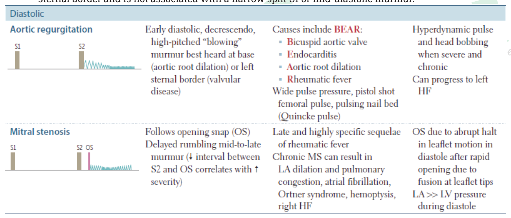

### 2. Answer: A — Staphylococcus epidermidis

*Medicine · PDF p.3*

• Staphylococcus epidermidis, is most commonly associated with prosthetic valve endocarditis. Incorrect Options: • Option B - Staphylococcus aureus: This statement is incorrect. While Staphylococcus aureus is a common cause of infective endocarditis, including native valve endocarditis, it is less commonly associated with prosthetic valve endocarditis • Option C - Coagulase-negative staphylococci are more commonly associated with prosthetic valve endocarditis within 12 months. • Option D - HACEK organisms: This statement is incorrect.

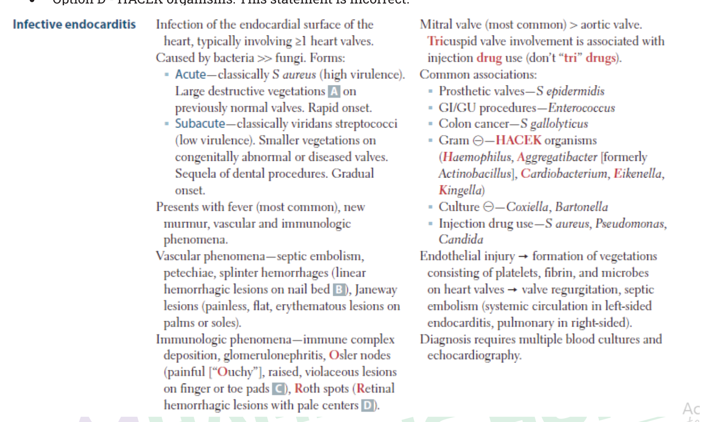

### 3. Answer: C — Liver

*Medicine · PDF p.4*

• During CPR, the most commonly injured solid organ is the liver. The liver is located in the right upper quadrant of the abdomen, beneath the ribcage. The forceful chest compressions involved in CPR can lead to injury, particularly when the hands are placed on the lower third of the sternum. Placing the hands too low, such as on the xiphisternum (pointed part of the sternum), can cause injury to the liver. Incorrect Options: • Option A - Kidneys: The kidneys are not typically at risk of injury during chest compressions in CPR. They are located in the retroperitoneal space, well-protected by the spine and muscles. • Option B - Spleen: The spleen is located in the left upper quadrant of the abdomen. While it is an organ that can be injured in traumatic situations, it is less commonly affected during standard chest compressions in CPR. • Option D - Lungs: Lungs are not considered solid organs; they are soft and elastic tissues. During CPR, the focus is on chest compressions to circulate blood, and lung injury is not a common occurrence.

### 4. Answer: B — Lid lag

*Medicine · PDF p.4*

• Lid lag/Stare sign is the earliest feature to be seen in the patient with Grave’s ophthalmopathy due to sympathetic stimulation caused by thyroid hormones resulting in contraction of the Muller’s muscle. Manifestations of Grave’s ophthalmopathy NO SPECS scheme 0 = No signs or symptoms 1 = Only • signs (lid retraction or lag), no symptoms 2 = Soft tissue involvement (periorbital edema) 3 = Proptosis (>22 mm) 4 = Extraocular muscle involvement (diplopia) 5 = Corneal involvement 6 = Sight loss Incorrect Options: • Options A, C, and D- Proptosis, Exposure keratitis & Diplopia: These are incorrect. Refer to Option B for an explanation.

### 5. Answer: A — Hypophosphatemia

*Medicine · PDF p.5*

• Hypophosphatemia: During TLS, there is a rapid release of intracellular phosphate from lysed cells, leading to an increase in serum phosphate levels (hyperphosphatemia) rather than a decrease. Incorrect options • Option B. Hypocalcemia: Hypocalcemia is commonly observed in Tumor Lysis Syndrome. The increased phosphate levels caused by tumor lysis can bind to calcium, resulting in a decrease in ionized calcium levels. • Option C. Hyperuricemia: Hyperuricemia is a characteristic feature of Tumor Lysis Syndrome. The release of purines from the breakdown of DNA in tumor cells leads to increased uric acid production. • Option D. Hyperkalemia: Hyperkalemia is frequently seen in Tumor Lysis Syndrome. The release of intracellular potassium from lysed cells, combined with impaired renal excretion, can result in increased serum potassium levels.

### 6. Answer: A — PSGN

*Medicine · PDF p.5*

• Past 3 weeks history of sore throat (most likely streptococcus), hematuria (6RBC/HPF), cola coloured Urine (dark brown urine) ,proteinuria of 3gm/24hr, Kidney biopsy showing starry sky appearance on immunoflourescence study and headache due to increased blood pressure are diagnostic of post streptococcal glomerulonephritis. PSGN shows sub-epithelial deposits on electron microscopy and can be managed by Benzathine penicillin, along with furosemide and IV labetalol. Incorrect Options: • Option B and C: Foot process effacement-tonsillectomy: It is seen in minimal change disease and tonsillectomy is an intervention that can be done in Bergers(IgA nephropathy) disease Diffuse mesangial deposits: It is seen in Bergers disease. • Option D -FSGS: Podocytes vacuolization: It is seen in FSGS and-Cyclosporine is used in the management of MCD

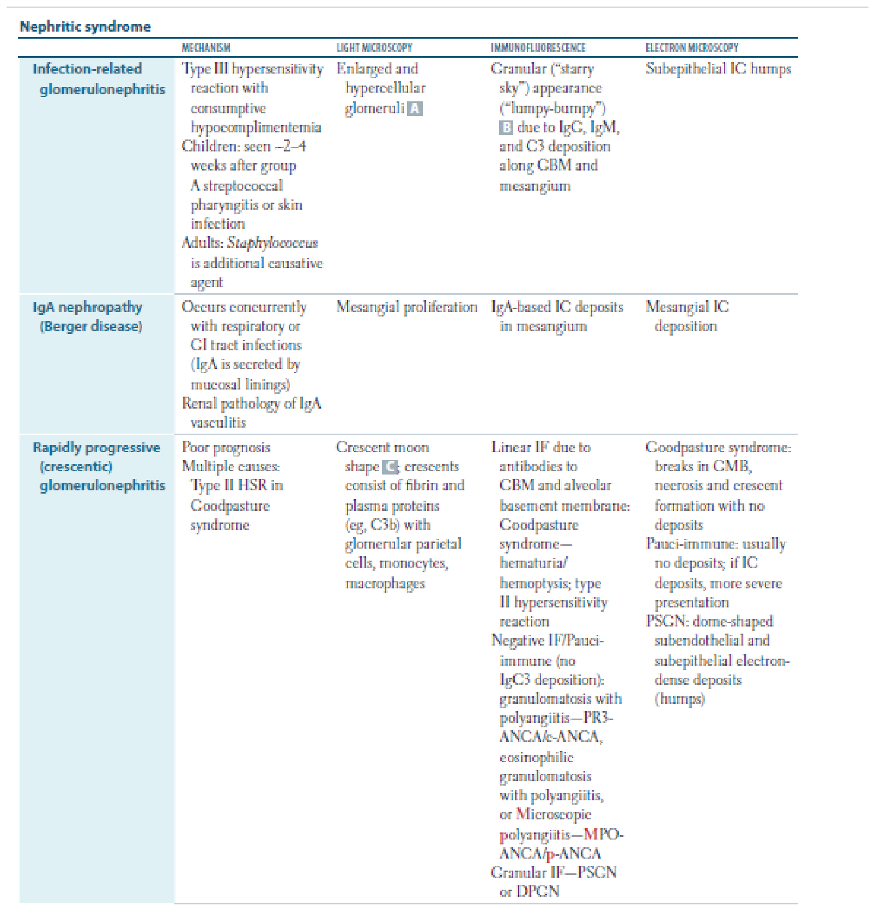

### 7. Answer: D — Proteus mirabilis

*Medicine · PDF p.7*

• Triple phosphate stones are composed of MgNH4PO4. • These three components crystallize to form a stone in an alkaline pH environment. • They typically take the shape of the kidney and are often referred to as Struvite stones or Staghorn Calculi. Proteus mirabilis converts urea to ammonia, contributing to the urine’s alkaline pH and facilitating the stone components’ crystallization. • Examining urine under the microscope may reveal crystals with a characteristic coffin lid appearance. These stones are commonly associated with urinary tract infections (UTIs) caused by urease-producing bacteria, such as Proteus mirabilis. • Therefore, the urinary tract infections in this patient are likely caused by Proteus mirabilis. Incorrect Options: • Option A, B, and C are incorrect Triple phosphate stones are composed of MgNH4PO4. • These three components crystallize to form a stone in an alkaline pH environment. • They typically take the shape of the kidney and are often referred to as Struvite stones or Staghorn Calculi. Proteus mirabilis converts urea to ammonia, contributing to the urine’s alkaline pH and facilitating the stone components’ crystallization. Examining urine under the microscope may reveal crystals with a characteristic coffin lid appearance.

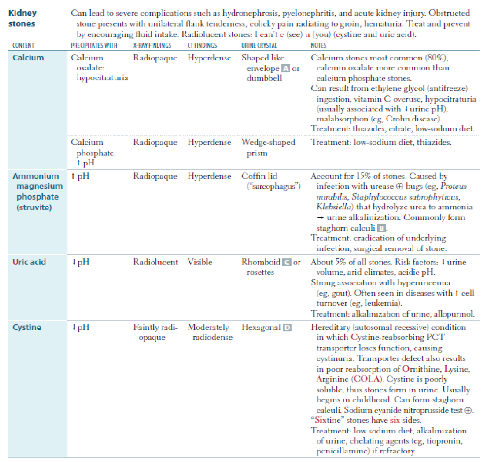

### 8. Answer: D — Lispro

*Medicine · PDF p.8*

• In this case, the patient’s presentation of excessive thirst, frequent urination, weight loss, fatigue, hyperglycemia, presence of glucose and ketones in the urine, and a family history of autoimmune disorders strongly suggests the diagnosis of diabetic ketoacidosis, likely due to type 1 diabetes. • The drug of choice for type 1 diabetes is insulin. Insulin preparations can vary in their onset, peak action, and duration of action. Among the options listed, insulin lispro has the shortest duration of action. Lispro is a rapid-acting insulin analog with an onset of action of about 15 minutes, a peak action at around 1-2 hours, and a duration of action of 3-4 hours. Its rapid onset makes it suitable for use just before or after meals to control postprandial glucose levels. Incorrect Options: • Option A - Regular: Regular insulin is a short-acting insulin with an onset of action of about 30 minutes, a peak action of around 2-4 hours, and a duration of action of approximately 4-6 hours. • Option B - NPH: NPH (Neutral Protamine Hagedorn) insulin is an intermediate-acting insulin with an on set of action of 1-2 hours, a peak action around 4-12 hours, and a duration of action of 14-24 hours. • Option C - Glargine: Glargine is a long-acting insulin with a duration of action of approximately 24 hours and no pronounced peak action. It provides a relatively constant level of insulin activity throughout the day.

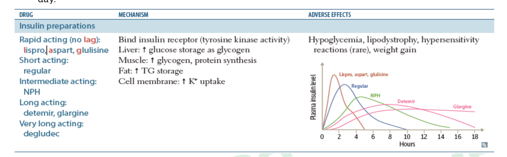

### 9. Answer: A — Granulomatosis with polyangiitis (Wegener’s granulomatosis)

*Medicine · PDF p.9*

_The source paper prints no explanation for this question._

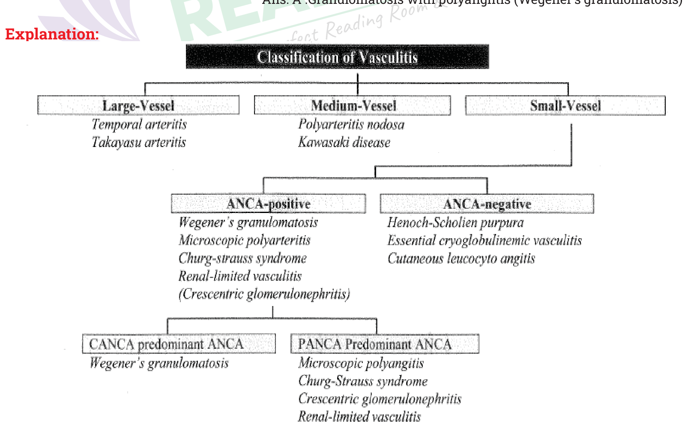

### 10. Answer: A — Wilson’s disease

*Medicine · PDF p.10*

• Wing beating tremor, also known as asterixis, refers to a flapping tremor of the hands and arms resembling a bird’s wing flapping. It is associated with the presence of hepatic encephalopathy, which can occur in various conditions affecting the liver and central nervous system. Among the options provided, Wilson’s disease is the most likely cause of wing beating tremor. Wilson’s disease is a genetic disorder characterized by impaired copper metabolism, leading to copper accumulation in various organs, including the liver, brain, and cornea. The accumulation of copper in the brain can result in neurological symptoms, such as movement disorders. One of the characteristic movement disorders seen in Wilson’s disease is a wing beating tremor. Incorrect Options: • Options B, C, and D are not characteristically associated with asterixis.

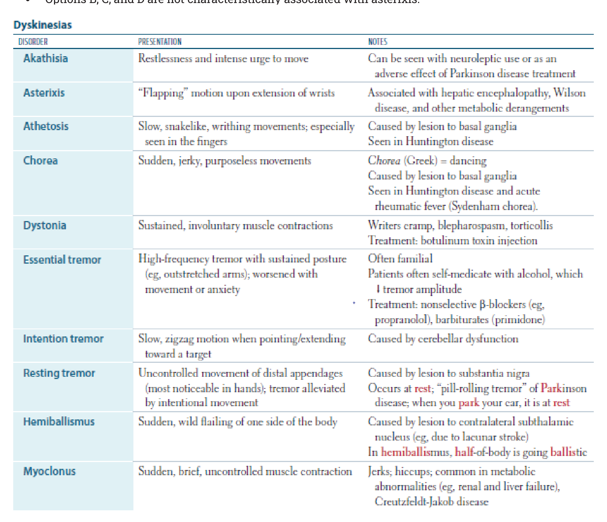

### 11. Answer: B — Albumin

*Medicine · PDF p.11*

• Albumin is not a parameter in the MELD score It is measured in the Child-Pugh score. Incorrect Options: • All the below are the parameters used to measure in MELD score • Option A - Serum bilirubin • Option C - INR • Option D - Serum creatinine

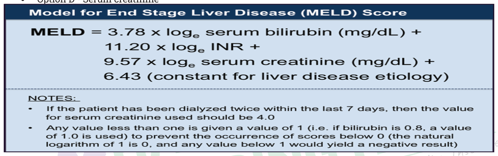

### 12. Answer: D — Partially compensated respiratory alkalosis

*Medicine · PDF p.11*

• ABG - Normal parameters: • pH: 7.35-7.45 • PaO2: 60 - 100 mmHg • PaCO2: 35 - 45 mmHg • HCO3: 22 to 26 mEq/L • In this question: • pH: 7.51 = Alkalosis • PaCO2 = 25 mmHg = Decreased • HCO3 = 19 mEq/L = Decreased - Compensation is taking place • This is a case of acclimatization. Exposure to high altitudes causes chronic hyperventilation due to low PO2 at high altitudes. Hyperventilation causes CO2 washout and respiratory alkalosis. A few days later, renal compensation starts taking place, and there will be compensatory metabolic alkalosis.

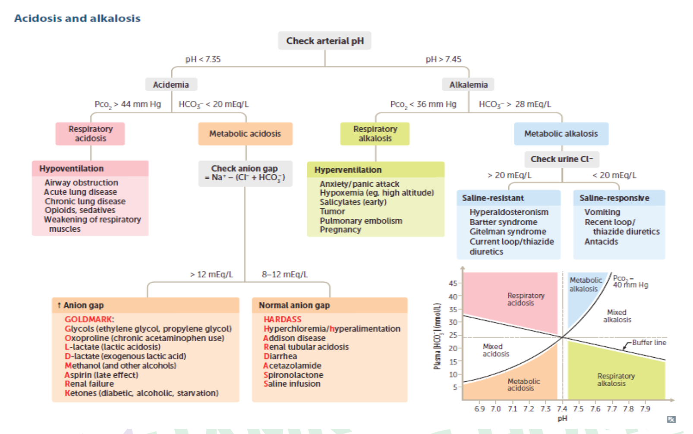

### 13. Answer: A — Klebsiella

*Medicine · PDF p.12*

• Klebsiella Pneumonia is also known as Friedlander Pneumonia, which refers to pneumonia caused by the organism Klebsiella pneumoaie, a gram-negative rod-shaped bacillus. • The prevalence of this disease is higher in older adults and alcoholics, and those immune compromised patients. • It is transmitted through person-to-person contact but can also contaminate ventilators, ureters, or IV catheters. • It is a severe form of community-acquired pneumonia with a predilection for the upper lobes of the lung. • The most common symptoms include fever, chills, cough, chest pain, shortness of breath, and mucus production, which is thick reddish brown due to blood; it is known as currant jelly sputum. Klebsiella pnemoniae can also cause urinary tract infection, intraabdominal infection, meningitis, cellulitis, endocarditis, etc. • Radiography demonstrates cavitatory pneumonia with a bulging/fissure sign due to pus in the interlobar space. Treatment is by antibiotics like IV ceftriaxone and IV amikacin. • Option B: Streptococcus Pneumoniae • S.Pneumoniae is the major cause of community-acquired pneumonia and meningitis in children and adults. It is not referred to as Friedlander Pneumonia. • Option C: Haemophilus Influenzae It can cause Pneumonia, epiglottitis, meningitis, cellulitis etc. However, it is not referred to as Friedlander Pneumonia. • Option D: Staphylococcus It is the leading cause of skin and soft tissue infections, e.g., abscesses, furuncles, etc.

### 14. Answer: A — 200 < PaO2/FiO2 =<300mm/Hg with PEEP is moderate

*Medicine · PDF p.13*

• According to the Berlin definition, moderate ARDS is defined by a PaO2/FiO2 ratio of 100-200 mmHg. • PaO2/FiO2 ratio of 200-300 mmHg would fall into the mild ARDS category. Incorrect Options: • Option B - Bilateral interstitial infiltrates: This statement is correct. • Option C - Symptom onset within a week: This statement is correct. • Option D - No cardiac failure in echocardiography: This statement is correct.

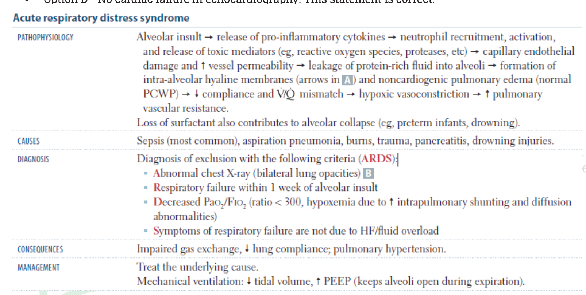

### 15. Answer: D — Herpes simplex esophagitis

*Medicine · PDF p.13*

• Herpes simplex virus (HSV) infection of the esophagus is usually observed in immunocompromised patients but can occasionally be seen in immunocompetent patients. Most infections are related to HSV type 1, although HSV-2 has occasionally been reported. Dysphagia and odynophagia are the typical symptoms of herpes esophagitis (HE). • Endoscopic findings reveal shallow erosions or ulcers (punched-out lesions) and vesicles, typically involving the lower third of the esophagus. • The three main antiviral drugs for treating herpes esophagitis are acyclovir, famciclovir, and valacyclovir. • Option A: CMV esophagitis CMV esophagitis is characteristically seen in immunocompromised; endoscopy would show deep ulcers, most commonly in the middle third of the esophagus. The treatment of CMV esophagitis involves induction therapy for 3 to 6 weeks, but the optimal therapy duration is unclear. Maintenance treatment is controversial. In general, intravenous ganciclovir 5 mg/kg or foscarnet 90 mg/ kg is recommended for induction therapy. • Option B: Candida esophagitis Esophageal candidiasis is also commonly seen in people with HIV/AIDS. Patients are usually asymptomatic. Endoscopy would show white plaques on the esophageal mucosa. A biopsy would show the presence of yeasts and pseudohyphae invading mucosal cells. The most commonly used medication for esophageal candidiasis is the systemic antifungal with oral fluconazole 200 to 400 mg daily for 14 to 21 days. The alternative for patients who may not tolerate oral medication is 400 mg of fluconazole intravenously daily. • Option C: Corrosive esophagitis Corrosive esophagitis is characterized by caustic injury due to the ingestion of chemical agents, mainly alkaline substances such as detergents. Esophageal bleeding, perforation, or stricture can be worsened by high-degree corrosive esophagitis. • Treatment: Medicines may be given to decrease inflammation or irritation from stomach acids. They may help increase the protective lining of the esophagus to help it heal. Dilatation is a procedure used to widen the esophagus. Surgery may be needed to remove an area of the esophagus.

### 16. Answer: A — M3-AML

*Medicine · PDF p.14*

• M3 subtype is Acute promyelocytic leukaemia (APL) • Seen in young patients with chromosomal translocation t(15,17). • Myeloblasts are usually characterized by positive cytoplasmic staining for myeloperoxidase (MPO) crystal aggregates of MPO are seen as “Auer rods”. • Disseminated intravascular coagulation (bleeding tendencies) are characteristic. • M3 AML is associated with PML-RARA mutation. • The PML gene region in chromosome 15 fuses with the RARA gene region in chromosome 17 (reciprocal translocation) • Treatment is ATRA ( All trans-retinoic acid ) and Arsenic trioxide. This subtype has an excellent prognosis. • Option B: M4-AML M4 subtype of AML has chromosomal translocation t(16,16). It is associated with eosinophilia and gingival hyperplasia • Option C: M2-AMLM2 type of AML is the most common subtype with chromosomal translocation of t(8,21). This subtype has an excellent prognosis. Myeloid Sarcoma is also seen in the M2 subtype. Associated with Choloroma • Option D: M5-AML M5 subtype of AML is associated with organ infiltration, gingival hyperplasia, increased WBCs count and fever sweat syndrome.

### 17. Answer: B — Normal HbF & normal HbA2

*Medicine · PDF p.14*

• In the alpha-thalassemia trait, the haemoglobin electrophoresis will show normal HbF and HbA2 levels. • In sickle cell anaemia absence of HbA means the disease severity is very high. But in the sickle cell trait, HbA is present. • The screening test for both alpha & beta thalassemia is NESTROFT (Naked Eye Single Tube Red Cell Osmotic Fragility Test). The investigation of choice for both alpha & beta thalassemia is HPLC (High- performance liquid chromatography). • Option A: Increased HbF & normal HbA2 In the case of beta thalassemia major, HbF markedly raises with a normal or slightly raised HbA2. • Option C: Normal HbF & decreased HbA2 • In the alpha-thalassemia trait, the HbF level is normal, but HbA2 will also be normal. • Option D: Decreased HbF & normal HbA2 This finding will be found in a normal adult individual.

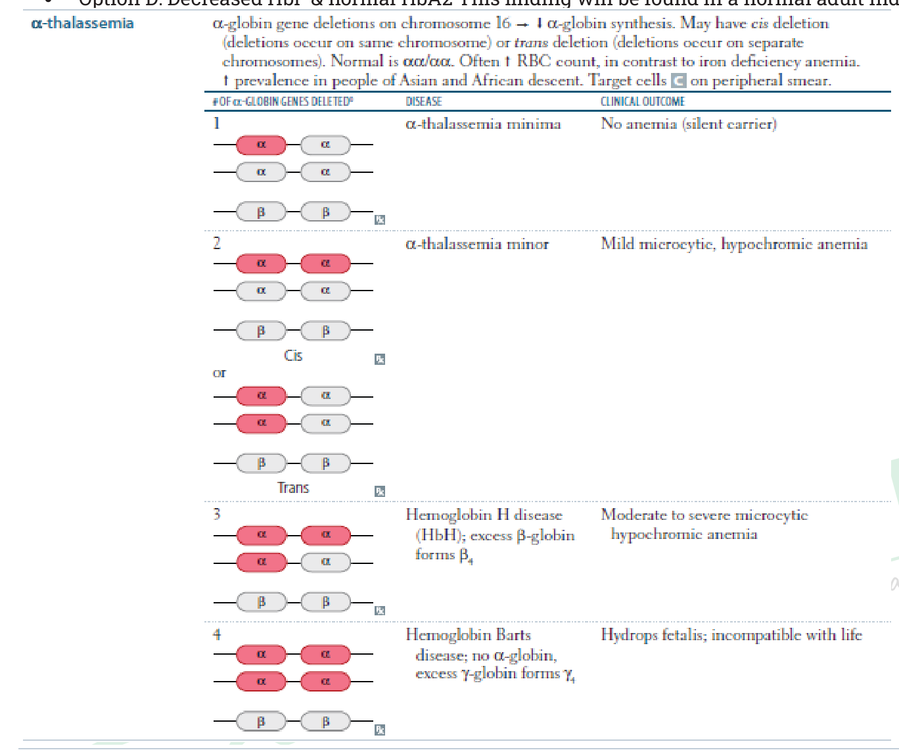

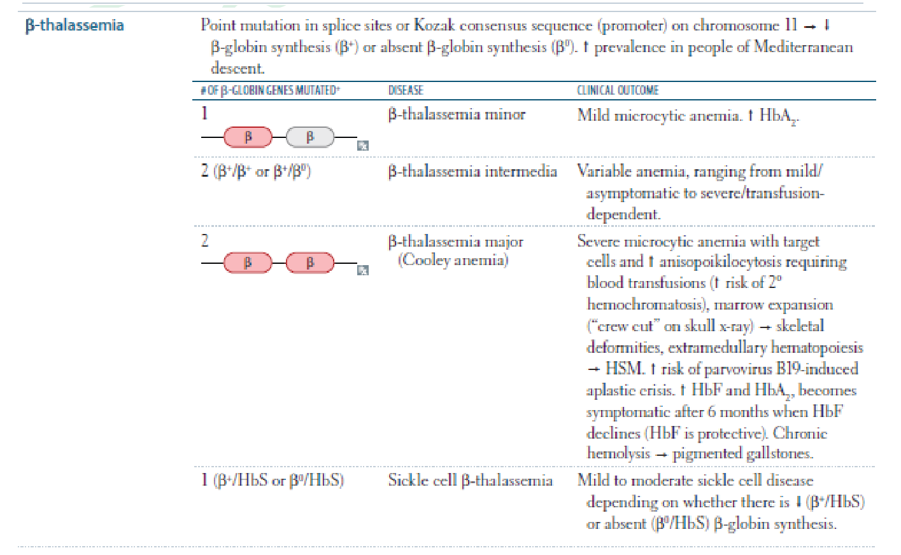

### 18. Answer: C — Crohn’s disease

*Medicine · PDF p.16*

• The patient’s presentation of chronic abdominal pain, diarrhea, and weight loss, along with colonoscopic findings of a cobblestone pattern of the mucosa in the terminal ileum, is highly suggestive of Crohn’s disease. • Crohn’s disease is characterized by chronic inflammation of the gastrointestinal tract, with the terminal ileum being the most commonly affected site. • The cobblestone appearance of the mucosa results from transmural involvement and submucosa fibrosis, which is typical of Crohn’s disease. Incorrect Options: • Option A - Ulcerative colitis: While ulcerative colitis is another form of inflammatory bowel disease, it typically presents with continuous colonic involvement and does not exhibit the cobblestone pattern seen in Crohn’s disease. • Option B - Irritable bowel syndrome (IBS): Irritable bowel syndrome (IBS) can cause abdominal pain and diarrhea, but it does not typically lead to weight loss, and it does not cause the cobblestone pattern observed in Crohn’s disease. • Option D - Diverticulitis: Diverticulitis involves inflammation of the diverticula, typically in the colon, and does not typically present with a cobblestone pattern on colonoscopy. Additionally, diverticulitis usually occurs in older patients and is less commonly associated with weight loss compared to Crohn’s disease.

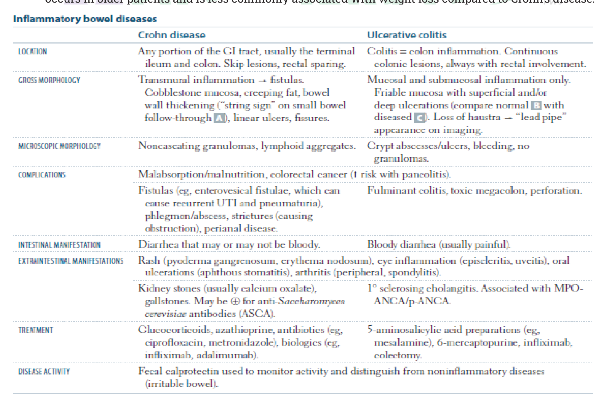

### 19. Answer: D — Neuromyelitis Optica

*Medicine · PDF p.17*

• The Lhermitte sign, also known as the “barber chair phenomenon,” is a clinical finding characterized by the sensation of an electric shock or tingling sensation that radiates down the spine and into the limbs upon flexion of the neck. • This sign is typically elicited by passively flexing the patient’s neck forward, leading to the transient sensation that travels along the spinal cord and peripheral nerves. Lhermitte sign is not seen in Neuromyelitis Optica • Instead, the Lhermitte sign is more commonly observed in patients with lesions affecting the cervical spinal cord, such as those seen in MS or cervical spondylosis. Incorrect Options: • Options A,B,C: Lhermitte sign is seen in Tabes dorsalis, Cervical spondylosis, and Multiple sclerosis

### 20. Answer: D — Obstructive hydrocephalus

*Medicine · PDF p.17*

• This option is not associated with Tuberculous Meningitis. Tuberculous Meningitis primarily affects the central nervous system and does not typically cause obstructive hydrocephalus. It primarily affects the meninges and brain. In fact, it causes non obstructive hydrocephalus. Incorrect Options: • Option A- Basal exudates on NCCT: This option is associated with Tuberculous Meningitis. Basal exudates on neuroimaging such as Non-Contrast Computed Tomography or NCCT are a characteristic finding in TBM and indicate the presence of inflammatory changes at the base of the brain. • Option B- Crackpot sign: This option is associated with Tuberculous Meningitis. The “Crackpot sign” is a clinical sign where there is a distinctive sound, similar to the sound of a wooden spoon tapping on a cracked pot, when percussing the skull in patients with TBM. It indicates increased intracranial pressure due to the presence of exudates. • Option C- Sutural diastasis: This option is associated with Tuberculous Meningitis. Sutural diastasis refers to the separation or widening of the cranial sutures seen on imaging studies, and it can occur in TB due to increased intracranial pressure.

### 21. Answer: B — Pectoralis major

*Surgery · PDF p.17*

• In Patey’s modified mastectomy, the pectoralis major is preserved. En-bloc removal of nipple, areola, skin, breast tissue, breast mass + removal of Level 1, 2, & 3 lymph nodes + excision of pectoralis minor Medial and lateral pectoral nerves are preserved. Nerve to Serratus Anterior, Nerve to Latissimus dorsi, Axillary vein, and Cephalic vein are preserved. • Options A: Intercostobrachial nerve Intercostobrachial nerve is not preserved during the modified radical mastectomy. • Option C: Pectoralis minor Pectoralis minor is not preserved during the modified radical mastectomy. • Option D: Axillary fascia Axillary fascia is not preserved during the modified radical mastectomy.

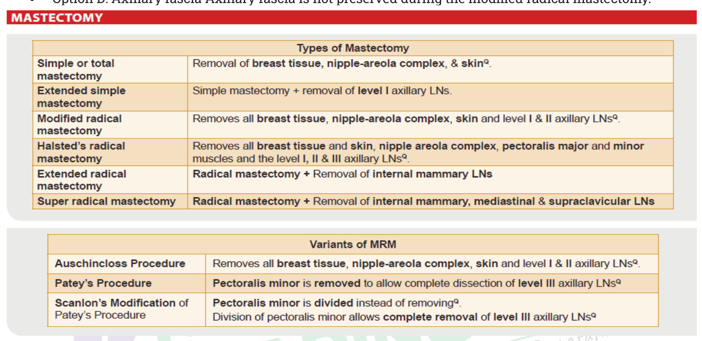

### 22. Answer: C — Fractionated plasma metanephrines

*Surgery · PDF p.18*

• MEN-2 syndrome has been suspected, as the inheritance of this condition is autosomal dominant and the patient had a first degree relative suffering from medullary carcinoma of thyroid. Components of MEN2 : Medullary carcinoma of thyroid, pheochromocytomas, Parathyroid carcinoma. The patient has symptoms of pheochromocytoma, so levels of fractionated plasma metanephrine should be evaluated. Pheochromocytoma: It is a tumor of the enterochromaffin cells of the adrenal medulla. It affects men and women equally, and the incidence is in the age 40 to 50 years. The patient presents with a classic triad of headache, diaphoresis, and palpitations. Hypertension is present in 90% of cases. The main hormone secreted by adrenal pheochromocytomas - Epinephrine. The main hormone secreted by extra-adrenal pheochromocytomas - Norepinephrine (as they lack phenylethanolamine N-methyltransferase ) • It is a tumor of the enterochromaffin cells of the adrenal medulla. • It affects men and women equally, and the incidence is in the age 40 to 50 years. • The patient presents with a classic triad of headache, diaphoresis, and palpitations. Hypertension is present in 90% of cases. • The main hormone secreted by adrenal pheochromocytomas - Epinephrine. The main hormone secreted by extra-adrenal pheochromocytomas - Norepinephrine (as they lack phenylethanolamine N-methyltransferase ) Incorrect Options • Option A: Chest X-ray Pheochromocytoma is a disease of the adrenal gland where excessive catecholamine synthesis due to the tumor activity causes symptoms of hypertension, headache, palpitations, and diaphoresis. As part of the MEN syndrome, where pheochromocytoma occurs alongside medullary thyroid cancer, a chest X-ray is not needed for diagnosis. • Option B: Measurement of 5-HIAA The excessive serotonin synthesis causes serotonin syndrome. Such patients present with flushing skin, diarrhea, vomiting, sweating, shivering, muscle twitching, involuntary contractions, muscle spasms, and rigidity. This patient has no such symptoms. The end product of serotonin metabolism is 5-HIAA, which is used to diagnose serotonin syndrome. • Option D: Intravenous pyelography Intravenous pyelography is an x-ray exam that uses an injection of contrast material to evaluate the kidneys, ureter, and urinary bladder to help diagnose blood in the urine or pain in the kidneys This patient has symptoms of pheochromocytoma and requires evaluation of the adrenal glands and not of the kidneys.

### 23. Answer: D — Cold nodules are diagnostic of malignancy

*Surgery · PDF p.19*

• Thyroid nodule: • In case of thyroid nodule investigation of choice is FNAC, but it does not distinguish between • Adenoma and Carcinoma. Diagnosis of follicular carcinoma thyroid is based on vascular invasion capsular invasion. Therefore, the investigation of choice is a biopsy (which identifies capsular and vascular invasion). Solitary thyroid nodule diagnosed on FNAC as follicular adenoma in elderly patients; if the size is >4 cm, because of the high risk of cancer, total thyroidectomy is done. • In hot or warm lesions, the risk of malignancy is <5%. Risk of malignancy in cold nodules is high (17%- 20%), but the cold nodule is not diagnostic of malignancy. Therefore, cold nodules are managed with observation, and an increase in size or compressive symptoms (dysphagia, dyspnea, hoarseness of voice) require a repeat FNAC with biopsy followed by thyroidectomy. • Option A: FNAC is the investigation of choice FNAC is the most important test in evaluating thyroid masses, as most nodules can be classified into several categories that determine further management. • Option B: FNAC cannot distinguish follicular adenoma from carcinoma Even though it is an important initial test to classify the thyroid nodule into different categories, the FNAC cannot distinguish between adenoma and carcinoma as the carcinoma is characterized by capsular invasion, which requires excisional tissue biopsy to locate the invasion. • Option C: Managed by total thyroidectomy Based on the results of the FNAC, if the sample is suspicious for/ or has signs of malignancy (i.e. cellular atypia, high nuclear to cytoplasmic ratio, undifferentiated tissue), it proceeded with total thyroidectomy. Furthermore, lobectomy is recommended for nodules greater than 4 cm, causing compressive symptoms as they have a higher incidence of malignancy.

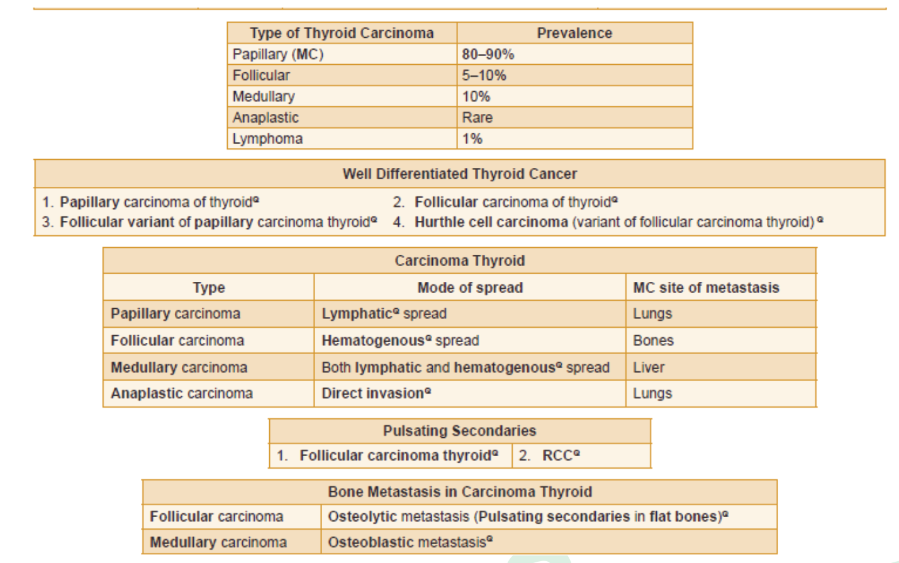

### 24. Answer: C — Irreversible alpha blocker

*Surgery · PDF p.20*

• Complaints of paroxysmal headache, nausea, vomiting, abdominal pain, and palpitations, along with elevated levels of urinary and plasma metanephrines levels lead to a probable diagnosis of Pheochromocytoma. • Pheochromocytoma is characterized by hypertension and low blood volume, resulting from an excessive concentration of catecholamines in the plasma. With insufficient preoperative antihypertensive management or untreated hypovolemia, the hemodynamic instability during surgical treatment of pheochromocytoma may be lethal. • The main goal of preoperative management of pheochromocytoma is to normalize blood pressure and heart rate, restore effective circulating blood volume, improve the metabolic condition, and prevent a patient from catecholamines storm and hemodynamic instability during surgery. Phenoxybenzamine is a non-selective, non-competitive alpha-AR antagonist, which binds irreversibly with both alpha1 and alpha2-AR causes vasodilation, and decreases blood pressure. Phenoxybenzamine is long-acting, and its effects persist long after it has been discontinued since the effect diminishes only after alpha-AR resynthesis. • The advantage of phenoxybenzamine is that its effect is profound and long-acting, even when excessive amounts of catecholamines reach the circulation. Incorrect Options • Option A: Beta Blocker Beta receptors normally cause vasodilation. Since catecholamines have both alpha and beta receptor activity, they also cause some degree of vasodilation through beta receptors. When beta blockers are used, then the vasodilatory effect of catecholamines through beta receptors is antagonized, and there is alpha receptors stimulation which can cause severe hypertension and end-organ damage. So beta blockers are avoided. • Option B: Diuretic Pheochromocytoma patients are already hypovolemic. Using a diuretic to control hypertension would be detrimental to the patient. A state of hypovolemia is classic for pheochromocytoma due to prolonged vasoconstriction by circulating catecholamines; further volume depletion can precipitate a crisis. • Option D: None of the above Phenoxybenzamine (irreversible long-acting alpha blocker) controls blood pressure in pheochromocytoma.

### 25. Answer: B — PAIR is the most preferred treatment, optionally

*Surgery · PDF p.21*

• Surgery is the first choice for complicated hydatid cysts Percutaneous and medical treatments represent alternatives to surgery Surgery is not done if cysts are too small or the patient is not a suitable candidate for surgery For most cysts, surgical resection involving laparoscopic or open complete cyst removal with the instillation of a scolicidal agent is preferred and is usually curative. Puncture aspiration injection reaspiration (PAIR): Most preferred technique for anatomically and surgically appropriate lesions PAIR - initial course of albendazole →puncture of the cyst →aspiration of the cyst contents →instillation of hypertonic saline in the cyst cavity →reaspiration Incorrect Options • Option A: Drug of choice for hydatid cyst is mebendazole Albendazole is the drug of choice for hydatid cysts. Mebendazole has poor reabsorption. • Option C: Surgery is the most effective treatment for small cysts Pericystectomy is the most effective treatment Pericystectomy / radical cystectomy involves the complete removal of the hydatid cyst. Surgery is a good choice for large cysts; if the cysts are too small, the surgery is not an indication • Option D: 3% hypertonic saline is most commonly used for PAIR The scolicidal agents are 15% to 20% hypertonic saline solution, 0.5% cetrimide solution, 10% povidone-iodine. At present, 20% hypertonic saline is recommended

### 26. Answer: D — Ultrasound (USG)

*Surgery · PDF p.21*

• Transabdominal ultrasonography is the initial imaging modality of choice as it is accurate, readily available, inexpensive, and quick to perform. It has sensitivity and specificity of 84% and 99%, respectively • For patients with biliary obstruction and obstructive jaundice, ultrasonography is the first investigation because it can identify intrahepatic and extrahepatic biliary dilatation and often the level of obstruction. In addition, the cause of obstruction may also be determined. Disadvantages are it is operator dependent and may be compromised by excessive body fat and intraluminal bowel gas. • Option A: CT Abdomen Unlike USG, CT is less affected by body habits and is not operator-dependent. It is the modality of choice in the staging of cancers of the liver, gallbladder, bile ducts, and pancreas. However, as only 75% of gallstones are identified by CT, it is not used as a screening modality for uncomplicated gallstones. • Option B: Magnetic resonance cholangiopancreatography (MRCP) It is a non-invasive modality that provides excellent imaging of the gallbladder and biliary system. Images can be obtained of the biliary tree demonstrating obstruction, strictures, or other intraductal abnormalities. • Option C: Endoscopic retrograde cholangiopancreatography (ERCP) This technique remains widely used as both a diagnostic and a therapeutic modality.

### 27. Answer: D — Periampullary

*Surgery · PDF p.22*

• Periampullary carcinomas can be detected early and hence have the best prognosis Periampullary carcinoma includes: Adenocarcinoma of the head of the pancreas, Adenocarcinoma of the ampulla of Vater, Distal bile duct adenocarcinoma, Duodenal Adenocarcinoma • The most common periampullary carcinoma is pancreatic ductal Adenocarcinoma (has the worst prognosis), followed by ampullary Adenocarcinoma, distal cholangiocarcinoma, and duodenal • Adenocarcinoma When compared to other periampullary malignancies, ampullary cancers tend to become symptomatic at an earlier stage, and thus as many as 80% of these tumours are resectable. Prognosis: Duodenal Adenocarcinoma > Ampullary carcinoma > Distal bile duct adenocarcinoma > Head of pancreas > Body and tail of the pancreas Incorrect Options • Option A: Head The head of the pancreas carcinoma has a 15 to 20% 5-year survival rate compared to 39% 5-year survival of ampullary adenocarcinoma and 59% for duodenal carcinoma, both periampullary carcinomas • Option B: Tail Patients with pancreas Adenocarcinoma involving the body or tail of the gland are more likely to have weight loss and abdominal pain as their initial complaints. These lesions can grow to a large size before producing symptoms and are often diagnosed later with a poor prognosis. Most body and tail cancers have already metastasized to distal sites or extended locally to involve nodes, nerves or major vessels by the time of diagnosis • Option C: Body Pancreatic cancers involving the body of the pancreas become symptomatic at a very later stage when they have already metastasized to different locations, making them unresectable at the time of diagnosis

### 28. Answer: C — 24-hour pH monitoring

*Surgery · PDF p.22*

• Gold standard Investigation for GERD Esophageal pH monitoring is used to evaluate gastroesophageal reflux disease and determine the effectiveness of medications that prevent acid reflux. • This test measures the amount of acid refluxing or backing up from the stomach into the esophagus. Incorrect Options • Option A: Barium swallow IOC for diagnosis of Hiatus hernia and Zenker’s diverticul A barium swallow, also called an esophagogram, is an imaging test that checks for problems in the upper GI tract. • Option B: Endoscopy IOC for diagnosis of Barrett’s esophagus • Option D: Esophageal manometry IOC for diagnosis of motility disorders of the esophagus like Achalasia cardia, Diffuse esophageal spasm, and Nut cracker’s esophagus.

### 29. Answer: A — Gastroduodenal artery

*Surgery · PDF p.22*

• Peptic ulcers are open sores in the stomach (gastric ulcer) and the upper part of the duodenum (duodenal ulcer). It usually presents with hematemesis and melena. • A peptic ulcer is the most common cause of upper GI bleeding, present in one-half to two-thirds of patients with upper GI bleeding. Duodenal ulcer bleeds from the gastroduodenal artery. Gastric ulcers mostly bleed from the left gastric artery. Gastroduodenal artery (duodenal ulcers) is the most common cause of upper GI bleeding Incorrect Options • Option B: Superior pancreaticoduodenal artery It arises from the gastroduodenal artery. It divides into anterior and posterior branches. It mostly supplies the pancreas and duodenum. • Option C: Left gastric artery The left gastric artery is a branch of the celiac artery. • The lesser curve is supplied by the right and left gastric vessels, and the greater curve is by the right and left gastroepiploic vessels. Gastric ulcers mostly bleed from the left gastric artery. • Option D: Left gastroepiploic artery The left gastroepiploic artery arises from the splenic artery and runs within the gastrosplenic ligament. The greater curve is supplied by the right and left gastroepiploic vessels.

### 30. Answer: C — Ovary

*Surgery · PDF p.23*

• Pseudomyxoma peritonei (PMP) is characterized by large quantities of encysted yellow-jelly material filling the abdomen and peritoneal cavity. It is associated with mucinous cystic tumors of the ovary and appendix. It may also arise from a primary appendiceal tumor with secondary implantation to one or both ovaries • As mucinous cystic tumor of the appendix or ovary rupture, it leads to seeding of the peritoneum with mucus-producing cells, which continue to proliferate and produce mucus. The progressive accumulation of copious amounts of mucinous fluid gradually fills the peritoneal cavity, resulting in the characteristic “jelly belly”. • Option A: Pancreas Mucinous cystic tumor of the pancreas are not associated with developing pseudomyxoma peritonei. • Option B: Kidney Mucinous cystadenocarcinoma is a very rare epithelial tumor originating from the urothelium of the renal pelvis. It does not contribute to the risk factor for developing pseudomyxoma peritonei. • Option D: Abdominal Testis Mucinous cystic tumor of the abdominal testis are extremely rare and are not associated with the pathophysiology of pseudomyxoma peritonei development.

### 31. Answer: C — Hypokalemia

*Surgery · PDF p.23*

• Paralytic ileus is associated with hypokalemia. • Hypokalemia can cause changes in the coordinated reflexes and patterns of GI motility by reducing neural conduction to and within the enteric nervous system (ENS). • Paralytic ileus: This is a condition where peristaltic waves fail due to neuromuscular failure in the myenteric (Auerbach’s) and submucous (Meissner’s) plexuses. The resultant stasis leads to the accumulation of fluid and gas within the bowel, with associated distension, vomiting, absence of bowel sounds, and absolute constipation. Clinical features: Paralytic ileus takes on a clinical significance if, 72 hours after laparotomy: There has been no return of bowel sounds on auscultation; there has been no passage of flatus. Abdominal distension becomes more marked and tympanitic. Colicky pain is not a feature. Distension increases pain from the abdominal wound. In the absence of gastric aspiration, effortless vomiting may occur. Radiologically, the abdomen shows gas-filled loops of the intestine with multiple fluid levels (if an erect film is felt necessary). Incorrect Options • Option A: Hyponatremia Hyponatremia is associated with neurologic symptoms. It does not cause ileus. • Option B: Hypernatremia Hypernatremia usually presents with neurologic symptoms. Ileus is not seen in hypernatremia. • Option D: Hyperkalemia Hyperkalemia leads to life-threatening arrhythmias. Ileus is not seen

### 32. Answer: B — Ileocolic artery

*Surgery · PDF p.24*

• The appendicular artery is a branch of the lower division of the ileocolic artery. • It traverses behind the terminal ileum and enters the mesoappendix, just proximal to the base of the appendix. • It traverses further to lie in the free border of the mesoappendix. An accessory appendicular artery may be present. • The appendicular artery is an end artery that may easily become thrombosed during acute inflammation, leading to necrosis and perforation of the distal appendix. • Option A: Right colic artery The right colic artery is a branch of the superior mesenteric artery. It supplies the ascending colon. • Option C: Posterior cecal artery Posterior cecal artery directly supplies the cecum and ileocecal valve. It arises from the ileocolic artery. • Option D: Superior mesenteric artery Superior mesenteric artery arises directly from the aorta. It divides into the right colic, middle colic, and ileocolic artery (this artery, in turn, gives appendicular artery).

### 33. Answer: A — Herniotomy

*Surgery · PDF p.24*

• Herniotomy is the procedure of choice for the congenital hydrocele. • A hydrocele describes the accumulation of fluid within the tunica vaginalis. • Congenital hydrocele: o The processus vaginalis is patent in congenital hydrocele and connects with the peritoneal cavity. o The communication is usually too small to allow herniation to intra-abdominal contents. o Spontaneous obliteration occurs at 2 years of age o If not obliterated, then the management of hydrocele of the hernia sac (congenital hydrocele) is herniotomy. Incorrect options: • Option B: Herniorrhaphy Herniorrhaphy is the removal of the hernial sac plus mesh repair of the posterior wall of the inguinal canal. Mesh is not used because there will be growth in the body compared to mesh. • Option C: Observation only If the hydrocele persists beyond the age of 1 year, or if it becomes symptomatic or significantly enlarges, surgical intervention may be considered. • With time, the communication may become large to allow herniation of intra-abdominal contents; it needs to be managed. • Option D: Operate after 5 years of age Infantile hydroceles are generally repaired if they do not resolve spontaneously by 1-2 years of age. The management of congenital hydrocele of the hernia sac is herniotomy.

### 34. Answer: A — Splenic injury

*Surgery · PDF p.25*

• The patient met a road traffic accident and has presented with abdominal pain, tenderness, and a positive Kehr’s sign. Kehr’s sign is seen in patients with splenic trauma Left shoulder pain caused by irritation of the left hemidiaphragm by subphrenic blood • There may be hyperaesthesia in the area of the left shoulder • It can be elicited by elevating the foot of the bed for 15 minutes, by which time blood will accumulate below the left cupula of the diaphragm Ballance’s sign is persistent dullness on the left side of the abdomen due to early coagulation of splenic blood. Shifting dullness is present on the right side. • Option B: Liver injury The physical findings associated with the liver injury include right upper quadrant or generalized abdominal tenderness, abdominal wall contusion or hematoma (seatbelt sign), right lower chest wall tenderness, contusion, or instability due to rib fractures. • Option C: Renal injury Physical exam findings such as flank tenderness and ecchymosis or displaced lower rib fractures should alert for a possible renal injury. • Option D: Mesenteric hematoma Mesenteric hematoma occurs as a direct result of abdominal trauma On examination, a mass can be palpable.

### 35. Answer: D — Hypernatremia

*Surgery · PDF p.26*

• Hypernatremia: Hypernatremia, which is an elevated serum sodium level, is not a recognized complication of massive blood transfusion. It is more commonly associated with conditions such as dehydration or excessive sodium intake. • Massive blood transfusion refers to the transfusion of a large volume of blood, usually more than 10 Units of whole blood/PRBC within 24 hours. It is associated with several complications due to various factors involved in the transfusion process. Incorrect choices: • Option A. Hypocalcemia: Massive blood transfusion can lead to hypocalcemia due to the citrate anticoagulant present in the stored blood. Citrate binds to calcium, resulting in a decrease in ionized calcium levels. • Option B. Hypokalemia: Due to transfusion of citrated cells potassium level decreases but initially hyperkalemia occurs due to lysis of red blood cells. • Option C. Hypothermia: Large volumes of cold blood products can cause hypothermia in the recipient. This occurs due to the temperature difference between the transfused blood and the patient’s body temperature.

### 36. Answer: B — Allen’s test

*Surgery · PDF p.26*

• Before using the radial artery, Allen’s test should be performed. • It assesses whether the ulnar artery can maintain collateral blood flow to the hand. • It consists of the patient making a fist while the surgeon compresses both radial and ulnar arteries digitally; this squeezes blood from the hand. The hand is then relaxed, and compression of the ulnar artery is released; the speed of returning colour to the hand is assessed. If colour returns in 5-7s, patency and collateral flow from the ulnar artery are confirmed. Incorrect Options: • Option A: Tinel’s test It is used for the identification of compression of a peripheral nerve. • It consists of tapping over the nerve of interest,and tingling sensation may indicate nerve compression. • Option C: Phalen’s test It indicates compression of the median nerve which causes paraesthesia. Used to diagnose Carpal tunnel syndrome.. • Option D: Froment’s test It suggests the weakness of the adductor pollicis muscle supplied by the ulnar nerve. A positive test is indicated by flexion of the thumb instead of adduction while holding a book or card.

### 37. Answer: C — Lambert-Eaton Syndrome

*Surgery · PDF p.27*

• Lambert-Eaton Syndrome (LES) is commonly associated with Small Cell Lung Carcinoma (SCLC) • Symptoms of LES include proximal muscle weakness and diminished reflexes • Elevated serum calcium levels can also occur in Lambert-Eaton Syndrome due to the release of parathyroid hormone-related peptide by the tumor cells, leading to hypercalcemia. • Therapy is directed at the primary tumor with resection, radiation, and/or chemotherapy. Incorrect Choices: • Option A- Acanthosis Nigricans: Acanthosis nigricans is a skin condition characterized by thick, dark, and velvety skin along the body folds and creases. • It is commonly associated with Adenocarcinoma, not Small Cell Lung Carcinoma, making it less likely in this case. • Option B- SIADH (Syndrome of Inappropriate Antidiuretic Hormone):b SIADH results in excessive production of antidiuretic hormone, leading to water retention and dilutional hyponatremia. • While SIADH can occur in Small Cell Lung Carcinoma, the patient’s symptoms of muscle weakness and elevated calcium levels suggest a different paraneoplastic syndrome. • Option D- Cushing Syndrome: Cushing Syndrome results from excessive cortisol production, often due to adrenal tumors or ACTH-secreting tumors. While cortisol levels can be elevated in lung cancer, the patient’s muscle weakness and hypercalcemia are more suggestive of another paraneoplastic syndrome.

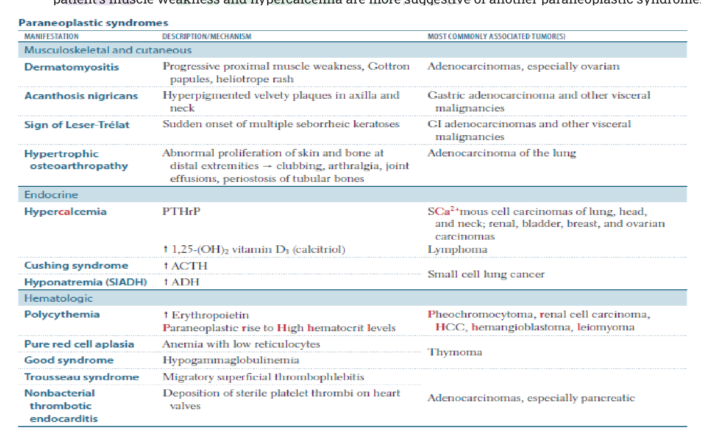

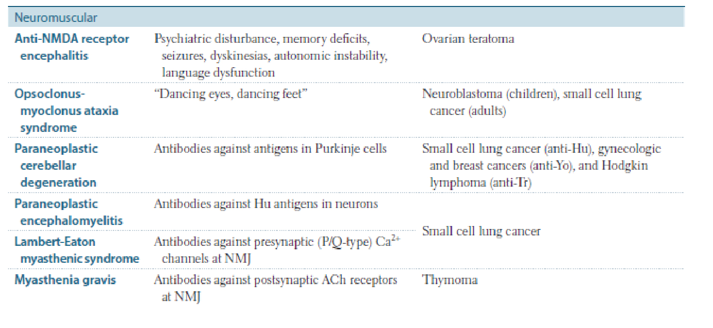

### 38. Answer: A — Open cholecystectomy for cholelithiasis

*Surgery · PDF p.28*

• It is an example of a clean-contaminated wound. These wounds lack unusual contamination. Clean contaminated wounds enter the genital, alimentary, respiratory, or urinary tracts. • Surgical wounds categorized based on bacterial contamination: • Clean wounds are those in which no part of the respiratory, gastrointestinal, or genitourinary tract is entered. Examples include Herniorrhaphy and breast surgery. Clean-contaminated wounds encompass those cases in which the above systems are entered but without evidence of active infection or gross spillage. Examples include elective cholecystectomy or elective colon resection with adequate bowel preparation. Contaminated wounds include active infection (perforated appendicitis with abscess) or gross spillage (gunshot wounds with large or small bowel injuries). • Dirty wounds - post operative infection already present in the wound before operation, associated with severe inflammation. For example- fecal peritonitis, necrotizing soft tissue infection. • Option B: Herniorrhaphy with mesh repair It is an example of a clean wound. Clean wounds are mostly closed, uninfected, and exhibit no inflammation. Herniorrhaphy is usually a clean and closed wound, so this wound is in this category. • Option C: Lumpectomy with axillary node dissection It is also an example of a clean wound. These wounds do not enter alimentary, genital, urinary, or respiratory tracts. • Option D: Appendectomy with walled-off abscess It is an example of contaminated wounds. They manifest in devitalized tissue and are frequently caused by bacteria in the surgical field or perforated viscera.

### 39. Answer: C — Inferior mesenteric artery

*Surgery · PDF p.28*

• Clinical signs: Urinary incontinence with intermittent normal voiding since birth and fused moiety, dilated ureters indicate the horseshoe kidney. • The ascent of the horseshoe kidney remains incomplete due to inferior mesenteric artery preventing further migration of the kidney. • The normal ascent of the kidneys makes the organs take their place in the abdomen below the adrenal glands. However, with horseshoe kidney, the ascent into the abdomen is prevented by the inferior mesenteric artery, which hooks over the isthmus. • Isthmus is usually located adjacent to L3-L4 vertebrae, just below the origin of IMA from the abdominal aorta. Incorrect Options: • Option A - Superior mesenteric artery: In the middle of the digestive tract is the superior mesenteric artery (midgut). It comes from the aorta, which is situated between the renal and celiac arteries. It has no relationship with the ascent of the kidney. • Option B - Superior mesenteric vein: The Superior mesenteric vein (SMV), a significant venous tributary of the abdominal cavity, is the superior mesenteric vein. It has no relationship with the ascent of the kidney. • Option D - Inferior mesenteric vein: It’s the inferior mesenteric artery, not the vein, which prevents the ascent of the horseshoe kidney in the abdomen.

### 40. Answer: B — Urine output

*Surgery · PDF p.29*

• Urine output is the best measure of organ perfusion and adequacy of shock therapy. • Minimum adequate urine output in adults – 1ml/kg/min • Minimum adequate urine output in children – 0.5 ml/kg/min Incorrect options: • Option A: Central Venous Pressure (CVP) The best guide for fluid resuscitation is urine output, not central venous pressure. Central venous pressure is an estimate of right atrial pressure used to assess cardiac preload and volume status in critically ill patients, diagnose right-sided heart failure, and guide fluid resuscitation. • Option C: Blood Pressure The best guide for managing fluid resuscitation is urine output, not blood pressure. Blood pressure is the force of circulating blood on the walls of the arteries. • Option D: Saturation of Oxygen The best guide for managing fluid resuscitation is urine output, not oxygen saturation.

### 41. Answer: D — It inhibits the secretion of FSH

*Obstetrics & Gynecology · PDF p.29*

• Inhibin primarily acts to suppress the secretion of FSH and stimulates the secretion of LH to cause ovulation Incorrect Options: • Option A: Inhibin has no role in the secretion or inhibition of prolactin. Prolactin is under tonic inhibitory control of the hypothalamus by dopamine. • Option B: Inhibin does not promote the synthesis of estrogen by follicles • Option C: Inhibin has no role in the secretion of suppression of TSH. TSH is stimulated by TSH-releasing hormone secreted by the hypothalamus and is inhibited by negative feedback from thyroid hormones T3 and T4.

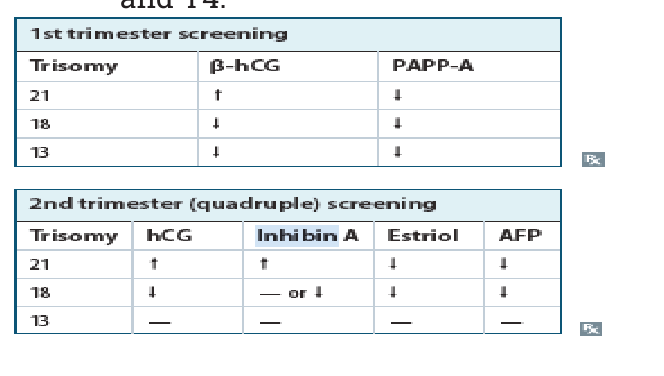

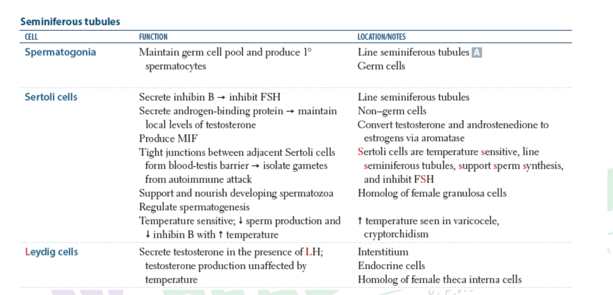

### 42. Answer: D — Mittelschmerz

*Obstetrics & Gynecology · PDF p.30*

• This term refers to the mid-cycle pain experienced by some women during ovulation. It typically occurs around the middle of the menstrual cycle, approximately 14 days before the start of the next menstrual period. The pain is usually sharp and localized to one side of the lower abdomen, corresponding to the side from which the egg is released. Incorrect Options: • Option A: While it can cause abdominal pain, ovarian cyst rupture is less likely to occur predictably around the same time each month and may present with more acute and severe pain. • Option B: Dysmenorrhea is pain that occurs during periods • Option C: Endometriosis can cause pelvic pain, but it may not follow a specific cyclical pattern. The pain associated with endometriosis is often more chronic and can occur at any time during the menstrual cycle.

### 43. Answer: C — Ovary

*Obstetrics & Gynecology · PDF p.31*

• Ovaries are a common site of endometriosis involvement. • Ovarian endometriomas, also known as chocolate cysts, can form, leading to cystic masses filled with • endometrial tissue. • Sites of Predilection • The most common site is the ovary • The second most common site is Pouch of Douglas • Bowel • Lung [periodic hemoptysis] (Vicarious Menstruation) • Nose [Periodic epistaxis] (Vicarious Menstruation) • Eyes (periodic subconjunctival hemorrhage] (Vicarious Menstruation) Incorrect Options: • Option A: Fallopian tube It is also a site for endometriosis. However, the more common site is the ovary. Endometriosis in the fallopian tubes may lead to inflammation, scarring, and potential obstruction, impacting fertility. • Option B: Cervix While endometriosis can affect the uterus, it is not the most common site. Endometriosis in the uterus may involve the outer layer (adenomyosis) or other structures, but ovarian involvement is more prevalent. • Option D: Pouch of Douglas The Pouch of Douglas, also known as the rectouterine pouch or cul-de-sac, is the space between the rectum and the back wall of the uterus. • It is the 2nd most common site for endometriosis. Endometriosis can involve the Pouch of Douglas, causing pain and adhesions in this area.

### 44. Answer: C — Inhibin B

*Obstetrics & Gynecology · PDF p.31*

• Granulosa cell tumors of the ovary often produce inhibin. Inhibin B, in particular, is a specific marker associated with granulosa cell tumors. Therefore, monitoring inhibin B levels can be valuable for detecting recurrence and assessing response to treatment in patients with granulosa cell tumors. Incorrect Options: • Option A- CA 125: CA 125 is a tumor marker that is commonly used for monitoring epithelial ovarian cancers. However, it is not typically elevated in granulosa cell tumors. Therefore, CA 125 is not the most appropriate marker for detecting recurrence in this context. • Option B- LDH: LDH is a tumor marker for dysgerminoma and yolk sac tumor • Option D- Placental Alkaline phosphatase (PLAP): PLAP is a tumor marker for dysgerminoma

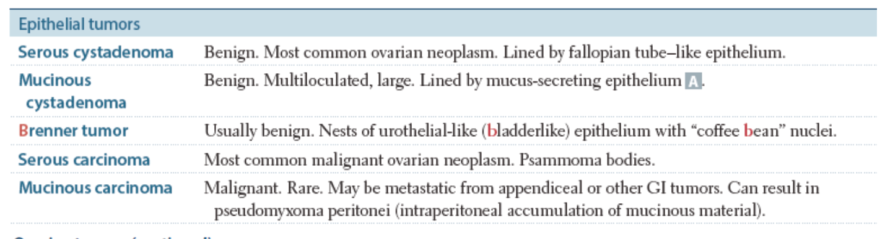

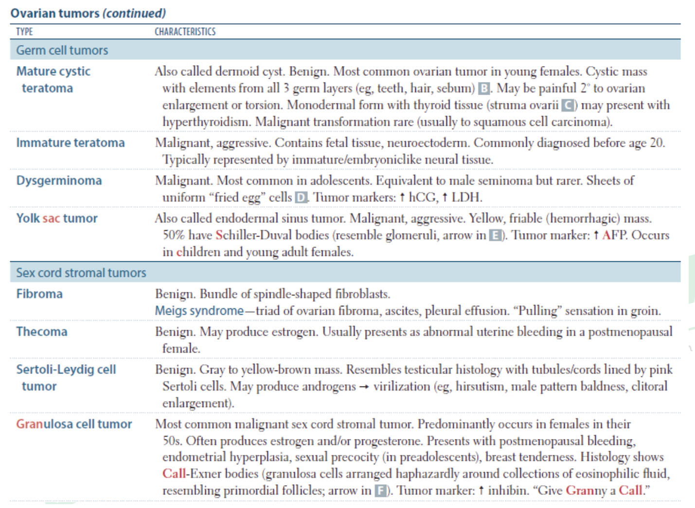

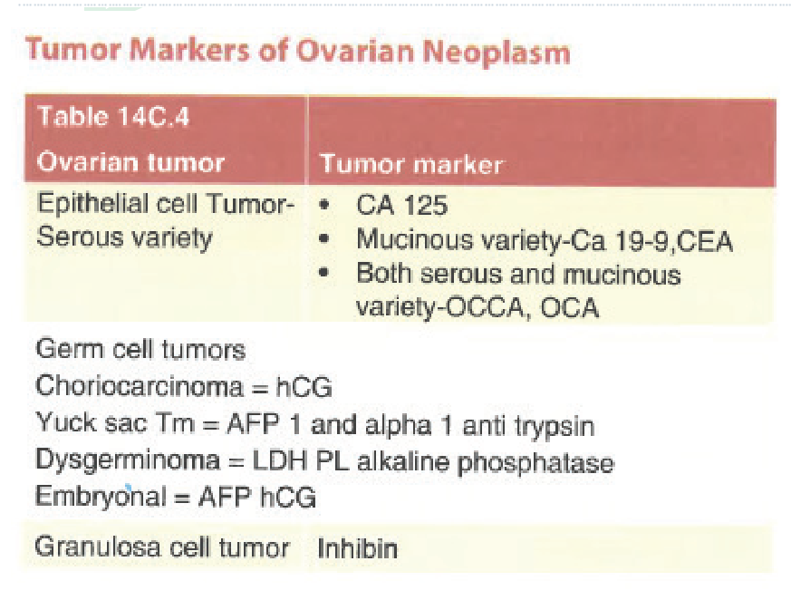

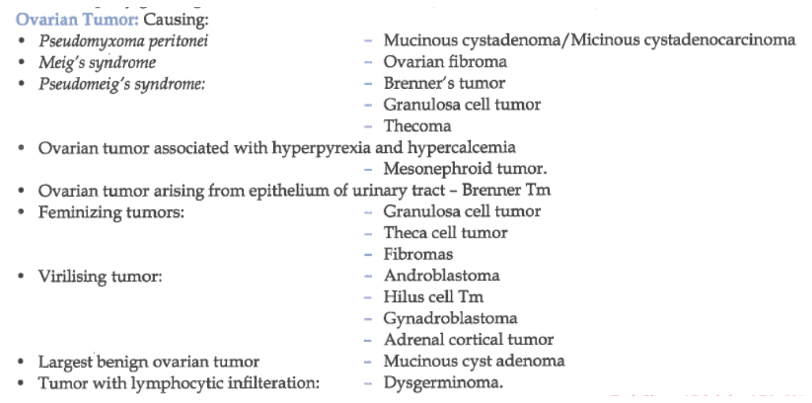

### 45. Answer: B — Unexplained vaginal bleeding

*Obstetrics & Gynecology · PDF p.33*

• Unexplained vaginal bleeding serves as an absolute contraindication for the insertion of an intrauterine contraceptive device. Incorrect Options: • Option A: Having a history of treated Pelvic Inflammatory Disease (PID) is not a contraindication for IUCD use. However, if a patient currently has PID, it is considered an absolute contraindication due to the increased risk of infection. • Option C: Having a history of ectopic pregnancy is not a contraindication for intrauterine contraceptive device (IUCD) insertion, provided that a current pregnancy is ruled out and there is no evidence of a pregnancy located in the fallopian tubes (ectopic pregnancy). The decision to insert an IUCD should consider the absence of current ectopic pregnancy and the individual’s reproductive health status. • Option D: Having HIV is not a contraindication for the insertion of an IUCD.

### 46. Answer: C — Complete androgen insensitivity syndrome

*Obstetrics & Gynecology · PDF p.33*

• Complete androgen insensitivity syndrome is a condition where a genetic male (XY chromosomes) is resistant to the effects of androgens, resulting in the female external genitalia and lack of pubic or axillary hair. These individuals have well-developed breasts due to the presence of estrogen receptors. However, they do not have a uterus or ovaries, leading to primary amenorrhea. Incorrect Options: • Option A: Turner syndrome It is characterized by the complete or partial absence of the X chromosome in females. Typical features include short stature, lack of secondary sexual characteristics (such as breast development), and primary amenorrhea. However, women with Turner syndrome do not have well- developed breasts. • Option B: Stein-Leventhal syndrome Also known as polycystic ovary syndrome (PCOS), is characterized by ovarian cysts, irregular menstrual cycles, and often features such as hirsutism (excessive hair growth) and obesity. The patient in question does not exhibit signs of hirsutism or obesity. • Option D: Premature ovarian failure It refers to the loss of ovarian function before the age of 40. It can lead to primary or secondary amenorrhea. While this is a possibility, the absence of pubic or axillary hair and well-developed breasts in the given patient suggests an androgen insensitivity syndrome rather than premature ovarian failure.

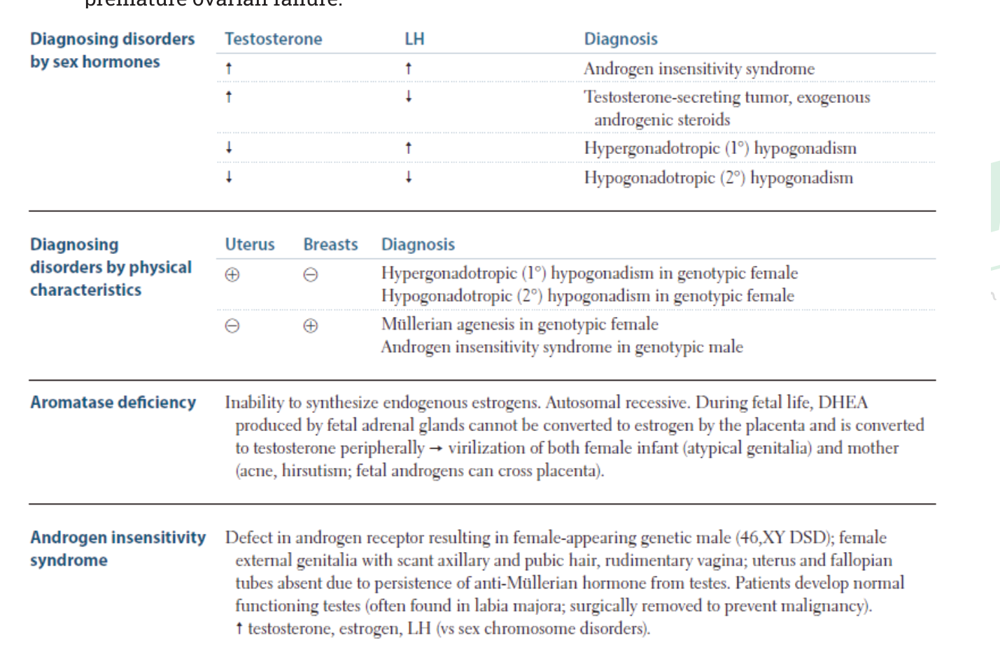

### 47. Answer: B — Hypertension and IUCD use

*Obstetrics & Gynecology · PDF p.34*

Risk factors for the development of cervical cancers • Commercial sex worker • Women with many sex partners • Partner with STD • Early intercourse (<16 yrs) • Low socio-economic status • Smoking • HPV16: Most commonly associated • HPV18: most malignant Incorrect Options: Options A, C and, D are all considered risk factors and, hence, incorrect.

### 48. Answer: D — 9 weeks

*Obstetrics & Gynecology · PDF p.35*

• The median time for normalization of hCG level is 7 weeks for partial moles and 9 weeks for complete moles. The normalization of hCG levels is an important marker indicating successful treatment and resolution of the molar pregnancy. During this period, close monitoring of hCG levels is essential to ensure that they steadily decline, and subsequent follow-up is necessary to confirm the absence of any persistent trophoblastic disease. Syncytiotrophoblasts secrete hCG, which is detectable in blood 1 week after fertilization and on home urine tests 2 weeks after fertilization. Placental hormone secretion generally increases over the course of pregnancy, but hCG peaks at 8–10 weeks of gestation. Incorrect Options: • Option A - 6 weeks • Option B: 12 weeks • Option C: 8 weeks

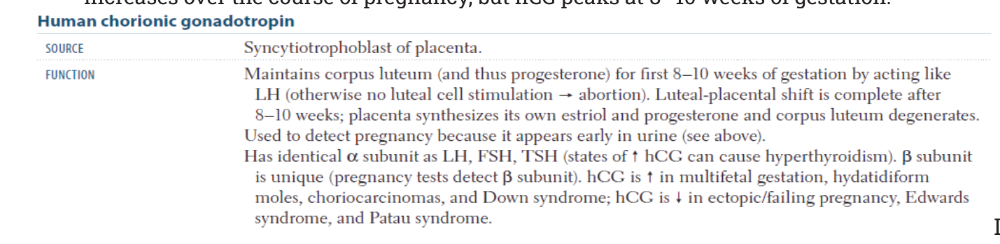

### 49. Answer: B — Full course of Hepatitis B vaccine and immunoglobulin to the child

*Obstetrics & Gynecology · PDF p.36*

• The child is born to a HBsAg-positive mother. He is at risk of developing the infection. He should be given Hep B immunoglobulins and a full course of Hep B vaccine as per schedule to prevent the infection. Incorrect Options: • Option A: Hepatitis B vaccine to the child Vaccine alone is insufficient to prevent the infection. Immunoglobulins must accompany it to ensure the child does not develop the infection. • Option C: Antiviral therapy after baby tests positive HBV transmission is mainly perinatal during delivery and breastfeeding, not transplacental . The baby is already at risk of developing the infection. Waiting for the baby to test positive is not the best action. • Option D: No management required for a healthy neonate The child is born to an HBsAg-positive mother. He is at risk of developing the infection. So, prevention strategies should be initiated even though the child is healthy.

### 50. Answer: D — Cardiac defect

*Obstetrics & Gynecology · PDF p.36*

• Bipolar disorder is treated with lithium, antidepressants, valproate, carbamazepine, and atypical antipsychotics. Lithium, a mood stabilizer, should not be used during pregnancy, especially during the first trimester (period of organogenesis), because of its possible teratogenicity. • High-resolution ultrasound with fetal anomaly scanning at 20 weeks is mandatory. • It is associated with severe fetal anomalies, particularly the Ebstein anomaly of the heart. • Ebstein anomaly is characterized by apical displacement of the tricuspid valve, often resulting in tricuspid regurgitation and marked right atrial(RA) enlargement, this leads to atrialization of the right ventricle. • When lithium is prescribed during pregnancy, its blood levels should be monitored weekly in the third trimester. • If lithium is discontinued during pregnancy, it should be restarted after delivery at a higher dose Incorrect Options: • Option A: Neural tube defects Neural tube defects are associated with maternal diabetes and folate deficiency. Anti-epileptics such as valproate and carbamazepine are associated with neural tube defects. It is not related to lithium intake. • Option B: Facial defects Facial defects are associated with isotretinoin, warfarin and valproic acid. Lithium does not cause facial defects. • Option C: Urogenital defects Anticonvulsants such as carbamazepine and phenobarbital are associated with urogenital defects. Lithium does not result in urogenital defects.

### 51. Answer: B — Lower central incisor →Lateral incisor →1st molar→ canine →2 molar

*Pediatrics · PDF p.37*

• Milk teeth: Lower central incisor →Lateral incisor →1st Molar →canine →2 molar • This is the normal sequence of milk teeth eruption Eruption sequence of temporary tooth Primary dentition • Mandibular central: 6 months • Mandibular lateral: 7 months • Maxillary central: 721​ months • Maxillary lateral: 9 months • Mandibular 1st molar: 12 months • Maxillary 1st molar: 14 months • Mandibular cuspid: 16 months • Maxillary cuspid: 18 months • Mandibular 2nd molar: 20 months • Maxillary 2nd molar: 24 months Eruption sequence of permanent tooth @Mom Is In Pune, Papa Can Make Maggi Mnemonic Word Tooth Type Eruption Age Mom 1st Molar 6−7 years Is Central Incisor 7−8 years In Lateral Incisor 8−9 years Pune 1st Premolar 9−10 years Papa 2nd Premolar 10−11 years Can Canine 11−12 years Make 2nd Molar 12−13 years Maggi 3rd Molar 18−25 years

### 52. Answer: A — Mild MR

*Pediatrics · PDF p.38*

• Child with an IQ of 55 comes under Mild Mental Retardation. Intelligence is usually measured by • calculating IQ. IQ is an intelligence quotient. IQ of 50-69 range belongs to the category of mild mental retardation. Such individuals can study up to 6th class and are educable. They can achieve self-sufficiency. The mental age (age of one’s intellect) of such individuals is 9-12 years. Incorrect Options: • Option B: Moderate retardation IQ of 35-49 • Option C: Severe retardation IQ of 20-34. • Option D: Profound retardation IQ < 20

### 53. Answer: A — Sacral agenesis

*Pediatrics · PDF p.38*

• Most specific neurologic abnormality in DM: Sacral agenesis or caudal regression syndrome. Incorrect Options: • Option B - Neural tube defects Most common congenital neurologic abnormality in DM: Neural tube defects • Option C – Hydrocephalus : It is caused by abnormal build up of CSF within the ventricles of the brain. It is not associated with maternal diabetes mellitus. • Option D - Dilated large ventricle: Ventriculomegaly is a condition in which the ventricles appear larger than normal on a prenatal ultrasound. It has several causes, but has no known association with maternal diabetes mellitus.

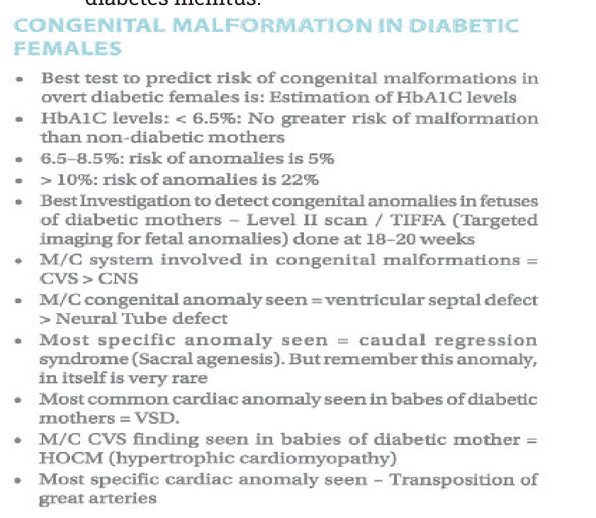

### 54. Answer: C — IV fluids ± TPN (total parenteral nutrition)

*Pediatrics · PDF p.39*

• Preterm babies <28 weeks gestation have: o Inadequate sucking efforts o Lack of propulsive gut motility • These babies are best initially fed by intravenous fluids or total parenteral nutrition. • It is the preferred method of feeding a preterm baby born at 27 weeks of gestation • Inadequate sucking efforts • Lack of propulsive gut motility Incorrect Options: • Option A- Orogastric tube feeding [gavage feeding]: This is for neonates of gestational age 28-31 weeks • Option B - Katori spoon paladai feeding or feeding: This is for neonates of gestational age 32-34 weeks • Option D - Direct breastfeeding: This is for neonates of gestational age > 34 weeks

### 55. Answer: D — Blood glucose level <54 mg/dl

*Pediatrics · PDF p.39*

• In severe acute malnutrition, hypoglycemia is defined as a blood glucose level <54 mg/dl (or 3 mmol/l) Hypoglycemia causes symptoms by activating the autonomic nervous system, such as sweating, trembling, flushing, anxiety, palpitation, and hunger. Blood glucose levels should be checked if there are any concerning clinical signs of hypothermia, apnea, anorexia, listlessness, or lethargy in a malnourished child. • Hepatic gluconeogenesis is decreased in patients with hypoalbuminemia, and energy production from substrates such as galactose and fructose is also impaired. Incorrect Options: • Option A - Blood glucose level < 60 mg/dl: Hypoglycemia is a blood sugar level of less than 54 mg/dl. This level falls below the lower limit of the normal range. • Option B - Blood glucose level < 75 mg/dl: This range falls into the normal range of blood sugar levels. The child will develop no obvious signs or symptoms of hypoglycemia. • Option C - Blood glucose level < 190 mg/dl: This level indicates hyperglycemia. • Neonatal hyperglycemia is defined as serum glucose more than 150 mg/dl (8.3 mmol/L) or blood glucose greater than 125 mg/dl (6.9 mmol/L).

### 56. Answer: B — Koplik spots: Rubeola

*Pediatrics · PDF p.39*

• Koplik spots are pathognomonic for Rubeola or measles. Koplik spots are characterized as clustered, white lesions on the buccal mucosa (opposite the lower 2nd molars on the buccal mucosa). • White lesions of the measles are present on an erythematous base and appear like grains of salt on a reddish background. • Koplik spots appear 2 to 3 days before the measles rash and are the first manifestation of the measles. • Option A: Forchheimer spot: Erythema infectiosum Forchheimer spots are seen in Rubella or German measles. Forcheimer spots are tiny rose-coloured lesions on the soft palate. These spots can be seen simultaneously as the rubella rash appears on the face. Slapped cheek appearance is characteristic of Erythema infectiosum. • Option C: Slapped cheek appearance: Molluscum contagiosum Slapped cheek rash is seen in erythema infectiosum or fifth disease. The fifth disease is caused by parvovirus B19. A nodular rash with a central indentation is a characteristic finding for Molluscum contagiosum. • Option D: Nodular rash: Rubell The nodular rash is seen in individuals infected with poxvirus. Poxvirus causes Molluscum contagiosum. Forcheimer spots are a characteristic finding of Rubella or German measles

### 57. Answer: C — Ethosuximide

*Pediatrics · PDF p.40*

• The most likely diagnosis in this case is absence seizures, previously known as petit mal seizures Absence seizures are a type of generalized non-motor seizure characterized by sudden brief episodes of altered consciousness without any convulsive movements. -The hallmark of absence seizures is a sudden onset and offset of impairment of consciousness, often accompanied by subtle automatisms like lip smacking, blinking, or staring spells. • The mainstay of treatment for absence seizures focuses on the medication to control and prevent these seizures from recurring. • The first-line treatment for absence epilepsy is ethosuximide. • It works by blocking the thalamic T-type calcium channels. • Side effects include fatigue, GI distress, headache, and/or itching. • Here’s an explanation of the options: Phenytoin: Phenytoin is an antiepileptic drug that is used to treat various types of seizures. However , it is not the first-line treatment for absence seizures. Phenytoin is more commonly used for focal (partial) seizures and tonic-clonic seizures. Valproic acid: Valproic acid is an antiepileptic drug that can be effective for various seizure types, in cluding absence seizures. However, it is generally considered as a second-line option for absence seiz ures, especially in cases where ethosuximide is ineffective or not well-tolerated. Levetiracetam: Levetiracetam is another antiepileptic drug that can be effective for various seizure types. While it may have a role in treating certain types of seizures, including absence seizures, it is not the first-line treatment for this specific seizure type.

### 58. Answer: B — Serum antibodies against alpha 3 NC 1 domain of collagen-IV

*Pediatrics · PDF p.40*

• In Goodpasture syndrome, type 1 RPGN & type II hypersensitivity reactions are seen. • It is characterized by serum antibodies against the alpha 3 NC1 domain of collagen- IV. Goodpasture syndrome: • An autoimmune disorder characterized by pulmonary alveolar haemorrhages and glomerulonephritis (type 1 RPGN) Pathogenesis: • The anti-glomerular basement membrane (GBM) antibody binds to the basement membrane of both the alveolus and the glomerulus. GBM antibodies attach to the alpha 3 NC1 domain of type IV collagen contained in the vascular endothelium. • Clinical feature: • Related to lung disease: cough, dyspnea, pallor, rhonchi, oedema, and hepatomegaly. Related to kidney disease: hematuria, proteinuria, and hypertension. Diagnosis: By renal biopsy and finding antibodies to the glomerular basement membrane. Incorrect Options • Option A: Lumpy-bumpy deposits on immunofluorescence Lumpy-bumpy deposits on immunofluorescence are most commonly seen in patients having post-streptococcal glomerulonephritis. • Option C: Serum antibodies against alpha 3 NC 1 domain of collagen-VI The type 1 RPGN & type II hypersensitivity reactions are seen in good pasture syndrome. It is characterized by serum antibodies against the alpha 3 NC1 domain of type-IV collagen. • Option D: Anti-DNase antibodies positive Anti-DNAse antibodies positive test is the best single antibody to document cutaneous streptococcal infection.

### 59. Answer: B — Assessment of heart rate

*Pediatrics · PDF p.41*

• It is not a part of essential newborn care Incorrect Options: • Option A, C & D: Thorough drying / Skin to skin contact & Early initiation of breastfeeding: These are components of essential newborn care

### 60. Answer: D — Any diastolic murmur

*Pediatrics · PDF p.41*

Nada’s Criteria • It is used to assess the presence of congenital heart disease • 1 major or 2 minor criteria indicates the possibility of Congenital Heart Disease • Major Criteria o Systolic murmur Grade 3 or more o Any diastolic murmur o Cyanosis o Congestive heart failure • Minor Criteria o Systolic murmur < Grade 3 o Abnormal S2 o Abnormal BP o Abnormal ECG o Abnormal Chest X-ray • One of the major criteria under it is the presence of any diastolic murmur • Other major criteria are: Systolic murmur Grade 3, Cyanosis, Congestive heart failure Incorrect Options: • Option A - Systolic murmur < Grade 3 • Option B - Abnormal S2 • Option C - Abnormal BP • These are the minor criteria of Nada’s criteria Pediatric Cardiology Facts Most common congenital heart disease is Ventricular septal defect Most common congenital heart disease, affected by Infective endocarditis is Ventricular septal defect • Most common heart disease in Down syndrome is AV septal defect or Endocardial cushion defect • Most common type of Atrial Septal Defect is Ostium secundum • Most common heart disease in Turner syndrome is Bicuspid Aortic valve • Most common site of coarctation of aorta is juxtaductal • Most common congenital heart disease causing mortality in 1st week of life is Hypoplastic left heart syndrome • Most common cause of heart disease in children in developing countries is Rheumatic Heart disease (RHD) • Most common age group involved in Rheumatic fever is 5−15 years. • Most common symptom of infective endocarditis is fever • Most common cause of myocarditis in Infant = Cox sackie virus • Most common aortic branch involved in Takayasu arteritis: Left subclavian artery • Most common associated anomaly with coarctation of aorta: Bicuspid valve • Most common cause of coronary artery aneurysm worldwide: Kawasaki diseases • Most common cause of cyanosis in a child: Tetralogy of Fallot

### 61. Answer: A — 10 mg/day for 14 days

*Pediatrics · PDF p.42*

• Zinc: Reduces duration and severity of diarrhea in children from developing countries. For a 2-6-month- old child, the dose is 10 mg/day for 14 days Incorrect Options: • Option B - 20 mg/day for 14 days • Option C - 15 mg/day for 14 days • Option D - 25 mg/day for 14 days • These are not the correct dose of Zinc in a 5-month-old child

### 62. Answer: A — MDI with spacer with face mask

*Pediatrics · PDF p.42*

• A Metering dose inhaler (MDI) is typically used to treat respiratory diseases such as asthma and COPD; it can be administered as a suspension or solution. • Advantages of Facemasks: They provide increased drug delivery and are suitable for patients with poor inhalation technique or limited coordination, reducing aerosol loss and enhancing compliance, especially in children and elderly populations. A metered-dose inhaler is a small, hand-held device that contains medicine and treats breathing problems. It aids in delivering medication through the mouth and into the lungs. According to current asthma guidelines, children aged 1 to 3 should use an MDI /VHC with a mask, and spacer/VHC.

### 63. Answer: C — Two or more domains

*Pediatrics · PDF p.43*

• Global developmental delay is defined as a delay in acquiring milestones in two or more of the following domains: gross and fine motor skills, speech and language, cognition, socio-personal skills, and activities of daily living.

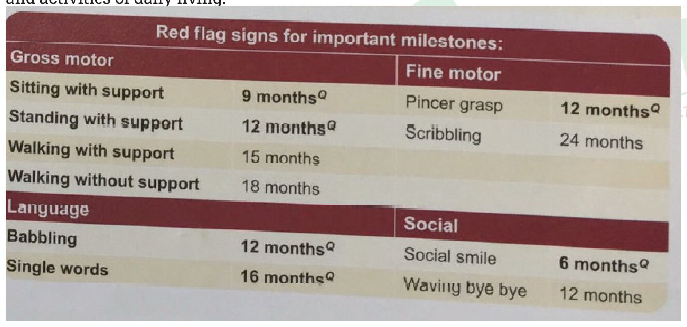

### 64. Answer: B — Thickened nuchal fold

*Pediatrics · PDF p.43*

• Ultrasound between 14 and 24 weeks of gestation can be a diagnostic tool for trisomies. The diagnosis is mainly based on soft markers such as increased nuchal fold thickness, small or no nasal bone, and large ventricles. • The most common prenatal USG markers of Down syndrome are as follows: Increased Thickness of nuchal fold of more than 3 mm (75% sensitive) Absent/hypoplastic nasal bone (58% sensitive) Cardiac defects • Duodenal atresia • Shortened femur and humerus • Echogenic bowel • Choroid plexus cysts Incorrect answer: • Option A: Absent nasal bone It is also a soft marker, which helps diagnose trisomy 21. However, it is only 58% sensitive. • Option C: Short femur The short femur is also a soft marker to be diagnosed via USG, but it is the least sensitive. • Option D: Echogenic Bowel An echogenic bowel is also a soft marker of trisomy 21 to be diagnosed via USG, but it is the least sensitive.

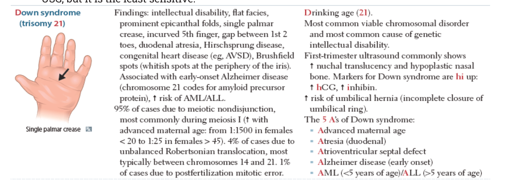

### 65. Answer: B — Yellow Fever

*Pediatrics · PDF p.44*

• The majority of the intramuscular inactivated influenza vaccines (IIVs) and the intranasal live-attenuated influenza vaccine (LAIV) are cultured on fluid from chicken embryos. As a result, there is a small amount of egg protein in these vaccines. Thus, there is a theoretical risk of inducing an allergic reaction when administering the influenza vaccine to a person with hen’s egg (HE) allergy. Yellow fever vaccine Influenza vaccine • Option A: MMR Measles, Mumps, and Rubella (MMR) Vaccination. The CDC recommends that people get the MMR vaccine to protect against measles, mumps, and rubella. • Option C: DPT DTaP vaccine can prevent diphtheria, tetanus, and pertussis. Diphtheria and pertussis spread from person to person. Tetanus enters the body through cuts or wounds DIPHTHERIA (D) can lead to difficulty breathing, heart failure, paralysis, or death. DPT is not contraindicated in patients with egg allergy. • Option D: BCG Bacille Calmette-Guérin (BCG) is a vaccine for tuberculosis (TB) disease. BCG is not contraindicated in egg allergy.

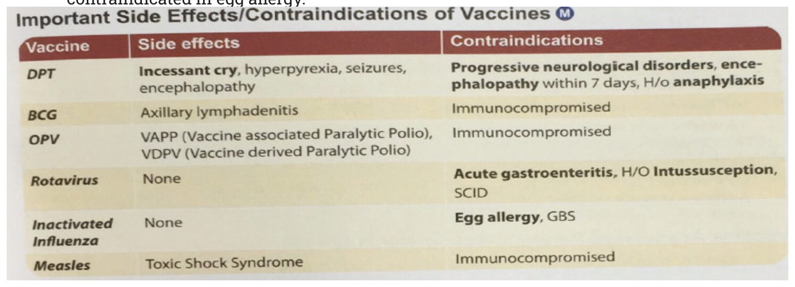

### 66. Answer: C — Pin tract infections

*Orthopedics · PDF p.45*

• A ring sequestrum refers to a circular or ring-like formation of necrotic bone within the soft tissue at the site of an amputation or surgical intervention. Pin tract infection in external fixation often leads to the osteomyelitis which results in the formation of ring sequestrum in the affected bone. Incorrect Options: • Options A - Fungal infection: Fungal infection is not specifically associated with the development of ring sequestrum. • Options B - Septic arthritis: Septic arthritis may cause bone destruction and necrosis, but the characteristic ring sequestrum is not commonly seen in this condition. • Options D - Acute osteomyelitis: The development of ring sequestrum is not seen in acute osteomyelitis.

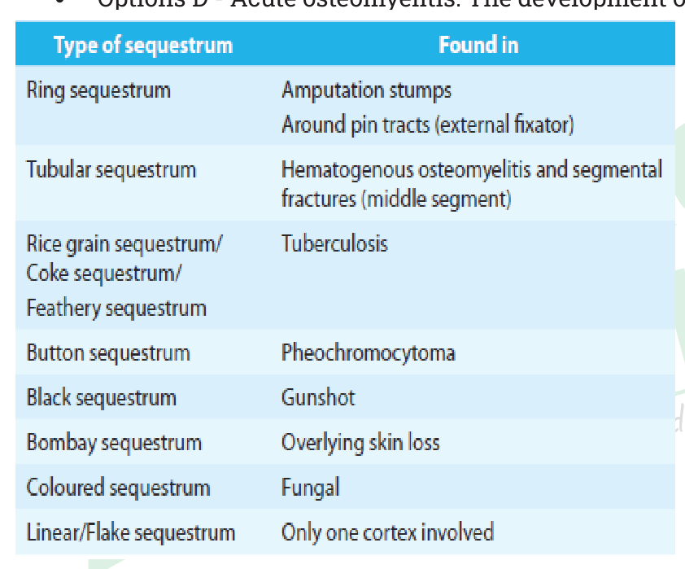

### 67. Answer: C — Narrowing of intervertebral disc space

*Orthopedics · PDF p.45*

• Radiological Image Feature The Earliest X-ray feature is loss of Curvature due to paravertebral spasm. • The next radiological feature of spinal tuberculosis is reduction of intervertebral disk space and osteoporosis of two adjacent vertebrae sometimes with fuzziness of the endplates. Paraspinal abscess appears as fusiform shadows along vertebral column. X-rays can show scalloping effect or aneurysmal appearance or saw tooth appearance due to erosions by abscess or aortic pulsations. MRI is one of the best radiological investigations for Pott’s Spine (showing soft tissues, cartilage and marrow changes). Remember that radiological picture always lags behind the biological process which is already more progressive. • Clinical Feature • Back pain, Usually minimal, is the Commonest symptom (1st symptom). • Tenderness is the earliest sign. Twist tenderness for Anterior elements is more significant as disease is anteriorly involving the vertebral body (paradiscal). • Paravertebral muscle spasm resulting in stiffness in the affected region is a constant early finding. The spine is held rigid. When picking an object up from floor, there is flexion at hips and knees and the spine is in extension, (Coin test). • Earliest sign in patient with neurological deficit—Increased deep tendon reflexes or clonus or extensor plantar response (twitching of muscles can be seen even earlier).

### 68. Answer: A — Prostate metastasis

*Orthopedics · PDF p.46*

Explanatio: • Metastatic Bone Disease • Most common primary is Breast>Prostate (overall) • Most common sites of primary for bone metastasis: • In males – Prostate > Lung • In Female – Breast > Lung • In Children – Neuroblastoma • Skeletal sites most frequently involved: Spine (Dorsal) • Lytic expansile metastasis seen in: Renal cancer, Thyroid carcinomas • Purely Osteoblastic secondaries: Prostate/Carcinoid/Medulloblastoma • Metastasis distal to knee and elbow is rare and usually arises from a primary tumors of the Bronchus, Bladder and Colon (BBC) • “BBC Can Go Anywhere even distal to Elbow and Knee”

### 69. Answer: C — Grade 3a

*Orthopedics · PDF p.46*

_The source paper prints no explanation for this question._

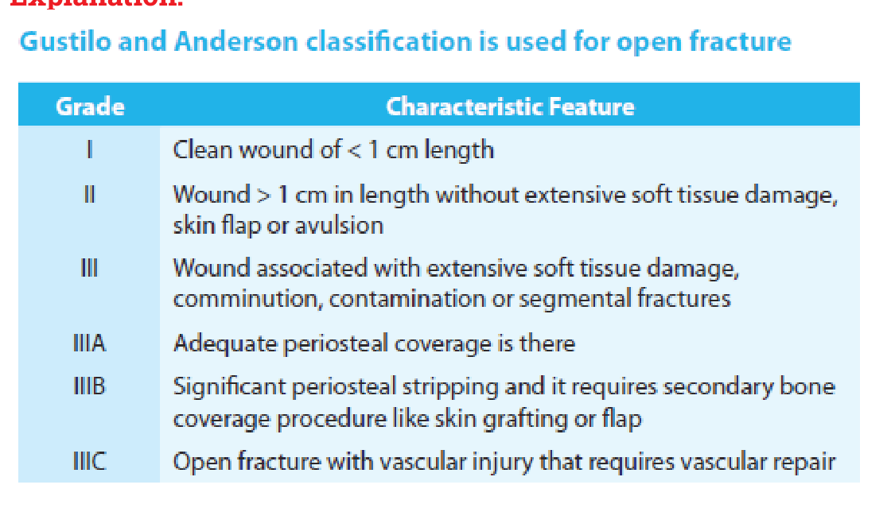

### 70. Answer: A — Supracondylar Fracture humerus

*Orthopedics · PDF p.47*

• Three Point Bony Landmarks In Elbow: • The tips of medial and lateral epicondyles and the olecranon. • Form Isosceles triangle—In Elbow flexion of 90 degree. • Lie transversely in straight line—Elbow Extension. • Three point bony relationship is not disturbed in fracture supracondylar humerus as the fracture occurs above the level of these bony landmarks. • With disturbed (increased) intercondylar distance: o Fracture lateral epicondyle and condyle o Fracture medial epicondyle and condyle o Fracture intercondylar humerus. • With maintained intercondylar distance: o Fracture olecranon (i.e. upper end ulna) o Elbow dislocation (classical example)

### 71. Answer: C — Conus medullaris lesion

*Orthopedics · PDF p.47*

• Conus medullaris syndrome is characterized by bilateral saddle anesthesia, prominent bladder bowel dysfunction and impotence with loss of bulbocavernosus and anal reflex but with the preservation of muscle strength largely.

### 72. Answer: D — Cervical

*Orthopedics · PDF p.47*

• Joint Involved In Rheumatoid Arthritis • RA can affect any diarthrodial joint and most often causes symmetrical arthritis. • Commonly Involved Joint (these 14 joints are used for diagnosis according to 1987 criterion) Right or left • Wrist joint • Metacarpophalangeal (MP) joint • Proximal interphalangeal (PIP) joint • Elbow • Knee • Ankle • Metatarsophalangeal joint • Less Common Involvement: • Upper cervical spine (facet joint) with Atlantoaxial subluxation • Commonest areas affected in axial skeleton: Hip joint, Temporomandibular joint

### 73. Answer: D — Bow legs

*Orthopedics · PDF p.48*

_The source paper prints no explanation for this question._

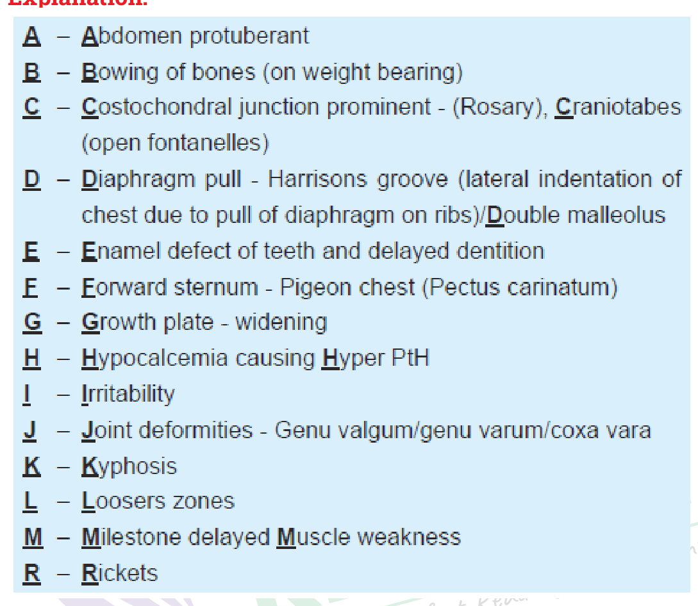

### 74. Answer: D — Oppose the thumb

*Orthopedics · PDF p.48*

• Abductor pollicis brevis (producing abduction of thumb) and opponens pollicis (producing opposition of thumb) are paralysed in low median nerve palsy (in carpal tunnel). So, opposition of thumb is lost. • Abduction of thumb can be also carried out by abductor pollicis longus supplied by radial nerve. • Flexor pollicis longus will be intact to carry out flexion at thumb phalanx as it is supplied by AIN nerve branch of median nerve above carpal tunnel and adductor pollicis will cause adduction as it is supplied by ulnar nerve.

### 75. Answer: B — Trimalleolar fracture

*Orthopedics · PDF p.48*

_The source paper prints no explanation for this question._

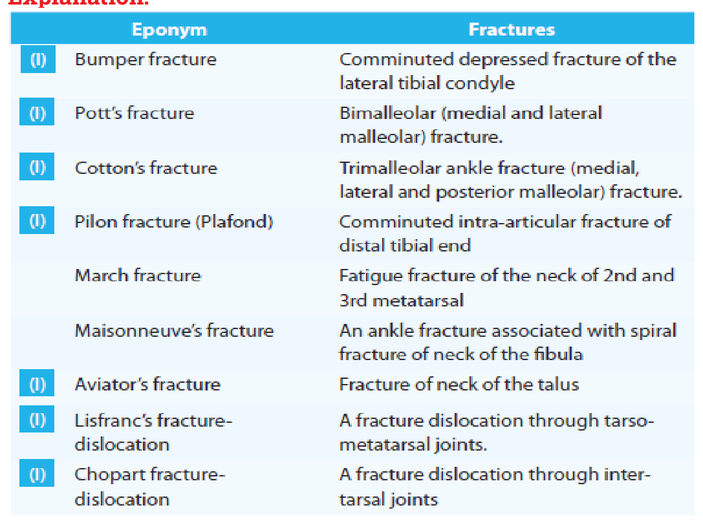

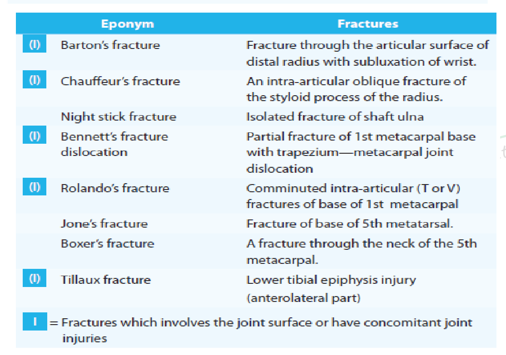

### 76. Answer: B — Staphylococcus aureus

*ENT · PDF p.49*

• The clinical presentation is suggestive of furunculosis. Staphylococcus aureus is a common causative organism in furunculosis. Incorrect Options: • Option A- Pseudomonas aeruginosa: Pseudomonas aeruginosa is not a common cause of furunculosis. • Option C- Candida albicans: Candida albicans is not a common cause of furunculosis. • Option D- Aspergillus niger: Aspergillus niger is not a common cause of furunculosis.

### 77. Answer: C — Macula

*ENT · PDF p.50*

• The neurosensory epithelium that covers the Saccule and the Utricle is called the Macula. Incorrect Options: • Option A - Cristae: Cristae are specialized structures found in the ampullae of the semicircular canals and are involved in detecting rotational movements, not in the saccule and utricle. • Option B - Cupula: The cupula is a gelatinous structure located in the ampullae of the semicircular canals. • Option D - Ampulla: An ampulla is a dilated portion of the semicircular canal where the crista and cupula are located

### 78. Answer: C — Antero-inferior region

*ENT · PDF p.50*

• The most common area affected in the middle ear is the antero-inferior region. Incorrect Options: • Option A- Posteroinferior region: This region is not the most common area affected in tubotympanic CSOM. • Option B - Postero-superior region: This region is more commonly associated with atticoantral CSOM, rather than tubotympanic CSOM. • Option D- Antero-superior region: This region is not the most common area affected in tubotympanic CSOM.

### 79. Answer: A — Greater superficial petrosal nerve

*ENT · PDF p.50*

• The lacrimation (tearing) is mediated by the greater superficial petrosal nerve, a branch of the facial nerve (CN VII). This nerve carries parasympathetic fibers to the lacrimal gland, which stimulates tear production. • The lacrimation (tearing) is mediated by the greater superficial petrosal nerve, a branch of the facial nerve (CN VII). This nerve carries parasympathetic fibers to the lacrimal gland, which stimulates tear production. Incorrect Options: • Option B - Nerve to stapedius: The nerve to the stapedius is responsible for innervating the stapedius muscle in the middle ear, contributing to the acoustic reflex. It is not involved in lacrimation. • Option C - Chorda tympani nerve: The chorda tympani nerve, another branch of the facial nerve, is responsible for taste sensation from the anterior two-thirds of the tongue and for the control of the submandibular and sublingual salivary glands. It is not associated with lacrimation. • Option D - Nerve of Wrisberg: The nerve of Wrisberg refers to the lesser petrosal nerve, another branch of the facial nerve. It carries parasympathetic fibers to the parotid gland and is not involved in lacrimation.

### 80. Answer: B — Dix-Hallpike maneuver

*ENT · PDF p.51*

• Dix-Hallpike maneuver, which is used for diagnosing BPPV in patients with vertigo and no hearing loss. If BPPV is confirmed through this maneuver, further treatment, such as the Epley maneuver, can be considered to alleviate the symptoms associated with BPPV. • When a patient presents with vertigo but no hearing loss, one of the diagnostic maneuvers that can be performed by adoctor to assess for benign paroxysmal positional vertigo (BPPV) is the Dix-Hallpike maneuver Dix-Hallpike maneuver is a clinical test used to diagnose BPPV, acommon cause of vertigo. Here’s an explanation of the options: Hampton’s maneuver: This term is not commonly associated with a • specific diagnostic maneuver for vertigo. It may not be a recognized medical term. • Dix-Hallpike maneuver: This is the correct option. During the Dix-Hallpike maneuver, the patient is moved into specific positions to provoke characteristic vertigo and nystagmus (involuntary eye movements) if BPPV is present. It helps in diagnosing the affected ear and canal involved in BPPV. • Epley’s maneuver: Epley’s maneuver is a therapeutic maneuver used to treat BPPV. It involves a series of head and body movements designed to reposition dislodged calcium carbonate crystals (otoconia) in the inner ear, which can cause BPPV. It is used after a diagnosis has been made through the Dix-Hallpike maneuver. Simon’s maneuver: Simon’s maneuver is not a well-known diagnostic or therapeutic maneuver for vertigo and is not typically associated with BPPV diagnosis or treatment.

### 81. Answer: A — Frontal sinus

*ENT · PDF p.51*

• It is absent at birth and the last sinus to develop. • Pyramidal in shape. • Drains into middle meatus of nose. • Drainage pathway: Frontal recess. Incorrect Options: • Option B - Ethmoidal sinus: The ethmoidal sinus is not the last sinus to develop. • Option C - Maxillary sinus: The maxillary sinus is the first sinus to develop and the first sinus to be visible radiologically. • Option D - Sphenoid sinus: The sphenoid sinus is not the last sinus to develop.

### 82. Answer: A — Subperiosteal abscess of frontal bone

*ENT · PDF p.52*

• Pott’s puffy tumor is a rare complication of frontal sinusitis that involves the spread of infection from the frontal sinus to the overlying frontal bone. Pott’s puffy tumor refers to a subperiosteal abscess that develops on the frontal bone as a result of the spread of infection from the frontal sinus. It is characterized by localized swelling, erythema, and tenderness of the forehead. Incorrect options • Option b. Subperiosteal abscess of ethmoid bone: Pott’s puffy tumor specifically involves the frontal bone and not the ethmoid bone. The ethmoid bone is located in the medial part of the skull and is associated with different conditions such as ethmoid sinusitis or ethmoidal mucoceles. • Option C. Mucocele of frontal bone: A mucocele refers to the accumulation of mucus within a paranasal sinus. While mucoceles can occur in various sinuses. • Option D. Mucocele of ethmoid bone: Similar to option c, mucoceles are not directly associated with Pott’s puffy tumor, which involves the frontal bone rather than the ethmoid bone.

### 83. Answer: A — Fossa of Rosenmuller

*ENT · PDF p.52*

• The most common site of origin for nasopharyngeal cancer is the Fossa of Rosenmuller. This area is located at the junction of the posterior nasal cavity and the nasopharynx, making it susceptible to the development of tumors. Incorrect Options: • option B - Sphenopalatine foramen: Sphenopalatine foramen is the most common site of origin for JNAF, but it is not the most common site of origin for nasopharyngeal cancer. • Option C - Eustachian tube opening: The Eustachian tube is not the primary site of origin for nasopharyngeal cancer. • Option D - Roof of the nasopharynx: The roof of the nasopharynx is not the most common site of origin for nasopharyngeal cancer.

### 84. Answer: B — Arytenoid cartilage

*ENT · PDF p.52*

• Elastic cartilage is a type of cartilage that contains elastic fibers, providing flexibility and resilience. • The arytenoid cartilage is not an elastic cartilage of the larynx; instead, it is a hyaline cartilage. Incorrect Options: • Option A - Epiglottis: The epiglottis is an elastic cartilage of the larynx. • Option C - Cuneiform cartilage: The cuneiform cartilages are small, rod-like elastic cartilages located in the aryepiglottic folds of the larynx. • Option D - Corniculate cartilage: The corniculate cartilages are paired elastic cartilages located on top of the arytenoid cartilages.

### 85. Answer: A — Infra-orbital nerve

*ENT · PDF p.53*

• The presentation of periorbital ecchymosis (bruising around the eye) and a step deformity (an abnormal contour or alignment) following a motor vehicle accident suggests a tripod fracture. The infra-orbital nerve is a branch of the maxillary nerve, which is the most common nerve to be injured in tripod fracture and results in anesthesia over the cheek region. Incorrect Options: • Option B- Buccal nerve: Buccal nerve injury is not associated with tripod fracture. • Option C- Infratrochlear nerve: Infratrochlear nerve injury does not cause anesthesia over the cheek region and is not associated with tripod fracture. • Option D- Mental nerve: Mental nerve injury does not cause anesthesia over the cheek region and is not associated with tripod fracture.

### 86. Answer: A — 7 mg/kg Body weight

*Anesthesia · PDF p.53*

• Lignocaine belongs to the amino amide group. • It is a short-acting local anesthetic. • The safe dose of lignocaine with epinephrine is 7mg/kg body weight. • The safe dosage without epinephrine is 4mg/kg body weight

### 87. Answer: B — 2 hours for liquids in adults

*Anesthesia · PDF p.53*

• A preoperative fasting period is a time prescribed before any procedure that involves general anesthesia, sedation, or regional anesthesia. During this period, no oral intake of solids or liquids is allowed. This fasting is mandatory for the safety process to protect gastric contents from pulmonary aspiration, which is supposed to happen at any time during the anesthesia. • It is considered 6 hours for milk as well as light meals, and 8 hours for fatty foods. • The collective fasting recommendation is two hours for clear and light liquids, four hours for breast milk, and six hours for solid foods, infant formula, light meals, and non-human milk. Incorrect options • Option A: 4 hours for solids in adults Eight hours of preoperative fasting is recommended for solid food in adults. • Option C: 2 hours for breast milk in infants Four hours of preoperative fasting is recommended for breast milk. • Option D: 4 hours for solids in infants It is recommended 6 hours for solid foods in preoperative fasting before anesthesia. It should be kept in mind that cereal and baby food are solid foods.

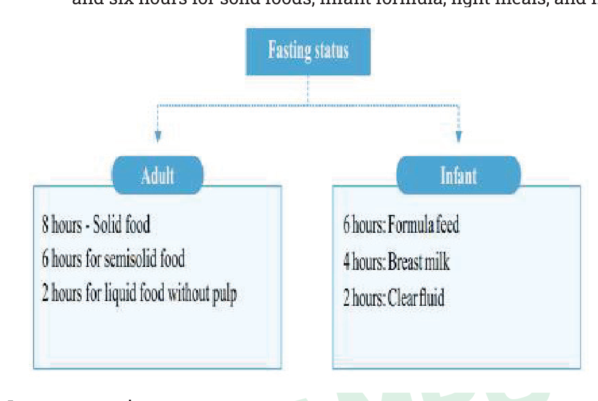

### 88. Answer: B — Sitting with neck flexed

*Anesthesia · PDF p.54*

• When inserting a Ryle’s tube, which is a type of nasogastric tube, the ideal position for the patient is sitting with the neck flexed. This position helps to straighten the nasal passage and facilitate the passage of the tube into the stomach. It allows for a more straightforward and safer insertion process. Incorrect Options: • Option A - Supine with neck flexed: This position may make the insertion of the Ryle’s tube more challenging as the neck flexion is limited in the supine position. • Option C - Supine with neck extended: This position can cause discomfort and may make the insertion of the Ryle’s tube more difficult. The neck extension can obstruct the nasal passage and hinder the passage of the tube. • Option D - Sitting with neck extended: This position may cause discomfort and can increase the risk of the tube going into the respiratory tract instead of the stomach.

### 89. Answer: B — Lidocaine

*Anesthesia · PDF p.55*

• Lidocaine is a commonly used local anesthetic with a relatively fast onset of action. It is frequently employed for intravenous regional anesthesia (IVRA), also known as Bier’s block. Lidocaine is suitable for short-duration surgical procedures, and its use allows for regional anesthesia of the limb. Incorrect Options: • Option A - Bupivacaine: Bupivacaine is a long-acting local anesthetic commonly used for various regional anesthesia techniques. Bupivacaine is more commonly utilized for epidural anesthesia, peripheral nerve blocks, and spinal anesthesia. • Option C - Ropivacaine: Ropivacaine is another long-acting local anesthetic similar to bupivacaine. While it is used for various regional anesthesia techniques, it is not typically administered through the intravenous route for IVRA. • Option D - Tetracaine: Tetracaine is a long-acting local anesthetic belonging to the ester class. Used mostly for topical anesthesia

### 90. Answer: A — Ketamine

*Anesthesia · PDF p.55*

• Ketamine is a non opioid intravenous anesthetic agent that causes emergence delirium/ hallucinations and vivid dreams due to thalamo-cortical disassociation. The most common side effect of ketamine is hallucinations. • Option B: Propofol Propofol is intravenous anaesthetic agent of choice for day care surgery because it does not have a residual effect. • Option C: Thiopentone The most common adverse effect of thiopentone sodium is laryngospasm. • Option D: Etomidate The most common adverse effect of etomidate is post operative nausea and vomiting.

### 91. Answer: A — Isoflurane

*Anesthesia · PDF p.55*

• If a coronary artery provides blood to two or three distal branches and one of them is narrowed, administration of the vasodilator may cause preferential vasodilatation of the normal vessel leading to an increase in blood flow to the area which is supplied by the normal anatomy. • This causes a relative decrease in the blood flow to the heart area supplied by the stenotic vessel. This is known as a coronary steal. • Isoflurane, more than other inhalational agents, increases coronary blood flow many times beyond the myocardial oxygen demand, thereby creating the potential for “Steal.” Isoflurane, sevoflurane, and desflurane have primary vasodilatory properties, reducing systemic vascular resistance (SVR) with relatively little initial effect on cardiac inotropy. Isoflurane and desflurane tend to produce progressive tachycardia at progressively higher concentrations, and tachycardia may be seen with sevoflurane at concentrations >1.0 MAC. • In particular, desflurane may induce tachycardia and hypertension due to its sympathomimetic properties, particularly with high or abruptly increased concentrations. Incorrect Options: • Option B - Sevoflurane: Sevoflurane also increases the blood flow of the coronary artery. However, its potency in the cardiovascular system is less than isoflurane • Option C - Desflurane: Desflurane’s main property is to cause respiratory irritation and laryngeal spasm The chances of coronary steal are less as it is not a major vasodilator of the coronary vessel • Option D - Halothane: Halothane has strong anaesthetic activity. It is a hepatotoxic drug. It also increases coronary blood flow but to a lesser extent than isoflurane.

### 92. Answer: D — High Flow Nasal Cannula

*Anesthesia · PDF p.56*

• High-Flow Nasal Cannula (HFNC) therapy is a mode of respiratory support that delivers a high flow of heated and humidified oxygen-enriched air through nasal prongs to patients with respiratory distress. Components of HFNC: • Flow generator: Provides gas flow rates up to 60 L/min. • Air-oxygen blender: Achieves FiO2 escalation from 21% to 100%, irrespective of flow rate. • Heated humidifier: Saturates the gas mixture at temperatures between 87.8°F to 98.6°F (31°C to • 37°C) Physiological mechanisms of HFNC efficacy: • Physiological dead-space washout: Elimination of waste gases, including carbon dioxide, from the anatomical dead space. Positive end-expiratory pressure (PEEP): HFNC provides a degree of PEEP, which helps keep alveoli open during exhalation. • Increased end-expiratory volume: This helps improve alveolar recruitment and facilitates gas exchange. Increased tidal volume Decreased respiratory rate Advantages of HFNC: • Decreased bronchospasm. • Reduced atelectasis. • Preservation of mucosal integrity and airway defenses due to heated humidification. • Patients can eat, drink, expectorate, and communicate verbally while receiving HFNC therapy Disadvantages of HFNC: • Cost: HFNC therapy can be expensive compared to other forms of non-invasive ventilation. Special training required: Healthcare providers need training to set up and manage the HFNC device effectively. • Decreased patient mobility: Patients may have limited mobility compared to other forms of • non-invasive ventilation. • Flow generator: Provides gas flow rates up to 60 L/min. • Air-oxygen blender: Achieves FiO2 escalation from 21% to 100%, irrespective of flow rate. • Heated humidifier: Saturates the gas mixture at temperatures between 87.8°F to 98.6°F (31°C to • 37°C) Incorrect Options: • Option A - Venturi mask: A Venturi mask is a device that delivers a precise and fixed concentration of oxygen. It works by mixing a specific amount of oxygen with room air to achieve the desired FiO2. The Venturi mask delivers a range of FiO2 levels, depending on the specific Venturi adaptor used. While it can provide accurate oxygen concentrations, it typically delivers lower FiO2 levels compared to a non- rebreathing mask. • Option B - Hudson mask: The Hudson mask is a simple mask that covers the patient’s nose and mouth It is commonly used in conventional oxygen therapy. However, it does not provide as high an FiO2 as a non- rebreathing mask. The FiO2 delivered by a Hudson mask is influenced by the patient’s breathing pattern, the fit of the mask, and the oxygen flow rate. It generally delivers a lower FiO2 than a non-rebreathing mask. • Option C- Non-rebreathing mask: Non-rebreather (NRB) masks deliver high concentrations of oxygen via a reservoir bag (600-1000 mL) and a one-way valve. The reservoir bag must be filled before use. Oxygen flow rates of 10-15 L/min achieve FiO2 levels of 65%- 95%. NRB masks are used in conditions such as smoke inhalation, carbon monoxide poisoning, and severe hypoxia. Contraindications include facial trauma and claustrophobia, with caution advised in COPD patients. NRB masks are for short-term use only and limit patients’ ability to eat, drink, or self-expectorate.

### 93. Answer: C — Sclerocorneal tunnel incision

*Ophthalmology · PDF p.57*

• The “Sclerocorneal tunnel incision” in Small Incision Cataract Surgery (SICS) is a curved, self-sealing incision in the eye’s tough outer layer (sclera) that allows cataract removal with reduced risk of complications and better wound stability. It consists of the following steps: • External scleral incision: A scleral groove, one-third to half thickness, is created approximately 1.5mm to 2mm behind the limbus and varies in length from 5.5mm to 7.5mm based on the hardness of the nucleus. Sclerocorneal tunnel: It is made with the help of a crescent knife. It usually extends l - 1.5 mm into the clear cornea. Internal corneal incision: It is made with the help of a sharp 3.2 mm angled keratome. • External scleral incision: A scleral groove, one-third to half thickness, is created approximately 1.5mm to 2mm behind the limbus and varies in length from 5.5mm to 7.5mm based on the hardness of the nucleus. • Sclerocorneal tunnel: It is made with the help of a crescent knife. It usually extends l - 1.5 mm into the clear cornea. Internal corneal incision: It is made with the help of a sharp 3.2 mm angled keratome. • Incorrect Options: • Option A - Linear incision: A linear incision typically refers to a straight-line cut, and it is not the type of incision used in Small Incision Cataract Surgery (SICS). • Option B - Radial incision: A radial incision would involve cuts extending outward from a central point, and it is not a common incision type in cataract surgery, especially in SICS. • Option D - Clear corneal incision: A clear corneal incision is a different type of incision used in some cataract surgery techniques, such as phacoemulsification. It involves a small, clear corneal cut, rather than a scleral incision. Clear corneal incisions are made on the cornea, not the sclera, and are associated with specific surgical methods.

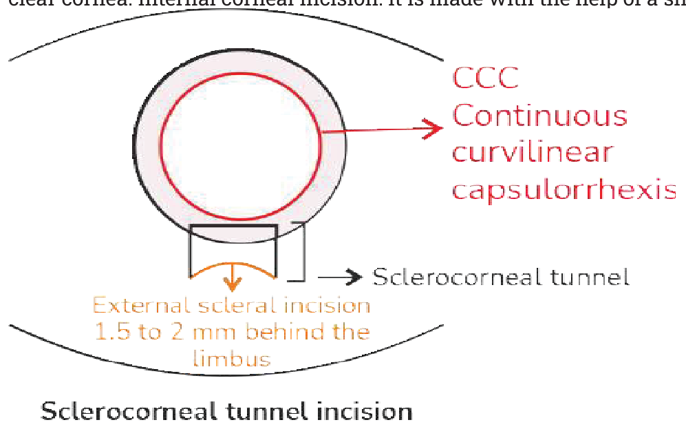

### 94. Answer: B — Dorzolamide

*Ophthalmology · PDF p.58*

• Dorzolamide is a topical carbonic anhydrase inhibitor, which is used as an oral medication for glaucoma treatment. It is contraindicated in individuals with sulfa allergies because it contains a sulfonamide moiety in its chemical structure. People with known sulfa allergies may experience allergic reactions, such as rash, itching, hives, or even severe allergic reactions like anaphylaxis, when exposed to drugs containing sulfonamides like acetazolamide. Incorrect Options: • Option A - Latanoprost: Latanoprost is a prostaglandin analog used for glaucoma treatment. It does not contain a sulfonamide moiety and is not contraindicated in individuals with sulfa allergies. • Option C - Brimonidine: Brimonidine is an alpha-2 adrenergic agonist used to reduce intraocular pressure in glaucoma. It does not contain a sulfonamide moiety and is not contraindicated in individuals with sulfa allergies. • Option D - Pilocarpine: Pilocarpine is a miotic agent that increases trabecular outflow and is used for glaucoma treatment. It does not contain a sulfonamide moiety and is not contraindicated in individuals with sulfa allergies.

### 95. Answer: A — Nebular

*Ophthalmology · PDF p.58*

• Nebular corneal opacities involve less than one-third of the stroma. They appear as faint white in color resulting in a hazy appearance. It causes some scattering of light, hence disturbs the function of even clear cornea ,leading to a decrease in visual acuity. Incorrect Options: • Option B - Macular: Macular corneal opacities involve one-third to two-thirds of the stroma and are white in color . • Option C - Leucoma: Leucoma refers to opacities that involve more than two-thirds to the full thickness of the cornea. They appear as dense white opacities and severely obstruct the transmission of light, leading to significant visual impairment. • Option D - Chlorpromazine deposits: Chlorpromazine deposits are not a type of corneal opacity. These are the deposits on the endothelium.

### 96. Answer: C — Trachoma

*Ophthalmology · PDF p.59*

• Arlt’s line is seen in Trachoma. Explanation of the options: • Option A: Vernal keratoconjunctivitis: Vernal keratoconjunctivitis is an allergic inflammatory condition of the conjunctiva that typically occurs in children and young adults. It is characterized by intense itching, redness, and watery discharge. Arlt’s line is not associated with vernal keratoconjunctivitis. • Option B: Phyctenular keratoconjunctivitis: Phyctenular keratoconjunctivitis is an inflammatory condition of the conjunctiva and cornea that is often associated with a delayed hypersensitivity reaction to an infectious agent or allergen. It is characterized by the formation of small nodules or ulcers on the cornea. Arlt’s line is not typically seen in phyctenular keratoconjunctivitis. • Option C: Trachoma: Trachoma is a chronic infectious disease caused by the bacterium Chlamydia trachomatis. It primarily affects the conjunctiva and can lead to scarring and deformity of the eyelids and cornea. Arlt’s line is a characteristic finding in trachoma and refers to a horizontal line of thickened conjunctiva along the upper tarsal border. It is formed due to repeated cycles of inflammation and scarring. • Option D: Pterygium: Pterygium is a non-cancerous growth of conjunctival tissue that extends onto the cornea. It is often associated with chronic exposure to sunlight and dry environments. Arlt’s line is not a feature of pterygium. Therefore, Arlt’s line is specifically associated with trachoma, an infectious disease caused by Chlamydia trachomatis, characterized by scarring and deformity of the eyelids and cornea.

### 97. Answer: C — Panuveitis

*Ophthalmology · PDF p.59*

• A condition affecting the internal structures of the eye, panuveitis is also referred to as diffuse uveitis or total uveitis. • The uveal tract is inflamed throughout in panuveitis, a type of uveitis in which no particular areas of inflammation are more prominent than others. In the majority of cases, the retina, vitreous humor, optic nerve, or lens are also involved in addition to the uvea. Incorrect Options: • Option A: Acute anterior uveitis is distinguished by an extremely painful red eye, which is frequently accompanied by photophobia and, in rare cases, decreased visual acuity. • Option B: Pars planitis is an eye disease that causes inflammation in the narrowed area (pars plana) between the coloured part of the eye (iris) and the choroid. Vision blurriness, dark spots in the vision, and progressive vision loss may result from this. • Option D: When cells or cellular aggregates are observed in the anterior chamber during examination, • anterior uveitis is said to be present. One of the most typical forms of ocular inflammation that eye care professionals will encounter is anterior uveitis. Anterior uveitis that lasts longer than six weeks is referred to as chronic.

### 98. Answer: B — Copper

*Ophthalmology · PDF p.60*

• Copper is an inorganic reactive intraocular foreign body. Pure copper can lead to Phthisis Bulbi and is hence known as the most dangerous intraocular foreign body. • Chalcosis: Chalcosis is a rare condition where copper deposits accumulate within the eye, typically in the anterior chamber or iris, often seen in patients with a history of intraocular copper foreign body. Phthisis Bulbi: Phthisis bulbi is a severe, end-stage complication characterized by the shrinkage and atrophy of the eyeball, often resulting from untreated or advanced ocular conditions such as trauma, infection, or severe intraocular inflammation. Incorrect Options: • Option A – Iron: Iron is also an inorganic reactive intraocular foreign body. Iron deposition can lead to Siderosis which is characterized by lens deposits, and retinal changes. However, this is less dangerous than Phthisis Bulbi. • Option C – Nickel: Nickel is also a reactive intraocular foreign body that can cause endophthalmitis, which is less dangerous than Phthisis Bulbi. • Option D – Aluminium: Aluminium is also a reactive intraocular foreign body that can cause local irritative reactions which is less dangerous than Phthisis Bulbi.

### 99. Answer: D — Tinea unguium

*Ophthalmology · PDF p.60*

• The clinical scenario describes a middle-aged male with thickened, discolored nails, yellowish discoloration, subungual hyperkeratosis, and onycholysis. These findings are consistent with tinea unguium, also known as onychomycosis. Tinea unguium is a fungal infection of the nails caused by dermatophytes, yeasts, or molds. It commonly presents with nail thickening, discoloration, subungual hyperkeratosis, and onycholysis, without significant inflammation or pain. Incorrect Options: • Option A – Onychogryphosis: It is a condition characterized by overgrowth and thickening of the nails, usually due to neglect or trauma. It does not typically present with yellowish discoloration, subungual hyperkeratosis, or onycholysis. • Option B – Paronychia: It is an infection or inflammation of the skin surrounding the nail. It is often associated with redness, swelling, and tenderness, which are not mentioned in the scenario. • Option C - Nail psoriasis: While nail psoriasis can cause changes in the nails, including onycholysis, pitting, and discoloration, the absence of signs of inflammation or pain makes nail psoriasis less likely. Nail psoriasis is often associated with skin involvement elsewhere on the body, such as plaques and scales, which are not mentioned in the scenario.

### 100. Answer: C — CN VII and V

*Ophthalmology · PDF p.61*

• The clinical presentation described is consistent with Ramsay Hunt syndrome, also known as herpes zoster oticus. This syndrome is caused by the reactivation of the varicella-zoster virus (VZV) and can involve both the facial nerve (cranial nerve VII) and the trigeminal nerve (cranial nerve V). Patients with Ramsay Hunt syndrome commonly experience severe ear pain (otalgia), unilateral facial paralysis (due to involvement of the facial nerve), vesicular rash in the external ear (herpes zoster eruption), and taste disturbances on the anterior two-thirds of the tongue (due to involvement of the chorda tympani branch of the facial nerve). Incorrect Options: • Option A, B & D: While other cranial nerves may be affected by Ramsay Hunt syndrome in rare cases, the most commonly involved nerves are the facial nerve (cranial nerve VII) and the trigeminal nerve (cranial nerve V) so option A, B and D are incorrect.

### 101. Answer: A — Pemphigus vulgaris

*Dermatology · PDF p.62*

• Pemphigus vulgaris: This is the correct choice. Pemphigus vulgaris is an autoimmune blistering disorder characterized by the presence of flaccid bullae that easily rupture, leaving painful erosions on the skin and mucous membranes. The characteristic histological finding of a suprabasal split (also known as acantholysis) is seen in the biopsy, where the cells detach above the basal layer of the epidermis. • The most likely diagnosis for the 30-year-old patient with flaccid bullae that are easy to rupture and a biopsy revealing a suprabasal split is Pemphigus vulgaris. Pemphigus vulgaris is an autoimmune blister disorder that usually affects the skin and mucous membranes. • It is characterized by flaccid bullae, large, fragile blisters that easily rupture, leaving painful erosions behind. • The blister is seen in the lower portion of the epidermis. The bullae are formed due to the loss of cohesion between skin cells due to the breakdown of intercellular bridges, a process called acantholysis. • In pemphigus vulgaris, the acantholysis occurs in the suprabasal layer of the epidermis, resulting in a suprabasal split on biopsy. Incorrect Options: • Option B. Pemphigus foliaceus: Pemphigus foliaceus is another autoimmune blistering disorder, but it typically presents with superficial, crusted erosions rather than bullae. The biopsy findings in pemphigus foliaceus typically show a subcorneal split rather than a suprabasal split, which differentiates it from pemphigus vulgaris. • Option C. Pemphigus vegetans: Pemphigus vegetans is a rare variant of pemphigus characterized by hypertrophic, vegetating lesions in the flexural areas of the body. While it shares some similarities with pemphigus vulgaris, the presence of flaccid bullae and a suprabasal split is more indicative of pemphigus vulgaris. • Option D. Erythema multiforme: Erythema multiforme is a hypersensitivity reaction that typically presents with target-like skin lesions, mucous membrane involvement, and often has a known trigger such as an infection or medication. It does not present with flaccid bullae or show a suprabasal split on histological examination, making it an unlikely diagnosis in this case.

### 102. Answer: D — Calymmatobacterium granulomatis

*Dermatology · PDF p.62*

• The clinical presentation of painless genital ulcers with a granulomatous appearance and the presence of Donovan bodies within histiocytes on microscopic examination are characteristic of granuloma venerum, also known as Donovanosis. The causative organism responsible for Donovanosis is Calymmatobacterium granulomatis. Incorrect Options: • Option A - Treponema pallidum: Treponema pallidum is the causative organism responsible for syphilis, not granuloma venerum (Donovanosis). Syphilis presents with different clinical features, including painless chancres and a characteristic rash in the secondary stage. • Option B - Haemophilus ducreyi: Haemophilus ducreyi is the causative organism responsible for chancroid, which is another sexually transmitted infection. Chancroid presents with painful genital ulcers and is not associated with Donovan bodies. • Option C - Chlamydia trachomatis: Chlamydia trachomatis is responsible for various sexually transmitted infections, but it is not the causative organism for granuloma venerum (Donovanosis). Chlamydia infections may cause urethritis, cervicitis, or other genitourinary tract infections, but they do not produce the characteristic granulomatous ulcers with Donovan bodies seen in Donovanosis.

### 103. Answer: C — Bacterial vaginosis

*Dermatology · PDF p.63*

• The wet smear findings of numerous white blood cells, clue cells (epithelial cells covered with bacteria), and a lack of lactobacilli are characteristic of bacterial vaginosis (BV). BV is a common vaginal infection caused by an imbalance in the vaginal flora, leading to an overgrowth of anaerobic bacteria. The absence of lactobacilli, which are typically present in the healthy vaginal environment contributes to the development of BV. Incorrect Options: • Option A - Candidiasis: Candidiasis, or yeast infection, typically presents with the presence of budding yeast cells and pseudohyphae on wet smear, not clue cells or a lack of lactobacilli. • Option B - Trichomoniasis: Trichomoniasis is caused by the protozoan parasite Trichomonas vaginalis. Wet smear findings in trichomoniasis include motile trichomonads, not clue cells or a lack of lactobacilli. Strawberry cervix is seen in trichomoniasis. • Option D - Atrophic vaginitis: Atrophic vaginitis is commonly seen in postmenopausal women due to decreased estrogen levels. Wet smear findings in atrophic vaginitis may show a decrease in lactobacilli, but clue cells are not typically present.

### 104. Answer: C — Absence of Stratum Corneum

*Dermatology · PDF p.63*

• Preterm babies, being born prematurely, often have underdeveloped skin, which can lead to the absence or immaturity of certain skin layers. The Stratum Corneum is the outermost layer of the epidermis and is responsible for providing a protective barrier to the skin. In preterm infants, this layer may be less developed or absent, making their skin more susceptible to fluid loss, infection, and external irritants. Incorrect Options: • Option A - Absence of Stratum Basale: The Stratum Basale is the deepest layer of the epidermis, a nd it is responsible for cell proliferation and regeneration of the epidermal layers. It contains basal cells that continuously divide to produce new keratinocytes. The Stratum Basale is an essential layer for the renewal and repair of the epidermis. It is not typically affected in preterm babies. • Option B - Absence of Stratum Granulosum: The Stratum Granulosum is a layer of the epidermis located between the Stratum Spinosum and the Stratum Corneum. It plays a crucial role in the production of keratin and the formation of keratohyalin granules, which contribute to the skin’s barrier function. While preterm babies may have less-developed Stratum Granulosum due to their premature birth, it is not specifically known for its absence • Option D - Absence of Stratum Lucidum: The Stratum Lucidum is a clear, translucent layer of the epidermis found in specific areas such as the palms and soles. While preterm babies may have less-developed Stratum Lucidum due to their premature birth, it is not specifically known for its absence

### 105. Answer: A — Delusion of Persecution

*Psychiatry · PDF p.64*

• This scenario describes the belief of being plotted against and harmed by others, which aligns with the characteristics of Delusion of Persecution. Delusions of persecution involve the irrational belief that one is being mistreated, harassed, or targeted by others, even when there is no objective evidence to support such a belief. Incorrect Options: • Option B - Delusion of Grandiosity Delusion of Grandiosity refers to the belief of having extraordinary powers, knowledge, or wealth, which is not described in the given scenario. • Option C - Delusion of Reference Delusion of Reference involves the belief that others are talking about or spying on the individual, which is not described in the given scenario. • Option D - Delusion of Nihilism Delusion of Nihilism refers to the belief that everything, including oneself and the world, does not exist, which is not described in the given scenario.

### 106. Answer: C — Tardive dyskinesia

*Psychiatry · PDF p.64*

• The above mention scenario of abnormal involuntary movements involving lip smacking, tongue protrusion, choreiform hand movements and history of intake of anti psychotic medication points towards the diagnosis of Tardive dyskinesia Incorrect Options: • Option A- Akathisia Akathisia is characterized by restlessness and an urge to move, often described as subjective and objective signs of restlessness, such as rocking motion or rapid alterations of sitting and standing. This condition is not associated with the specific abnormal involuntary movements seen in the given scenario. • Option B- Acute Dystonia Acute Dystonia is characterized by sustained muscle contractions that result in abnormal postures or repetitive movements. It commonly affects the neck (torticollis), jaw muscles (trismus), orother muscle groups. The symptoms of dystonia do not align with the lip smacking, tongue protrusion, and choreiform hand movements described in the scenario. • Option D- Parkinsonism Parkinsonism refers to a cluster of symptoms similar to Parkinson’s disease, including tremors, rigidity, bradykinesia (slowness of movement), and sometimes a characteristic rabbit syndrome involving peri-oral tremors. Although Parkinsonism can be caused by antipsychotic medication, the specific symptoms mentioned in the scenario, such as lip smacking and choreiform hand movements, are not indicative of Parkinsonism.

### 107. Answer: A — Hypothyroidism

*Psychiatry · PDF p.65*

• Lithium is known to increase the risk of hypothyroidism, especially in women and those with rapid cycling. Regular monitoring of thyroid function is important in individuals taking lithium to detect and manage any potential thyroid-related issues. Incorrect Options: • Option B - Hyperglycemia: Lithium is not typically associated with hyperglycemia or elevated blood sugar levels. • Option C - Hypernatremia: Lithium does not cause hypernatremia, which is characterized by high levels of sodium in the blood. • Option D - Hypercalcemia: Lithium does not cause hypercalcemia, which is characterized by high levels of calcium in the blood.

### 108. Answer: A — Cognitive Behavioural Therapy (CBT)

*Psychiatry · PDF p.65*

• CBT is a widely recognized and effective form of therapy for treating various mental health disorders, including Obsessive-Compulsive Disorder (OCD). It focuses on identifying and changing unhealthy thoughts and behaviours through various techniques, such as cognitive restructuring and exposure and response prevention. Incorrect options: • Option B - Psychodynamic Psychotherapy: Psychodynamic psychotherapy is a form of therapy that explores unconscious thoughts, emotions, and conflicts that may contribute to psychological difficulties. While it may have some benefits for certain individuals, it is not considered the first-line treatment for OCD. • Option C - Family Therapy: Family therapy involves the participation of family members in the treatment process. It can be helpful in addressing family dynamics and improving communication, but it is not typically considered the first-line treatment specifically for OCD. However, family support and involvement can play a crucial role in the overall management of OCD. • Option D - Thought-stopping: Thought-stopping is a cognitive technique that aims to interrupt and replace unwanted or distressing thoughts. It involves techniques such as self-monitoring, identifying triggers, and using specific cues to stop the intrusive thoughts. While thought-stopping techniques may be a part of a comprehensive treatment plan for OCD, it is not the primary or first-line treatment option.

### 109. Answer: D — Cocaine

*Psychiatry · PDF p.66*

• Cocaine: Among the options provided, cocaine is most commonly associated with black pigmentation of the tongue and tactile hallucinations. The black pigmentation of the tongue is known as “black tongue,” and it occurs due to a condition called black hairy tongue. It is characterized by elongation of the filiform papillae on the tongue, which can appear black or dark brown. Tactile hallucinations, also known as formication, are a common symptom of cocaine use and can involve sensations of insects crawling on or under the skin. Incorrect Options • Option A: Heroin: Heroin is an opioid drug derived from morphine. Black pigmentation of the tongue is not typically associated with heroin use. Heroin use may cause other physical symptoms, such as constricted pupils, drowsiness, and respiratory depression. • Option B: Opium: Opium is another opioid drug derived from the poppy plant. Black pigmentation of the tongue is not a characteristic feature of opium use. Opium use can lead to symptoms such as sedation, euphoria, and constipation • Option C: Alcohol: Alcohol consumption does not typically cause black pigmentation of the tongue. Excessive alcohol intake can have various effects on the body, including impaired judgment, motor coordination, and liver damage.

### 110. Answer: C — Major Depressive Disorder

*Psychiatry · PDF p.66*

• Major Depressive Disorder is the most common indication for Electroconvulsive Therapy (ECT). It is particularly recommended for patients with major depressive disorder who have certain characteristics, such as depression with suicidal risk, severe agitation, psychotic symptoms, a lack of response or intolerance to medications, or for pregnant women with depression and suicidal tendencies who cannot take medications. Incorrect Options: • Option A - Schizophrenia: ECT is more commonly associated with the treatment of mood disorders like major depressive disorder than schizophrenia. • Option B - Manic episodes: ECT can be considered for the treatment of manic episodes, but it is not the primary indication mentioned in the information. • Option D - Intractable seizure disorder: ECT is not most common treatment for intractable seizure disorders.

### 111. Answer: A — Schizoid personality disorder

*Psychiatry · PDF p.66*

• Schizoid personality disorder: This is the correct answer. Pattern of social withdrawal, emotional coldness, preference for solitary activities, and lack of close friends are typical features of schizoid personality disorder. Incorrect Options: • Option B - Borderline personality disorder: Borderline personality disorder is characterized by emotional instability, impulsivity, and difficulties in relationships. The scenario does not mention these symptoms, making it less likely that Sarah has borderline personality disorder. • Option C - Antisocial personality disorder: Antisocial personality disorder is characterized by a disregard for the rights of others, impulsivity, and a lack of empathy. The scenario does not mention any behaviours related to exploiting or harming others, making it less likely that Sarah has antisocial personality disorder. • Option D - Avoidant personality disorder: Avoidant personality disorder is characterized by a pervasive pattern of social inhibition, feelings of inadequacy, and hypersensitivity to criticism or rejection. While Sarah’s preference for solitude may overlap with avoidant personality disorder to some extent, the emotional coldness and indifference described in the scenario align more closely with schizoid personality disorder.

### 112. Answer: C — Disproportionately enlarged subarachnoid space

*Radiology · PDF p.67*

• Disproportionately enlarged subarachnoid spaces as evidenced by effacement of the sulci at the vertex and widening of the Sylvian fissures associated with ventriculomegaly that is out of proportion to the sulcal prominence is most likely associated with the clinical symptoms of normal pressure hydrocephalus (NPH). • In NPH, there is an enlargement of the subarachnoid space, which is often out of proportion to the degree of ventricular enlargement. This finding contributes to the classic triad of gait disturbances, cognitive decline, and urinary incontinence seen in NPH. Incorrect Options: • Option A - Narrowing of the ventricles: This is not typically associated with normal pressure hydrocephalus (NPH). In NPH, there is ventriculomegaly (enlarged ventricles), not narrowing. • Option B - Dilated sulci: Dilated sulci are associated with brain atrophy, which may not be the primary feature in NPH. The key feature in NPH is the disproportionately enlarged subarachnoid space. • Option D - Hyperintense lesions in the periventricular white matter: Hyperintense lesions in the periventricular white matter are more suggestive of conditions like white matter hyperintensities (WMH) seen in conditions such as small vessel disease, rather than NPH.

### 113. Answer: D — Lateral decubitus

*Radiology · PDF p.67*

• In this case, the patient’s symptoms and examination findings suggest a potential pleural effusion, which is an abnormal accumulation of fluid in the pleural space. The lateral decubitus view is the most sensitive X-ray for detecting pleural effusion. Incorrect Options: • Option A - PA view: The PA (Posteroanterior) view is a standard chest X-ray, but it is not as sensitive for detecting pleural effusions as the lateral decubitus view. • Option B - Lateral view: The lateral view provides a side perspective of the chest and is valuable for assessing structures within the mediastinum. However, it is not as sensitive as the lateral decubitus view for detecting pleural effusions. • Option C - AP view: The AP (Anteroposterior) view is taken with the patient facing the X-ray tube. While it is commonly used, especially when a PA view is not feasible, it may not be as sensitive as the lateral decubitus view for detecting pleural effusions.

### 114. Answer: B — Dilated loops with haustrations

*Radiology · PDF p.68*

• Large bowel obstruction refers to ablockage that occurs in the large intestine, also known as the colon. When a large bowel obstruction occurs, the affected area of the colon becomes distended or dilated due to the accumulation of fecal matter and gas. This dilation results in the enlargement of the loops of the intestine. However, in large bowel obstruction, the dilation of the colon is usually accompanied by the presence of haustrations. Haustrations are the segmented or pouch-like appearance of the colon, caused by the muscular contractions of the colon wall. These haustral markings are distinct features seen in the large intestine and are indicative of the normal function of the colon. In the case of large bowel obstruction, the presence of dilated loops with haustrations suggests that the obstruction is occurring in the large bowel. Incorrect Options: • Option A. Dilated loops of the intestine with plica circularis: Plica circularis refers to the circular folds or ridges that are present in the small intestine, not the large intestine. Therefore, dilated loops of the intestine with plica circularis would not be a finding associated with large bowel obstruction. • Option C. String of pearls sign: The “string of pearls” sign is a characteristic radiological finding seen in small bowel obstruction, not large bowel obstruction. It refers to the appearance of multiple air-fluid levels lined up in a row on an abdominal X-ray. This finding is a result of the accumulation of fluid and gas in the dilated small bowel loops. • Option D. Central dilated bowel loops: Central dilated bowel loops can be seen in both small bowel obstruction and large bowel obstruction. It does not specifically indicate large bowel obstruction, as it can be observed in cases of obstruction in either the small or large bowel. Therefore, this finding alone is not sufficient to diagnose large bowel obstruction.

### 115. Answer: C — Inferior articular process

*Radiology · PDF p.68*

• The inferior articular process corresponds to the front leg of Scotty dog. Incorrect Options: • Option A - Superior articular process: It corresponds to the ear of Scotty dog • Option B - Transverse process: It corresponds to the nose of Scotty dog • Option D - Pars interarticularis: It corresponds to the neck of Scotty dog •

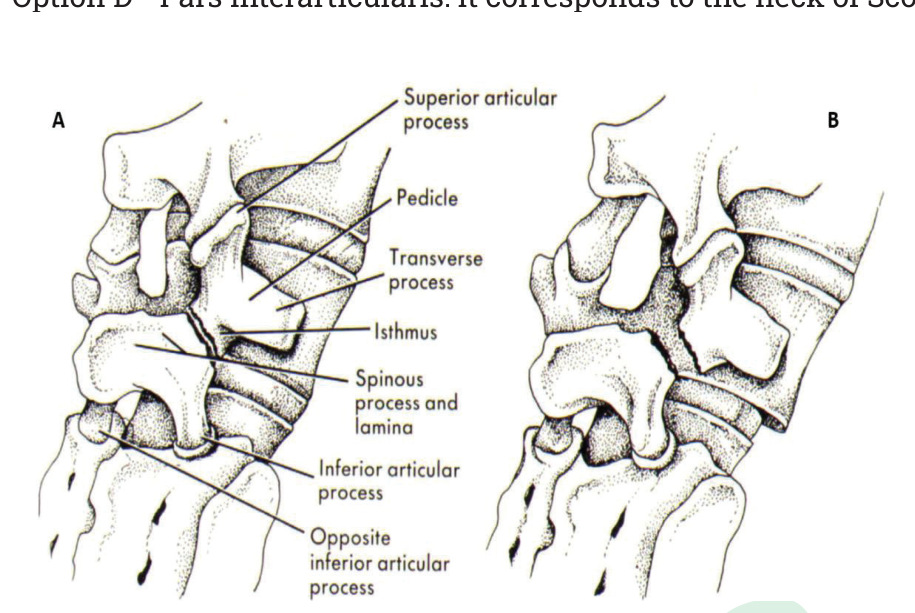

### 116. Answer: C — White matter – Bright

*Radiology · PDF p.69*

• Different tissues exhibit varying signal intensities in T1-weighted magnetic resonance imaging (MRI) based on their T1 relaxation times. White matter appears bright in T1-weighted MRI because it contains myelinated nerve fibers, which have a shorter T1 relaxation time than other tissues. Incorrect Options: • Option A - CSF-Bright: In T1-weighted MRI, cerebrospinal fluid (CSF) appears dark or hypo-intense. CSF has a longer T1 relaxation time, leading to a darker signal on T1-weighted images. • Option B - Fat-Dark: In T1-weighted MRI, fat appears bright or hyper-intense. Fat has a shorter T1 relaxation time, resulting in a brighter signal on T1-weighted images. • Option D - Inflammation-Bright: In T1-weighted MRI, inflammation appears dark.

### 117. Answer: D — Stapes

*Anatomy · PDF p.69*

• Stapes come from the second arch (Reichert’s cartilage - secondary mesenchyme Other structures from the 2nd arch are the Styloid process, Stylohyoid ligament, Lesser horn and upper part of the body of the hyoid bone • Option A ,B ,C • Malleus, Maxilla, and Incus come from 1st arch (Meckel cartilage - secondary mesenchyme) • Other structures from 1st arch are Mandible (GT), Anterior ligament of malleus and Sphenomandibular ligament

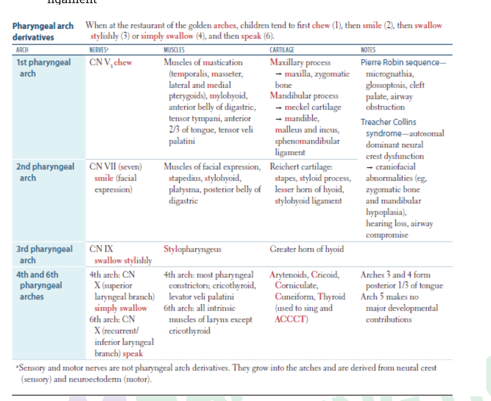

### 118. Answer: C — Ciliated columnar epithelium

*Anatomy · PDF p.70*

• The fallopian tube is lined by ciliated columnar epithelium. Ciliated epithelium performs the function of moving particles in a certain direction over the epithelium. It is present in the inner hollow surface of the fallopian tube. This ciliated epithelium is generally present in the distal part of the fallopian tube. Incorrect options: • Option A: The fallopian tube (FT) is composed of three layers, and the innermost mucosa is a simple columnar epithelium • Option B:Pseudostratified ciliated columnar epithelium lines the nasal passage of the upper respiratory tract, providing protection and producing mucus to trap particles and humidify air In the lower respiratory tract, it lines the trachea and bronchi, assisting in airway clearance and maintaining respiratory function. • Option D: The proximal convoluted tubule of the nephron is lined by cuboidal epithelium with a brush border of microvilli.

### 119. Answer: B — Ulna

*Anatomy · PDF p.70*

• Ulnar bones do not participate in the formation of the wrist joint It forms the elbow joint but do not participate in the wrist joint formation It also articulates with the radius proximally and distally • Option A: Scaphoid It one of the carpal bones Located on the thumb side between the hand and the forearm that is the wrist joint • Option C: Radius Wrist joint is also referred to as radiocarpal joint Lower end of the radius participates in the wrist joint formation • Option D: Triquetral It is a pyramid shape bone One of the carpal bones Participates in the wrist joint formation

### 120. Answer: B — Supraoptic nucleus

*Anatomy · PDF p.71*

• Diabetes insipidus results when the neurons located in the supraoptic nucleus (and paraventricular nucleus) of the hypothalamus fail to release sufficient quantities of vasopressin (or ADH – Anti Diuretic Hormone) into the systemic circulation. Diabetes insipidus is characterized by the production of large volumes of dilute urine and normal or elevated plasma osmolality. • Option A: Paraventricular nucleus Paraventricular nucleus of hypothalamus lies adjacent to the third ventricle and its axons project to the posterior pituitary. The nucleus produces ADH & oxytocin • Option C: Preoptic nucleus Preoptic nucleus produces gonadotropin-releasing hormones It is present in the hypothalamus • Option D: Suprachiasmatic nucleus The suprachiasmatic nucleus of the hypothalamus is present in the anterior part of the thalamus. It is a central pacemaker for the circadian rhythm timing

### 121. Answer: A — Posterior inferior cerebellar artery

*Anatomy · PDF p.71*

• The medulla is supplied by the posterior inferior cerebellar artery. The occlusion of the posterior inferior cerebellar artery causes lateral medullary syndrome, also called Wallenberg syndrome. In this condition, we can see ipsilateral nystagmus, ataxia of limbs, and Horner syndrome, among many other symptoms. Incorrect Options: • Option B: Basilar artery: The basilar artery is a major blood vessel formed by the fusion of the vertebral arteries. It supplies blood to various parts of the brainstem and cerebellum. While it plays a crucial role in brainstem circulation, it is not the specific artery involved in lateral medullary syndrome. • Option C: Superior cerebellar artery: The superior cerebellar artery is a branch of the basilar artery that primarily supplies blood to the superior part of the cerebellum. It is not typically associated with lateral medullary syndrome, as it does not directly affect the lateral medulla region. • Option D: Anterior inferior cerebellar artery (AICA): The anterior inferior cerebellar artery is another branch of the basilar artery. It supplies blood to the anterior and inferior aspects of the cerebellum, as well as parts of the pons. While AICA can cause various neurological symptoms, it is not specifically associated with lateral medullary syndrome.

### 122. Answer: B — Left aortic arch

*Anatomy · PDF p.72*

• This patient has a history of caustic ingestion, now presenting with drooling and chest pain due to obstruction of chicken steak in the esophagus at the level of superior mediastinum, which is the most likely site of stricture in this patient. The aortic arch leaves an imprint on the right anterior edge of the esophagus in the superior mediastinum at about 23(±3 cm) beyond the upper incisors. • Option A: Cricopharyngeal sphincter Esophageal hiatus is located 15 cm from the upper incisor at the level of the C6 vertebra. • Option C: Esophageal hiatus The Esophageal hiatus is located at 40 cm from the upper incisor at the level of the T10 vertebra opening. • Option D: Left principal bronchus The left main bronchus compresses the esophagus in the posterior mediastinum. Although this area can also be damaged from caustic ingestions, it resides lower down, at 28 cm beyond the incisors.

### 123. Answer: B — Left anterior descending artery

*Anatomy · PDF p.72*

• A triple vessel disease is an extreme form of coronary artery disease. Coronary artery disease develops when the major blood vessels supplying the heart become damaged or diseased. Plaques (cholesterol deposits) and inflammation are the two main causes of coronary artery disease. • Most coronary artery diseases may only significantly impact one of the major coronary arteries. • Triple vessel disease, as the name implies, impacts the three major blood vessels that supply the heart with blood: • The left ventricle also has reduced contractile function. • The relative incidence of the left anterior descending artery in triple vessel disease is 50% Therefore it is highly involved in triple vessel disease. • The relative incidences of the vessels involved in triple vessel disease are: Left anterior descending artery: 50% > Right coronary artery: 30% > Left circumflex artery: 15%. • Option A: Right coronary artery The relative incidence of the right coronary artery is 30% in triple vessel disease. The left anterior descending artery has the highest incidence of involvement in triple vessel disease. • Option C: Left circumflex artery The relative incidence of the circumflex artery is 15% in the triple vessel disease, making it the lowest incidence of possible involvement in the disease The left anterior descending artery has the highest incidence of involvement in triple vessel disease • Option D: Posterior descending artery. The posterior descending artery is not involved in the triple vessel disease. The left anterior descending artery has the highest incidence of involvement in triple vessel disease.

### 124. Answer: D — C5, C6 and C7 nerve roots

*Anatomy · PDF p.72*

• Winged scapula: Serratus palsy is usually a preganglionic injury to the C5, C6, and C7 nerve roots. When the serratus anterior is paralyzed, the medial border of the scapula and especially its lower angle stand out prominently. The arm cannot be raised fully. Pushing is ineffective; indeed, attempts to do soproduce further projection known as wings. Incorrect Options: • Option A: Medial cord Medial cord: Anterior division of the Lower trunk continues as a medial cord The nerve involved is the ulnar nerve • Option B: Posterior cord The posterior division of the Upper, Middle and Lower trunk joins to form the Posterior Cord The nerve involved is the Radial nerve • Option C: Lower trunk Lower Trunk: C8 & T1 roots join to form the lower trunk Winged scapula is caused by injury to the C5-C7

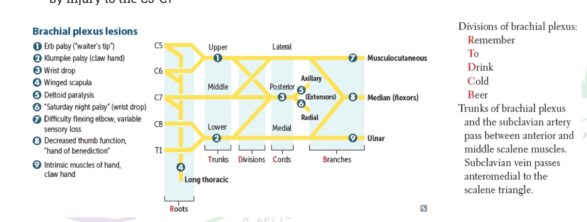

### 125. Answer: C — Ulnar nerve

*Anatomy · PDF p.73*

• The proximal lesion of the ulnar nerve is caused by the fracture of the medial epicondyle of the humerus(also known as the funny bone). • The distal lesion of the ulnar nerve is caused by a fracture of the hook of the hamate due to the fall on an outstretched hand, as in this patient. FROMENT’S SIGN/BOOK TEST: • It Tests Adductor pollicis muscle ULNAR NERVE innervates this muscle Incorrect Options: • Option A: Intercostobrachial nerve The intercostobrachial nerve originates from the lateral cutaneous branch of the second intercostal nerve. It innervates the axilla, tail of the breast, lateral chest wall, and the medial side of the arm. • Option B: Radial nerve The Radial Nerve originates from the posterior cord along the axillary nerve. Radial Nerve supplies the posterior portion of the upper limb. It also innervates the medial and lateral heads of the triceps as well as the posterior compartment of the forearm. • Option D: Median nerve It originates from the lateral and medial cords of the brachial plexus. It mainly innervates the motor components to the flexors of the forearm and hand and those muscles responsible for flexion, abduction, extension and opposition of the thumb.

### 126. Answer: D — Two arteries and one vein, the umbilical vein supplying the fetus

*Anatomy · PDF p.74*

• The umbilical cord contains 2 umbilical arteries and 1 umbilical vein • Left umbilical artery - LUA • Right umbilical artery - RUA • Left umbilical vein - LUV • The umbilical vein carries oxygenated blood to the fetus, and the umbilical arteries carry deoxygenated blood to the placenta. • The umbilical artery is a pair of vessels that originates from the internal iliac artery (ILA). During the development of the fetus, it is a major part of fetal circulation. After birth, the distal part of the artery obliterates and becomes the medial umbilical ligament. The • proximal part of the artery remains functional, providing a blood supply for males’ superior aspect of the urinary bladder and ductus deferens. It usually forms anastomoses with the inferior vesical, vaginal, and obturator arteries. Incorrect options • Option A,B,C: Because the umbilical cord contains 2 umbilical arteries and 1 umbilical vein, that is: • Left umbilical artery - LUA • Right umbilical artery - RUA • Left umbilical vein – LUV

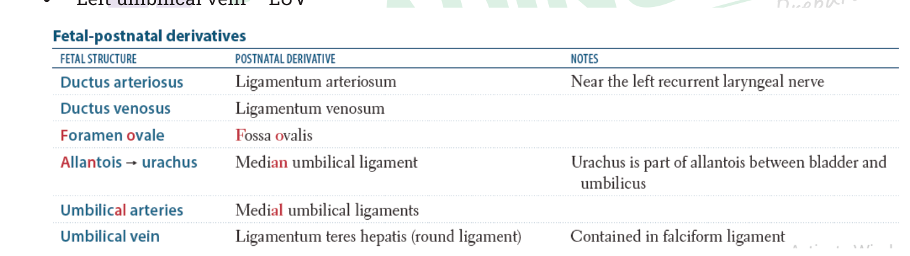

### 127. Answer: B — Cystic lymph node

*Anatomy · PDF p.74*

• The cystic lymph node of Lund, also referred to as the Calot or Mascagni node, serves as the sentinel node for the gallbladder and is situated within the Calot triangle. • It is closely positioned near the cystic artery and is typically excised during cholecystectomy procedures. Mascagni node does not form the boundary of Calot’s triangle Boundaries of Calot’s triangle: • Medial- Common hepatic duct. • Inferior- Cystic duct. • Superior- superior border of cystic artery • Option A, C and D: Contents:The contents of Calot’s triangle include: Right hepatic artery– Formed by the bifurcation of the proper hepatic artery into right and left branches. Cystic artery– Typically arises from the right hepatic artery and traverses the triangle to supply the gallbladder. Lymph node of Lund– The first lymph node of the gallbladder.

### 128. Answer: A — Skene’s glands

*Anatomy · PDF p.75*

• Skene’s glands (urethral and paraurethral glands) lie on each side of the vestibule in the females. • They open into the vestibule by small ducts on either side of the external urethral orifice. They secrete a substance that helps in the lubrication of the urethral opening. • Their analogue in males is the prostate gland. Other options: • Option B: Bulbourethral glands Bulbourethral glands (Cowper glands) are found in males. They are present in the deep perineal pouch and secrete mucus in the bulbar urethra. Its analogue in females is Bartholin’s gland. • Option C: Ovaries Gonads form the ovaries in the female. Its analogue is testis in males. • Option D: Bartholin’s glands The Bartholin’s glands, also known as greater vestibular glands, are two pea-sized compound alveolar glands situated slightly posteriorly and to the left and right of the opening of the vagina. They are located in the superficial perineal pouch in females. Its analogue in males is bulbourethral glands (Cowper glands).

### 129. Answer: A — Femoral Vein

*Anatomy · PDF p.75*

• A femoral hernia is situated below the inguinal ligament and is present in females only as the femoral ring through which the abdominal contents protrude is larger in females • If the hernia gets strangulated, it can cause a lot of pain and has to be surgically treated • In the case of a femoral hernia, the contents of the abdomen are pressed through the femoral ring, which is directly lateral to the lacunar ligament and just medial to the femoral vein. • The femoral vein would be immediately lateral to the femoral hernia. • Option B: Femoral artery The femoral artery is lateral to the femoral vein • Option C: Pectineus muscle The pectineus muscle is situated inferiorly to the femoral ring • Option D: Femoral nerve The femoral nerve is most lateral and is lateral to the femoral artery and vein

### 130. Answer: C — C-fibers

*Physiology · PDF p.76*

• C-fibers are unmyelinated nerve fibers. C-fibers are primarily responsible for transmitting slow, chronic pain sensations, including the dull aching, and throbbing pain often associated with conditions like varicose ulcers. Incorrect Options: • Option A - A-delta fibers: A-delta fibers are myelinated nerve fibers. They are responsible for transmitting fast, sharp, acute pain signals. Typically associated with quick, well-localized pain responses. • Option B – B-fibers: B-fibers are myelinated fibers. They are involved in the autonomic nervous system and are not typically associated with pain transmission. • Option D – A-alpha fibers: A-alpha fibers are large-diameter, myelinated fibers. They are primarily involved in motor functions, transmitting signals to skeletal muscles. Not typically associated with pain transmission.

### 131. Answer: B — 2, troponin I

*Physiology · PDF p.76*

• Troponin is a spherical molecule that remains attached to tropomyosin at a particular interval and this spherical molecule has three subunits: • The Troponin T subunit remains attached to tropomyosin. • The Troponin C subunit has a total of 4 binding sites for calcium, out of which only 2 sites act as regulatory calcium-binding sites. • The Troponin I subunit, also called the inhibitory subunit, is responsible for monitoring the unwinding of tropomyosin from the actin molecule. It is a wedge-shaped molecule that holds the tropomyosin in place so that tropomyosin can prevent the actin-myosin interaction. Incorrect Options: • Option A – 1, troponin T: Only 2 sites act as regulatory calcium-binding sites in troponin C. Troponin T is more associated with binding to tropomyosin and positioning troponin on the actin filament. • Option C - 3, troponin T: 2 sites act as regulatory calcium-binding sites in troponin C, not 3. Troponin T is primarily involved in binding troponin to tropomyosin on the actin filament. • Option D - 4, troponin I: 2 sites act as regulatory calcium-binding sites in troponin C, not 4, and troponin I is indeed responsible for monitoring the unwinding of tropomyosin from the actin molecule.

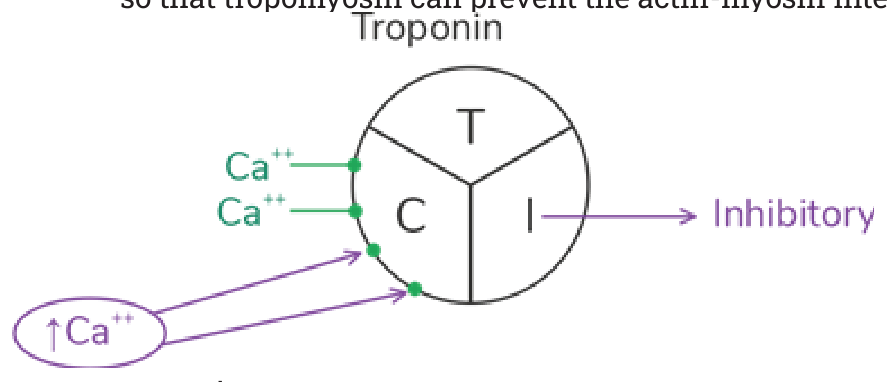

### 132. Answer: C — Lead aVL

*Physiology · PDF p.77*

• aVL is oriented to view the lateral wall of the left ventricle and shows ST elevation when lateral wall of the heart is damaged. Leads II, III, and aVF are called “inferior leads.” and they show ST elevation when the inferior wall of the heart is damaged. Incorrect Options: • Options A, B and D refer to the explanation for option C.

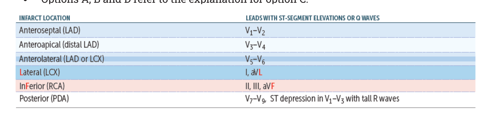

### 133. Answer: B — Factor VII

*Physiology · PDF p.77*

• The extrinsic pathway of coagulation is initiated by tissue factor (TF), which is released from damaged tissues. • Factor VII (FVII) is a vitamin K-dependent clotting factor that is activated by binding to TF. Once activated, the FVII-TF complex activates factor X (FX), which leads to the formation of thrombin and ultimately the formation of a blood clot. Incorrect Options: • Option A: Factor VIII is a clotting factor that participates in the intrinsic pathway of coagulation, which is activated by damage to the endothelial lining of blood vessels. • Option C: Factor XI is also a clotting factor that participates in the intrinsic pathway of coagulation. • Option D: Factor IX is a clotting factor that participates in the intrinsic pathway of coagulation, and is activated by factor XI.

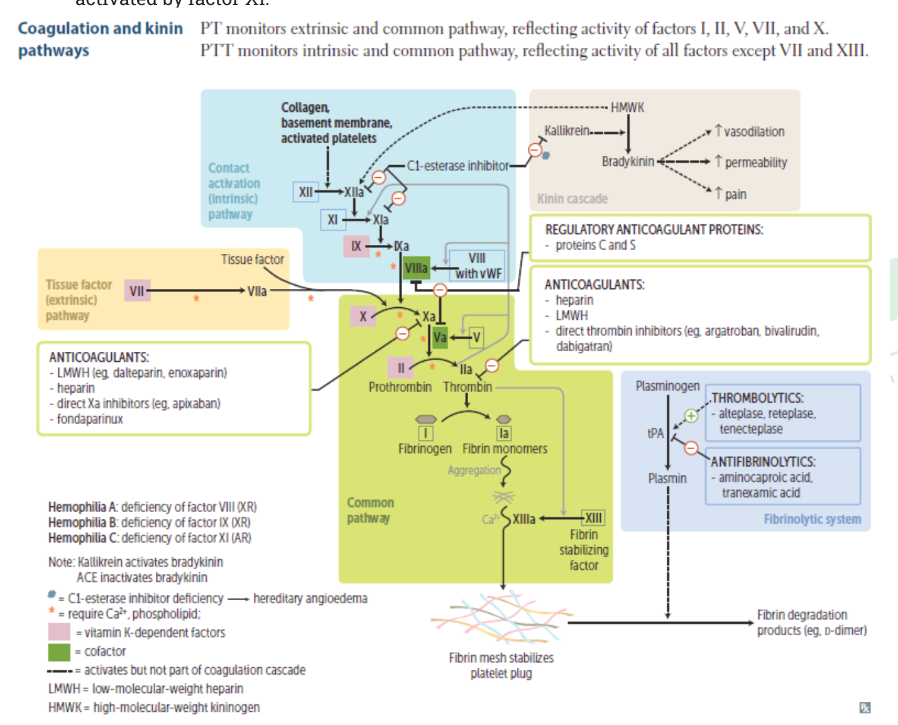

### 134. Answer: C — Positively charged >> Neutral charged >> Negatively charged

*Physiology · PDF p.78*

• A selectively permeable membrane allows particles within a certain size range (between 1.8 and 4.2 nm) to pass through. The filtration barrier is selectively permeable due to its negatively charged membrane. The permeability of the membrane will depend on the charge of the molecules passing through it, and the order is: Positively charged >> Neutral charged >> Negatively charged. Positively Charged Molecules: Positively charged molecules experience less repulsion from the negatively charged components of the filtration barrier, making them relatively more permeable than negatively charged molecules. • Neutral Charged Molecules: Neutral molecules have intermediate permeability, as they are less affected by charge than positively or negatively charged molecules. • Negatively Charged Molecules: Negatively charged molecules face greater repulsion from the negatively charged components of the filtration barrier, resulting in decreased permeability. Incorrect Options: • Options A, B, and D are incorrect. Refer to option C for an explanation.

### 135. Answer: B — Hypercapnia

*Physiology · PDF p.79*

• Oxygen hemoglobin dissociation curve: The oxygen-hemoglobin dissociation curve illustrates the relationship between the percentage saturation of hemoglobin’s oxygen-carrying capacity (SaO2) and the partial pressure of oxygen ( PO2). Carbon dioxide is highly soluble in blood, about 20 times more than oxygen. When CO2 enters red blood cells, it combines with water to form carbonic acid (H2CO3) with the help of carbonic anhydrase enzyme. This acid dissociates into hydrogen ions (H+) and bicarbonate ions (HCO3-), where H+ is mainly buffered by hemoglobin and HCO3- enters the plasma. Additionally, some CO2 reacts with hemoglobin and proteins, forming carbamino compounds. • Hemoglobin’s affinity for CO2 is inversely related to its oxygenation state. Deoxygenated hemoglobin has a higher affinity for H+ ions and forms carbamino compounds more easily than oxygenated hemoglobin. Thus, oxygen binding to hemoglobin reduces its affinity for CO2. Hypercapnia levels in the blood shift the oxygen dissociation curve to the right. This shift is primarily due to the acidification of the blood caused by increased carbonic acid resulting from dissolved CO2. The increased acidity reduces hemoglobin’s affinity for oxygen, facilitating its release to the ctissues. As a result, the curve representing hemoglobin saturation with oxygen shifts to the right, indicating decreased affinity for oxygen. This shift allows for more efficient oxygen unloading in tissues with high metabolic demands. Incorrect options • Option A: Alkalosis The Bohr effect refers to the reduction in the oxygen affinity of hemoglobin when the blood pH decreases. This phenomenon is closely linked to the observation that deoxygenated hemoglobin (deoxyhemoglobin) binds hydrogen ions (H+) more readily than oxygenated hemoglobin (oxyhemoglobin). Therefore- Alkalosis shifts the curve to the left. Acidosis shifts the curve to the right. • Option C: Fetal hemoglobin Because 2,3-diphosphoglycerate (DPG) binds less strongly to fetal hemoglobin, it has a higher O2 affinity than adult hemoglobin (left-shift). O2 transport from the mother to the fetus is made easier because fetal hemoglobin has a higher O2 affinity than adult hemoglobin. • Option D: CO poisoning CO competes with O2 for hemoglobin’s O2-binding sites. Hemoglobin’s affinity for CO is 200 times greater than its affinity for O2. Furthermore, the binding of CO to Hb enhances the affinity of remaining sites for O2, shifting the curve to the left. This left shift (increased affinity) prevents oxygen unloading at tissues.

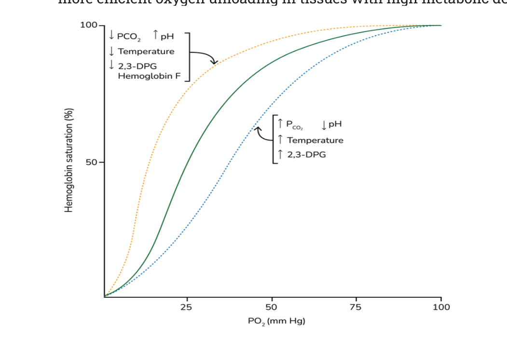

### 136. Answer: A — Bile salts

*Physiology · PDF p.80*

• Bile is a physiological aqueous solution produced and secreted by the liver. It consists mainly of bile salts, phospholipids, cholesterol, conjugated bilirubin, electrolytes, and water. • Bile travels through the liver in a series of ducts, eventually exiting through the common hepatic duct. Bile flows through this duct into the gallbladder, where it is concentrated and stored. • When stimulated by the hormone cholecystokinin (CCK), the gallbladder contracts, pushing bile through the cystic duct and into the common bile duct. Simultaneously, the sphincter of Oddi relaxes, permitting bile to enter the duodenal lumen. In the small intestine, bile acids facilitate lipid digestion and absorption. Only approximately 5% of these bile acids are eventually excreted. • Mostly bile acids are efficiently reabsorbed from the ileum, secreted into the portal venous system, and returned to the liver through enterohepatic recirculation. Once they are deconjugated, they can be absorbed by non-ionic diffusion. Still, most are absorbed in their conjugated forms from the terminal ileum by an extremely efficient Na+– bile salt cotransport system (ABST), whose activity is secondarily driven by the low intracellular sodium concentration established by the basolateral Na+, K+ ATPase. • Incorrect Options • Option B: Folic Acid Folic acid is absorbed in the jejunum. • Option C: Iron Iron is absorbed in the duodenum. • Option D: Calcium Calcium is absorbed in the duodenum.

### 137. Answer: A — Pain and temperature

*Physiology · PDF p.80*

• In Brown-Sequard syndrome, there is damage to one-half (hemisection) of the spinal cord. As a result, the sensations that are typically lost on the opposite side of the lesion include pain and temperature perception. Incorrect Options: • Option B - Proprioception and vibration: These sensations are typically lost on the same side as the lesion. • Option C - Crude touch and pressure: Crude touch and pressure sensations are lost on the same side as the lesion. • Option D - Tactile discrimination: Sensations of tactile discrimination are lost on the same side as the lesion.

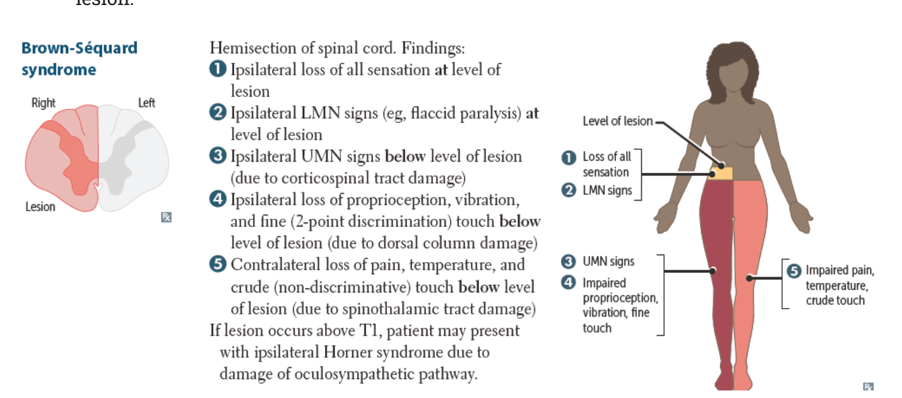

### 138. Answer: B — Luteinizing hormone (LH)

*Physiology · PDF p.81*

• During the luteal phase of the menstrual cycle, LH stimulates granulosa cells to convert cholesterol into progesterone. Progesterone plays a crucial role in preparing the endometrium for potential implantation of a fertilized egg. Incorrect Options: • Option A - Follicle-stimulating hormone (FSH): FSH primarily stimulates the development of ovarian follicles during the follicular phase, but it does not directly stimulate the conversion of cholesterol to progesterone in granulosa cells during the luteal phase. • Option C - Estrogen: Estrogen is primarily produced by developing follicles during the follicular phase and plays a key role in stimulating the growth of the endometrium. It does not directly stimulate the conversion of cholesterol to progesterone in granulosa cells during the luteal phase. • Option D - Pregnenolone: Pregnenolone is a precursor molecule in the synthesis of steroid hormones, including progesterone, but it is not directly stimulated by LH during the luteal phase.

### 139. Answer: A — Growth hormone

*Physiology · PDF p.81*

• The growth hormone receptor is a transmembrane receptor associated with JAK-STAT pathway signaling. Another hormone that has JAK-STAT signaling is prolactin (JAK2-STAT5) Incorrect Options • Option B: Thyroid hormone The thyroid hormone uses intracellular receptors • Option C: Insulin Insulin acts via the transmembrane receptor, which has intrinsic tyrosine kinase activity • Option D: Glucocorticoids Glucocorticoids use intracellular receptors

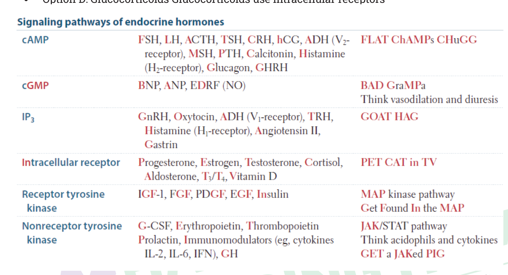

### 140. Answer: C — Ganglion cells

*Physiology · PDF p.82*

• Ganglion cells are the only cells in the retina that generate action potentials. They receive input from bipolar cells, integrating visual information from the photoreceptors (rods and cones). Upon stimulation by bipolar cells, ganglion cells generate action potentials. Incorrect Options: • Options A, B, and D are incorrect, as only ganglion cells can generate an action potential.

### 141. Answer: A — Coagulative

*Pathology · PDF p.82*

• A type of necrosis caused by tissue ischemia, which denatures proteolytic enzymes. Occurs in most tissues except the brain. Histopathologic examination shows preserved anuclear, eosinophilic cellular architecture. • Tissue ischemia in solid organs such as the heart, liver, spleen, and kidneys leads to coagulative necrosis (e.g., splenic infarction). Reduced oxygen delivery, which characterizes ischemia, lowers the rate at which ATP is created through aerobic glycolysis. Acidosis results from the hypoxic cells switching to anaerobic metabolism, which raises lactic acid generation. • Acidosis results in the denaturation of proteins, particularly lysosomal and proteolytic enzymes, which inhibit the cell from dissolving (autolysis). The absence of cell nuclei or the presence of nuclei still undergoing karyolysis are hence characteristics of coagulative necrosis. • Histologically, this is the most prevalent kind of necrosis. For at least a few days, the architecture of dead tissue remains retained. An infarct is a localized area of coagulative necrosis. Incorrect Options: • Option B - Liquefactive necrosis: A type of necrosis characterized by the partial or complete dissolution of dead tissue and transformation into a liquid, viscous mass. Caused by neutrophilic release of lysosomal enzymes that digest tissue. Seen in bacterial abscesses and brain infarcts. Numerous cystic spaces and disintegration of the normal tissue architecture are visible. There is abundant cellular debris. • Option C - Fibrinoid necrosis: A type of necrosis characterized by small blood vessel injury and accumulation of fibrin and other plasma proteins caused by malignant hypertension or vasculitis (type III hypersensitivity reaction). Seen on histological examination of vessels in patients with polyarteritis nodosa, preeclampsia, and hypertensive emergency. • Option D - Caseous necrosis: A type of necrosis characterized by granular debris results from macrophages walling off a pathogen. Seen in tubercular, fungal, and Nocardia infections. A granuloma with necrosis in the center, a surrounding layer of immune cells such as macrophages, and a peripheral layer that consists of epitheloid cells. A giant cell can also be seen.

### 142. Answer: C — Psammoma bodies

*Pathology · PDF p.83*

• The patient’s history of occupational asbestos exposure and the presentation of pleural thickening and calcified nodules are indicative of mesothelioma, a malignant neoplasm commonly associated with asbestos exposure. Microscopic examination of mesothelioma often reveals spindle-shaped cells forming papillary structures and frequently demonstrates psammoma bodies, which are concentric, lamellated, calcific structures. These structures are commonly observed in serous tumors, such as papillary carcinoma of the thyroid and meningiomas, and can also be found in malignant mesothelioma. Their presence helps in the histological diagnosis of mesothelioma. Incorrect Options: • Option A- Auer rods: Auer rods are needle-like, azurophilic inclusions found in the cytoplasm of myeloblasts or immature myeloid cells. They are characteristic of acute myeloid leukemia (AML) and are not typically seen in mesothelioma. • Option B- Lewy bodies: Lewy bodies are abnormal protein aggregates, specifically alpha-synuclein, found in the cytoplasm of neurons. They are a pathological hallmark of Parkinson’s disease and other neurodegenerative disorders but are not associated with mesothelioma. • Option D- Call-Exner bodies: Call-Exner bodies are small, eosinophilic, glandular structures found in granulosa cell tumors of the ovary. These structures are not associated with mesothelioma.

### 143. Answer: D — C5a

*Pathology · PDF p.84*

• Phagocytosis involves a step called recognition by phagocytic receptors. • The efficacy of phagocytosis increases when the foreign substances are coated with opsonins for which the phagocytes express high-affinity receptors. The opsonins include: • C3b • IgG • Mannose-binding lectin • Leukocytes recognize these opsonins. • C5a is a component of the complement system, which is an anaphylatoxin and chemoattractant. It has no role as an opsonin. Incorrect Options: • Option A - C3b: C3b is one of the opsonins with receptors on the leukocytes’ surface. • Option B - IgG: IgG is one of the opsonins. • Option C - Mannose-binding lectin: Mannose-binding lectin is one of the opsonins.

### 144. Answer: B — Neisseria meningitidis

*Pathology · PDF p.84*

• The patient presents with a deficiency of MAC and symptoms of meningitis. MAC is responsible for cell lysis. • MAC is formed when C5b attaches to the C6-9 complex. • MAC forms holes in the cell membrane, making the cell-permeable to water and ions. This leads to cell lysis. MAC is important for killing microbes with thin cell walls, such as Neisseria. Hence, deficiency of this terminal complex predisposes an individual to disseminated meningococci and gonococci infections. Incorrect Options: • Options A, C and D are incorrect and the correct option has been explained above.

### 145. Answer: B — EBV

*Pathology · PDF p.84*

• The patient’s biopsy is concerning for Hodgkin’s lymphoma, a lymphoid malignancy characterized by the presence of Reed-Sternberg cells. • The patient’s biopsy is concerning for Hodgkin’s lymphoma, a lymphoid malignancy characterized by the presence of Reed-Sternberg cells. • It is known that Epstein-Barr virus (EBV) is associated with the development of Hodgkin’s lymphoma. • EBV is a member of the herpesvirus family and has been implicated in the pathogenesis of various lymphoid malignancies, including a subset of Hodgkin’s lymphoma cases. This virus can be detected in the Reed-Sternberg cells in these cases. Other viruses listed in the options are not typically associated with the development of Hodgkin’s lymphoma • It is known that Epstein-Barr virus (EBV) is associated with the development of Hodgkin’s lymphoma. EBV is a member of the herpesvirus family and has been implicated in the pathogenesis of various lymphoid malignancies, including a subset of Hodgkin’s lymphoma cases. This virus can be detected in the Reed- Sternberg cells in these cases. Other viruses listed in the options are not typically associated with the development of Hodgkin’s lymph oma Incorrect Options: • Options A, C, and D are incorrect. Refer to the explanation of the correct answer.

### 146. Answer: C — IgG

*Pathology · PDF p.85*

• M-protein is a monoclonal immunoglobulin in the blood. M-proteins are complete proteins with high molecular weight that cannot pass through the membranes and hence, are restricted to the plasma and extracellular fluid. • They cannot be excreted in the urine without glomerular damage. • The most frequent M protein produced and seen in multiple myeloma is IgG (55% of patients) followed by IgA (25% of cases). IgM, E, and D are rarely produced by myeloma cells. Incorrect Options: • IgG is most commonly responsible for the ‘M protein’ seen in patients with multiple myeloma. • IgM is common in Waldenström Macroglobulinemia (WM) • Options A, B, and D are incorrect. Refer to the explanation of Option C.

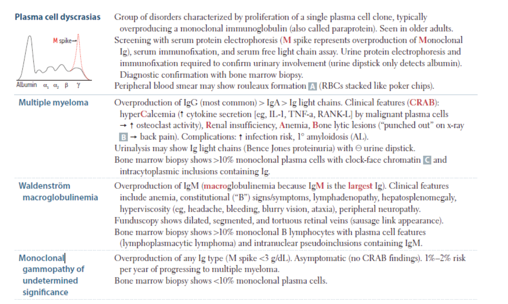

### 147. Answer: B — Anti La

*Pathology · PDF p.86*

• Among the options provided, anti-La antibodies (also known as anti-SS-B antibodies) are more specific for the diagnosis of Sjögren’s syndrome. These antibodies are commonly detected in patients with Sjögren’s syndrome and help confirm the diagnosis. Incorrect Options: • Option A - Anti-Ro: While anti-Ro antibodies are commonly associated with Sjögren’s syndrome, they are more sensitive compared to anti-La antibodies. • Option C - Anti-Scl 70: Anti-Scl 70 antibodies are associated with diffuse systemic sclerosis (scleroderma) and are not specific for Sjögren’s syndrome. • Option D - Anti-U1 RNP: Anti-U1 RNP antibodies are associated with mixed connective tissue disease (MCTD)

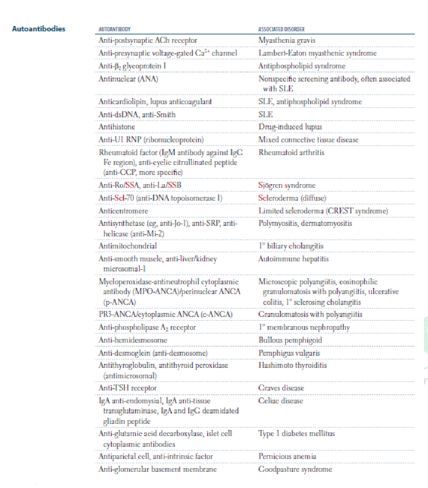

### 148. Answer: A — Ovary

*Pathology · PDF p.87*

• Gastric adenocarcinoma can spread to distant sites, and one common site of metastasis is the ovary, where it can manifest as Krukenberg tumor. This tumor is characterized by bilateral ovarian involvement and the presence of signet ring cells, which are indicative of gastric origin. Incorrect Options: • Options B, C, and D are not the location of the Krukenberg tumor.

### 149. Answer: A — Kimmelstiel-Wilson nodules

*Pathology · PDF p.88*

• Diabetic nephropathy is a kidney disease occurring in patients who have diabetes. • Diabetes is one of the most common causes of end-stage kidney disease. • In patients with diabetes mellitus, there is non-enzymatic glycosylation due to increased blood glucose levels. • This results in the deposition of advanced glycation end products on the efferent arteriole. • There is increased filtration injury which causes nodular glomerulosclerosis (most characteristic) • Increase in the number of mesangial cells and mesangial matrix results in the invasion of the glomerular capillaries. • This results in the formation of deposits called Kimmelstiel-Wilson nodules. Further expansion results in diffused glomerulosclerosis. • The most important glomerular lesions seen in diabetic nephropathy are: Capillary basement membrane thickening Diffuse mesangial sclerosis Nodular glomerulosclerosis. • Nodular glomerulosclerosis or Kimmelstiel-Wilson lesions are also called intercapillary glomerulosclerosis. These nodules are PAS-positive. Incorrect Options: • Options B, C and D are incorrect and the correct option has been explained above.

### 150. Answer: A — Paroxysmal nocturnal hemoglobinuria

*Pathology · PDF p.88*

• CD59 is a regulatory protein that inhibits the complement system, specifically membrane attack complex (MAC) formation. • In PNH, there is a deficiency of CD59 on the surface of red blood cells, making them susceptible to complement-mediated lysis. Incorrect Options: • Options B, C, and D are incorrect.

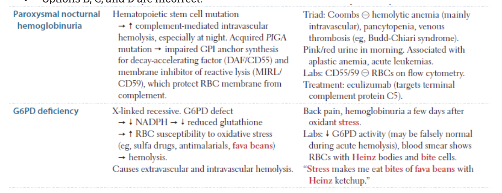

### 151. Answer: A — Hydroxylation

*Pharmacology · PDF p.89*

• Hydroxylation belongs to phase 1 reactions: • Phase 1 reactions These are non-synthetic reactions. The phase 1 enzymes introduce functional groups, such as –OH, –COOH, –SH, –O–, or NH2, to the drug. The enzymes include – Cytochrome P450s, Flavin- containing monooxygenases (FMOs), and Epoxide hydrolases (EHs) This alters the biological properties of the drug. It includes oxidation, reduction, and hydrolytic reactions. • Phase 2 reactions These are synthetic reactions. Phase 2 reactions include conjugation of the products of the phase 1 reactions. They improve the water solubility of the drug and increase its elimination. It includes: • Glucuronidation (Most common) • Acetylation • Methylation • Sulfation • Glycine conjugation Incorrect Options: • Option B- Methylation: Methylation is a phase 2 reaction. It involves the conjugation of the drug substrate with a methyl group to increase its solubility in water. • Option C- Conjugation: Conjugation is an example of phase 2 reactions. • Option D- Acetylation: Acetylation is a type of phase 2 reaction involving a drug substrate’s ethanoylation. Sulfamethoxazole is an example of a drug that undergoes this reaction.

### 152. Answer: B — Physiological antagonism

*Pharmacology · PDF p.89*

• Physiological antagonism is the action of two different chemicals on different sites of the same cell, resulting in opposite responses in their pharmacological effects. • Example: Histamine acting on H1 receptors causes bronchoconstriction, while adrenaline acting on beta two receptors causes bronchodilation. Here, histamine and adrenaline are two different drugs that act on two other sites (H1 and beta two receptors). • Both these receptors are present on bronchial smooth muscles but produce an opposite response in their pharmacological effect. Type of Antagonism • Competitive Antagonism: Antagonist competes with agonist for receptor binding site, reducing agonist’s effect. Naloxone blocks opioid receptors, reversing the effects of opioids Non-competitive Antagonism: Antagonist binds to a different site on the receptor or a different target in the signaling pathway, inhibiting agonist’s action Phenoxybenzamine irreversibly binds to alpha-adrenergic receptors, blocking the activation by norepinephrine Physiological Antagonism • Two substances exert opposing physiological effects through different mechanisms Histamine causes vasodilation. In contrast, epinephrine causes vasoconstriction, resulting in physiological antagonism Chemical Antagonism Antagonist interacts with another substance, rendering it inactive through a chemical reaction Chelating agents like EDTA bind to heavy metals, forming stable complexes and reducing their toxic effects. • Option A: Chemical antagonism • Chemical antagonism occurs when drugs interact chemically in solution; they create an inactive • product that lowers the plasma concentration of the free drug. • Option C: Competitive antagonism • Here, an agonist and antagonist drug compete to bind the same site on a receptor. • Option D: Reversible antagonism Here, a reversible antagonist binds to a receptor non-covalently and can be displaced.

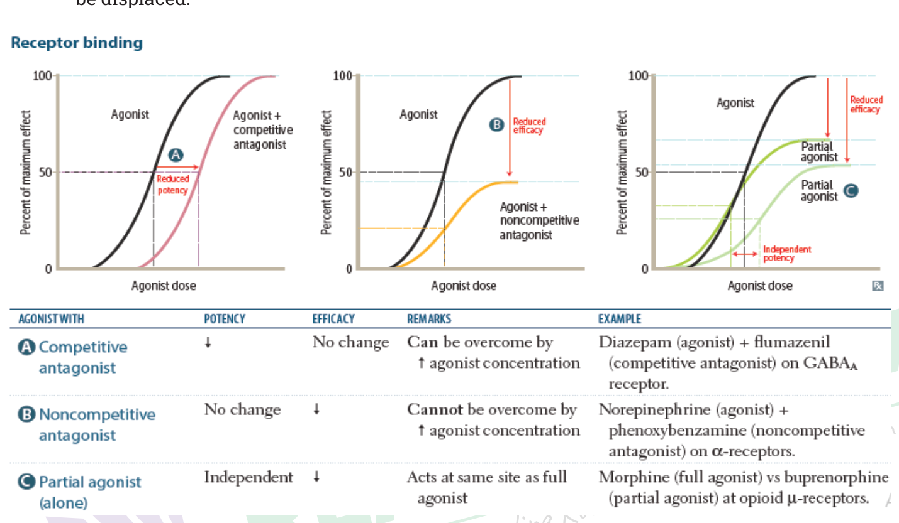

### 153. Answer: C — It doesn’t cross BBB effectively and has no central action

*Pharmacology · PDF p.90*

• Neostigmine is an anticholinesterase drug which increases ACh activity at NMJ and improves muscle weakness • It also has shown directly depolarizes muscle end plates will not cross BBB, and has no central Actions Physostigmine can cross BBB and produce central actions, which is not required in myasthenia gravis Incorrect Options: • Option A - It is better absorbed orally: Neostigmine is poorly absorbed from GIT when given orally compared to physostigmine. Actually, physostigmine has better GIT absorption than neostigmine. • Option B - It has a longer duration of action: The duration of physostigmine ( 4-6hrs) is longer than the neostigmine(3-4hrs) • Option D - It is a tertiary amine: Neostigmine is a quaternary amine and penetrates the blood-brain barrier poorly Physostigmine is a tertiary amine and can penetrate the blood-brain barrier effectively

### 154. Answer: D — Antiplatelet aggregatory

*Pharmacology · PDF p.91*

• Aspirin taken by prescription can alleviate the symptoms of rheumatoid arthritis, osteoarthritis, systemic lupus erythematosus, and certain other rheumatologic conditions. • Acetylsalicylic acid inhibits the generation of prostaglandins throughout the body by concentrating its effects on cyclooxygenase-1 (COX-1) and cyclooxygenase-2. • Dose-dependent effects of aspirin: Antiplatelet effects are produced(40-325 mg)At very low doses For M.I & Stroke prophylaxis 75-150mg During M.I: 162-325mg Analgesic and antipyretic effect 1-2g/day, used as 0.3-0.6g 6-8th hourly Anti-inflammatory effects Dose 3-6g/day used in divided doses. • Option A: Analgesic Aspirin produces analgesic effects at a dose 1-2g/day used as 0.3-0.6g 6-8th hourly • Option B: Antipyretic Aspirin produces antipyretic effects at a dose 1-2g/day used as 0.3-0.6g 6-8th hourly • Option C: Anti-inflammatory Aspirin produces anti-inflammatory effects at a dose 3-6g/day used in divided doses.

### 155. Answer: B — Colchicine inhibits the release of inflammatory mediators by blocking the formation of microtubules

*Pharmacology · PDF p.91*

- Colchicine inhibits the release of inflammatory mediators by blocking the formation of microtubules: • Colchicine’s primary mechanism of action involves its ability to inhibit microtubule formation. Microtubules are important structural components of cells and are involved in various cellular processes, including cell division and intracellular transport. • In the context of gout and other inflammatory conditions, colchicine works by interfering with the microtubule polymerization process. This, in turn, disrupts the normal function of neutrophils and their ability to migrate to the site of inflammation. • By preventing neutrophil chemotaxis and activation, colchicine reduces the release of inflammatory mediators and ultimately provides relief from the pain and inflammation associated with gouty arthritis. Incorrect Options: • Option A - Colchicine inhibits uric acid production by competitively inhibiting xanthine oxidase: This statement is not accurate. Medications like allopurinol and febuxostat are xanthine oxidase inhibitors and are used to lower serum uric acid levels in conditions like gout. • Option C-Colchicine directly reduces serum uric acid levels by promoting uric acid excretion in the kidneys: This statement is not correct either. Medications such as probenecid act through this mechanism. • Option D - Colchicine acts by reducing the synthesis of cyclooxygenase-2 (COX-2) and prostaglandins, leading to pain relief: This statement is inaccurate as well. Colchicine does not affect the synthesis of cyclooxygenase-2 (COX-2) or prostaglandins, which is the mechanism of action for nonsteroidal anti- inflammatory drugs (NSAIDs).

### 156. Answer: C — Phospholipase A2

*Pharmacology · PDF p.92*

• Glucocorticoids act by interfering at several steps of the inflammatory response. One such mechanism is the indirect inhibition of phospholipase A2 leading to decreased production of proinflammatory mediators such as prostaglandins and leukotrienes. Incorrect Options: • Options A, B, and D are incorrect.

### 157. Answer: C — Hypoglycemia

*Pharmacology · PDF p.93*

• The treatment of asthma involves the use of beta-agonist drugs such as salbutamol. Hyperglycemia is a side effect of beta-agonist drugs not Hypoglycemia • Option A: Tremor Salbutamol can cause tremors, especially at higher doses. Tremors are a common side effect of beta2-agonists due to their stimulatory effects on the sympathetic nervous system. • Option B: Tachycardia Salbutamol can increase heart rate (tachycardia) as a result of its beta2-agonist activity. This effect is due to its action on beta2-adrenergic receptors in the heart, leading to increased cardiac output. • Option D: Hypokalemia Salbutamol can cause hypokalemia, which is a decrease in potassium levels in the blood. This occurs because beta2-agonists like salbutamol stimulate the uptake of potassium into cells, leading to lower levels of potassium in the bloodstream.

### 158. Answer: D — Chloramphenicol

*Pharmacology · PDF p.93*

• Newborn infants lack an effective glucuronic acid conjugation mechanism for the degradation and detoxification of chloramphenicol. Consequently, when infants are given dosages above 50mg/kg/day, the drug may accumulate, resulting in Gray baby syndrome. They experience symptoms such as vomiting, flaccidity, hypothermia, grayish discoloration of skin, shock and vascular collapse. To avoid this toxic effect, chloramphenicol should be used with caution in infants. Adverse effects of chloramphenicol include anaemia (dose-dependent), aplastic anaemia (dose independent), gray baby syndrome (in premature infants because they lack liver UDP- glucuronosyltransferase) • Options A, B and C are not associated with gray baby syndrome.

### 159. Answer: C — Quinidine

*Pharmacology · PDF p.94*

• Quinidine is a drug that belongs to class 1A antiarrhythmic, indicated in atrial fibrillation, atrial flutter, and ventricular tachycardia. Na+ channel blockers reduce the slope of phase 0, whereas K+ channel blockers prolong the APD. Both properties are characteristic of Class IA antiarrhythmics like Quinidine and Procainamide. Quinidine functions by strengthening the heart’s defenses against aberrant activity. Phase 0 of the action potential is known as “the depolarization” phase; it is characterized by the rapid entry of sodium ions (Na+) into the cell along an electrochemical gradient, which results in a membrane potential of about positive 30 mV. • Option A: Lignocaine Lignocaine is a member of the local anesthetic group. It also acts as an antiarrhythmic in supraventricular tachycardia. Lignocaine is a Class 1B anti-arrhythmic. It is a sodium channel blocker and potassium channel opener. It reduces the slope of phase 0 of action potential due to its sodium channel-blocking ability. Secondly, its potassium channel opening ability also decreases the action potential duration. • Option B: Propanolol It does not decrease the slope of Phase 0 or prolong the action potential duration. • Option D: Adenosine Adenosine slows conduction time through the A-V node and restores normal sinus rhythm in paroxysmal supraventricular tachycardia (PSVT), including PSVT associated with Wolff- Parkinson-White Syndrome.

### 160. Answer: B — Prominent frontal eminence

*Forensic Medicine · PDF p.94*

• Frontal eminences & parietal eminences are more prominent in Females. Incorrect Options: • Option A - Mastoid process bigger: Mastoid process is small and pointed in females. • Option C - Orbit square with round edges: Orbit square with rounded and sharp margins in Females. • Option D - Prominent zygomatic arch: Zygomatic arch: Not prominent.

### 161. Answer: C — Gunpowder

*Forensic Medicine · PDF p.95*

• Gunpowder is the component of the fired shot which is responsible for the findings of tattooing. Tattooing: It consists of unburnt or partially burnt powder particles that are embedded in and under the skin through the force of their impact (when the weapon is near enough for the powder grains to strike). Tattooing is an antemortem phenomenon and indicates that the individual was alive, and it cannot be wiped away with wet cotton. Incorrect Options: • Option A - Burns: Burning at entrance wound along with burning or singeing of hairs due to flame/fire. Smokeless powder: It is more effective than black powder as it burns more efficiently and produces much less smoke, resulting in less blackening and tattooing around the entry wound. • Option B - Smoke: Soot or smoke soiling/blackening/smudging: These particles being light, do not travel afar (for virtually all handgun cartridges, soot is absent around the entry wound where the muzzle-to- target distance is beyond one foot). • Option D - Wads: Wad is made of some soft material, like a disc of felt, cardboard, plastic, cork or straw. It is placed between powder and shot or over the shot. The cardboard disc behind the shot charge prevents the pellets from getting lodged in the felt wad.

### 162. Answer: C — No Mud and vegetation in respiratory tract

*Forensic Medicine · PDF p.95*

• This statement is false as in the case of antemortem drowning there is fine froth in the respiratory tract along with mud, sand and vegetation. • There is no mud and vegetation in the case of post-mortem drowning. Incorrect options: • Option A: Water in the stomach: In cases of antemortem drowning, it is common to find water in the stomach due to the inhalation or ingestion of water during the drowning process. • Option B: Froth on nose and mouth: Froth on the nose and mouth can be observed in cases of antemortem drowning. It occurs due to the mixing of air and water during the struggle for breath. • Option D: Cadaveric spasm in hand muscle: Cadaveric spasm refers to the postmortem stiffening of muscles that occurs in the position they were in at the time of death. It can be observed in drowning cases when the victim may grasp onto an object or exhibit a specific hand posture due to a sudden muscular contraction at the time of death.

### 163. Answer: D — Wind screen impact

*Forensic Medicine · PDF p.95*

• As a result of the accident, the windshield glass is broken. The broken windshield leads to shattered glass. The shattered glass results in the formation of glass particles, which may take on spherical or cubicle shapes. The driver may be thrown forward during the collision, impacting the broken windshield. • The impact of the driver’s face against the broken windshield can lead to specific injuries, described as “Sparrow Feet Mark”. This is due to windshield/windscreen impact Incorrect Options: • Option A: Motor cyclist’s fracture Motor cyclist’s fracture is a type 1 Hinge fracture of the skull. The base is completely split into anterior and posterior halves, creating a hinge. • Option B: Under-running or tail gating A unique injury wherein the motorcyclist drives under the rear of the truck, causing head injuries and even decapitation, which is known as ‘under-running’ or ‘tail-gating’ • Option C: Steering wheel impact Steering wheel impact injury: The circular rim of the steering wheel may cause fractures of the jaws and facial bones, as well as imprint abrasions, minor bruises, and contusions of the chest or bilateral rib fractures. Transverse fracture of the sternum is usually seen at the 3rd intercostal space. Damaged steering wheel spokes may penetrate the chest and lacerate the heart and lungs. A flail chest may occur.

### 164. Answer: B — Nobbing fractures on the anterior angles of the ribs

*Forensic Medicine · PDF p.96*

• Nobbing fractures occur on the posterior angles of the ribs in the paravertebral gutter region due to lateral compression. Gives a string of beads appearance due to callus formation. Incorrect Options: • Option A - Subdural haemorrhage occurs in 40 % of fatal cases: Subdural hemorrhage occurs in 40% of fatal cases. • Option C - Vitreous and subhyaloid hemorrhages in the eyes: In the eyes, retinal detachment, retinal haemorrhages, Vitreous and subhyaloid haemorrhages are seen. • Option D - Torn frenulum on the lower lip is a characteristic lesion: Torn frenulum on the lower lip is a characteristic lesion.

### 165. Answer: B — Agglutination test

*Forensic Medicine · PDF p.96*

• The Coombs test is an agglutination test in which the Ag and Ab come together to form clumps. Two types of Coomb’s test are: Direct Coomb’s test, also known as direct antiglobulin testing (DAT), is a technique used to detect the presence of antibodies that are directly attached to red blood cells (RBCs). Used for autoimmune hemolytic anemia and drug-induced hemolytic anemia. • Indirect Coomb’s test, also known as indirect antiglobulin testing (IAT), is a technique used to detect unbound antibodies to RBCs present in the patient’s serum. Principle - When sera-containing antibodies are mixed with antigen-coated red cells, the antibody globulin coats the surface of the erythrocytes, though they are not agglutinated. When erythrocytes coated with the antibody globulin are washed and free of all unattached protein and treated with a rabbit antiserum against human gamma globulin (antiglobulin or Coombs serum), the cells get agglutinated. Incorrect Options: • Option A - Precipitation test: In a precipitation test, the formation of a visible precipitate occurs when antigens and antibodies react in a soluble form, whereas the Coomb’s test typically involves agglutination reactions. • Option C - Complement fixation test: Complement fixation tests are used to detect the presence of specific antibodies that fix complement, leading to lysis of antigen-antibody complexes. The Coomb’s test is more focused on detecting antibodies attached to red blood cells. • Option D - Neutralization test: Neutralization tests are used to determine the ability of antibodies to neutralize the activity of a specific virus or toxin. In contrast, the Coomb’s test assesses the presence of antibodies that can cause agglutination or lysis of red blood cells, particularly in the context of hemolytic disease of the newborn.

### 166. Answer: A — Plasmodium falciparum

*Microbiology · PDF p.97*

• Plasmodium falciparum is one of the species of malaria causing parasites and is the most common and deadly species responsible for malaria infections worldwide, particularly in tropical and subtropical regions. • The HRP-2 (Histidine-rich protein 2) antigen is specific to Plasmodium falciparum. It is a a naturally occurring histidine- and alanine-rich protein localized in several cell compartments, including the cytoplasm of P. falciparum, and can be detected in the blood using rapid diagnostic tests (RDTs). Incorrect Options: • Options B, C, and D are incorrect. Refer to Option A for an explanation.

### 167. Answer: A — Naegleria fowleri

*Microbiology · PDF p.97*

• This is a case of primary amoebic meningoencephalitis in which the patient presents with complaints of fever, headache, confusion and vomiting. • The most likely organism is Naegleria fowleri. It causes acute and fulminating primary amoebic meningoencephalitis (PAM). Clinical features of N. fowleri are typical of meningitis with rhinitis. The key to diagnosis is clinical suspicion based on the recent history of swimming or diving in warm waters. Incorrect Options: • Option B - Acanthamoeba castellani: Acanthamoeba species that have been isolated as etiologic agents in Acanthamoeba keratitis are A. castellani and A. polyphagia. • Option C - Toxoplasma gondii infection: Toxoplasma can cause encephalitis and is transmitted through ingestion of undercooked meat, and ingestion of sporulated oocysts from contaminated soil, food, or w • Option D - Entamoeba. Coli Entamoeba coli do not cause meningoencephalitis.

### 168. Answer: B — Rhizopus

*Microbiology · PDF p.98*

• Rhizopus is a genus of fungi, and the species most commonly associated with orbital cellulitis in patients with diabetic ketoacidosis is Rhizopus. • This fungal infection is known as rhinocerebral mucormycosis. Patients with diabetic ketoacidosis have compromised immune systems, and Rhizopus can invade the sinuses and orbit, leading to orbital cellulitis. This infection can spread rapidly and is considered a medical emergency. Incorrect Options: • Option A- Candida: Candida is a genus of yeast that can cause various infections in individuals with weakened immune systems, including those with diabetes. While Candida species are associated with various infections, they are not typically implicated in orbital cellulitis in patients with diabetic ketoacidosis. • Option C- Aspergillus: Aspergillus is a genus of filamentous fungi commonly found in the environment. It can cause invasive fungal infections in immunocompromised individuals, but it is not the primary fungus associated with orbital cellulitis in patients with diabetic ketoacidosis. Aspergillus is more commonly associated with lung infections such as invasive pulmonary aspergillosis. • Option D- Trichophyton: Trichophyton is a genus of fungi that primarily causes infections of the skin, hair, and nails. It is not commonly associated with orbital cellulitis or invasive fungal infections in the orbit in patients with diabetic ketoacidosis.

### 169. Answer: A — Measles

*Microbiology · PDF p.98*

• SSPE (Subacute Sclerosing Panencephalitis) is a rare, progressive neurological disorder that occurs as a late complication of measles virus infection.

### 170. Answer: A — There is a gradual sequential change in antigenic structure

*Microbiology · PDF p.98*

• Antigenic drift is a phenomenon that occurs in influenza viruses. It involves a gradual sequential change in the antigenic structure of the virus due to mutations in the genes that code for its surface proteins. • These surface proteins, hemagglutinin (HA) and neuraminidase (NA) are responsible for the recognition and binding of the virus to host cells and the release of newly formed virus particles from infected cells, respectively. • The accumulation of these mutations in the HA and NA genes over time can lead to the emergence of new strains of the virus that are no longer recognized by the immune system of individuals who have been previously exposed to other strains of the virus. • This is why annual updates to the flu vaccine are necessary to provide protection against new strains of the virus that emerge due to antigenic drift. Incorrect Options: • Option B: Causes a sudden increase in the number of cases: This is inaccurate because antigenic drift is less likely to cause major epidemics and pandemics. • Option C: The new antigens thus formed are totally unrelated to the previous antigens: The new antigens formed due to antigenic drift are related to the previous antigens, but they may differ in their antigenic properties due to mutations in the genes that code for the surface proteins of the virus. • Option D: Antibodies to the predecessor viruses do not neutralize the new variants: Antibodies to the predecessor viruses still provide some degree of cross-protection against the new variants, but the degree of protection may vary depending on the degree of antigenic similarity between the old and new strains.

### 171. Answer: C — M protein

*Microbiology · PDF p.99*

• Neisseria gonorrhoeae is a Gram-negative diplococcus that is usually non-encapsulated. These bacteria are kidney-shaped. • These symptoms present the picture of cervicitis caused by Neisseria gonorrhoeae. • Myeloma protein is not a virulent factor of Neisseria gonorrhoeae. It acts as an infectious factor for Streptococcus pyogenes, which belongs to the group of A streptococci. Incorrect Options: • Option A - Outer membrane proteins: This is one of the virulence factors of gonococci, serving both as a means of nutrient scavenging and as a method of evasion from the host’s defense mechanisms. It includes various proteins, such as porin(protein 1), which forms membrane channels or pores. Protein 2, also called opacity-associated protein, helps in adhesion and invasions. Transferrin-binding and lactoferrin-binding proteins are required for the uptake of iron. • Option B - IgA protease: This is also a virulence factor in Neisseria gonorrhoeae. They undermine the function of human IgA1, causing the elimination of the host defense It degrades the mucosal IgA antibody. It also acts as an autotransporter protein as its gene encodes to direct its secretion outside the cell. • Option D - Pilli: It is a principal virulent factor of the gonococci. Pili helps the bacteria attach in vitro to the human epithelial cells and evade phagocytosis. It also helps in the adhesion and motility of the cells.

### 172. Answer: A — Clostridium botulinum

*Microbiology · PDF p.99*

• This is a case of Floppy baby syndrome in which the patient presents with complaints of failure to thrive, poor head control, constipation, and progressive muscular weakness. • It is caused due to C. botulinum. • Infant botulism/Floppy child syndrome: • The incubation period is 1 to 2 days. Transmitted by ingesting contaminated food (usually honey) with spores of C. botulinum in children <1 year of age. • Spores germinate in the intestine, releasing the toxin. • Manifestations include: • Inability to suck and swallow. • Weakened voice. • Ptosis. • Floppy neck. • The botulinum toxin is the most potent toxin causing disease in humans. Blocks the release of acetylcholine from motor nerve endings at the neuromuscular junctions, leading to descending flaccid paralysis. Other species that can cause botulism- are C. baratii, C. butyricum, and C. argentinense. Incorrect Options: • Option B - Clostridium difficile: It causes pseudomembranous colitis, an advanced form of Clostridium difficile-associated disease (CDAD). • Option C - Clostridium perfringens: In clostridium perfringens, 13 major & minor toxins are present. Toxins: Type A – E Most infections are caused by Type A/alpha toxin. • Option D - Clostridium tetani: It produces the following toxins: Tetanolysin Tetanospasmin: presynaptic inhibition of glycine / GABA.

### 173. Answer: B — Vit K

*Microbiology · PDF p.100*

• Biliary atresia results in malabsorption of fat-soluble vitamins due to the obstruction or absence of the bile ducts, which are essential for the secretion of bile into the intestine. Without adequate bile flow, the absorption of fat-soluble vitamins (such as vitamins A, D, E, and K) from the intestinal lumen into the bloodstream is impaired. • Bile is needed for the digestion of lipids (micelle formation). So, the absence of bile leads to lipid malabsorption • Lipid soluble vitamins are absorbed along with lipids • Among the options, Vitamin K is the only fat-soluble vitamin. So, that is the answer. Incorrect options • Option A, C and D: Vitamin B12, Vitamin C and Niacin • Biliary atresia leads to the malabsorption of fat-soluble vitamins. Vitamin B12, Vitamin C, and Niacin are all water-soluble. So their absorption will not be affected in this patient.

### 174. Answer: D — Transferrin

*Biochemistry · PDF p.100*

• Absorption of iron in an intestinal cell: Cytochrome b reductase 1 is a ferric reductase enzyme that converts Fe3+ to Fe2+ and aids the entry of Fe2+ into the mucosal cell • The ferrous iron is then transported to the cell by a divalent metal transporter (DMT-1). Divalent Metal/ Cation Transporter 1(DMT1 or DCT1) is Located on the apical membrane of enterocytes. Body iron stores regulate DMT1 expression to maintain iron homeostasis. • Transport in blood: For transport, ferrous iron needs to be oxidized to ferric iron. It is done by hephaestin, a membrane-associated ferroxidase protein. In the blood, ceruloplasmin, a copper-containing ferroxidase, oxidases any ferrous iron to ferric iron Transferrin can carry 2 molecules of ferric ion. It is a b1-globulin synthesized in the liver and is the transporter of iron. • Transferrin delivers the iron to different tissue cells by receptor-mediated endocytosis. • The iron can be incorporated into various iron-containing proteins or stored in ferritin. Incorrect options • Option A: Ferritin It is the iron storage form and is not associated with iron transport to the tissues. • Option B: Hepcidin Hepcidin regulates iron transport in circulation, but the receptor-mediated transport of iron to the tissues is a function particular to transferrin. • Option C: Hemosiderin Hemosiderin is also an iron storage form and has no role in the iron transport to the tissues.

### 175. Answer: A — Km is directly proportional to substrate concentration

*Biochemistry · PDF p.101*

• Km stands for the dissociation constant of enzyme. A high Km represents weak binding of enzymes with the substrate while a low Km stands for strong binding with the substrate. Hence, dissociation of substrate does not occur if a low Km value is present. According to Michaelis-Menten equation, v = Vmax [S] /Km+[S] where v is the velocity of enzyme, S is substrate, Km is Michaelis-Menten constant, and Vmax is maximum velocity achieved by the enzyme. Hence, the rate of enzyme and substrate concentration is directly proportional to each-other. The reaction belongs to first-order kinetics. • v = Vmax [S] /Km+[S] where v is the velocity of enzyme, S is substrate, Km is Michaelis-Menten constant, and Vmax is maximum velocity achieved by the enzyme. Hence, the rate of enzyme and substrate concentration is directly proportional to each-other. The reaction belongs to first-order kinetics. v = Vmax [S] /Km+[S] where v is the velocity of enzyme, S is substrate, Km is Michaelis-Menten constant, and Vmax is maximum velocity achieved by the enzyme. Hence, the rate of enzyme and substrate concentration is directly proportional to each-other. The reaction belongs to first-order kinetics.

### 176. Answer: B — Type III

*Biochemistry · PDF p.101*

• Collagens are a group of proteins that are essential for the structural integrity of various tissues in the body, including the skin and other connective tissues. Different types of collagens play specific roles in different tissues and physiological processes. In the context of wound healing, Type III collagen is particularly important. Type III collagen is a fibrillar collagen that is involved in the early stages of wound healing and the formation of granulation tissue. Granulation tissue is the initial tissue formed during the early stages of wound healing and serves as a scaffold for new blood vessels and fibroblasts. • During the inflammatory phase of wound healing, Type III collagen is synthesized by fibroblasts and deposited in the wound bed. It provides tensile strength and support to the healing tissue, allowing for the migration of various cell types involved in the repair process. Type III collagen is gradually replaced by Type I collagen, which is the main collagen type found in normal mature scar tissue. Incorrect options: • Option A: Type II collagen: Type II collagen is mainly found in cartilage and plays a critical role in maintaining the structure and function of cartilaginous tissues. It is not directly involved in the wound healing process. • Option C: Type IV collagen: Type IV collagen is a non-fibrillar collagen that is primarily found in basement membranes, which provide structural support and serve as a barrier between different tissues. While Type IV collagen is important for tissue organization, it is not directly involved in the wound healing process. • Option D: Type V collagen: Type V collagen is a fibrillar collagen that is present in various tissues, including the skin. It contributes to the structural integrity of tissues but does not have a prominent role in wound healing. Other collagens, such as Type I and Type III, are more directly involved in the wound healing process.

### 177. Answer: C — Denature DNA, anneal primers, Extends DNA

*Biochemistry · PDF p.102*

• Denature DNA, anneal primers, extend DNA: This is the correct sequence of steps in PCR. The first step is denaturation, which involves heating the DNA sample to separate the double-stranded DNA into single strands. Next, the temperature is lowered to allow the primers to anneal or bind to the • complementary regions of the single-stranded DNA templates. Finally, the temperature is raised, and a DNA polymerase extends the primers by adding nucleotides to synthesize new DNA strands. Incorrect options: • Option A. Extend DNA, anneal primers, denature DNA: This sequence is incorrect. In PCR, the denaturation step usually comes first to separate the DNA strands. Then, primers are annealed to the single-stranded DNA templates, and finally, DNA extension occurs. • Option B. Anneal primers, extend DNA, denature DNA: This sequence is also incorrect. The denaturation step typically precedes primer annealing. • Option D. Denature DNA, extend DNA, anneal primers: This sequence is incorrect. The annealing of primers typically occurs after the denaturation step but before DNA extension.

### 178. Answer: A — Tertiary structure is three-dimensional

*Biochemistry · PDF p.102*

• Tertiary structure refers to the overall three-dimensional arrangement of a protein’s polypeptide chain. It is determined by various interactions between amino acid residues, including hydrophobic interactions, hydrogen bonds, electrostatic interactions, and disulfide bonds. These interactions contribute to the folding of the protein into its functional three-dimensional shape. Incorrect options: • Option B. Primary structure refers to a protein’s specific sequence of amino acids. It is not destroyed by denaturation, as the primary structure remains intact even if the protein loses its native conformation. • Option C. Secondary structure refers to local folding patterns within a protein, such as alpha helices and beta sheets. While disulfide bonds can contribute to the stability of some proteins, they are not the primary stabilizing force in secondary structure formation. Instead, secondary structure is primarily stabilized by hydrogen bonding between amino acid residues. • Option D. Protein’s secondary and tertiary structures depend on the amino acid sequence. The primary structure determines the specific sequence of amino acids, and the interactions between these amino acids ultimately drive the formation of the secondary and tertiary structures. Therefore, it is incorrect to say that only the secondary structure depends on the amino acid sequence.

### 179. Answer: B — Ornithine transcarbamoylase

*Biochemistry · PDF p.103*

• The urea cycle is the primary metabolic cycle in protein metabolism occurring in the liver. It converts ammonia to a less toxic form, urea, which is excreted from the body via urine. There are 5 enzymatic reactions in the urea cycle • The first two, CPS-I and ornithine Tanscarbamoylase (OTC), occur inside the mitochondria and the rest inside the cytosol. • In the first step, ammonia combines with carbon dioxide and forms carbamoyl phosphate with the help of the enzyme CPS-I • The carbamoyl phosphate combines with ornithine and forms citrulline. The enzyme responsible for the reaction is ornithine carbamoyltransferase. CPS-I is the regulator of the urea cycle, as it is a rate-limiting step. CPS-I is a hepatic mitochondrial enzyme. Incorrect options • Option A: Arginase Arginase is present in the cytoplasm. It cleaves L-arginine to urea and ornithine. Orthinine combines with carbamoyl phosphate to form citrulline. • Option C: Argininosuccinate lyase Argininosuccinate lyase is present in the cytoplasm. It cleaves argininosuccinate to arginine and fumarate. • Option D: Argininosuccianate synthetase Argininosuccinate synthetase is present in the cytoplasm. It combines citrulline and aspartate to form arginosuccinate.

### 180. Answer: A — HMP shunt

*Biochemistry · PDF p.103*

• The pentose phosphate pathway (aka HMP shunt) is an alternative metabolic route for glucose. • It does not directly produce ATP. • Two major functions: Formation of NADPH Essential for the synthesis of fatty acids and steroids. • Supports cellular processes related to lipid and steroid formation. Maintenance of reduced glutathione • Contributes to antioxidant activity within the cell. • Reductases in fatty acid synthesis require NADPH as a source of reducing power. Out of all the options, NADPH is produced by the HMP shunt only. • Other minor pathways producing NADPH are: The malic enzyme: Malate + NADP+ ® Pyruvate + CO2 + NADPH + H+ Cytoplasmic Isocitrate dehydrogenase (IDH-1) Glutamate dehydrogenase: It produces NAD+ and utilizes NADPH. Incorrect options • Options B, C, and D are incorrect. Refer to the explanation of Option A.

### 181. Answer: C — Holoendemic

*Community Medicine · PDF p.104*

• Holoendemic distribution of disease is characterized by infection beginning early in childhood, increasing over time, and eventually reaching an equilibrium level where fewer adults suffer from infections compared to children. This pattern is commonly observed in diseases such as malaria, where exposure to the disease is widespread and occurs from a young age, leading to immunity in adults and fewer symptomatic infections. Incorrect Options: • Option A - Exotic: Exotic distribution of disease refers to a disease that does not occur naturally in a particular country or region but is imported from elsewhere. • Option B - Sporadic: Sporadic distribution of disease refers to a pattern of haphazard or irregular occurrence of disease cases, where cases cannot be epidemiologically linked in terms of time, place, and person. • Option D - Hyperendemic: Hyperendemic distribution of disease refers to a pattern where the disease occurs at a higher prevalence and incidence rate compared to the general population, affecting all age groups equally.

### 182. Answer: C — Verification of diagnosis →Confirmation of epidemic →Data analysis → Formulating and testing a hypothesis

*Community Medicine · PDF p.104*

• Step 1: Verification of diagnosis • Most important step Examination of a sample of cases and verify the diagnosis This aids in avoiding a spurious diagnosis based on signs and symptoms • Step 2: Confirmation of the existence of an epidemic Compare the data collected with the previous year’s data Case incidence is >2SD greater than the mean Case incidence is >2SD greater than the mean • Step 3: Define the population at risk Obtain a map of the area affected A house-to-house survey trying to find the entire population at risk • Step 4: Rapid search for all cases and their characteristics Medical survey Epidemiological case sheet • Step 5: Data analysis Done in terms of time, place and person Try to identify type of epidemic by drawing the epidemic curve • Step 6: Formulation of hypothesis Will have all the information about agent, host, environment, modes of transmission etc. Formulation of hypothesis is the work of descriptive epidemiology • Step 7: Testing of hypothesis Next step: Do an analytical study design First step: Case- control study All of those who have suffered have become the cases and compare them with those who have not become the cases to answer why and how • Second step: Plan to cohort Compare the attack rates in exposed vs Non-exposed groups All of those who have suffered have become the cases and compare them with those who have not become the cases to answer why and how Incorrect Options: • Define population at risk → Verification of diagnosis → Data analysis → Confirmation of existence of epidemic → Formulate a hypothesis Verification of diagnosis → Formulate a hypothesis → Data analysis → Testing the hypothesis Define population at risk → Verification of diagnosis→ Data analysis→ Formulating and testing a Hypothesis

### 183. Answer: D — Cross-sectional study

*Community Medicine · PDF p.105*

• A cross-sectional study is used to determine the prevalence of a disease or condition within a population at a specific point in time. Incorrect Options: • Option A - Ecological study: Ecological studies do not directly measure disease prevalence. The unit of observation is a population and it compares exposure and frequency of disease in a series of populations. • Option B - Cohort study: Cohort studies are more suitable for assessing incidence, not prevalence. • Option C - Case-control study: Case-control studies are used to determine if an exposure is associated with an outcome, it is not used in estimating disease prevalence within a population.

### 184. Answer: A — <70

*Community Medicine · PDF p.105*

• In Sustainable Development Goal 3, target 3.1 aims to reduce the Maternal Mortality Ratio by 2030 to < 70 (per 1 lakh live births) • “Transforming our world: the 2030 agenda for sustainable development” was adopted by the United Nations General Assembly on 25th September 2015. It has 17 goals and 169 targets, including a specific goal 3 for health with 13 targets.

### 185. Answer: B — Unpaired t test

*Community Medicine · PDF p.106*

• The unpaired t-test, also known as the independent samples t-test, is used to compare the means of two independent groups. In the context of the clinical trial comparing blood pressure between two groups, this test is appropriate because it assesses whether there is a statistically significant difference in means between the two groups. Incorrect Options: • Option A. Paired t-test: The paired t-test is used when comparing the means of two related groups (e.g., before and after measurements in the same group). Since the question states that the comparison is between two distinct groups, the paired t-test is not suitable. • Option C. ANOVA: ANOVA (Analysis of Variance) is used to compare means among three or more groups. Since the question specifically mentions two groups, ANOVA is not the appropriate test in this scenario. • Option D. Chi-square test: The chi-square test is used to examine the association between categorical variables. It is not suitable for comparing continuous variables like blood pressure.

### 186. Answer: A — Infant mortality rate

*Community Medicine · PDF p.106*

• The infant mortality rate is the deaths of infants less than 1 year of age in a specific year to the total number of live births in the same year. • It is an important indicator of the health status of an entire population, socio-economic conditions, and the health status of infants. • It is a sensitive indicator to assess the availability, utilization, and effectiveness of healthcare usually in perinatal care. Incorrect Options: • Option B. Maternal mortality rate: It is the death of a mother at any time in pregnancy, labor, or <42 days after delivery. It is an indirect indicator of health and is used as a starting point in the evaluation of health. • Option C. Immunization coverage: It is the proportion of infants 9-11 months of age who have received BCG vaccine, 3 doses of DPT, 3 doses of OPV, and 1 dose of measles vaccine against the number of deliveries in a given year. • Option D. Disability-adjusted life years: It is only a quantitative indicator of the burden of disease that reflects the( total number of years lost (pre-mature mortality) or some degree of disability(mortality) during a period of time. (DALY= YLL + YLD).

### 187. Answer: C — Stage of Clinical Disease

*Community Medicine · PDF p.106*

• Secondary prevention measures are usually applied during the stage of Clinical Disease. At this stage, individuals typically exhibit signs and symptoms of the disease and are diagnosed. Secondary prevention aims to detect and treat the disease at its early stages to prevent further progression and complications. • Stage of disease: Stage of susceptibility Always happening in the environment Susceptible when exposed to risk factors Stage of Pre-pathogenesis phase Primary level of prevention could be applied Stage of subclinical disease Disease agent enters the body Stage Early Pathogenesis – No signs and symptoms, person is not aware of being infected with the disease Secondary level of prevention could be applied Early diagnosis could be done by techniques like screening and prevent the disease Stage of clinical disease The disease is more advanced Stage of late pathogenesis Secondary and tertiary level of prevention could be applied Treatment and prevent complication Stage of Recovery Disability or death Outcome happens after the diagnosis Could recovery, disability or death. Incorrect Options: • Option A - Stage of Susceptibility: This is the stage before the individual is exposed to the disease-causing agent. Primary prevention measures are typically applied at this stage to reduce the risk of exposure to the agent. • Option B - Stage of Subclinical Disease: In this stage, the disease is present, but individuals do not yet exhibit any signs or symptoms. • Option D - Stage of Recovery, Disability, or Death: At this stage, the disease has progressed, and individuals may be experiencing complications, disability, or even death.

### 188. Answer: B — 4 weeks

*Community Medicine · PDF p.107*

• The minimum interval between the administration of two live vaccines should be 4 weeks. Live vaccines are made from weakened or attenuated forms of the actual infectious agent. When administered, they stimulate the immune system to produce a protective response against the disease without causing the full-blown illness. Examples of live vaccines include the measles, mumps, rubella (MMR) vaccine and the oral polio vaccine. • The interval between the administration of two live vaccines is important to ensure that each vaccine can generate an adequate immune response and to minimize any potential interference between the vaccines. Giving live vaccines too close together may result in a reduced immune response or interference between the vaccines, affecting their effectiveness. Incorrect Options: • Option A: 2 weeks- This choice suggests a shorter interval of 2 weeks between the administration of two live vaccines. While some vaccines can be given within a short interval, it is generally recommended to have a longer interval to allow sufficient time for the immune response to develop. • Option C: 8 weeks- This choice suggests a longer interval of 8 weeks between the administration of two live vaccines. While a longer interval may not necessarily be harmful, it may not be necessary in most cases. The recommended minimum interval is typically shorter than 8 weeks. • Option D: 12 weeks- This choice suggests an even longer interval of 12 weeks between the administration of two live vaccines. Again, while a longer interval may not cause harm, it is generally not required for most live vaccines

### 189. Answer: D — Selecting houses in a village where a pneumonia case was found

*Community Medicine · PDF p.108*

• Snowball sampling is a non-random, non-probability sampling technique where existing study subjects recruit future subjects from among their acquaintances. • The method is particularly useful when studying populations that are difficult to access or hidden for various reasons. • Selecting houses in a village where a pneumonia case was found - does not align with snowball sampling. • Instead, it describes a form of purposive sampling based on a specific criterion (presence of a pneumonia case). It does not involve recruiting additional participants through referrals or social networks, which are central to the snowball sampling technique. Incorrect Options: • Option A - Homeless people This is an example of snowball sampling. Homeless individuals often form networks or communities, and reaching out to one homeless person can lead to identifying others within the same network, making snowball sampling an effective method to study this population. • Option B - Migrants: This is also an example of snowball sampling. Migrant communities often have close-knit social networks, and accessing one member can facilitate the recruitment of others through referrals, which aligns with the principles of snowball sampling. • Option C - Commercial sex workers: This is another example of snowball sampling. Commercial sex workers often have connections with others in their profession, and accessing one individual can lead to the identification of additional participants through referrals or introductions within their social circles.

### 190. Answer: B — Weak correlation

*Community Medicine · PDF p.108*

• The correlation coefficient is a statistical measure that quantifies the relationship between two variables. It ranges from -1 to +1, where -1 represents a perfect negative correlation, +1 represents a perfect positive correlation, and 0 indicates no correlation. • When the correlation coefficient is less than 0.5 (but greater than 0), it indicates a weak correlation between the variables. This means that there is a relationship between the variables, but it is not very strong or significant. The strength and direction of the correlation increase as the correlation coefficient approaches -1 or +1. Incorrect options: • Option A. Confidence interval of 95%: This option is incorrect because the correlation coefficient is a measure of the strength and direction of the relationship between variables, and it is not directly related to confidence intervals. Confidence intervals are used to estimate the range within which the true value of a parameter is likely to fall. • Option C. Not statistically significant: This option is incorrect because statistical significance refers to the probability that the observed correlation is due to chance. The correlation coefficient being less than • 0.5 does not necessarily imply that it is not statistically significant. The significance of the correlation depends on the sample size, the variability of the data, and the predetermined level of significance. • Option D. Strong correlation: This option is incorrect because a correlation coefficient less than 0.5 indicates a weak correlation, not a strong one. A strong correlation typically refers to a coefficient closer to -1 or +1, indicating a more pronounced relationship between the variables.

### 191. Answer: C — Ventilation: 22-25 breaths/ min

*Community Medicine · PDF p.109*

• Ventilation rate should be 10 - 12 breaths/min. • Clear the airway before provide rescue breaths. • CPR is carried out at a ratio of 30:2, i.e. give 2 breaths after 30 chest compressions if one person is performing CPR. • If two persons are performing CPR, give two breaths after every 15 chest compressions i.e, a ratio of 15:2. Incorrect Options: • Option A - Depth of chest compression up to 5-6 cm: The depth of the chest compression has to be up to 5-6 cm. The rule nowadays is to “push hard and fast in the center of the chest” in adults. • Option B - Allow adequate chest recoil: Chest recoil should be complete between two compressions. As the compression depth is 5 cm, the chest must recoil before the next compression. • Option D - Chest compression rate 100-120/min: The rescuers should deliver at least 100-120 compressions/ minute.

### 192. Answer: B — SPIKES protocol

*Community Medicine · PDF p.109*

• Option B - SPIKES protocol: The SPIKES protocol is commonly used for breaking bad news to patients . It is an evidence-based communication framework that guides healthcare professionals through the process of delivering difficult or distressing news. SPIKES stands for Setting, Perception, Invitation, Knowledge, Emotion, and Strategy/Summary, which are the steps involved in the protocol. Incorrect Options: • Option A - HOPE protocol: The HOPE protocol is not specifically related to breaking bad news. It is an acronym used in healthcare for assessing and addressing patients’ concerns, exploring their beliefs and values, providing realistic optimism, and making a plan for the future. It focuses on a patient-centred approach but is not specifically designed for delivering bad news. • Option C - SOAP protocol: The SOAP protocol is not related to breaking bad news. It is an acronym used in medical documentation and clinical note-taking. SOAP stands for Subjective, Objective, Assessment, and Plan. It is a systematic method for organizing and documenting patient information in medical records. • Option D - FAST protocol: The FAST protocol is not specifically associated with breaking bad news. It is an acronym used to identify the signs and symptoms of a stroke and to expedite the evaluation and treatment of a suspected stroke. FAST stands for Face, Arms, Speech, and Time, which are the key factors assessed to recognize a potential stroke.

### 193. Answer: D — “You’ve brought up important issues. What are one or two small changes you feel most ready to tackle now?”

*Community Medicine · PDF p.110*

• This patient recently experienced a myocardial infarction and expresses concern about having another one. He identifies a number of issues he feels he should address to reduce his risk (eg, stop smoking, lose weight, start exercising). Like many patients, he faces multiple health challenges and has specific life circumstances that influence his priorities (eg, high-pressure job). Rather than developing an exhaustive list of changes, helping the patient focus on 1 or 2 specific behaviors he feels most ready to change is more productive. In motivational interviewing, this is referred to as the process of focusing. • A patient-centered, collaborative approach is important; the physician should elicit the patient’s thoughts and feelings about what to focus on. Rather than giving advice without permission, unilaterally setting the agenda, or overwhelming the patient with a long list of changes, the physician can help the patient focus on realistic changes he is more likely to pursue. • (Choice A) This statement prematurely assumes the patient is internally motivated to change. It describes the patient as committed to these goals when he said only that he “should” do all those things. This response also may overwhelm the patient because it fails to help him focus on realistic goals. • (Choice B) This is an example of noncollaborative agenda-setting. It is less likely to be effective than eliciting the patient’s perspective. • (Choice C) This question fails to consider the patient’s perspective about his job (ie, “I can’t wait to get back to work”) and reflects a premature suggestion. Exploring the patient’s thoughts and feelings about his work is a better approach, eliciting his suggestions about how to best integrate his health goals into his schedule. CONTACT US New Baneshwor, Ktm 9866576080 Bharatpur, Chitwan 9841694953 Kanchanbari, Biratnagar 9806357053 Our Rapid Review Series NMCLE MBBS LOKSEEWA 9TH AND 11TH LEVEL CEE MDMS 200 HIGH YIELD LOKSEWA 8TH LEVEL 200 HIGH YIELD FOR LOKSEWA Way to Baneshwor Way to Koteshwor Shantinagar Gate Pipal Bot Petrol Pump

---

## Blueprint

| Subject | Questions | Share |
| --- | --- | --- |
| Medicine | 20 | 10.4% |
| Surgery | 20 | 10.4% |
| Obstetrics & Gynecology | 10 | 5.2% |
| Pediatrics | 15 | 7.8% |
| Orthopedics | 10 | 5.2% |
| ENT | 10 | 5.2% |
| Anesthesia | 7 | 3.6% |
| Ophthalmology | 8 | 4.1% |
| Dermatology | 4 | 2.1% |
| Psychiatry | 7 | 3.6% |
| Radiology | 5 | 2.6% |
| Anatomy | 13 | 6.7% |
| Physiology | 11 | 5.7% |
| Pathology | 10 | 5.2% |
| Pharmacology | 9 | 4.7% |
| Forensic Medicine | 6 | 3.1% |
| Microbiology | 8 | 4.1% |
| Biochemistry | 7 | 3.6% |
| Community Medicine | 13 | 6.7% |
| **Total** | **193** | **100%** |

Answer key spread: A 53 · B 53 · C 52 · D 35

Figures: 61 across 45 questions.

---

## Notes on the source

- Seven questions in this paper also appear in CEE Model Exam Set 2 (Q35, Q49, Q53, Q101, Q105, Q135, Q162 of the source). They were dropped so no question repeats across sets, which is why this set has 193 questions rather than 200.
- The paper prints no subject headers. Subjects were assigned from the question content and the paper's contiguous subject blocks.
- Four questions carry no explanation in the source at all (source Q9, Q72, Q76, Q78). They are marked as such rather than filled in with invented text.
- The source numbers its answers in several formats (`Ans :`, `ANS :`, `answer :`, `Correct Option A -`). All were normalised to a single letter and cross-checked against the option text.

---

## Files

- `surgery-practice.html` — bank registered as `cee5` under CEE MD/MS
- `cee-img/` — figure crops referenced above
- `CEE MDMS Bhadra 20.pdf` — source paper
