# CEE Model Exam Set 6

**200 questions · 18 subjects · CEE MD/MS entrance practice**

Source: `CEE Bhadra 27 finalised.pdf` (PDF pages 3–41). Every question below is carried over from that paper with its answer key and explanation; page citations point back to the PDF.

---

## Contents

| Subject | Questions | Range |
| --- | --- | --- |
| Medicine | 19 | Q1–Q19 |
| Surgery | 15 | Q20–Q34 |
| Pediatrics | 7 | Q35–Q41 |
| Obstetrics & Gynecology | 20 | Q42–Q61 |
| Orthopedics | 16 | Q62–Q77 |
| ENT | 13 | Q78–Q90 |
| Ophthalmology | 10 | Q91–Q100 |
| Anesthesia | 10 | Q101–Q110 |
| Psychiatry | 8 | Q111–Q118 |
| Radiology | 8 | Q119–Q126 |
| Anatomy | 15 | Q127–Q141 |
| Physiology | 12 | Q142–Q153 |
| Pathology | 9 | Q154–Q162 |
| Pharmacology | 15 | Q163–Q177 |
| Forensic Medicine | 5 | Q178–Q182 |
| Microbiology | 6 | Q183–Q188 |
| Biochemistry | 3 | Q189–Q191 |
| Community Medicine | 9 | Q192–Q200 |

---

## Questions

### 1. A patient presents with fever, non-painful bump and blister at the site of cat bite with swollen lymph nodes. Causative organism of cat scratch disease is?

*Medicine · PDF p.3*

- **A.** Streptobacillus moniliformis
- **B.** Spirillum minus
- **C.** B. Henselae
- **D.** R. Tsutsugamushi

### 2. HER-2/neu gene causes breast carcinoma due to?

*Medicine · PDF p.3*

- **A.** Over expression
- **B.** Suppression
- **C.** Mutation
- **D.** Translocation

### 3. A 29-year-old woman presents to the emergency room with a high fever and cough. She has been feeling fatigued for a year prior to presentation. Chest radiography reveals lower lobe pneumonia. Labs reveal Hb 6.7 g/dL, leukocyte count of 5,000/mm3, platelets of 100,000/mm3,high reticulocyte count, and high LDH. Coombs test was negative. Concerned with the apparent intravascular hemolysis, a bone marrow biopsy showed hypercellularity and normal cytogenetics. Flow cytometry was positive for CD55/CD59-negative RBCs. Most likely diagnosis is:

*Medicine · PDF p.3*

- **A.** Hemolytic anemia
- **B.** Paroxysmal cold hemoglobinuria
- **C.** PNH
- **D.** Blackfan Diamond syndrome

### 4. A 65-year old man presented with an episode of syncope. He said he felt dizzy during defecation and noticed gross bleeding in the pan. Fecal occult blood test done 3 months ago as a part of routine screening for colon cancer was negative. There is no history of recent weight loss. What is the likely colonoscopic finding?

*Medicine · PDF p.3*

- **A.** Early stage carcinoma colon
- **B.** Sigmoid diverticulitis
- **C.** Microscopic colitis
- **D.** Dilated mucosal and submucosal veins in the colon

### 5. Site of absorption of Folic acid is:

*Medicine · PDF p.3*

- **A.** Stomach
- **B.** Proximal jejunum
- **C.** Terminal Ileum
- **D.** Colon

### 6. In MDS, prognosis strongly correlates with:

*Medicine · PDF p.3*

- **A.** Hypogranulation in granulocytic precursors
- **B.** Ringed sideroblasts
- **C.** Proportion of marrow blasts
- **D.** Circulating myeloblasts

### 7. Which of the following about Still’s murmur is false?

*Medicine · PDF p.3*

- **A.** Benign grade 2 murmur
- **B.** Vibratory mid-systolic murmur
- **C.** At lower left sternal border
- **D.** In elderly

### 8. AV bypass tracts are associated with which of the following congenital abnormalities?

*Medicine · PDF p.4*

- **A.** ASD
- **B.** VSD
- **C.** TOF
- **D.** Ebstein’s anomaly

### 9. Which of the following statements about chest pain of acute pericarditis is false?

*Medicine · PDF p.4*

- **A.** Retrosternal and left precordial
- **B.** Exacerbated by inspiration
- **C.** Worse when the patient sits upright and leans forward and improves in supine position
- **D.** Pain may radiate to one or both trapezius muscle ridges

### 10. Pectus carinatum is also called?

*Medicine · PDF p.4*

- **A.** Rachitic rosaries
- **B.** Kyphoscoliosis
- **C.** Pigeon-breast
- **D.** Barrel chest

### 11. Which of the following is a respiratory fluoroquinolone?

*Medicine · PDF p.4*

- **A.** Moxifloxacin
- **B.** Gemifloxacin
- **C.** Levofloxacin
- **D.** All of the above

### 12. In COPD, at rest, PaO2 usually remains near normal until the FEV1 is decreased to?

*Medicine · PDF p.4*

- **A.** ~ 25 % of predicted
- **B.** ~ 33 % of predicted
- **C.** ~ 50 % of predicted
- **D.** ~ 75 % of predicted

### 13. Which of the following stimulates respiration?

*Medicine · PDF p.4*

- **A.** Acetazolamide
- **B.** Oestrogen
- **C.** Testosterone
- **D.** Norepinephrine

### 14. The “gold standard” for monitoring in the ICU is?

*Medicine · PDF p.4*

- **A.** Pulse oximetry
- **B.** Arterial blood-gas analysis
- **C.** Circulatory Status
- **D.** Respiratory system mechanics

### 15. There occurs a steep decline in GFR when mean arterial pressure falls below?

*Medicine · PDF p.4*

- **A.** 80 mm Hg
- **B.** 90 mm Hg
- **C.** 100 mm Hg
- **D.** 110 mm Hg

### 16. In renal biopsy, which of the following is an ominous sign of irreversibility and progression to renal failure?

*Medicine · PDF p.5*

- **A.** Synechiae
- **B.** Interstitial fibrosis
- **C.** Crescents
- **D.** All of the above

### 17. Cerebellar ataxia & pellagra-like skin lesions is a feature of?

*Medicine · PDF p.5*

- **A.** Renal glucosuria
- **B.** Hartnup Disease
- **C.** Cystinuria
- **D.** Dent’s disease

### 18. Which of the following is not an ideal indication for bioprosthetic valve (compared to mechanical prosthetic valve)?

*Medicine · PDF p.5*

- **A.** Female planning pregnancy
- **B.** Young adult male
- **C.** Elderly female
- **D.** History of endocarditis

### 19. Commonest site of intraperitoneal abscess is:

*Medicine · PDF p.5*

- **A.** Lesser sac
- **B.** Greater sac
- **C.** Pelvis
- **D.** Paracolic gutter

### 20. Interstitial cystitis is also known as:

*Surgery · PDF p.5*

- **A.** Eosinophilic cystitis
- **B.** Radiation cystitis
- **C.** Hunner’s, cystitis
- **D.** Tubercular cystitis

### 21. Sequence of color change observed in Raynaud’s disease is:

*Surgery · PDF p.5*

- **A.** Red, blue, white
- **B.** Blue, red, white
- **C.** White, red, blue
- **D.** White, blue, red

### 22. In submandibular gland surgery, Nerve Least likely to be injured:

*Surgery · PDF p.6*

- **A.** Inferior alveolar Nerve
- **B.** Hypoglossal Nerve
- **C.** Lingual Nerve
- **D.** Mandibular branch of facial Nerve

### 23. A 70 years male patient presents with history of a lower GI bleeding for last 6 months. Sigmoidoscopy examination shows a mass of size 4cm located about 1cm above the anal verge. The treatment of choice is:

*Surgery · PDF p.6*

- **A.** Colostomy
- **B.** Anterior resection
- **C.** Abdomino-perineal resection
- **D.** Defunctioning anastomosis

### 24. Intraperitoneal bladder rupture can’t present with:

*Surgery · PDF p.6*

- **A.** Loss of desire to pass urine
- **B.** Generalized abdominal tenderness
- **C.** Distended bladder
- **D.** Can void normally but mixed with blood

### 25. Most common metabolic complication after gastrectomy:

*Surgery · PDF p.6*

- **A.** Iron deficiency anemia
- **B.** Megaloblastic anemia
- **C.** Hypocalcemia
- **D.** Osteoporosis

### 26. In treatment of femoral hernia, LOCKWOOD’S operation refers to:

*Surgery · PDF p.6*

- **A.** High inguinal operation
- **B.** Inguinal approach
- **C.** Low inguinal approach
- **D.** Laparoscopic surgery

### 27. Not true about struvite stones:

*Surgery · PDF p.7*

- **A.** Also known as staghorn calculus
- **B.** E. coli never causes struvite stones
- **C.** Usually seen in acidic urine
- **D.** Common in infected urine

### 28. Lumbar sympathectomy is not indicated in:

*Surgery · PDF p.7*

- **A.** Peripheral vascular disease
- **B.** Causalgia
- **C.** Anhidrosis
- **D.** Healing of ulcer

### 29. Punched out edge seen in:

*Surgery · PDF p.7*

- **A.** Squamous cell carcinoma
- **B.** Basal cell carcinoma
- **C.** Trophic ulcer
- **D.** Tuberculosis

### 30. Which of the following is not a component of Rigler’s triad?

*Surgery · PDF p.8*

- **A.** Atypical opacity in abdominal x-ray
- **B.** Hemobilia
- **C.** Small bowel obstruction
- **D.** None

### 31. Splenectomy is curative in all except?

*Surgery · PDF p.8*

- **A.** Abscess of the spleen
- **B.** Amyloidosis
- **C.** Grade 4 traumatic rupture of spleen
- **D.** Splenic artery aneurysm

### 32. In what position do patient of facial trauma need to be managed in?

*Surgery · PDF p.8*

- **A.** Prone
- **B.** Semiprone
- **C.** Supine
- **D.** Any

### 33. Struvite stones are commonly seen in:

*Surgery · PDF p.8*

- **A.** Acidic urine
- **B.** Alkaline urine
- **C.** Neutral urine
- **D.** No association with pH of urine

### 34. What is the commonest type of malignancy of upper respiratory & gastrointestinal tract?

*Surgery · PDF p.8*

- **A.** Adenocarcinoma
- **B.** Small cell carcinoma
- **C.** Squamous cell carcinoma
- **D.** Large cell carcinoma

### 35. When does a hypertrophic scar usually stop growing?

*Pediatrics · PDF p.9*

- **A.** 2 weeks after injury
- **B.** 2 months after injury
- **C.** 6 months after injury
- **D.** Never

### 36. All are true about neuroblastoma except:

*Pediatrics · PDF p.9*

- **A.** Most common solid extracranial tumor in children
- **B.** Tumors arise in the adrenal glands
- **C.** Stage 4s has poor prognosis
- **D.** Can cause profound secretory diarrhea

### 37. Alport syndrome will lead to:

*Pediatrics · PDF p.9*

- **A.** Blindness
- **B.** Autism
- **C.** Renal failure
- **D.** Obesity

### 38. An 8-month-old boy is brought to the emergency department by his mother. She is concerned that her son has had intermittent periods of severe abdominal pain over the past several days that has been associated with emesis and “currant jelly” stool. On physical examination, a sausage-shaped mass is noted on palpation of the right upper quadrant of the abdomen. Ultrasound of the abdomen was consistent with a diagnosis of intussusception. An air-contrast barium enema was performed, which confirmed the diagnosis and also successfully reduced the intussusception. Which of the following is the next best step in the management of this patient?

*Pediatrics · PDF p.10*

- **A.** Discharge to home with follow-up in 3 weeks in an outpatient pediatric gastroenterology clinic
- **B.** Repeat barium enema q6 hrs to monitor for recurrence
- **C.** Keep patient NPO and initiate work-up to identify lead-point
- **D.** Admit to hospital for 24 hour observation for complications and/or recurrence

### 39. A 2-month-old baby girl is brought to the clinic by her parents for a wellness check-up. The mother denies any fevers, changes in feeding, or excessive crying. She is concerned that her baby doesn’t smile much like her previous child. A physical examination demonstrates a well-developed baby who is following her growth curve appropriately. Eye examination shows bilateral white pupillary reflexes. Which of the following is the most likely to be deficient or abnormal in this patient?

*Pediatrics · PDF p.10*

- **A.** Aldolase B
- **B.** Fructokinase
- **C.** Galactokinase
- **D.** Galactose-1-phosphate uridyltransferase

### 40. Which phase of treatment of ALL focuses on CNS therapy?

*Pediatrics · PDF p.11*

- **A.** Remission induction
- **B.** Consolidation
- **C.** Intensification
- **D.** Maintenance

### 41. Most common pediatric soft tissue tumor

*Pediatrics · PDF p.11*

- **A.** Rhabdomyosarcoma
- **B.** Fibrosarcoma
- **C.** Malignant histiocytoma
- **D.** Liposarcoma

### 42. Barking cough, biphasic stridor and ‘steeple’ sign on chest x-ray of a child is suggestive of?

*Obstetrics & Gynecology · PDF p.11*

- **A.** Acute epiglottitis
- **B.** Croup
- **C.** Bronchiolitis
- **D.** Pneumonia

### 43. A child presents with palpable purpura, abdominal pain and arthralgia. He developed hematuria, which of the following is most likely seen in renal biopsy?

*Obstetrics & Gynecology · PDF p.11*

- **A.** Hypercellular glomeruli
- **B.** Focal and segmental glomerulosclerosis
- **C.** mesangial proliferation deposition of IgA
- **D.** tram-track appearance

### 44. While assessing development in a 12 months old baby, you should know that he can:

*Obstetrics & Gynecology · PDF p.11*

- **A.** Use jargon
- **B.** Come when called and play simple ball game
- **C.** Speak 2-3 words sentence and use pronoun I,me you,
- **D.** Scribble

### 45. A mother comes to OPD with her 10 year old daughter anxious about the changes in her body.It is important to know the sequence of events occurring in puberty in females is:

*Obstetrics & Gynecology · PDF p.11*

- **A.** Thelarche → menarche → pubarche
- **B.** Thelarche → pubarche → menarche
- **C.** Pubarche → thelarche → menarche
- **D.** Pubarche→ menarche → thelarche

### 46. A child presents with muscle twitching and cramps. On inflating the blood pressure cuff above systolic pressure, carpopedal spasm was seen. The cause of the underlying disorder can be:

*Obstetrics & Gynecology · PDF p.12*

- **A.** William syndrome
- **B.** Parathyroid adenoma
- **C.** Digeorge syndrome
- **D.** All of the above

### 47. A child is found to be wasted on examination. Wasting is defined as:

*Obstetrics & Gynecology · PDF p.12*

- **A.** Low weight for age
- **B.** Low height for age
- **C.** Low weight for height
- **D.** None of the above

### 48. A child presents with swelling of wrists, bow legs and rachitic rosary. The first radiological changes seen in the underlying condition is:

*Obstetrics & Gynecology · PDF p.12*

- **A.** Splaying
- **B.** Cupping
- **C.** Fraying
- **D.** Osteopenia

### 49. Morphologically, it is continuous with the round ligament and together are the homologous to the gubernaculum testis. Normally, spermatozoa should fertilize the oocyte at:

*Obstetrics & Gynecology · PDF p.12*

- **A.** Ampulla
- **B.** Fimbria
- **C.** Isthmus
- **D.** Fundus

### 50. Groove sign is seen in:

*Obstetrics & Gynecology · PDF p.12*

- **A.** Syphilis
- **B.** LGV
- **C.** Donovanosis
- **D.** Herpes

### 51. Saline Infusion Sonography may aid in diagnosis of:

*Obstetrics & Gynecology · PDF p.13*

- **A.** Ovarian teratoma
- **B.** Pelvic varicosity
- **C.** Endometrial polyp
- **D.** Vulval ulcer

### 52. The pessary acts by stretching:

*Obstetrics & Gynecology · PDF p.13*

- **A.** Uterosacral ligament
- **B.** Transverse cervical ligament
- **C.** Pubocervical Ligament
- **D.** Round ligament

### 53. Which of the following is a feature of Gartner’s cyst?

*Obstetrics & Gynecology · PDF p.13*

- **A.** Situated anteriorly
- **B.** Reducible
- **C.** Impulse on coughing
- **D.** Metal catheter tip introduced per urethra comes underneath the vaginal mucosa

### 54. Normally, spermatozoa should fertilize the oocyte at:

*Obstetrics & Gynecology · PDF p.13*

- **A.** Ampulla
- **B.** Fimbria
- **C.** Isthmus
- **D.** Fundus

### 55. Which of the following is not a content of Broad ligament?

*Obstetrics & Gynecology · PDF p.13*

- **A.** Round ligament—anteriorly
- **B.** Ovarian ligament—posterior fold
- **C.** Uterine vessels
- **D.** Sacral plexus

### 56. The uterine artery crosses the ureter in the parametrium where it gives off an important ureteric branch to that structure.

*Obstetrics & Gynecology · PDF p.13*

- **A.** Above
- **B.** Below
- **C.** Does not cross
- **D.** Forms > 180 degree loop

### 57. Important indicator of imminent ovulation is:

*Obstetrics & Gynecology · PDF p.14*

- **A.** LH surge
- **B.** FSH surge
- **C.** Estrogen surge
- **D.** Progesterone surge

### 58. Irregular early menstrual cycles soon after menarche is:

*Obstetrics & Gynecology · PDF p.14*

- **A.** Menarche
- **B.** Puberty menorrhagia
- **C.** Insufficiency menorrhagia
- **D.** Breakthrough menorrhagia

### 59. FSH level in menopausal woman is (mIU/mL):

*Obstetrics & Gynecology · PDF p.14*

- **A.** 40
- **B.** 30
- **C.** 20
- **D.** 10

### 60. Which of the following does not need Hormone Replacement Therapy?

*Obstetrics & Gynecology · PDF p.14*

- **A.** Symptomatic women who suffer from progesterone deficiency
- **B.** Gonadal dysgenesis in adolescents
- **C.** Women demanding HRT as prophylaxis
- **D.** Premature menopause

### 61. What is the fluid of choice for immediate management of a patient with poly trauma following road traffic accident?

*Obstetrics & Gynecology · PDF p.15*

- **A.** Blood
- **B.** Dextran
- **C.** Normal saline
- **D.** Ringer’s lactate

### 62. What is the treatment of choice in a 4-year-old child with congenital dislocation of hip?

*Orthopedics · PDF p.15*

- **A.** Closed reduction
- **B.** Hip spica
- **C.** Open reduction
- **D.** Pavlik harness

### 63. What is the location of bursa involved in Tailor’s ankle?

*Orthopedics · PDF p.15*

- **A.** Great toe
- **B.** Infrapatellar region
- **C.** Lateral malleolus
- **D.** Medial malleolus

### 64. Kanaval’s sign is positive in:

*Orthopedics · PDF p.15*

- **A.** Tenosynovitis
- **B.** Carpal tunnel syndrome
- **C.** Trigger finger
- **D.** Dupuytren’s contracture

### 65. All are true regarding Galeazzi fracture except:

*Orthopedics · PDF p.15*

- **A.** Fracture lower end of the radius
- **B.** Dislocation of the inferior radioulnar joint
- **C.** Dislocation of the superior radioulnar joint
- **D.** Generally managed surgically

### 66. Which of the following test is positive in anterior dislocation of shoulder?

*Orthopedics · PDF p.15*

- **A.** Thomas test
- **B.** Barlow’s test
- **C.** McMurrry’s test
- **D.** Dugas’ test

### 67. A plaster of paris cast which includes a limb and a part of the trunk is called:

*Orthopedics · PDF p.15*

- **A.** Functional brace
- **B.** Active splint
- **C.** Biological cast
- **D.** Spica

### 68. Aeroplane splint is used for:

*Orthopedics · PDF p.16*

- **A.** Radial Nerve injury
- **B.** Brachial plexus injury
- **C.** Ulnar Nerve injury
- **D.** Scoliosis

### 69. Triple arthrodesis involves:

*Orthopedics · PDF p.16*

- **A.** Ankle joint, calcaneocuboid, talonavicular
- **B.** Tibiotalar, calcaneocuboid, talonavicular
- **C.** Sub -talar, calcaneocuboid, talonavicular
- **D.** Talocalcaneal, tibiotalar, talonavicular

### 70. Dunlop’s traction is a type of traction used for correcting:

*Orthopedics · PDF p.16*

- **A.** Supracondylar fracture elbow
- **B.** Cervical spinal injuries
- **C.** Femoral shaft fractures
- **D.** Calcaneal fracture

### 71. How will you treat a case of frostbite of pinna?

*Orthopedics · PDF p.16*

- **A.** Rewarm it with moist cotton pledgets
- **B.** Rapid rewarming with hot instruments
- **C.** Clearing the bullae first and cover the wound with moist gauze
- **D.** Admit to ICU and treat

### 72. What is Hennebert’s phenomenon seen in?

*Orthopedics · PDF p.16*

- **A.** Congenital syphilis
- **B.** Meniere’s disease
- **C.** Perilymph fistula
- **D.** All of the above

### 73. Stapes footplate covers:

*Orthopedics · PDF p.16*

- **A.** Round window
- **B.** Oval window
- **C.** Inferior sinus tympani
- **D.** Pyramid

### 74. Threshold for moderate hearing loss is:

*Orthopedics · PDF p.17*

- **A.** 26-40 dB
- **B.** 0-25 dB
- **C.** 41-55 dB
- **D.** More than 91 dB

### 75. The sinus which is most superior in face is:

*Orthopedics · PDF p.17*

- **A.** Maxillary
- **B.** Frontal
- **C.** Ethmoid
- **D.** Sphenoid

### 76. Sleep apnea is cessation of breathing during sleep that lasts for at least:

*Orthopedics · PDF p.17*

- **A.** 5 seconds
- **B.** 10 seconds
- **C.** 15 seconds
- **D.** 20 seconds

### 77. What is potato tumor?

*Orthopedics · PDF p.17*

- **A.** Rhinosporidiosis
- **B.** Rhinophyma
- **C.** Nasopharyngeal angiofibroma
- **D.** Tubercular infection

### 78. What is false about retrocochlear lesion?

*ENT · PDF p.17*

- **A.** Roll over phenomenon absent
- **B.** Sensorineural hearing loss
- **C.** Stapedial reflex absent
- **D.** Wave V delayed in BERA

### 79. Surgical landmark for endolymphatic sac during surgery is:

*ENT · PDF p.17*

- **A.** Solid angle
- **B.** Trautman triangle
- **C.** Utelli’s angle
- **D.** Donaldson line

### 80. Advantages of PTA ever tuning force tests are all except:

*ENT · PDF p.17*

- **A.** It confirms the type of hearing loss
- **B.** It confirms the degree of hearing loss
- **C.** It can tell response to the treatment
- **D.** It can be used in neonates

### 81. What is the spatial distinction by an observer when the threshold is much lower than the ordinary acuity?

*ENT · PDF p.18*

- **A.** Minimum discriminable
- **B.** Minimum resolvable
- **C.** Minimum visible
- **D.** Minimum visual acuity

### 82. What is the cause of amaurotic cat’s eye reflex?

*ENT · PDF p.18*

- **A.** Congenital cataract
- **B.** Pseudogliomas
- **C.** Retrolental fibroplasia
- **D.** Toxocara endophthalmitis

### 83. What is not a cause of deep anterior chamber?

*ENT · PDF p.18*

- **A.** Buphthalmos
- **B.** Intumescent lens
- **C.** Keratoconus
- **D.** Myopia

### 84. Intercalary staphyloma is:

*ENT · PDF p.18*

- **A.** Ectasia of sclera with incarceration of root of iris
- **B.** Ectasia of sclera with incarceration of choroid
- **C.** Ectasia of sclera with incarceration of ciliary body
- **D.** Ectasia of sclera with incarceration of iris

### 85. Which of the following is characteristically seen in the lens in Diabetes Mellitus?

*ENT · PDF p.18*

- **A.** Polar Cataract
- **B.** Snow Flake Cataract
- **C.** Nuclear Cataract
- **D.** Posterior Capsular Cataract

### 86. What refractive error is seen in forward displacement of the retina due to retinal detachment?

*ENT · PDF p.18*

- **A.** Acquired axial hypermetropia
- **B.** Acquired curvatural hypermetropia
- **C.** Consecutive hypermetropia
- **D.** Positional hypermetropia

### 87. The histology of pterygium is:

*ENT · PDF p.19*

- **A.** Elastotic degeneration
- **B.** Epithelial inclusion bodies
- **C.** Precancerous changes
- **D.** Squamous metaplasia of the epithelium

### 88. Respiratory mucosal ciliary activity is inhibited by all inhalational agents except which?

*ENT · PDF p.19*

- **A.** Ether
- **B.** Halothane
- **C.** Nitrous oxide
- **D.** Sevoflurane

### 89. What is not a disadvantage of closed anesthesia breathing system?

*ENT · PDF p.19*

- **A.** Heavy weight
- **B.** High dead space and breathing resistance
- **C.** High level of monitoring is essential
- **D.** Less economical

### 90. What is not a cause of decreased anatomical dead space?

*ENT · PDF p.19*

- **A.** Bronchoconstrictors
- **B.** Jaw protrusion
- **C.** Neck flexion
- **D.** Tracheostomy

### 91. What is phase III of normal capnography waveform known as?

*Ophthalmology · PDF p.19*

- **A.** Alveolar plateau
- **B.** Dead space
- **C.** Down slope
- **D.** Transition phase

### 92. Which stage of anesthesia is divided into 4 planes?

*Ophthalmology · PDF p.20*

- **A.** Stage of analgesia
- **B.** Stage of excitement
- **C.** Stage of medullary paralysis
- **D.** Stage of surgical anesthesia

### 93. Which gas is an example of Poynting effect?

*Ophthalmology · PDF p.20*

- **A.** Cyclopropane
- **B.** Entonox
- **C.** Heliox
- **D.** Liquid nitrogen

### 94. What is not a feature of propofol?

*Ophthalmology · PDF p.20*

- **A.** Antiemetic
- **B.** Early and complete elimination
- **C.** Pruritogenic
- **D.** Smooth recovery

### 95. Mutism and akinesis in a person who appears awake and even alert, is best described as:

*Ophthalmology · PDF p.20*

- **A.** Twilight state
- **B.** Oneiroid state
- **C.** Stupor
- **D.** Delirium

### 96. Ambitendency is

*Ophthalmology · PDF p.20*

- **A.** Presence of anxiety with severe motor restlessness
- **B.** Absence of motor activity
- **C.** Tentative actions are made, but no goal directed action occurs
- **D.** Inability to decide for or against

### 97. Regarding Asperger’s syndrome, all are true except:

*Ophthalmology · PDF p.21*

- **A.** Autistic features present
- **B.** More common amongst girls
- **C.** Has milder presentation
- **D.** Normal intelligence

### 98. Not a risk factor for suicide

*Ophthalmology · PDF p.21*

- **A.** Age>40years
- **B.** Female
- **C.** Coexistent depression
- **D.** Previous suicidal attempt

### 99. Which of these is a mood stabilizer with an anti-suicidal effect?

*Ophthalmology · PDF p.21*

- **A.** Lamotrigine
- **B.** Carbamazepine
- **C.** Lithium
- **D.** Valproate

### 100. A 48-year-old woman is brought to the emergency department by her family at her psychiatrist’s recommendation. According to her family, she has been more restless than her baseline over the past week. Her past medical history is significant for bipolar disorder on lithium and type 1 diabetes mellitus. The family and the patient both assert that the patient has been taking her medications. She appears diaphoretic, and her cardiac exam is notable for an irregularly irregular rhythm with a 2/6 early systolic murmur. The patient’s lithium level is within therapeutic range. Which of the following laboratory tests would be the most useful to include in the evaluation of this patient?

*Ophthalmology · PDF p.21*

- **A.** Thyroglobulin level
- **B.** Thyroid stimulating hormone and free thyroxine levels
- **C.** Thyroid stimulating hormone and total thyroxine levels
- **D.** Triiodothyronine and thyroxine levels

### 101. Patient projects feelings about important person onto physician, this is:

*Anesthesia · PDF p.21*

- **A.** Transference
- **B.** Countertransference
- **C.** Facilitation
- **D.** Reflection

### 102. Gyromagnetic property of proton is seen in:

*Anesthesia · PDF p.22*

- **A.** MRI
- **B.** CT
- **C.** PET scan
- **D.** USG

### 103. Which of the following is common herniation?

*Anesthesia · PDF p.22*

- **A.** Subfalcine
- **B.** Uncal
- **C.** Transtentorial
- **D.** Tonsillar

### 104. Most common molecule used in PET is:

*Anesthesia · PDF p.22*

- **A.** I-131
- **B.** F-18 FDG
- **C.** Gamma ray
- **D.** P-32

### 105. What is the role of radiology in massive hemoptysis?

*Anesthesia · PDF p.22*

- **A.** Diagnosis
- **B.** Bleeder localization
- **C.** Embolization
- **D.** All of the above

### 106. Calcified pulmonary metastasis is seen in which carcinoma

*Anesthesia · PDF p.22*

- **A.** Pancreatic carcinoma
- **B.** Thyroid carcinoma
- **C.** Endometrial carcinoma
- **D.** Osteosarcoma

### 107. String sign of Kantor is seen in:

*Anesthesia · PDF p.22*

- **A.** Crohn’s disease
- **B.** Ulcerative colitis
- **C.** TB
- **D.** Carcinoma

### 108. Wimberger’s sign is seen in:

*Anesthesia · PDF p.23*

- **A.** Scurvy
- **B.** Rickets
- **C.** Congenital syphilis
- **D.** Osteomalacia

### 109. What percent of elderly patients with herpes zoster usually experience pain?

*Anesthesia · PDF p.23*

- **A.** <25%
- **B.** >25%
- **C.** >55%
- **D.** >85%

### 110. Which one of the following is more likely to cause lichen planus?

*Anesthesia · PDF p.23*

- **A.** Ketoconazole
- **B.** Lithium
- **C.** Gold salts
- **D.** NSAIDS

### 111. Which of the following is relatively difficult to rupture?

*Psychiatry · PDF p.23*

- **A.** Pemphigus foliaceus
- **B.** Bullous impetigo
- **C.** Pemphigus vulgaris
- **D.** Bullous pemphigoid

### 112. What is the causative agent of bullous impetigo?

*Psychiatry · PDF p.23*

- **A.** Pseudomonas aeruginosa
- **B.** Staphylococcus aureus
- **C.** Streptococcus spp.
- **D.** Yersinia pestis

### 113. What is the most important prognostic factor for survival in localized cutaneous melanoma?

*Psychiatry · PDF p.24*

- **A.** Microscopic satellites
- **B.** Mitotic rate
- **C.** Tumor thickness
- **D.** Ulceration

### 114. All of the following cutaneous manifestations are associated with hepatitis viruses. Which of the following is mostly associated with hepatitis B in comparison to hepatitis C?

*Psychiatry · PDF p.24*

- **A.** Cryoglobulinemia
- **B.** Erythema nodosum
- **C.** Porphyria cutanea tarda
- **D.** Sarcoidosis after ribavirin

### 115. What is hydroxychloroquine used in?

*Psychiatry · PDF p.24*

- **A.** Lupus erythematosus
- **B.** Pemphigus vulgaris
- **C.** Psoriasis
- **D.** Scabies

### 116. Due to rib fracture, the intercostal vessels are damaged, parietal pleura is torn, and blood flows into the pleural space. The loss of negative pressure within the pleural cavity results in collapse of the lung. The carotid vessels would not be affected by the described injury. The pulmonary vessels are found within the parenchyma of the lungs and would not be injured due to an external injury such as that described. The internal thoracic artery is well protected by the sternum and is not the cause of this hemothorax. Short head of biceps is attached in:

*Psychiatry · PDF p.24*

- **A.** Bicipital groove
- **B.** Acromion process
- **C.** Supraglenoid tubercle of scapula
- **D.** Coracoid process of scapula

### 117. Structure passing through lesser sciatic foramen are all except:

*Psychiatry · PDF p.24*

- **A.** Nerve to obturator internus
- **B.** Nerve to obturator externus
- **C.** Pudendal artery
- **D.** Pudendal nerve

### 118. Excretory tubules of kidney is derived from:

*Psychiatry · PDF p.25*

- **A.** Mesonephros
- **B.** Metanephros
- **C.** Allantois
- **D.** Ureteric bud

### 119. Which of the following is not a boundary of Koch triangle?

*Radiology · PDF p.25*

- **A.** Tendon of torado
- **B.** Limbus fossa ovalis
- **C.** Coronary sinus
- **D.** Tricuspid valve ring

### 120. Sensory supply of larynx above vocal cord:

*Radiology · PDF p.25*

- **A.** External laryngeal nerve
- **B.** Inferior laryngeal nerve
- **C.** Internal laryngeal nerve
- **D.** Recurrent laryngeal nerve

### 121. Median umbilical ligament is the embryologic remnant of?

*Radiology · PDF p.25*

- **A.** Urachus
- **B.** Allantois
- **C.** Umbilical arteries
- **D.** None

### 122. The trapezoid body is concerned with

*Radiology · PDF p.25*

- **A.** Pain and temperature
- **B.** Hearing
- **C.** Touch and pressure
- **D.** Proprioception

### 123. Middle lobe of prostate is in between

*Radiology · PDF p.26*

- **A.** Prostatic urethra and ejaculatory duct
- **B.** Prostatic urethra and rectum
- **C.** Ejaculatory duct and pubis
- **D.** Pubis and rectum

### 124. Which of these nerve root is the control center for the stapedial reflex?

*Radiology · PDF p.26*

- **A.** Superior olivary complex
- **B.** Lateral lemniscus
- **C.** Inferior colliculus
- **D.** Medial geniculate body

### 125. Which of the following structures crosses over the inferior or horizontal (third) portion of the duodenum?

*Radiology · PDF p.26*

- **A.** Pancreas
- **B.** Hepatic artery
- **C.** Portal vein
- **D.** Superior mesenteric artery

### 126. Which of the following structures is located between the ischial spine and the ischial tuberosity?

*Radiology · PDF p.26*

- **A.** Obturator foramen
- **B.** Lesser sciatic notch
- **C.** Acetabular notch
- **D.** Pubic arch

### 127. 52-year-old patient is admitted to the hospital with severe chest pain. ECG and radiogra hic examinations provide evidence of a significant myocardial infarction and cardiac tamponade. An emergency pericardiocentesis is ordered. At which of the following locations will the needle best be inserted to relieve the tamponade?

*Anatomy · PDF p.26*

- **A.** Right seventh intercostal space in the midaxillary line
- **B.** Left fifth intercostal space in the midclavicular line
- **C.** Right third intercostal space, 1 inch lateral to the sternum
- **D.** Left sixth intercostal space, 1 ⁄ 2 inch lateral to the sternum

### 128. A 42-year-old female is admitted to the hospital after a traumatic landing while skydiving. Radiographic examination reveals a ruptured spleen. An emergency splenectomy is performed. Which of the following peritoneal structures must be carefully manipulated to prevent intraperitoneal bleeding?

*Anatomy · PDF p.27*

- **A.** Coronary ligament
- **B.** Gastrocolic ligament
- **C.** Splenorenal ligament
- **D.** Phrenocolic ligament

### 129. The small saphenous vein empties into which of the following veins?

*Anatomy · PDF p.27*

- **A.** Femoral
- **B.** Peroneal
- **C.** Popliteal
- **D.** Great saphenous

### 130. rRNA is synthesized in:

*Anatomy · PDF p.27*

- **A.** Cytoplasm
- **B.** Mitochondria
- **C.** Nucleolus
- **D.** Endoplasmic reticulum

### 131. True regarding ECF in comparison to ICF

*Anatomy · PDF p.27*

- **A.** Increase osmolality
- **B.** Increase protein concentration
- **C.** Decrease chloride ion
- **D.** Decrease pH

### 132. Measurement of anatomic dead space is by:

*Anatomy · PDF p.28*

- **A.** O2 breath test
- **B.** Helium dilution test
- **C.** N2 breath test
- **D.** PCO2

### 133. Normal GFR at rest is:

*Anatomy · PDF p.28*

- **A.** 70 ml/min
- **B.** 90 ml/min
- **C.** 125 ml/min
- **D.** 140 ml/min

### 134. Which cranial nerve stimulation leads to elevation of mood?

*Anatomy · PDF p.28*

- **A.** Optic
- **B.** Olfactory
- **C.** Trigeminal
- **D.** Vagus

### 135. Which of the following causes right shift of Oxygen- hemoglobin dissociation curve?

*Anatomy · PDF p.28*

- **A.** Increased Fetal Hb
- **B.** Increased CO
- **C.** Increased H+
- **D.** Decreased 2,3 BPG

### 136. What is correct about the composition of myosin chain of muscle fiber?

*Anatomy · PDF p.29*

- **A.** Six light chains only
- **B.** Two heavy chains and four light chains
- **C.** Four heavy chains and two light chains
- **D.** Six heavy chains only

### 137. What initiates extrinsic pathway of blood clotting?

*Anatomy · PDF p.29*

- **A.** Factor III
- **B.** Factor VII
- **C.** Factor X
- **D.** Factor XII

### 138. Extrafusal fibre innervated by which motor fibres:

*Anatomy · PDF p.29*

- **A.** Aα
- **B.** Aγ
- **C.** Aβ
- **D.** C

### 139. The sensation carried by dorsal column are all except:

*Anatomy · PDF p.30*

- **A.** Proprioception
- **B.** Fine touch
- **C.** Vibration
- **D.** Crude touch

### 140. Which of the following is true about Hb-O2 dissociation curve?

*Anatomy · PDF p.30*

- **A.** Fetal Hb shifts curve to right
- **B.** Hypothermia shifts curve to left
- **C.** Hypercarbia shifts curve to Left
- **D.** Acidosis shift curve to Left

### 141. Lung compliance is:

*Anatomy · PDF p.30*

- **A.** dPdV
- **B.** dV/dP
- **C.** dP-dV
- **D.** dP+dV

### 142. Creola bodies are seen in:

*Physiology · PDF p.30*

- **A.** Bronchial asthma
- **B.** Chronic bronchitis
- **C.** Emphysema
- **D.** Bronchiectasis

### 143. Which one of the following is not a feature of liver histology in Non cirrhotic portal fibrosis (NCPF)?

*Physiology · PDF p.30*

- **A.** Fibrosis in and around the portal tracts
- **B.** Thrombosis of the medium and small portal vein branches
- **C.** Non specific inflammatory cell infiltrates in the portal tracts
- **D.** Bridging fibrosis

### 144. The following host tissue responses can be seen in acute infection, except:

*Physiology · PDF p.30*

- **A.** Exudation
- **B.** Vasodilation
- **C.** Margination
- **D.** Granuloma formation

### 145. Which of the following disease is associated with storage of nonfunctional protein in hepatocytes?

*Physiology · PDF p.30*

- **A.** Cystic fibrosis
- **B.** alpha 1 antitrypsin deficiency
- **C.** Tay-Sachs disease
- **D.** Familial hypercholesterolemia

### 146. Which among the following is not a neuronal tumor?

*Physiology · PDF p.30*

- **A.** Ependymoma
- **B.** Ganglioglioma
- **C.** Neurocytoma
- **D.** Gangliocytoma

### 147. Buerger’s disease affects:

*Physiology · PDF p.31*

- **A.** Veins
- **B.** Arteries
- **C.** Veins and arteries
- **D.** Arteries, veins and nerves

### 148. Which hypersensitivity reaction is associated with Type I Diabetes Mellitus?

*Physiology · PDF p.31*

- **A.** Immediate hypersensitivity
- **B.** Antibody-mediated hypersensitivity
- **C.** Immune complex–mediated hypersensitivity
- **D.** Cell-mediated hypersensitivity

### 149. Flea bitten kidney is seen with all except

*Physiology · PDF p.31*

- **A.** Malignant HTN
- **B.** Infective endocarditis
- **C.** Rapidly progressive glomerulonephritis
- **D.** Benign Nephrosclerosis

### 150. Which of the following is true about the changes seen in respiratory epithelium of habitual smoker

*Physiology · PDF p.31*

- **A.** Normal ciliated epithelium is replaced by stratified squamous epithelium
- **B.** Protective mechanism is improved
- **C.** Ciliary clearance of particulate matter is improved
- **D.** All of the above.

### 151. Bernard soulier syndrome is due to deficiency of:

*Physiology · PDF p.31*

- **A.** GpIIb/IIIa
- **B.** GpIb
- **C.** VWF
- **D.** TNF

### 152. Concerning the Brown-Séquard syndrome false statement is

*Physiology · PDF p.32*

- **A.** There is ipsilateral corticospinal loss below the lesion
- **B.** There is ipsilateral loss of joint-position sense below the lesion
- **C.** There is ipsilateral loss of two-point discrimination below the level of the lesion
- **D.** There is ipsilateral loss of pain and temperature below the level of the lesion

### 153. True statement about adenocarcinoma lung

*Physiology · PDF p.32*

- **A.** Strongly associated with smoking
- **B.** More common amongst female
- **C.** Central involvement
- **D.** Upper lobe is more commonly involved

### 154. Ticlopidine act by:

*Pathology · PDF p.32*

- **A.** Decreasing ADP mediated cAMP activation
- **B.** Inhibiting COX enzyme irreversibly
- **C.** GP IIb/IIIa antagonist
- **D.** Phosphodiesterase inhibition

### 155. Bisacodyl is:

*Pathology · PDF p.32*

- **A.** Bulk forming
- **B.** Stool softener
- **C.** Stimulant purgative
- **D.** Osmotic purgative

### 156. Which of the following is a phase II drug metabolism reaction associated with a genetic polymorphism?

*Pathology · PDF p.33*

- **A.** Acetylation
- **B.** Glucuronidation
- **C.** Oxidation
- **D.** Reduction

### 157. Lidocaine is an effective antiarrhythmic because it

*Pathology · PDF p.33*

- **A.** suppresses excitability in hypoxic areas of the heart
- **B.** prolongs the QT interval
- **C.** prolongs the PR interval
- **D.** depresses the slope of phase 0 in slow response tissues

### 158. What is the dose of a drug required to produce 50% of that drug’s maximal effect known as?

*Pathology · PDF p.33*

- **A.** Efficacy
- **B.** Potency
- **C.** Safety
- **D.** Therapeutic window

### 159. Catecholamines usually undergo which phase II reaction?

*Pathology · PDF p.33*

- **A.** Acetylation
- **B.** Glucuronidation
- **C.** Methylation
- **D.** Sulfation

### 160. Which among the following is not an Alpha2 selective agonist?

*Pathology · PDF p.33*

- **A.** Clonidine
- **B.** Guanabenz
- **C.** Methyldopa
- **D.** Midodrine

### 161. In patients taking inhibitors of which isoform MAO, the concurrent consumption of tyramine produces greatly intensified sympathomimetic effects?

*Pathology · PDF p.34*

- **A.** MAO-A
- **B.** MAO-B
- **C.** MAO-C
- **D.** MAO-D

### 162. Rifampin inhibits:

*Pathology · PDF p.34*

- **A.** DNA-dependent RNA polymerase in prokaryotes
- **B.** RNA-dependent DNA polymerase in prokaryotes
- **C.** DNA-dependent RNA polymerase in eukaryotes
- **D.** RNA-dependent DNA polymerase in eukaryotes

### 163. Increased severity or earlier onset of disease in succeeding generations is:

*Pharmacology · PDF p.34*

- **A.** Anticipation
- **B.** Codominance
- **C.** Pleiotropy
- **D.** Variable expressivity

### 164. Hemolytic anemia, acanthocytosis, muscle weakness, demyelination of posterior columns is seen in deficiency of Vitamin:

*Pharmacology · PDF p.34*

- **A.** A
- **B.** D
- **C.** E
- **D.** K

### 165. All are true about oxygenases, except:

*Pharmacology · PDF p.34*

- **A.** Can incorporate 2 atoms of O2 in a substance
- **B.** Can incorporate 1 atom of O2 in a substance
- **C.** Important in hydroxylation of steroids
- **D.** Catalyse carboxylation of drugs

### 166. In Benedict’s test, red color are produced by all except:

*Pharmacology · PDF p.34*

- **A.** Sucrose
- **B.** Fructose
- **C.** Lactose
- **D.** Maltose

### 167. In which of the following steps ATP is released?

*Pharmacology · PDF p.35*

- **A.** Phosphoenol pyruvate to pyruvate
- **B.** Glyceraldehyde 3 phosphate to 1,3 bisphosphoglycerate
- **C.** Fructose 6 phosphate to fructose 1,6 bisphosphate
- **D.** Glucose to Glucose 6 phosphate

### 168. All of the covalent modification regulate enzyme kinetics except:

*Pharmacology · PDF p.35*

- **A.** Phosphorylation
- **B.** Acetylation
- **C.** ADP Ribosylation
- **D.** Glycosylation

### 169. True about isoenzymes is:

*Pharmacology · PDF p.35*

- **A.** Catalyse the same reaction
- **B.** Same quaternary structure
- **C.** Same distribution in different organs
- **D.** Same enzyme classification with same number and name

### 170. Inulin like fructosans are used as prebiotics as they are nondigestible. Resistance to digestion in the upper GI tract results from:

*Pharmacology · PDF p.35*

- **A.** Absence of digestive enzyme in the upper GIT
- **B.** Beta configuration of anomeric C2
- **C.** Low pH of the stomach
- **D.** Presence of α-Glycosidic linkage

### 171. Alkaline pH of the urine is associated with infection due to which organism?

*Pharmacology · PDF p.35*

- **A.** E. coli
- **B.** Klebsiella
- **C.** Pseudomonas
- **D.** Proteus

### 172. CSF storage can be done in:

*Pharmacology · PDF p.35*

- **A.** TI medium
- **B.** IT medium
- **C.** VR medium
- **D.** RV medium

### 173. Organism causing conjunctivitis, which is epitheliotropic and appearing as intracellular inclusion under microscopy is:

*Pharmacology · PDF p.36*

- **A.** Neisseria
- **B.** Hemophilus
- **C.** Chlamydia
- **D.** Streptococcus

### 174. Incorrectly matched serological test among the following

*Pharmacology · PDF p.36*

- **A.** Optimal – Malaria
- **B.** IGRA – TB
- **C.** rk39 – Kalazar
- **D.** NS1 – Dengue

### 175. Which of the following is not a live vaccine?

*Pharmacology · PDF p.36*

- **A.** BCG vaccine
- **B.** MMR vaccine
- **C.** Sabin vaccine
- **D.** Salk vaccine

### 176. O-antigen of gram negative bacteria a part of which of the following?

*Pharmacology · PDF p.36*

- **A.** Capsule
- **B.** Cell wall
- **C.** Cytoplasmic membrane
- **D.** Lipopolysaccharide

### 177. What is associated with genetic deficiencies of complement C3 and C3b inactivator?

*Pharmacology · PDF p.36*

- **A.** Angioneurotic edema
- **B.** Collagen vascular diseases
- **C.** Severe recurrent pyogenic infections
- **D.** No particular disease

### 178. Which of the following produces beta-interferon?

*Forensic Medicine · PDF p.37*

- **A.** Fibroblasts
- **B.** Leukocytes
- **C.** T-lymphocytes
- **D.** All of the above

### 179. All of the following are true regarding ratio except:

*Forensic Medicine · PDF p.37*

- **A.** Numerator is component of denominator
- **B.** Numerator is not a component of denominator
- **C.** Numerator and denominator are not related
- **D.** It is expressed as number

### 180. The formula A/A+B in the following table denotes: Test result Person with disease Person without disease Total Positive A B A+B Negative C D C+D

*Forensic Medicine · PDF p.37*

- **A.** Sensitivity
- **B.** Specificity
- **C.** Positive predictive value
- **D.** Negative predictive value

### 181. All of the following are true about screening test except:

*Forensic Medicine · PDF p.38*

- **A.** Done on apparently healthy
- **B.** Applied to groups
- **C.** Used as basis for treatment
- **D.** Test results are arbitrary and final

### 182. P-value is the probability of:

*Forensic Medicine · PDF p.38*

- **A.** Not rejecting a null hypothesis when true
- **B.** Rejecting a null hypothesis when true
- **C.** Not rejecting a null hypothesis when false
- **D.** Rejecting a null hypothesis when false

### 183. True about continuous common source epidemics:

*Microbiology · PDF p.38*

- **A.** High secondary attack rate
- **B.** Duration more than one incubation period
- **C.** Rapid rise and fall of epidemic curve
- **D.** Brief and simultaneous exposure

### 184. Action which halts the progress of a disease at its incipient stage and prevents complications:

*Microbiology · PDF p.38*

- **A.** Primary prevention
- **B.** Primordial prevention
- **C.** Secondary prevention
- **D.** Tertiary prevention

### 185. Disease elimination refers to:

*Microbiology · PDF p.38*

- **A.** Extinction of disease agent
- **B.** Termination of all disease
- **C.** Global removal of disease agent
- **D.** Regional removal of disease agent

### 186. The period preliminary to the onset of disease in man, when the disease agent has not yet entered man but the factors favoring its interaction with human host exist in the environment is known as:

*Microbiology · PDF p.39*

- **A.** Incubation period
- **B.** Pre-pathogenesis period
- **C.** Pathogenesis period
- **D.** Pre-symptomatic period

### 187. Sullivan index is:

*Microbiology · PDF p.39*

- **A.** Measures disability
- **B.** Measures life years adjusted with disability
- **C.** Measures life expectancy adjusted without disability or free of disability
- **D.** Measures life expectancy

### 188. Commonest cause of pulmonary embolism is:

*Microbiology · PDF p.39*

- **A.** Fat
- **B.** Amniotic fluid
- **C.** Thrombus
- **D.** Air

### 189. When two objects come in contact, an exchange of trace material takes place. This is known as:

*Biochemistry · PDF p.39*

- **A.** Galton exchange
- **B.** Locard exchange principle
- **C.** Bertillion system
- **D.** Hasse rule

### 190. Tache noire is seen in:

*Biochemistry · PDF p.39*

- **A.** Eye
- **B.** Leg
- **C.** Back
- **D.** Scalp

### 191. First external sign of decomposition in a dead body:

*Biochemistry · PDF p.39*

- **A.** Decomposition of liver and intestine
- **B.** Greenish discoloration over right iliac fossa
- **C.** Greenish discoloration over dependent parts
- **D.** Bloodstained froth from mouth

### 192. The commonest type of abrasion seen in road traffic accidents is:

*Community Medicine · PDF p.40*

- **A.** Scratch abrasions
- **B.** Graze abrasions
- **C.** Contact abrasions
- **D.** Imprint abrasions

### 193. Waterless hand hygiene products are effective in killing most microbes but do not remove dirt or debris and are ineffective against

*Community Medicine · PDF p.40*

- **A.** Pseudomonas
- **B.** Hepatitis A
- **C.** Salmonella
- **D.** C. difficile

### 194. Which of the following is a correct statement regarding COVID 19 disease (myth buster)?

*Community Medicine · PDF p.40*

- **A.** Exposing yourself to the sun or to temperatures higher than 25C degrees DOES NOT prevent the coronavirus disease (COVID-19)
- **B.** You can recover from the coronavirus disease (COVID-19). Catching the new coronavirus DOES NOT mean you will have it for life.
- **C.** Being able to hold your breath for 10 seconds or more without coughing or feeling discomfort DOES NOT mean you are free from the coronavirus disease (COVID-19) or any other lung disease.
- **D.** All are correct

### 195. Order of 3 steps of CPR in accordance with the 2010 American Heart Association (AHA) guidelines:

*Community Medicine · PDF p.40*

- **A.** ABC
- **B.** CAB
- **C.** CBA
- **D.** BAC

### 196. in STEMI, door-to-treatment goal time for percutaneous coronary intervention (PCI) is:

*Community Medicine · PDF p.41*

- **A.** 30 minutes
- **B.** 60 minutes
- **C.** 90 minutes
- **D.** 150 minutes

### 197. First step in management of bradycardia is:

*Community Medicine · PDF p.41*

- **A.** IV atropine
- **B.** Airway maintenance
- **C.** IV Dopamine
- **D.** Observation

### 198. Putting yourself in the shoes of another is:

*Community Medicine · PDF p.41*

- **A.** Compassion
- **B.** Empathy
- **C.** Sympathy
- **D.** Passion

### 199. Pharmacovigilance is about:

*Community Medicine · PDF p.41*

- **A.** Drug safety
- **B.** Drug mechanism
- **C.** Drug rationale
- **D.** Drug combination

### 200. You are asked by the principal of Hamro Reading school to take an online class in Zoom Application about the COVID 19 for their Class 6 students who are in home. What topics will you prioritize?

*Community Medicine · PDF p.41*

- **A.** Hand hygiene and social distancing
- **B.** Drugs used in COVID19
- **C.** Diagnostic centers available in Nepal
- **D.** How to prepare for board exams in Lockdown

---

## Answer key

| Q | Ans | Q | Ans | Q | Ans | Q | Ans |
| --- | --- | --- | --- | --- | --- | --- | --- |
| 1 | C | 51 | C | 101 | A | 151 | B |
| 2 | A | 52 | A | 102 | A | 152 | D |
| 3 | C | 53 | A | 103 | A | 153 | B |
| 4 | D | 54 | A | 104 | B | 154 | A |
| 5 | B | 55 | D | 105 | D | 155 | C |
| 6 | C | 56 | A | 106 | D | 156 | A |
| 7 | D | 57 | A | 107 | A | 157 | A |
| 8 | D | 58 | B | 108 | C | 158 | B |
| 9 | C | 59 | A | 109 | D | 159 | C |
| 10 | C | 60 | A | 110 | C | 160 | D |
| 11 | D | 61 | D | 111 | D | 161 | A |
| 12 | C | 62 | C | 112 | B | 162 | A |
| 13 | A | 63 | C | 113 | C | 163 | A |
| 14 | B | 64 | A | 114 | B | 164 | C |
| 15 | A | 65 | C | 115 | A | 165 | D |
| 16 | B | 66 | D | 116 | D | 166 | A |
| 17 | B | 67 | D | 117 | B | 167 | A |
| 18 | B | 68 | B | 118 | B | 168 | D |
| 19 | C | 69 | C | 119 | B | 169 | A |
| 20 | C | 70 | A | 120 | C | 170 | B |
| 21 | D | 71 | A | 121 | A | 171 | D |
| 22 | A | 72 | C | 122 | B | 172 | A |
| 23 | C | 73 | B | 123 | A | 173 | C |
| 24 | C | 74 | C | 124 | A | 174 | B |
| 25 | A | 75 | B | 125 | D | 175 | D |
| 26 | C | 76 | B | 126 | B | 176 | D |
| 27 | C | 77 | B | 127 | B | 177 | C |
| 28 | C | 78 | A | 128 | C | 178 | A |
| 29 | C | 79 | D | 129 | C | 179 | A |
| 30 | B | 80 | D | 130 | C | 180 | C |
| 31 | B | 81 | A | 131 | A | 181 | C |
| 32 | B | 82 | B | 132 | C | 182 | B |
| 33 | B | 83 | B | 133 | C | 183 | B |
| 34 | C | 84 | A | 134 | D | 184 | C |
| 35 | C | 85 | B | 135 | C | 185 | D |
| 36 | C | 86 | A | 136 | B | 186 | B |
| 37 | C | 87 | A | 137 | A | 187 | C |
| 38 | D | 88 | A | 138 | A | 188 | C |
| 39 | C | 89 | D | 139 | D | 189 | B |
| 40 | B | 90 | B | 140 | B | 190 | A |
| 41 | A | 91 | A | 141 | B | 191 | B |
| 42 | B | 92 | D | 142 | A | 192 | B |
| 43 | C | 93 | B | 143 | D | 193 | D |
| 44 | B | 94 | C | 144 | D | 194 | D |
| 45 | B | 95 | C | 145 | B | 195 | B |
| 46 | C | 96 | C | 146 | A | 196 | C |
| 47 | C | 97 | B | 147 | D | 197 | B |
| 48 | C | 98 | B | 148 | D | 198 | B |
| 49 | A | 99 | C | 149 | D | 199 | A |
| 50 | B | 100 | B | 150 | A | 200 | A |

---

## Explanations

### 1. Answer: C — B. Henselae

*Medicine · PDF p.3*

Ref: Harrison’s Principles of Internal Medicine; 19th Edition, Page No: 1314- 1315 Cat scratch disease is caused by: • Bartonella henselae (most common) • Afipia felis

### 2. Answer: A — Over expression

*Medicine · PDF p.3*

Ref: Regulatory Mechanism in Breast cancer p434 • HER2 (from human epidermal growth factor receptor 2) or HER2/neu or ERBB2 gene which encodes for receptor tyrosine-protein kinase erbB-2 also known as CD340 is a member of the human epidermal growth factor receptor (HER/EGFR/ERBB) family. • Amplification or Over expression of this oncogene has been shown to play an important role in the development and progression of certain aggressive types of breast cancer. • Other cancers associated with this gene ovarian cancer, lung cancer, stomach cancer and oral cancer.

### 3. Answer: C — PNH

*Medicine · PDF p.3*

Ref: Harrison’s Principles of Internal Medicine; 19th Edition, Page No: 664 • Paroxysmal nocturnal hemoglobinuria (PNH) is an acquired clonal disease that is associated with abnormality of compliment regulation. • There is defect in the ability to synthesize membrane glycoprotein anchor. • Absence of membrane glycoprotein anchor render them susceptible to complement mediated lysis. • This defect affect the pluripotent stem cells so the clonal progeny of mutant stem cells. Red cells, white cells and platelets are deficient in these proteins.

### 4. Answer: D — Dilated mucosal and submucosal veins in the colon

*Medicine · PDF p.3*

Ref: Harrison’s Principles of Internal Medicine; 19th Edition, Page No: 731 | Bailey 26th Edition, Page No:1174, 25th Edition, Page No:1157 • Diagnosis in a 65 year old patient of bleeding per rectum with syncope and negative fecal occult blood test and no history of recent weight loss is HEYDE’S Syndrome. • The colonoscopic finding in heyde’s syndrome is dilated mucosal and submucosal veins in the colon. HEYDE’S Syndrome: Triad of aortic stenosis, acquired coagulopathy and anaemia due to bleeding from intestinal angiodysplasia.

### 5. Answer: B — Proximal jejunum

*Medicine · PDF p.3*

Ref: Harrison’s Principles of Internal Medicine; 18th Edition, Page No: 862 • Folates in food are largely conjugated to a chain of glutamic acid residues which impair its intestinal absorption. Conjugases (gamm -glutamyl carboxypeptidases) in gut lumen convert polyglutamates to mono- & diglutamates, which are readily absorbed in proximal jejunum.

### 6. Answer: C — Proportion of marrow blasts

*Medicine · PDF p.3*

Ref: Harrison’s Principles of Internal Medicine; 19th Edition, Page No: 671 • Prognosis strongly correlates with the proportion of marrow blasts. Circulating myeloblasts usually correlate with marrow blast numbers.

### 7. Answer: D — In elderly

*Medicine · PDF p.3*

Ref: Harrison’s Principles of Internal Medicine; 17th Edition, Page No: 1386 • Still’s murmur refers to a benign grade 2, vibratory mid-systolic murmur at the lower left sternal border in normal children and adolescents.

### 8. Answer: D — Ebstein’s anomaly

*Medicine · PDF p.4*

• WPW syndrome: 9 A ventricular pre-excitation syndrome resulting in an aberrant conduction tract that bypasses the atrioventricular (AV) node 9 Ventricular pre-excitation results from an aberrant conduction tract from the atria to the ventricle, known as the bundle of Kent, this fast accessory tract bypasses the AV node, ventricles then depolarize earlier than normal, this causes the classic delta wave and widened QRS 9 Administration of calcium channel blockers or digoxin will worsen a supraventricular tachycardia (SVT) caused by WPW syndrome 9 These medications block conduction in the AV node and will force more conduction down the aberrant tract, worsening WPW syndrome 9 Associated conditions: Ebstein anomaly, hypertrophic cardiomyopathy

### 9. Answer: C — Worse when the patient sits upright and leans forward and improves in supine position

*Medicine · PDF p.4*

Ref: Harrison’s Principles of Internal Medicine; 19th Edition, Page No: 1971 • Pain of acute pericarditis is often severe, retrosternal & left precordial, referred to neck, arms, or left shoulder. Often pain is pleuritic, aggravated by inspiration, coughing & changes in body position. Pericardial pain is relieved by sitting up & leaning forward & is intensified by lying supine.

### 10. Answer: C — Pigeon-breast

*Medicine · PDF p.4*

Ref: Harrison’s Principles of Internal Medicine; 19th Edition, Page No: 1443 • Thoracic cage abnormalities have been well described among patients with connective tissue disease syndromes. They include pectus carinatum (“pigeon chest”) and pectus excavatum (“funnel chest”). Pectus carinatum is also called Pigeon-breast. It is the reverse of pectus excavatum with the sternum protruding anteriorly. It is associated with congenital ASD or VSD & severe prolonged childhood asthma.

### 11. Answer: D — All of the above

*Medicine · PDF p.4*

Ref: Harrison’s Principles of Internal Medicine; 19th Edition, Page No: 2135 Respiratory fluoroquinolones include moxifloxacin, gemifloxacin and levofloxacin.

### 12. Answer: C — ~ 50 % of predicted

*Medicine · PDF p.4*

Ref: Harrison’s Principles of Internal Medicine; 18th Edition, Page No: 2154 • PaO2 usually remains near normal until the FEV1 is decreased to ~50% of predicted at rest.

### 13. Answer: A — Acetazolamide

*Medicine · PDF p.4*

Ref: Harrison’s Principles of Internal Medicine; 19th Edition, Page No: 1722 • Treatment of chronic hypoventilation from lung or neuromuscular diseases should be directed at the underlying disorder. Pharmacologic agents that stimulate respiration, such as medroxyprogesterone and acetazolamide, have been poorly studied in chronic hypoventilation and should not replace treatment of the underlying disease process.

### 14. Answer: B — Arterial blood-gas analysis

*Medicine · PDF p.4*

Ref: Harrison’s Principles of Internal Medicine; 19th Edition, Page No: 1733 • Because respiratory failure and circulatory failure are common in critically ill patients, monitoring of the respiratory and cardiovascular systems is undertaken frequently. Evaluation of respiratory gas exchange is routine in critical illness. The “gold standard” remains arterial blood-gas analysis, in which pH, PaO2, partial pressure of carbon dioxide (PCO2), and O2 saturation are measured directly. With arterial blood-gas analysis, the two main functions of the lung—oxygenation of arterial blood and elimination of CO2—can be assessed directly.

### 15. Answer: A — 80 mm Hg

*Medicine · PDF p.4*

Ref: Harrison’s Principles of Internal Medicine; 19th Edition, Page No: 1800 • Once the mean arterial pressure falls below 80 mmHg, there is a steep decline in GFR.

### 16. Answer: B — Interstitial fibrosis

*Medicine · PDF p.5*

Ref: Harrison’s Principles of Internal Medicine; 19th Edition, Page No: 1837 Interstitial fibrosis is an ominous sign of irreversibility & progression to renal failure.

### 17. Answer: B — Hartnup Disease

*Medicine · PDF p.5*

Ref: Harrison’s Principles of Internal Medicine; 18th Edition, Page No: 2365 In Hartnup disease, tryptophan is retained in intestinal lumen & converted to indole compounds that are toxic to CNS. Consequent niacin deficiency leads to skin manifestations. Hartnup deficiency • Deficiency of proximal renal tubule neutral amino acid transporters • Defective reabsorption of neutral amino acids leading to • Decreased serum concentrations of tryptophan resulting in • Decreased conversion of tryptophan to niacin

### 18. Answer: B — Young adult male

*Medicine · PDF p.5*

It would be better to implant a mechanical prosthetic valve in an adult male because of the longer projected longevity of the individual and higher chance of degeneration of a bioprosthetic valve due to higher hemodynamic trauma. BIOPROSTHETIC HEART VALVES (TISSUE VALVES) • They are heart valves obtained from animals which undergo chemical procedures to make them suitable for implantation in the human heart. • Porcine valves are the commonly used tissue valves (As the pig heart is the most similar to the human heart). Advantages: • Bioprosthetic valves do not require anticoagulant therapy after the valve gets endothelialized (about 3 months). • In contrast, a mechanical valve requires lifelong anticoagulant therapy. Disadvantages: • They have a higher rate of degeneration due to hemodynamic trauma and hence have a lower projected longevity Indications: They are preferred in: • Elderly patients • Elderly patients are more prone to develop bleeding complications when given anticoagulants. • Due to lower haemodynamic stress, the valves have increased longevity. • Females planning pregnancy • Heparin is needed for anticoagulation in females planning pregnancy as warfarin can cause fetal anomalies • But the long term use of heparin is costly, has injection site issues and is less effective compared to warfarin in preventing coagulation. • It is also associated with risk of osteoporosis. • Hence, bioprosthetic valves are preferred in females as they don’t require anticoagulation after the initial period of endothelialization. • Patients with history of infective endocarditis • Bioprosthetic valves are more resistant to endocarditis.

### 19. Answer: C — Pelvis

*Medicine · PDF p.5*

Ref: Bailey and Love’s Short Practice of Surgery 27th Edition, Page No: 1055 • The pelvis is the most common site of abscess formation because the vermiform appendix is often pelvic in position and the fallopian tubes are also frequent sites of infection. A pelvic abscess can also occur as a sequel to any case of diffuse peritonitis, and is common after anastomotic leakage following colorectal surgery.

### 20. Answer: C — Hunner’s, cystitis

*Surgery · PDF p.5*

Ref: Bailey and Love’s Short Practice of Surgery 27th Edition, Page No: 1443 Interstitial cystitis (Hunner’s ulcer) • Confined to women; Etiology obscure • Chronic pancystitis, often with marked infiltration with lymphocytes and macrophages. • Ulceration of the mucosa occurs in the fundus of the bladder. • In severe cases the bladder capacity is reduced to 30–60 ml. • Characteristic linear bleeding ulcer is caused by splitting of the mucosa when the bladder is distended under anaesthesia.

### 21. Answer: D — White, blue, red

*Surgery · PDF p.5*

Ref: Bailey and Love’s Short Practice of Surgery 27th Edition, Page No: 967 Raynaud’s disease • This idiopathic condition usually occurs in young women and affects the hands more than the feet. There is abnormal sensitivity in the arteriolar response to cold. • These vessels constrict and the digits (usually the fingers) turn white and become incapable of fine movements. The capillaries then dilate and fill with slowly flowing deoxygenated blood, resulting in the digits becoming swollen and dusky. As the attack passes off, the arterioles relax, oxygenated blood returns into the dilated capillaries and the digits become red. • Thus, the condition is recognised by the characteristic sequence of blanching, dusky cyanosis and red engorgement, often accompanied by pain. Superficial necrosis is very uncommon. This condition must be distinguished from Raynaud’s syndrome, which has similar features. Treatment of Raynaud’s disease consists of protection from cold and avoidance of pulp and nail bed infection. Calcium antagonists, such as nifedipine, may also have a role to play and electrically heated gloves can be useful in winter. Sympathectomy has been used in the past but it is either ineffective or its effects are short-lived.

### 22. Answer: A — Inferior alveolar Nerve

*Surgery · PDF p.6*

Ref: Bailey and Love’s Short Practice of Surgery 27th Edition, Page No: 780 Important anatomical relationships of the submandibular glands • Lingual nerve • Hypoglossal nerve • Anterior facial vein • Facial artery • Marginal mandibular branch of the facial nerve

### 23. Answer: C — Abdomino-perineal resection

*Surgery · PDF p.6*

Ref: Bailey and Love’s Short Practice of Surgery 26th Edition, Page No: 1229, 1232 • A sphincter-saving operation (anterior resection) is usually possible for tumours whose lower margin is 2 cm above the anal canal. • Abdominoperineal excision of the rectum is still required for some tumours of the lower third of the rectum, which are unsuitable for a sphincter-saving procedure.

### 24. Answer: C — Distended bladder

*Surgery · PDF p.6*

Ref: Bailey and Love’s Short Practice of Surgery 27th Edition, Page No: 1311, 1362 • Intraperitoneal rupture of bladder is associated with sudden severe pain in the hypogastrium, often accompanied by syncope. The shock subsides and the abdomen distends and there is no desire to micturate. Peritonitis does not follow immediately if the urine is sterile; varying degrees of rigidity are present on examination. • Rupture of the membranous urethra typically occurs in association with a fractured pelvis and may be associated with an extraperitoneal rupture of the bladder. The clinical features include urinary retention, blood at the urethral meatus and a high riding prostate on digital rectal examination

### 25. Answer: A — Iron deficiency anemia

*Surgery · PDF p.6*

Ref: Bailey and Love’s Short Practice of Surgery 27th Edition, Page No: 1124 Nutritional consequences • Nutritional disorders are more common after gastrectomy than after vagotomy and drainage. Weight loss is common after gastrectomy and the patient may, in fact, never return to their original weight. Nutritional advice advising the taking of small meals is often more useful. Anaemia may be due to either iron or vitamin B12 deficiency. • Iron-deficiency anaemia occurs after both gastrectomy and vagotomy and drainage and is probably multifactorial in origin. Reduced iron absorption is probably the most important factor, although the loss of blood from the gastric mucosa may also be important. Vitamin B12 deficiency is prone to occur after total gastrectomy. However, because of the very large vitamin B12 stores that most patients have, this may be very late in occurring. Vitamin B12 supplementation after total gastrectomy is essential. Rarely, vitamin B12 deficiency may occur after lesser forms gastrectomy. In such patients the cause is probably a combination of reduced intrinsic factor production and also the fact that some patients have bacterial colonization, which results in the destruction of the vitamin B12 in the gut. • Bone disease is seen principally after gastrectomy and mainly in women. The condition is essentially indistinguishable from the osteoporosis commonly seen in post-menopausal women. It is only the frequency and magnitude of the disorder that distinguish it. Treatment is with dietary supplementation, calcium and vitamin D, and exercise.

### 26. Answer: C — Low inguinal approach

*Surgery · PDF p.6*

Ref: Bailey and Love’s Short Practice of Surgery 27th Edition, Page No: 1036 Surgery for femoral hernia • There is no alternative to surgery for femoral hernia and it is wise to treat such cases with some urgency. There are three open approaches and appropriate cases can be managed laparoscopically. LOW APPROACH (LOCKWOOD) • This is the simplest operation for a femoral hernia but suitable only when there is no risk of bowel resection. It can easily be performed under local anaesthesia. A transverse incision is made over the hernia. The sac of the hernia is opened and its contents reduced. The sac is also reduced and non-absorbable sutures are placed between the inguinal ligament above and the fascia overlying the bone below. A small incision can be made in the medial lacunar ligament to aid reduction but there may be an abnormal branch of the obturator artery just deep to it, which can bleed. The femoral vein, lateral to the hernia, needs to be protected. Some surgeons place a mesh plug into the hernia defect for further reinforcement. THE INGUINAL APPROACH (LOTHEISSEN) • The initial incision is identical to that of Bassini’s or Lichtenstein’s operation into the inguinal canal. The spermatic cord (or round ligament) is mobilised and the transversalis fascia opened from deep inguinal ring to the pubic tubercle. A femoral hernia lies immediately below this incision and can be reduced by a combination of pulling from above and pushing from below. If necessary, the peritoneum can be opened to help with reduction. Once reduced, the neck of the hernia is closed with sutures or a mesh plug, protecting the iliac vein throughout. The layers are closed as for inguinal hernia and the surgeon may place a mesh into the inguinal canal to protect against development of an inguinal hernia. Some surgeons believe that exploration of the femoral canal to exclude a hernia should be a routine part of inguinal hernia surgery but most surgeons do not do this. HIGH APPROACH (McEVEDY) • This more complex operation is ideal in the emergency situation where the risk of bowel strangulation is high. It requires regional or general anaesthesia. A horizontal incision (classically vertical) is made in the lower abdomen centred at the lateral edge of the rectus muscle. The anterior rectus sheath is incised and the rectus muscle displaced medially. The surgeon proceeds deep to the muscle in the preperitoneal space. The femoral hernia is reduced and the sac opened to allow careful inspection of the bowel, and a decision made regarding the need for bowel resection. This is performed if necessary. In dubious cases, the bowel is replaced into the peritoneal cavity for 5 minutes and then re-examined. The femoral defect is then closed with sutures, mesh or plug. This approach allows a generous incision to be made in the peritoneum, which aids inspection of the bowel and facilitates bowel resection. LAPAROSCOPIC APPROACH • Both the TEP and TAPP approaches can be used for a femoral hernia and a standard mesh inserted. This is ideal for reducible femoral hernias presenting electively, but not for emergency cases or irreducible hernia.

### 27. Answer: C — Usually seen in acidic urine

*Surgery · PDF p.7*

Ref: Bailey and Love’s Short Practice of Surgery 27th Edition, Page No: 1406 INFECTION • Urease-producing organisms, e.g. Proteus, Pseudomonas and Staphylococcus, break down urea to produce ammonia and CO2. The urine becomes alkaline which promotes formation of struvite calculi (magnesium ammonium phosphate, (Triple phosphate) ) which can grow to form a staghorn calculus. E. coli never causes struvite stones.

### 28. Answer: C — Anhidrosis

*Surgery · PDF p.7*

Ref: SRB’s Manual of Surgery; 5th Edition, Page No: 187 Lumbar sympathectomy: Indications • Peripheral vascular disease like TAO. • To promote healing of cutaneous ulcers. • To change level of amputation and to make flaps heal better after amputation. • Causalgia of lower limb (it is common in upper limb). • Hyperhidrosis of lower limb is rare. Procedure Under general or spinal anaesthesia, ganglia are approached through a transverse incision in the loin at the level of umbilicus, through extraperitoneal approach, by dividing external oblique, and internal oblique, and splitting transverse abdominis muscles. Inferior vena cava on right side, aorta on left side are identified. Sympathetic chain is identified by its rami, over transverse processes of lumbar spines. L2, L3, L4, L5 ganglia are removed. L2 is identified by its size (Larger) and more number of rami. L1 is retained on one side in bilateral cases. If both are removed it will lead to failure of ejaculation and so sterility (Dry ejaculation). • It effects are only temporary (3–4weeks).Long- term results are doubtful. It can be combined with omentoplasty. • It can also be done along with below-knee amputation to increase the blood supply of skin flap so as to have better healing. • Limb will become warmer immediately after sympathectomy.

### 29. Answer: C — Trophic ulcer

*Surgery · PDF p.7*

Ref: SRB’s Manual of Surgery; 5th Edition, Page No: 15 ULCER Definition An ulcer is a break in the continuity of the covering epithelium, either skin or mucous membrane due to molecular death. Parts of an Ulcer • Margin: It may be regular or irregular. It may be rounded or oval. • Edge: Edge is the one which connects floor of the ulcer to the margin. Different edges are: 9 Sloping edge. It is seen in a healing ulcer. Its inner part is red because of red, healthy granulation tissue. Its outer part is white due to scar/fibrous tissue. Its middle part is blue due to epithelial proliferation. 9 Undermined edge is seen in a tuberculous ulcer. Disease process advances in deeper plane (in subcutaneous tissue) whereas (skin) epidermis proliferates inwards. 9 Punched out edge is seen in a gummatous (syphilitic) ulcer and trophic ulcer. It is due to endarteritis. 9 Raised and beaded edge (pearly white) is seen in a rodent ulcer (BCC). Beads are due to proliferating active cells. 9 Everted edge (rolled out edge): It is seen in a carcinomatous ulcer due to spill of the proliferating malignant tissues over the normal skin. • Floor: It is the one which is seen. Floor may contain discharge, granulation tissue or slough. • Base: Base is the one on which ulcer rests. It may be bone or soft tissue.

### 30. Answer: B — Hemobilia

*Surgery · PDF p.8*

Ref: Bailey and Love’s Short Practice of Surgery 27th Edition, Page No: 1282 • The characteristic radiological sign of gallstone ileus is Rigler’s triad, comprising: small bowel obstruction, pneumobilia and an atypical mineral shadow on radiographs of the abdomen. • The presence of two of these radiological signs has been considered pathognomic of gallstone ileus and is encountered in 40–50% of the cases (note than pneumobilia is common following endoscopic retrograde cholangiopancreatography (ERCP) with sphincterotomy).

### 31. Answer: B — Amyloidosis

*Surgery · PDF p.8*

Ref: Schwartz’s Principles of Surgery, Eleventh Edition, Page No: 1523

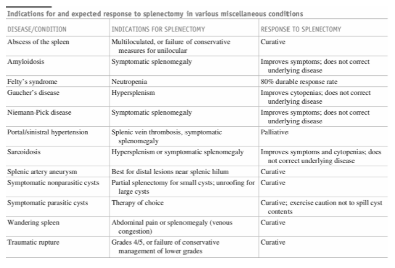

### 32. Answer: B — Semiprone

*Surgery · PDF p.8*

Ref: Bailey and Love’s Short Practice of Surgery 27th Edition, Page No: 355 • The patient suffering from facial trauma should be nursed in the semiprone position to allow secretions, blood and foreign bodies to fall from the mouth/

### 33. Answer: B — Alkaline urine

*Surgery · PDF p.8*

Ref: Schwartz’s Principles of Surgery, Eleventh Edition, Page No: 1762 • Stones are most commonly composed of calcium oxalate. Other stone compositions include calcium phosphate, uric acid, cystine, medication-related, and infectious stones (struvite or carbonate apatite) or a mix thereof. Stone composition can vary based on a number of underlying pathophysiological processes. • Uric acid stones will form in a context of acidic urinary pH, low urinary volume, and high oral intake of purines. Countering these factors by alkalinizing the urine and increasing urine output may lead to dissolution of uric acid stones and reduced further formation. • Proteus species, Klebsiella species, and other urease- producing bacteria metabolize urea into ammonium and bicarbonate. The alkaline milieu (pH >7) predisposes to infectious (struvite) stones with the precipitation of magnesium, ammonium, and phosphate.

### 34. Answer: C — Squamous cell carcinoma

*Surgery · PDF p.8*

Ref: Schwartz’s Principles of Surgery, Eleventh Edition, Page No: 629 • Squamous cell carcinoma (SCC) comprises >90% of all of the malignant pathology of the mucosal lining of the upper aerodigestive tract.

### 35. Answer: C — 6 months after injury

*Pediatrics · PDF p.9*

Ref: Schwartz’s Principles of Surgery, Eleventh Edition, Page No: 1970 – 1971 • A well-performed skin incision sets the stage for an accurate repair that minimizes the risk of unfavorable scarring. An unfavorable scar is characterized by excessive amount of collagen deposition, leading to hypertrophic scarring or keloid formation. • The difference between them is that a hypertrophic scar stops growing 6 months after the injury, whereas a keloid continues to grow, even growing well beyond its borders.36.Most common organ that herniate in Morgagni’s hernia: 9 Spleen 9 Stomach 9 Liver 9 Transverse colon Ans: d Ref: Bailey and Love’s Short Practice of Surgery 27th Edition, Page No: 938 There are two well-recognized congenital sites where abdominal viscera can herniate into the chest • The foramen of Morgagni: a hernia in the anterior part of the diaphragm with a defect between the sternal and costal attachments. The most commonly involved viscus is the transverse colon. • The foramen of Bochdalek: through the dome of the diaphragm posteriorly.

### 36. Answer: C — Stage 4s has poor prognosis

*Pediatrics · PDF p.9*

Ref: Nelson Textbook of Pediatrics, Elsevier, 20th Edition, Page No: 2461-2463 Neuroblastoma is the most common extracranial solid tumor in children and the most commonly diagnosed malignancy in infants. Neuroblastoma tumors are derived from primordial neural crest cells. Clinical manifestations • Neuroblastoma may develop at any site of sympathetic nervous system tissue. Approximately half of neuroblastoma tumors arise in the adrenal glands, and most of the remainder originate in the paraspinal sympathetic ganglia. Metastatic spread, which is more common in children older than 1 yr of age at diagnosis, occurs via local invasion or distant hematogenous or lymphatic routes. The most common sites of metastasis are the regional or distant lymph nodes, long bones and skull, bone marrow, liver, and skin. Lung and brain metastases are rare, occurring in >3% of cases. • The signs and symptoms of neuroblastoma reflect the tumor site and extent of disease, and the symptoms of neuroblastoma can mimic many other disorders, a fact that can result in a delayed diagnosis. Metastatic disease can cause a variety of signs and symptoms, including fever, irritability, failure to thrive, bone pain, cytopenias, bluish subcutaneous nodules, orbital proptosis, and periorbital ecchymoses .Localized disease can manifest as an asymptomatic mass or can cause symptoms because of the mass itself, including spinal cord compression, bowel obstruction, and superior vena cava syndrome. • Children with neuroblastoma can also present with neurologic signs and symptoms. Neuroblastoma originating in the superior cervical ganglion can result in Horner syndrome. Paraspinal neuroblastoma tumors can invade the neural foramina, causing spinal cord and nerve root compression. Neuroblastoma can also be associated with a paraneoplastic syndrome of autoimmune origin, termed opsoclonus–myoclonus– ataxia syndrome, in which patients experience rapid, uncontrollable jerking eye and body movements, poor coordination, and cognitive dysfunction. Some tumors produce catecholamines that can cause increased sweating and hypertension, and some release vasoactive intestinal peptide, causing a profound secretory diarrhea. Treatment • Treatment strategies for neuroblastoma have changed dramatically over the past 20 yr, with significant reduction in treatment intensity for children who have localized low-risk tumors and with continued increased treatment intensity and addition of new agents for treatment of children who have high-risk neuroblastoma. The patient’s age and tumor stage are combined with cytogenetic and molecular features of the tumor to determine the treatment risk group and estimated prognosis for each patient. • The usual treatment for children with low-risk neuroblastoma is surgery for stages 1 and 2 and observation for stage 4S with cure rates generally >90% without further therapy. Treatment with chemotherapy or radiation for the rare child with local recurrence can still be curative. Children with spinal cord compression at diagnosis also may require urgent treatment with chemotherapy, surgery, or radiation to avoid neurologic damage. Stage 4S neuroblastomas have a very favorable prognosis, and many regress spontaneously without therapy. Chemotherapy or resection of the primary tumor does not improve survival rates, but for infants with massive liver involvement and respiratory compromise, small doses of cyclophosphamide or low- dose hepatic irradiation may alleviate symptoms. For children with stage 4S neuroblastoma who require treatment for symptoms, the survival rate is 81%.

### 37. Answer: C — Renal failure

*Pediatrics · PDF p.9*

Ref: Nelson Textbook of Pediatrics, Elsevier, 20th Edition, Page No: 2497 • All patients with Alport syndrome have asymptomatic microscopic hematuria, which may be intermittent in girls and younger boys. Single or recurrent episodes of gross hematuria commonly occurring 1-2 days after an upper respiratory infection are seen in approximately 50% of patients. • Proteinuria is often seen in boys but may be absent, mild, or intermittent in girls. Progressive proteinuria, often exceeding 1 g/24 hr, is common by the 2nd decade of life and can be severe enough to cause nephrotic syndrome. • Bilateral sensorineural hearing loss, which is never congenital, develops in 90% of Hemizygous males with X-linked AS, 10% of heterozygous females with X-linked AS, and 67% of patients with autosomal recessive AS. • This deficit begins in the high-frequency range, but progresses to involve hearing associated with normal speech, prompting the need for hearing aids. Ocular abnormalities, which occur in 30-40% of patients with X-linked AS, include anterior lenticonus (extrusion of the central portion of the lens into the anterior chamber), macular flecks, and corneal erosions. Leiomyomatosis of the esophagus, tracheobronchial tree, and female genitals in association with platelet abnormalities has been reported, but is rare. Prognosis and treatment • The risk of progressive renal dysfunction leading to end-stage renal disease (ESRD) is highest among hemizygote and autosomal recessive homozygotes. ESRD occurs before age 30 yr in approximately 75% of hemizygotes with X-linked AS. The risk of ESRD in X-linked heterozygotes is 12% by age 40 yr and 30% by age 60 yr. Risk factors for progression are gross hematuria during childhood, nephrotic syndrome, and prominent GBM thickening. Intrafamilial variation in phenotypic expression results in significant differences in the age of ESRD among family members. No specific therapy is available to treat AS, although angiotensin-converting enzyme inhibitors (and possibly angiotensin-2 receptor inhibitors) can slow the rate of progression. • Careful management of renal failure complications such as hypertension, anemia, and electrolyte imbalance is critical. Patients with ESRD are treated with dialysis and kidney transplantation. • Approximately 5% of kidney transplantation recipients develop anti-GBM nephritis, which occurs primarily in males with X-linked AS who develop ESRD before age 30 yr. • Pharmacologic treatment of proteinuria with angiotensin-converting enzyme inhibition or angiotensin II receptor blockade has proven effective in other glomerular diseases and has also shown promise in AS. Screening of heterozygote carriers for significant renal disease in later adulthood and possible treatment of significant proteinuria is also recommended.

### 38. Answer: D — Admit to hospital for 24 hour observation for complications and/or recurrence

*Pediatrics · PDF p.10*

• This patient suffered from an intussusception that was successfully resolved with an air-contrast barium enema. He should be admitted and observed for 24 hours to monitor for complications and/or recurrence. • Admission should be the first choice in management when the patient cannot easily return promptly to the hospital in the event of changes in the child’s condition. • Contraindications to nonoperative reduction with therapeutic enema include clinical presentation of peritonitis and evidence of bowel perforation on radiographs. • Hydrostatic (water) or pneumatic (air) reduction techniques are both acceptable; however, many practitioners prefer air enemas due to supposedly reduced complication rates. • Overall recurrence rates of intussusception after reduction with enemas are estimated to be between 10-15%, with 48 hour recurrence rates even lower at 2-7%. Some practitioners utilize these relatively low recurrence rates to advocate for discharge to home from the emergency department over admission for observation in patients who are capable of returning quickly to the hospital in the event of complication or recurrence.

### 39. Answer: C — Galactokinase

*Pediatrics · PDF p.10*

• This patient likely has galactokinase deficiency as demonstrated by her bilateral infantile cataracts in the setting of healthy growth. • Galactokinase deficiency is a disorder of galactose metabolism that is milder in presentation compared to its more severe form, classic galactosemia. The disease is due to a hereditary deficiency of galactokinase, which leads to the accumulation of galactitol if galactose is present in the diet. • The most common presentation involves bilateral infantile cataracts within the first few weeks to months of life. Parents may complain of the lack of tracking objects or developing a social smile. Other findings include galactosemia (galactose in the blood) and galactosuria (galactose in urine). • This is in contrast with classic galactosemia, where patients present with failure to thrive, jaundice, hepatomegaly, and sometimes sepsis in neonates. Of note, newborn screening programs within the United States all test for galactosemia. • Aldolase B deficiency is the pathophysiology of fructose intolerance, which presents with hypoglycemia, jaundice, cirrhosis, and vomiting due to the accumulation of fructose-1-phosphate. The symptoms are especially worse following the consumption of fruit, juice, or honey. • Fructokinase deficiency is the pathophysiology of essential fructosuria, which is a benign, asymptomatic condition as fructose is not trapped in cells. • Galactose-1-phosphate uridyltransferase deficiency is the pathophysiology of classic galactosemia, which can also present with infantile cataracts. However, patients also present with failure to thrive, jaundice, hepatomegaly, and intellectual disability.

### 40. Answer: B — Consolidation

*Pediatrics · PDF p.11*

Ref: Nelson Textbook of Pediatrics, Elsevier, 20th Edition, Page No: 2440 • Initial therapy, termed remission induction, is designed to eradicate the leukemic cells from the bone marrow • The second phase of treatment, consolidation, focuses on intensive CNS therapy in combination with continued intensive systemic therapy in an effort to prevent later CNS relapses • Subsequently, many regimens provide 14-28 wk of therapy. This period of treatment is often termed intensification including (delayed intensification) ans (interim maintenance). • Finally, patients enter the maintenance phase of therapy, which lasts for 2-3 yr, depending on the protocol used

### 41. Answer: A — Rhabdomyosarcoma

*Pediatrics · PDF p.11*

Ref: Nelson Textbook of Pediatrics, Elsevier, 20th Edition, Page No: 2468 • The most common pediatric soft tissue sarcoma, rhabdomyosarcoma, accounts for approximately 3.5% of childhood cancers.

### 42. Answer: B — Croup

*Obstetrics & Gynecology · PDF p.11*

Ref: OP Ghai Pediatrics 9th Edition, Page No: 368 Acute laryngotracheobronchitis (croup) • Viral upper respiratory infection that affects children 6 months to 3 years of age • Present with biphasic stridor, barking cough and low grade fever after an episode of common cold • Chest x-ray: subglottic narrowing, steeple sign

### 43. Answer: C — mesangial proliferation deposition of IgA

*Obstetrics & Gynecology · PDF p.11*

Ref: OP Ghai Pediatrics 9th Edition, Page No: 628 | Ref: Nelson Textbook of Pediatrics, Elsevier, 20th Edition, Page No: 1216 • The given features are suggestive of HSP (Henoch- Schönlein purpura) mesangial proliferation and IgA deposition is characteristic renal findings. • Henoch-Schönlein purpura (HSP) is the most common vasculitis of childhood and is characterized by leukocytoclastic vasculitis and immunoglobulin (Ig) A deposition in the small vessels in the skin, joints, gastrointestinal tract, and kidney. • The hallmark of HSP is its rash: palpable purpura starting as pink macules or wheals and developing into petechiae, raised purpura, or larger ecchymoses • Musculoskeletal involvement, including arthritis and arthralgias, is common, occurring in up to 75% of children with HSP. • Gastrointestinal manifestations of HSP occur in up to 80% of children with HSP and include abdominal pain, vomiting, diarrhea, paralytic ileus and melena; intussusception, mesenteric ischemia, intestinal perforation are uncommon • Renal involvement occurs in up to 50% of children with HSP, manifesting as microscopic hematuria, proteinuria, hypertension, frank nephritis, nephrotic syndrome, and acute or chronic renal failure.

### 44. Answer: B — Come when called and play simple ball game

*Obstetrics & Gynecology · PDF p.11*

Come when called and play simple ball game- 12 months Ref: OP Ghai Pediatrics 9th Edition, Page No: 45, 48, 49 • Jargon: 15 months • Imitates scribbling-15months ; scribbles-18 months • Speak 2-3 words sentence and use pronoun I, me you, -2 years

### 45. Answer: B — Thelarche → pubarche → menarche

*Obstetrics & Gynecology · PDF p.11*

Ref: OP Ghai Pediatrics 9th Edition, Page No: 61 Onset and Sequence of Puberty • Puberty in girls starts with breast development (thelarche) • between 8 and 13 years .This is then followed by • appearance of pubic hair (Pubarche) and then, • menstruation (menarche) occurring at an average of 12.6 years (range 10-16 years) • Peak growth velocity in girls occurs before attainment of menarche (stage 3)

### 46. Answer: C — Digeorge syndrome

*Obstetrics & Gynecology · PDF p.12*

Ref: OP Ghai Pediatrics 9th Edition, Page No: 78 • The given features are suggestive of hypocalcemia, hence the answer is DigGeorge syndrome which is associated with hypoparathyroidism . • Options a and b are associated with hypercalcemia. • Hypocalcemia manifests as central nervous system irritability and poor muscular contractility. DigGeorge syndrome • Newborns present with nonspecific symptoms such as lethargy, poor feeding, jitteriness, vomiting, abdominal distension and seizures. • Children may develop seizures, twitching, cramps and rarely laryngospasm. Tetany and signs of nerve irritability may manifest as muscular twitching, carpopedal spasm and stridor. • Latent tetany can be diagnosed clinically by clinical maneuvers such as Chvostek sign (twitching of the orbicularis oculi and mouth elicited by tapping the facial nerve anterior to the external auditory meatus) and the Trousseau sign. (carpopedal spasm elicited by inflating a blood pressure cuff on the arm to pressure above the systolic pressure for 3 min). • ECG shows prolonged corrected QT interval (QTc to more than 0.45 seconds. Cardiac function may be impaired because of poor muscle contractility. • Prolonged hypocalcemia can present with features of rickets.

### 47. Answer: C — Low weight for height

*Obstetrics & Gynecology · PDF p.12*

Ref: OP Ghai Pediatrics 9th Edition, Page No: 94 • Low weight for age àunderweight • Low height for ageàstunting • Low weight for heightàwasting

### 48. Answer: C — Fraying

*Obstetrics & Gynecology · PDF p.12*

Ref: OP Ghai Pediatrics 9th Edition, Page No: 113 • The given features are suggestive of Rickets. The initial evaluation of rickets includes • serum biochemistry and radiographs of the wrists and/ or knee joints. Serum levels of calcium may be normal or low, serum phosphate will be low and alkaline phosphatase • high. Radiologic changes are characteristically seen at the metaphysis. • The first change is loss of normal zone of provisional calcification adjacent to the metaphysis seen as a blurring or a frayed appearance of the metaphyseal margin (fraying). Cartilage hypertrophy leads to widening of the growth plate giving the appearance of cupping and widening of metaphyseal ends (splaying) Weight-bearing and stress on uncalcified bone gives rise to bowing of limbs. Eventually, a generalized reduction in bone density is seen (osteopenia)

### 49. Answer: A — Ampulla

*Obstetrics & Gynecology · PDF p.12*

Ref: Dutta Gynecology 6th Edition, Page No: 227 Factors Essential for Conception • Healthy spermatozoa should be deposited high in the vagina at or near the cervix (male factor). • The spermatozoa should undergo changes (capacitation, acrosome reaction) and acquire motility (cervical factor). • The motile spermatozoa should ascend through the cervix into the uterine cavity and the fallopian tubes. • There should be ovulation (ovarian factor). • The fallopian tubes should be patent and the oocyte should be picked up by the fimbriated end of the tube (tubal factor). • The spermatozoa should fertilize the oocyte at the ampulla of the tube. • The embryo should reach the uterine cavity after 3–4 days of fertilization. • The endometrium should be receptive (by estrogen, progesterone, IGF-l, cytokines, integrins) for implantation, and the corpus luteum should function adequately.

### 50. Answer: B — LGV

*Obstetrics & Gynecology · PDF p.12*

Ref: Dutta Gynecology 6th Edition, Page No: 151 • Lymphogranuloma venereum (LGV) is caused by one of the aggressive L serotypes of Chlamydia trachomatis usually acquired sexually. It is an obligatory intracellular and Gram-intermediate organism. The incubation period is 3–30 days. It is more commonly found in the sea ports of the Far East, Malaysia, Africa, and South America. • Initial lesion is a painless papule, pustule or ulcer in the vulva, urethra, rectum or the cervix. The inguinal nodes are involved and feel rubbery. There is acute lymphangitis and lymphadenitis. The glands become necrosed and abscess (bubo) forms. Within 7–15 days, the bubo ruptures and results in multiple draining sinuses and fistulas. The healing occurs with intense fibrosis with lymphatic obstruction. • The secondary phase is noted by painful adenopathy. • The classical clinical sign of LGV is the “groove sign”, a depression between the groups of inflamed nodes.

### 51. Answer: C — Endometrial polyp

*Obstetrics & Gynecology · PDF p.13*

Ref: Dutta Gynecology 6th Edition, Page No: 190 • Saline Infusion Sonography (SIS) is found very helpful to diagnose endometrial polyps, submucous fibroids and uterine abnormality (septate/subseptate uterus).

### 52. Answer: A — Uterosacral ligament

*Obstetrics & Gynecology · PDF p.13*

Ref: Dutta Gynecology 6th Edition, Page No: 201 Pessary • Pessary is less commonly used in present day gynecologic practice. • However, it may be indicated: (1) for pessary test, (2) in subinvolution of uterus, (3) in pregnancy when spontaneous correction to anteversion fails by 12th week. • Usually, Hodge-Smith pessary is used. • The pessary acts by stretching the uterosacral ligaments so as to pull the cervix backwards

### 53. Answer: A — Situated anteriorly

*Obstetrics & Gynecology · PDF p.13*

Ref: Dutta Gynecology 6th Edition, Page No: 210 Features of Gartner’s cyst: • Situated anteriorly or anterolaterally and of variable sizes. • Rugosity of the overlying vaginal mucosa are lost. • Vaginal mucosa over it becomes tense and shiny. • Margins are well-defined. • It is not reducible. • There is no impulse on coughing. • The metal catheter tip introduced per urethra fails to come underneath the vaginal mucosa.

### 54. Answer: A — Ampulla

*Obstetrics & Gynecology · PDF p.13*

Ref: Dutta Gynecology 6th Edition, Page No: 227 Factors Essential for Conception • Healthy spermatozoa should be deposited high in the vagina at or near the cervix (male factor). • The spermatozoa should undergo changes (capacitation, acrosome reaction) and acquire motility (cervical factor). • The motile spermatozoa should ascend through the cervix into the uterine cavity and the fallopian tubes. • There should be ovulation (ovarian factor). • The fallopian tubes should be patent and the oocyte should be picked up by the fimbriated end of the tube (tubal factor). • The spermatozoa should fertilize the oocyte at the ampulla of the tube. • The embryo should reach the uterine cavity after 3–4 days of fertilization. • The endometrium should be receptive (by estrogen, progesterone, IGF-l, cytokines, integrins) for implantation, and the corpus luteum should function adequately.

### 55. Answer: D — Sacral plexus

*Obstetrics & Gynecology · PDF p.13*

Ref: Shaw Gynecology 16th Edition, Page No: 10 Contents of broad ligament • Fallopian tube—upper portion • Round ligament—anteriorly • Ovarian ligament—posterior fold • Vestigial structures of Wolffian body—epoophoron and paroophoron • Vestigial structure of Wolffian duct—Gartner’s duct • Ureter • Uterine vessels • Pelvic nerves • Parametrial lymph node • Pelvic cellular tissue condensed to form Mackenrodt’s ligament • Infundibulopelvic ligament

### 56. Answer: A — Above

*Obstetrics & Gynecology · PDF p.13*

Ref: Shaw Gynecology 16th Edition, Page No: 19 • The relation of the uterine artery to the ureter is of great importance. The uterine artery crosses above the ureter in the parametrium where it gives off an important ureteric branch to that structure. The artery runs transversely while the ureter runs approximately anteroposteriorly through the ureteric canal of the parametrium.

### 57. Answer: A — LH surge

*Obstetrics & Gynecology · PDF p.14*

Ref: Shaw Gynecology 16th Edition, Page No: 28, 35 The most important physiological marker of imminent ovulation is LH surge and not E2 peak, as the latter may not always culminate into ovulation. LH surge causes the following: Completion of meiosis of ovum, Ovulation, Development of corpus luteum • The ovary of the newborn has about 2 million primordial follicles. These are reduced to about 400,000 at puberty and of these around 400 are available during the reproductive lifespan. • Cyclic changes in the Graafian follicle—leading to ovulation, corpus luteum formation and menstruation— are under the control of the hypothalamus, which controls the release of gonadotropins from the anterior pituitary. • Oestrogen causes regeneration of the endometrium and the proliferative phase. Progesterone is responsible for secretory transformation of the endometrium rendering it favourable for implantation of the fertilized ovum. • Peak level of 75 ng/mL of LH is needed for ovulation. • In present-day practice, serial ultrasound monitoring of the Graafian follicle is used to detect ovulation in patients undergoing treatment for infertility. • Endometrial histology is required to diagnose endometrial tuberculosis, endometrial cancer and hormonal dysfunction. • Endometrial thickness of 8–12 mm is considered normal in the premenstrual phase. In menopausal women, endometrial thickness should not exceed 4 mm. • LH surge is an important indicator of imminent ovulation.

### 58. Answer: B — Puberty menorrhagia

*Obstetrics & Gynecology · PDF p.14*

Ref: Shaw Gynecology 16th Edition, Page No: 61 • Puberty menorrhagia: Soon after the menarche, the early menstrual cycles tend to be irregular and often prolonged leading to severe anaemia.

### 59. Answer: A — 40

*Obstetrics & Gynecology · PDF p.14*

Ref: Shaw Gynecology 16th Edition, Page No: 66 Hormone levels in a menopausal woman • E2: 5–25 pg/mL • Oestrone: 20–70 pg/mL—more in obese women • FSH: > 40 mIU/mL • Androgen: 0.3–1.0 ng/mL • Testosterone 0.1–0.5 ng/mL • LH: 50–100 mIU/mL • Androstenedione: 800 pg/mL • Growth hormone, Inhibin B, Anti-Müllerian hormone: Low

### 60. Answer: A — Symptomatic women who suffer from progesterone deficiency

*Obstetrics & Gynecology · PDF p.14*

Ref: Shaw Gynecology 16th Edition, Page No: 70 Hormone Replacement Therapy Not all women require HRT. Besides, HRT does not suit all, and it may cause complication and be harmful. However, it is logical to prescribe HRT and not withhold it when one needs it in the minimal effective dose for the shortest needed duration under supervision while on therapy. Who Needs HRT? • Symptomatic women who suffer from oestrogen deficiency (therapeutic). • High-risk cases for menopausal complications such as cardiovascular disease, osteoporosis, stroke, Alzheimer’s disease and colonic cancer (prophylactic). • Premature menopause, spontaneous or following surgery (hysterectomy, tubectomy). The surgical procedures disturb and compromise the blood supply to the ovaries. • Menopause caused by radiotherapy and chemotherapy for cancer, especially alkylating agents (prophylactic). • Gonadal dysgenesis in adolescents (therapeutic). • Women demanding HRT as prophylaxis Uses of HRT • Short term—hot flushes, vasomotor symptoms • Dyspareunia, libido • Urethral syndrome • Long term—osteoporosis • Cardiovascular • Alzheimer’s disease

### 61. Answer: D — Ringer’s lactate

*Obstetrics & Gynecology · PDF p.15*

Ref: Apley & Solomon’s System of Orthopaedics & Trauma, 10th edition, page 657 • The 2016 NICE guidance in the UK is to titrate fluids against the presence of a central pulse, with a crystalloid solution such as Ringer’s lactate or Hartmann’s compound sodium lactate being the preferred fluid (large, infused volumes of 0.9% sodium chloride solution can be associated with the development of a hyperchloraemic acidosis and should be avoided). • Pre-hospital blood transfusion is increasingly available in the UK, with two units of O-negative packed red blood cells typically being carried on HEMS air ambulances. Some UK HEMS teams now also carry two units of plasma, given with the blood to replace clotting factors and avoid raising the haemoglobin inappropriately.

### 62. Answer: C — Open reduction

*Orthopedics · PDF p.15*

Ref: Ebnezar Orthopedics, 4th edition, page 499

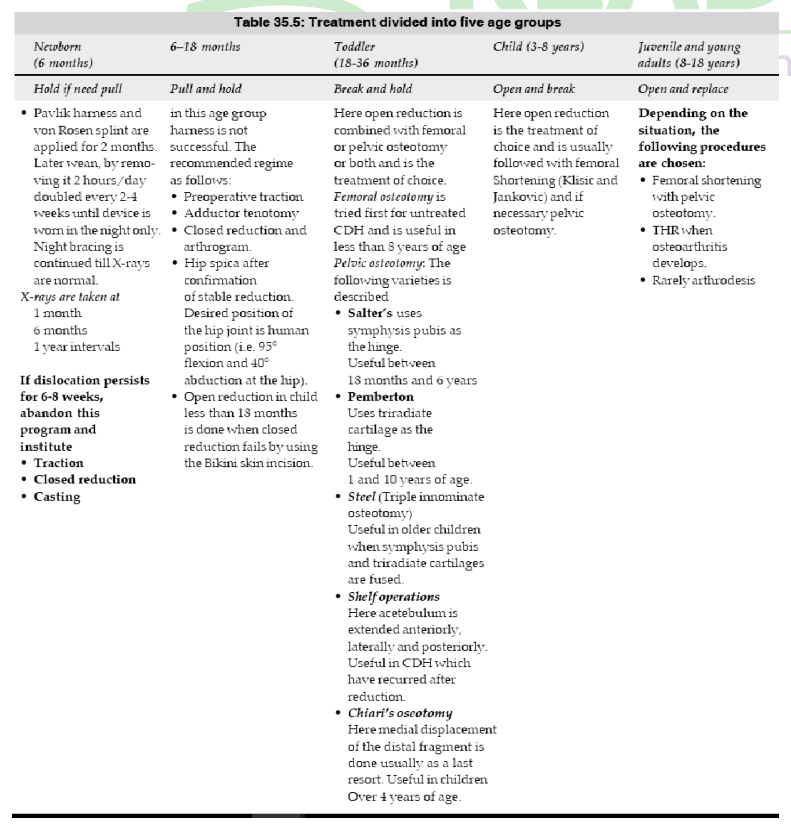

### 63. Answer: C — Lateral malleolus

*Orthopedics · PDF p.15*

Ref: Maheshwari Orthopedics, 5th edition, page 301 Common bursitis: • Prepatellar bursitis: Housemaid’s knee • Infrapatellar bursitis: Clergyman’s knee • Olecranon bursitis: Student’s elbow • Ischial bursitis: Weaver’s bottom • On lateral malleolus: Tailor’s ankle • On great toe: Bunion

### 64. Answer: A — Tenosynovitis

*Orthopedics · PDF p.15*

Ref: Essential Orthopedics by Maheshwari & Mhaskar, 5th Edition, Page No: 209 • In acute suppurative tenosynovitis of the little finger, the ulnar bursa also becomes involved, giving rise to swelling of the palm and sometimes fullness immediately above the flexor retinaculum. The area of maximum tenderness in an ulnar bursa infection can be elicited over that part of the bursa lying between the transverse palmar creases. This is Kanavel’s sign.

### 65. Answer: C — Dislocation of the superior radioulnar joint

*Orthopedics · PDF p.15*

• Galeazzi fracture is fracture lower end of radius with dislocation of the inferior radioulnar joint and this is generally managed surgically.

### 66. Answer: D — Dugas’ test

*Orthopedics · PDF p.15*

The following signs, associated with anterior dislocation of shoulder: • Dugas’ test • Hamilton ruler test • Callaway’s test.

### 67. Answer: D — Spica

*Orthopedics · PDF p.15*

Ref: Essential Orthopedics by Maheshwari & Mhaskar, 5th Edition, Page No: • Spica involves the limb and part of the trunk like hip spica for fracture shaft of femur in children. • The cast extends from the heads of the metatarsals of the injured limb and extends up the thigh and the trunk upto the chest leaving sufficient space in the chest part of the cast to allow for respiration

### 68. Answer: B — Brachial plexus injury

*Orthopedics · PDF p.16*

Ref: Essential Orthopedics by Maheshwari & Mhaskar, 5th Edition, Page No: 25 Common splints/braces and their uses

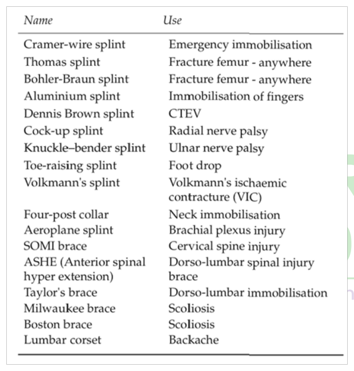

### 69. Answer: C — Sub -talar, calcaneocuboid, talonavicular

*Orthopedics · PDF p.16*

Ref: Essential Orthopedics by Maheshwari & Mhaskar, 5th Edition, Page No: 216 • Ref: Triple arthrodesis: This consists of the fusion of three joints of the foot (subtalar, calcaneocuboid and talonavicular), after taking suitable wedges to correct the deformity. It is performed after the age of 12 years, because before this the bones are cartilaginous and it is difficult to achieve fusion. Of the three, talonavicular joint fusion is most difficult to achieve.

### 70. Answer: A — Supracondylar fracture elbow

*Orthopedics · PDF p.16*

Ref: Essential Orthopedics by Maheshwari & Mhaskar, 5th Edition, Page No: 100 • The traction may be given with a K-wire passed through the olecranon (Smith’s traction) or a below- elbow skin traction (Dunlop’s traction). These methods are no longer used.

### 71. Answer: A — Rewarm it with moist cotton pledgets

*Orthopedics · PDF p.16*

Ref: PL Dhingra and Shruti Dhingra ENT and HNS 7th Edition, Page No: 52, 53 Frostbite Injury due to frostbite varies between erythema and edema, bullae formation, necrosis of skin and subcutaneous tissue, and complete necrosis with loss of the affected part. Treatment of a frostbitten ear consists of: • Rewarming with moist cotton pledgets at a temperature of 38–42 °C, • Application of 0.5% silver nitrate soaks for superficial infection, • Analgesics for pain; rapid rewarming of frostbitten ear causes considerable pain, • Protection of bullae from rupture, • Systemic antibiotics for deep infection, and • Surgical debridement should wait several months as the true demarcation between the dead and living tissues appears quite late.

### 72. Answer: C — Perilymph fistula

*Orthopedics · PDF p.16*

Ref: Dhingra ENT, 7th edition, page 508 • Hennebert’s phenomenon. Dysequilibrium following nose blowing or lifting a heavy object. Seen in perilymph fistula (do not confuse with Hennebert’s sign). • Hennebert’s sign is a positive fistula sign in the absence of fistula. Seen in congenital syphilis due to formation of adhesions between stapes footplate and saccule. Also seen in some cases of Ménière’s disease.

### 73. Answer: B — Oval window

*Orthopedics · PDF p.16*

Footplate of stapes covers the oval window and secondary tympanic membrane covers the round window. Mnemonic: SORT: • Stapes (footplate) covers- Oval window • Round window is covered by- Tympanic membrane (Secondary)

### 74. Answer: C — 41-55 dB

*Orthopedics · PDF p.17*

Ref: PL Dhingra and Shruti Dhingra ENT and HNS 6th Edition, Page No: 38 Degree of hearing loss 1. Mild: 26–40 dB 2. Moderate 41–55 dB 3. Moderately severe 56–70 dB 4. Severe 71–91 dB 5. Profound More than 91 dB 6. Total

### 75. Answer: B — Frontal

*Orthopedics · PDF p.17*

Ref: PL Dhingra and Shruti Dhingra ENT and HNS 7th Edition, Page No: 187 • The superior most sinus is frontal sinus—as it is located between the inner and outer table of frontal bone, above and deep to supraorbital margin. • This is followed by ethmoid sinus situated between the upper third of lateral nasal wall and medial wall of the orbit. • Next is sphenoid sinus in the body of sphenoid and most inferior is maxillary sinus in the maxillary bone.

### 76. Answer: B — 10 seconds

*Orthopedics · PDF p.17*

Ref: PL Dhingra and Shruti Dhingra ENT and HNS 7th Edition, Page No: 313 • Sleep apnoea is cessation of breathing that lasts for 10 s or more during sleep. Less than five such episodes is normal.

### 77. Answer: B — Rhinophyma

*Orthopedics · PDF p.17*

Ref: PL Dhingra and Shruti Dhingra ENT and HNS 7th Edition, Page No: 162 • Rhinophyma or potato tumor is a slow-growing benign tumor due to hypertrophy of the sebaceous glands of the tip of nose often seen in cases of long-standing acne rosacea. It presents as a pink, lobulated mass over the nose with superficial vascular dilation and mostly affects men past middle age. • Rhinosporidiosis is a chronic granulomatous disease caused by Rhinosporidium seeberi.

### 78. Answer: A — Roll over phenomenon absent

*ENT · PDF p.17*

Ref: PL Dhingra and Shruti Dhingra ENT and HNS 7th Edition, Page No: 113

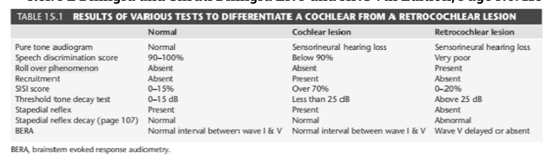

### 79. Answer: D — Donaldson line

*ENT · PDF p.17*

• Donaldson’s line: This line is a surgical landmark for endolymphatic sac. It passes through horizontal bisecting the posterior semicircular canal. The endolymphatic sac that appears as thickening of the posterior cranial fossa dura is situated inferior to Donaldson’s line. • Citelli’s angle (sinodural angle): It lies between the sigmoid sinus and middle fossa dura mater. • Bill’s island: This thin plate of bone left on sigmoid sinus during mastoidectomy helps in retracting the sigmoid sinus. It should not be confused with Bill’s bar, which lies in the fundus of internal auditory canal. • Solid angle: This area of bony labyrinth lies between the three semicircular canals. • Trautmann’s triangle: This area is bounded by the bony labyrinth anteriorly, sigmoid sinus posteriorly and the superior petrol sinus superiorly. Any infection in the posterior canal fossa can spread through this triangle and can be approached by removing the bone in between the triangle.

### 80. Answer: D — It can be used in neonates

*ENT · PDF p.17*

In neonates/infants only objective tests are used, not subjective tests. Indications—PTA is an Accurate Measure to know: • Degree of hearing loss: Hearing loss may be mild, moderate, severe or profound. • Type of hearing loss: Hearing loss may be conductive, sensory, neural or mixed. • Progress of the disease: Hearing loss can be fluctuating progressive and stationary. • Response to the treatment: It is important to know whether the hearing loss is improving or not with the therapy. • Hearing aids: The type and necessary setting of hearing aids can be determined. • Degree of handicap: It is needed for compensation and certain benefits.

### 81. Answer: A — Minimum discriminable

*ENT · PDF p.18*

Ref: Khurana Ophthalmology, 6th edition, page 17 • The minimum separation between the two points, which can be discriminated as two, is known as minimum resolvable. • Minimum visible. It is the ability to determine whether an object is present or not. • Minimum discriminable refers to spatial distinction by an observer when the threshold is much lower than the ordinary acuity. • Resolution (ordinary visual acuity). Discrimination of two spatially separated tar ets is termed resolution

### 82. Answer: B — Pseudogliomas

*ENT · PDF p.18*

Ref: Khurana Ophthalmology, 6th edition, page 505 • Leucocoria (white reflex in pupil) in children is seen in congenital cataract, retinoblastoma, retrolental fibroplasia (retinopathy of prematurity), persistent primary hyperplastic vitreous and toxocara endophthalmitis. • The yellowish white, semidilated, non-reacting pupil seen in retinoblastoma and pseudogliomas is also called as amaurotic cat’s eye reflex.

### 83. Answer: B — Intumescent lens

*ENT · PDF p.18*

Ref: Khurana Ophthalmology, 6th edition, page 503 • Causes of shallow anterior chamber 9 Primary narrow angle glaucoma 9 Hypermetropia 9 Postoperative shallow anterior chamber (after intraocular surgery due to wound leak or ciliochoroidal detachment) 9 Malignant glaucoma 9 Anterior perforations (perforating injuries or perforation of corneal ulcer) 9 Anterior subluxation of lens 9 Intumescent (swollen) lens. • Causes of deep anterior chamber 9 Aphakia/Pseudophakia 9 Total posterior synechiae 9 Myopia 9 Keratoglobus 9 Buphthalmos 9 Keratoconus 9 Anterior dislocation of lens into the anterior chamber 9 Posterior perforation of the globe.

### 84. Answer: A — Ectasia of sclera with incarceration of root of iris

*ENT · PDF p.18*

Ref: Parson Ophthalmology 22ndEdition, Page No: 229 Intercalary Staphyloma • This is located at the limbus and is lined by the root of the iris and the anteriormost part of the ciliary body. • It is seen externally from the limbus to up to 2 mm behind the limbus. The usual causes are lesions that produce weakening of the globe in this region such as perforating injuries of the peripheral cornea, marginal corneal ulcer, anterior scleritis, scleromalacia perforans, complicated cataract surgery with poor wound apposition and secondary glaucoma.

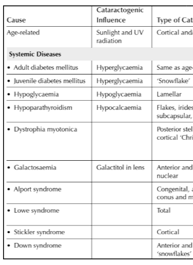

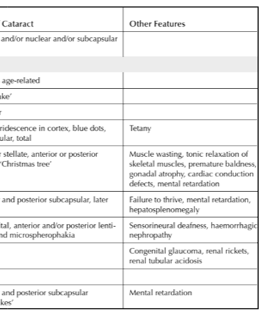

### 85. Answer: B — Snow Flake Cataract

*ENT · PDF p.18*

Ref: Parson Ophthalmology 22ndEdition, Page No: 264

### 86. Answer: A — Acquired axial hypermetropia

*ENT · PDF p.18*

Ref: Khurana Ophthalmology, 6th edition, page 35 • Acquired axial hypermetropia due to forward displacement of the retina as seen in retinal detachment, central serous retinopathy and orbital tumours. • Acquired curvatural hypermetropia may occur due to post-traumatic or post-inflammatory corneal flattening. • Consecutive hypermetropia due to surgically overcorrected myopia. • Positional hypermetropia due to posterior subluxation of lens.

### 87. Answer: A — Elastotic degeneration

*ENT · PDF p.19*

Ref: AK Khurana Ophthalmology 6th Edition, Page No: 87 • Pathologically pterygium is a degenerative and hyperplastic condition of conjunctiva. The subconjunctival tissue undergoes elastotic degeneration and proliferates as vascularised granulation tissue under the epithelium, which ultimately encroaches the cornea. The corneal epithelium, Bowman’s layer and superficial stroma are destroyed.

### 88. Answer: A — Ether

*ENT · PDF p.19*

Ref: Ajay Yadav Anesthesia, 6th edition, page 5 • Ciliated epithelium up co terminal bronchioles after which non-ciliated epithelium. • Ciliary activity is inhibited by all inhalational agents except ether.

### 89. Answer: D — Less economical

*ENT · PDF p.19*

Ref: Ajay Yadav Anesthesia, 6th edition, page 29

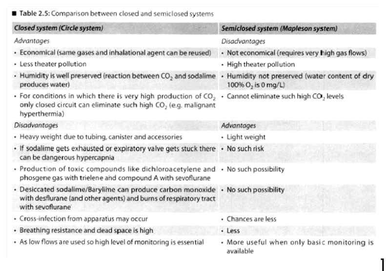

### 90. Answer: B — Jaw protrusion

*ENT · PDF p.19*

Ref: Ajay Yadav Anesthesia, 6th edition, page 7 • Anatomical dead space is constituted by air which is not participating in diffusion. Therefore it is constituted by air present in nose, trachea and bronchial tree (up to terminal bronchioles). Normally, it is 30% of tidal volume or 2 mL/kg or 150 mL. • Anatomical dead space is increased in: 9 Old age 9 Neck extension 9 Jaw protrusion 9 Bronchodilators 9 Increasing lung volume 9 Atropine (causes bronchodilatation) 9 Anesthesia mask, circuits 9 Intermittent positive pressure ventilation (JPPV) and positive end-expiratory pressure (PEEP). • Anatomical dead space is decreased by: 9 Intubation (nasal cavity is bypassed and diameter of tube is less than airway diameter) 9 Tracheostomy (upper airways and nasal cavity bypassed) 9 Hyperventilation (decreasing lung volume) 9 Neckflexion 9 Bronchoconstrictors

### 91. Answer: A — Alveolar plateau

*Ophthalmology · PDF p.19*

Ref: Ajay Yadav Anesthesia, 6th edition, page 62 • Normal waveform: It has four phases: • Phase I: Contains dead space gases with almost no CO2. • Phase II: Transition from phase l (dead space) to phase Ill (alveolar phase) • Phase III: Alveolar plateau • Phase IV: Down slope at the time of inspiration

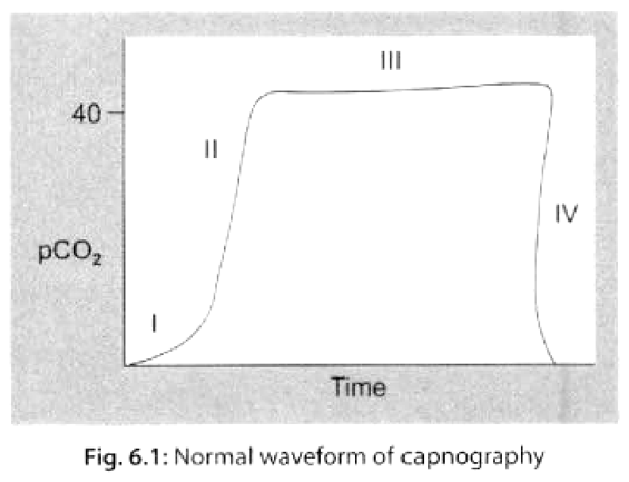

### 92. Answer: D — Stage of surgical anesthesia

*Ophthalmology · PDF p.20*

Ref: Ajay Yadav Anesthesia, 6th edition, page 88

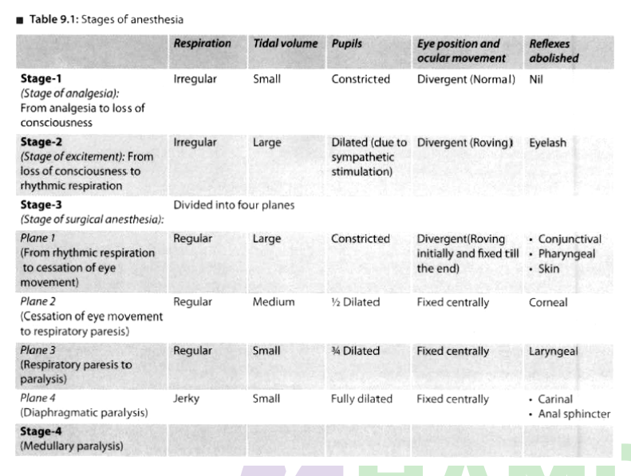

### 93. Answer: B — Entonox

*Ophthalmology · PDF p.20*

Ref: Ajay Yadav Anesthesia, 6th edition, page 11 • POYNTING EFFECT: Mixing of liquid nitrous oxide at low pressure with oxygen at high pressure (in Entonox) leads to formation of gas of nitrous oxide. Therefore, oxygen and nitrous oxide both are present in gaseous state in Entonox cylinder.

### 94. Answer: C — Pruritogenic

*Ophthalmology · PDF p.20*

Ref: Ajay Yadav Anesthesia, 6th edition, page 110 • Advantages of Propofol over Thiopentone 9 Rapid and smooth recovery. 9 Completely eliminated from body in 4 hours therefore patient is ambulatory early. 9 Antiemetic. 9 Antipruritic. 9 Bronchodilator. • Disadvantages 9 Apnea is more profound and longer. 9 Hypotension is more severe. 9 Injection is painful. 9 Solution is less stable (6 hours). 9 Chances of sepsis with contaminated solution are high. 9 Myoclonic activity may occur. 9 Sexual fantasies and hallucinations are additional side effects. 9 Expensive than thiopentone. 9 Because of maximum inhibition of airway 9 reflexes there are increased chances of aspiration in high risk cases. 9 As propofol increases the dopamine concentration in brain its addiction has been reported. 9 Propofol infusion syndrome: It is rare but is a lethal complication. It is usually seen if propofol infusion is continued for more than 48 h ours. It is more common in children. It occurs because of the failure of free fatty acid metabolism caused by propofol. It is associated with severe metabolic acidosis (lactic acidosis) acute cardiac failure, cardiomyopathy, skeletal myopathy, hyperkalemia, lipemia and 9 hepatomegaly.

### 95. Answer: C — Stupor

*Ophthalmology · PDF p.20*

Ref: Niraj Ahuja Psychiatry 7th Edition, Page No: 59 • Mutism: Complete absence of speech • Rigidity: Maintenance of a rigid posture against efforts to be moved • Negativism: An apparently motiveless resistance to all commands and attempts to be moved, or doing just the opposite • Posturing: Voluntary assumption of an inappropriate and often bizarre posture for long periods of time • Stupor: Akinesis (no movement) with mutism but with evidence of relative preservation of conscious awareness • Echolalia: Repetition, echo or mimic king of phrases or words heard • Echopraxia: Repetition, echo or mimic king of actions observed • Waxy flexibility: Parts of body can be placed in positions that will be maintained for long periods of time, even if very uncomfortable; flexible like wax 9. Ambitendency: Due to ambivalence, conflicting impulses and tentative actions are made, but no goal directed action occurs, e.g. on asking to take out tongue, tongue is slightly protruded but taken back again

### 96. Answer: C — Tentative actions are made, but no goal directed action occurs

*Ophthalmology · PDF p.20*

Ref: Niraj Ahuja Psychiatry 7th Edition, Page No: 246 • Ambitendency: Due to ambivalence, tentative actions are made, but no goal directed action occurs. • Ambivalence: Inability to decide for or against, due to co-existence of two opposing impulses for the same thing at the same time in the same person. • Agitation: Presence of anxiety with severe motor restlessness. • Akinesia: Absence of motor activity. • Alexithymia: Inability to verbally describe one’s emotionally feelings.

### 97. Answer: B — More common amongst girls

*Ophthalmology · PDF p.21*

Ref: Niraj Ahuja Psychiatry 7th Edition, Page No: 165 • Asperger’s syndrome is characterized by autism without any significant delay in language or cognitive development (including intelligence). This syndrome occurs predominantly in boys (male : female ratio = 8:1). It probably represents mild cases of autism and has been also called as high functioning autism.

### 98. Answer: B — Female

*Ophthalmology · PDF p.21*

Ref: Niraj Ahuja Psychiatry 7th Edition, Page No: 223 The presence of following factors increases the risk of completed suicide: • Age>40 years • Male gender • Staying single • Previous suicidal attempt(s) • Depression (risk about 25 times more than usual) • Suicidal preoccupation (for example, a written ‘suicide note’ and/or detailed plans are made for committing suicide) • Alcohol or drug dependence • Severe, disabling, painful or untreatable physical illness • Recent serious loss or major stressful life event • Social isolation • Higher degree of impulsivity

### 99. Answer: C — Lithium

*Ophthalmology · PDF p.21*

Ref: Kaplan and Sadock Psychiatry 11th Edition, Page No: 236 • Lithium is the drug of choice for Bipolar disorders as it is a mood stabilizer as well as it has an anti-suicidal effect. Hence it is also used as a response augmenting agent with antidepressants in resistant major depression. • Clinical studies have shown that Lithium reduces the incidence of suicide in Bipolar disorder patients six fold seven fold. • This anti-suicide property is also seen in Clozapine (2nd generation anti-psychotic)

### 100. Answer: B — Thyroid stimulating hormone and free thyroxine levels

*Ophthalmology · PDF p.21*

This describes a patient with bipolar disorder on lithium presenting with restlessness in the setting of atrial fibrillation and diaphoresis. Hyperthyroidism needs to be evaluated using TSH and free T4 levels. Hyperthyroidism is an excessive concentration of thyroid hormones in tissues caused by increased synthesis of thyroid hormones, excessive release of preformed thyroid hormones, or an endogenous or exogenous extrathyroidal source. Lithium normally suppresses thyroid hormone production, causing hypothyroidism, but rare cases of lithium-associated thyrotoxicosis have been described. The pathophysiology is currently unknown. The TSH test has the highest sensitivity and specificity for hyperthyroidism. Free thyroxine (T4) and total triiodothyronine (T3) levels can be obtained subsequently or simultaneously depending on clinical suspicion. • Thyroglobulin levels are used to evaluate effectiveness of thyroid cancer treatment. Increased levels can suggest hyperthyroidism but do not necessary correlate with increased thyroxine levels. • TSH and total thyroxine levels may be elevated without clinical evidence of hyperthyroidism because free thyroxine levels more accurately reflect the physiological amount of thyroxine. • Triiodothyronine and thyroxine levels are insufficient to assess whether the hyperthyroidism is primary, secondary, or tertiary in etiology. • TSH, free T4, and total T3 levels are used to evaluate hyperthyroidism.

### 101. Answer: A — Transference

*Anesthesia · PDF p.21*

• Transference: patient projects feelings about important person onto physician; e.g. psychiatrist = parent • Countertransference: Physician projects feelings about important person onto patient

### 102. Answer: A — MRI

*Anesthesia · PDF p.22*

Ref: Curry TS, Dowdey JE, Murry RE. Christensen ́s physics of diagnostic radiology 4 Ed. Lippincott Williams & Wilkins. (1990) The precessional frequency of nuclei of a substance placed in a static magnetic field B0 is calculated from the Larmor Equation: ω = γB where ω is the Larmor frequency in MHz, γ is the gyromagnetic ratio in MHz/tesla and B is the strength of the static magnetic field in tesla. The gyromagnetic ratio (MHz/T) for a few commonly measured or imaged isotopes are: • H-1 42.58 • F-19 40.05 • Na-23 11.26 • P-31 17.24

### 103. Answer: A — Subfalcine

*Anesthesia · PDF p.22*

Ref: Berry and Sury Diagnostic Radiology, 2nd Edition, Page No: 597 There are three types of herniation: • Subfalcine • Uncal • Transtentorial: Descending, Ascending. Subfalcine Herniation • This is the most common form of herniation. • Imaging features include displacement of the cingulate gyrus across the midline under the falx cerebri, compression of the ipsilateral ventricle due to mass effect and enlargement of the contralateral ventricle due to obstruction of the foramen of Monro. Due to such displacement, there will be trapping of the callosomarginal branches of the anterior cerebral artery (ACA), which may lead to ACA infarction.

### 104. Answer: B — F-18 FDG

*Anesthesia · PDF p.22*

Ref: Berry and Sury Diagnostic Radiology, 2nd Edition, Page No: 1080 • In the present time, the molecule that is most commonly used in PET is fluorine-18 fluorodeoxyglucose (F-18 FDG), a glucose analogue, developed to image glucose metabolism in the body. • FDG is taken up in cells by glucose transporters.

### 105. Answer: D — All of the above

*Anesthesia · PDF p.22*

Ref: Berry and Sury Diagnostic Radiology, 2nd Edition, Page No: 1959 • Hemoptysis is considered massive when at least 300 mL of blood is lost in less than 24 hours, and it may be life threatening. • Common causes of massive hemoptysis are cystic fibrosis, bronchiectasis, tuberculosis, and aspergillosis. • Malignancy is rarely a cause. Surgical intervention is usually not feasible because of severe pulmonary disease; therefore, embolization of the bleeding bronchial arteries can be lifesaving. • Bronchial arteries are variable. They usually arise from the descending thoracic aorta between thoracic vertebrae T4 and T7. The right bronchial artery arises from the intercostobronchial trunk in most patients (>90%). The left bronchial artery usually arises directly from the aorta and is multiple in most patients. Occasionally, the right and left bronchial arteries arise from a common trunk.

### 106. Answer: D — Osteosarcoma

*Anesthesia · PDF p.22*

Ref: Berry and Sury Diagnostic Radiology, 2nd Edition, Page No: 2693

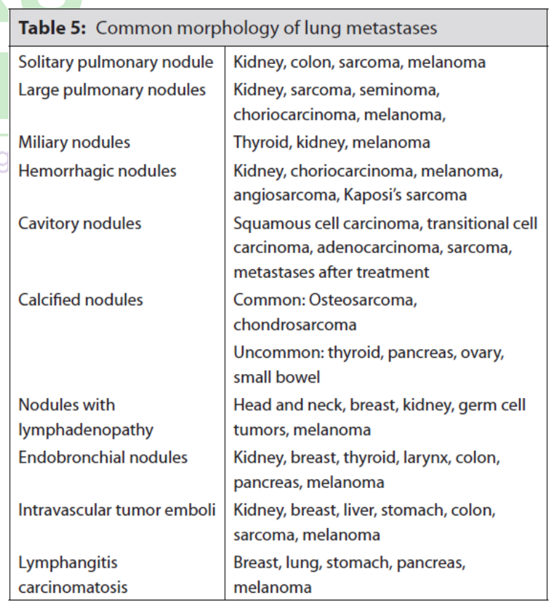

### 107. Answer: A — Crohn’s disease

*Anesthesia · PDF p.22*

Ref: String sign (bowel) by Uchechi Emeka and Dr Behrang Amini et al. in Radiopedia • The gastrointestinal string sign (also known as the string sign of Kantor) refers to the string-like appearance of a contrast-filled bowel loop caused by its severe narrowing. • Originally used to describe the reversible narrowing caused by spasms in Crohn disease, it is now used for any severe narrowing of the bowel lumen, including that seen in hypertrophic pyloric stenosis, gastrointestinal tuberculosis, carcinoid tumor and colon cancer.

### 108. Answer: C — Congenital syphilis

*Anesthesia · PDF p.23*

Ref: Wimberger sign by Dr Daniel J Bell and Dr Maxime St-Amant et al. in Radiopedia. • The Wimberger sign, also called Wimberger corner sign, refers to localized bilateral metaphyseal destruction of the medial proximal tibias. It is a pathognomonic sign for congenital syphilis. • It must not be mixed up with Wimberger ring sign seen in scurvy, which is sometimes also confusingly referred to as Wimberger sign.

### 109. Answer: D — >85%

*Anesthesia · PDF p.23*

Ref: Fitzpatrick Dermatology 9th edition, Page 3042 • Although rash is important, pain is the cardinal symptom of herpes zoster, especially in the elderly. • Some patients with herpes zoster do not experience pain, but most (>85% over age 50) have dermatomal pain or discomfort during the acute phase (the first 30 days following rash onset) that ranges from mild to severe. • Patients describe their pain or discomfort as “burning,” “deep aching,” “tingling,” or “stabbing.” • For some patients, the pain intensity is so great that words like “horrible” or “excruciating” are used to describe the experience. • Acute herpes zoster pain is associated with decreased physical functioning, emotional distress, and decreased social functioning.

### 110. Answer: C — Gold salts

*Anesthesia · PDF p.23*

Ref: Fitzpatrick Dermatology 9th edition, Page 537 Lichen planus (Greek leichen, “tree moss”; Latin planus,“flat”) is a common inflammatory condition that canaffect any ectodermal-derived tissue.

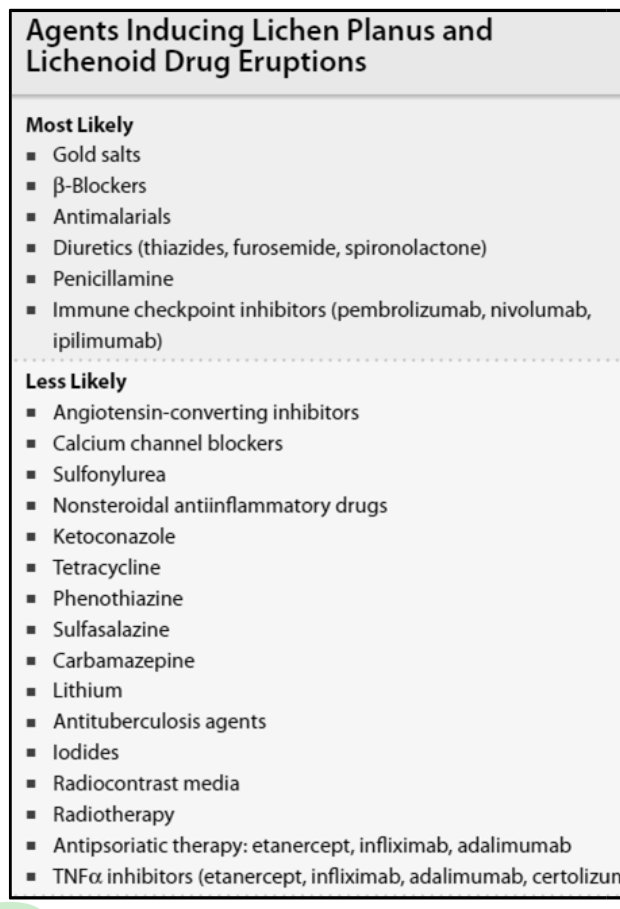

### 111. Answer: D — Bullous pemphigoid

*Psychiatry · PDF p.23*

Ref: Dermatology, Neena Khanna, 4th edition, Page No: 7

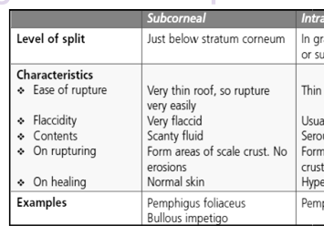

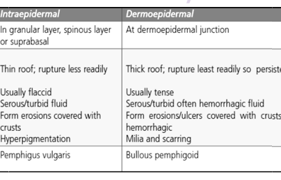

### 112. Answer: B — Staphylococcus aureus

*Psychiatry · PDF p.23*

Ref: Fitzpatrick Dermatology, 9th edition, page 2721 • Bullous impetigo is caused by S. aureus strains that express certain exfoliative toxins that cleave desmoglein 1 in the epidermis, resulting in clusters of thin-roofed bullae, vesicles, and/or pustules. • Bullae usually arise on areas of grossly normal skin and can easily rupture, creating crusted and erythematous erosions that may have a residual collarette of scale that represent remnants of the bullae and vesicles. Bullous impetigo occurs most commonly in newborns and older infants, and is characterized by the rapid progression of vesicles to flaccid bullae

### 113. Answer: C — Tumor thickness

*Psychiatry · PDF p.24*

Ref: Fitzpatrick Dermatology, 9th edition, page 1998 • The single most important prognostic factor for survival and clinical management in localized stage I and II cutaneous melanoma is tumor thickness. As originally described by Breslow, thickness is measured from the top of the granular layer of the epidermis to the greatest depth of tumor invasion using an ocular micrometer measured in millimeters. Survival decreases with increasing Breslow thickness. Clark level is an alternate, less accurate method of measuring tumor thickness by the anatomic level of invasion. Clark level of invasion is no longer used in routine staging of melanoma.

### 114. Answer: B — Erythema nodosum

*Psychiatry · PDF p.24*

Ref: Fitzpatrick Dermatology, 9th edition, page 2433 Cutaneous Findings Associated with Hepatitis Band Hepatitis C • Cryoglobulinemia (C>B) • Porphyria cutanea tarda (C>B) • Sarcoidosis after interferon/ribavirin (C>B) • Erythema nodosum (B>C) • Gianotti-Crosti syndrome (B>C)

### 115. Answer: A — Lupus erythematosus

*Psychiatry · PDF p.24*

Ref: Fitzpatrick Dermatology, 9th edition, page 1037 • Lupus erythematosus are a group of heterogeneous illnesses that have in common the development of immunity to selfnucleic acids and their associated proteins, with skin-only disease at one end of the spectrum and severe visceral involvement at the other. • Skin lesions may be specific to lupus or nonspecific, being seen in other conditions as well. Acute cutaneous lupus erythematosus (malar rash) is almost always associated with underlying visceral involvement. Subacute cutaneous lupus patients meet American College of Rheumatology systemic lupus erythematosus criteria approximately50% of the time (but typically express only mild systemic clinical manifestations). Chronic cutaneous lupus (classic discoid lupus erythematosus, lupus panniculitis, chilblain lupus, and tumid lupus erythematosus) patients most often have skin-only or skin-predominant disease. • Treatment consists of physical sun protection, topical sunscreens, local and short-term systemic glucocorticoids, antimalarials (hydroxychloroquine), retinoids, thalidomide/lenalidomide, conventional immunosuppressives, and biologic therapies.

### 116. Answer: D — Coracoid process of scapula

*Psychiatry · PDF p.24*

Ref: Snell’s clinical anatomy; 9th edition; Page 374 Table: Muscles of the arm

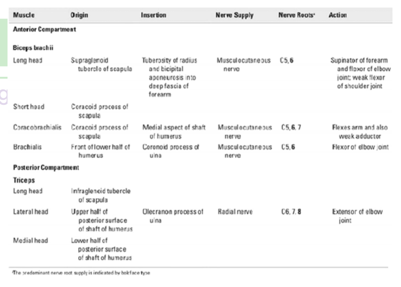

### 117. Answer: B — Nerve to obturator externus

*Psychiatry · PDF p.24*

Ref: Snell’s clinical anatomy; 9th edition; Page 445-446 Foramina of the Gluteal Region • The two important foramina in the gluteal region are the greater sciatic foramen and the lesser sciatic foramen. Greater Sciatic Foramen The greater sciatic foramen is formed by the greater sciatic notch of the hip bone and the sacrotuberous and sacrospinous ligaments. It provides an exit from the pelvis into the gluteal region. The following structures exit the foramen: • Piriformis • Sciatic nerve • Posterior cutaneous nerve of the thigh • Superior and inferior gluteal nerves • Nerves to the obturator internus and quadratus femoris • Pudendal nerve • Superior and inferior gluteal arteries and veins • Internal pudendal artery and vein Lesser Sciatic Foramen The lesser sciatic foramen is formed by the lesser sciatic notch of the hip bone and the sacrotuberous and sacrospinous ligaments. It provides an entrance into the perineum from the gluteal region. Its presence enables nerves and blood vessels that have left the pelvis through the greater sciatic foramen above the pelvic floor to enter the perineum below the pelvic floor. The following structures pass through the foramen: • Tendon of obturator internus muscle • Nerve to obturator internus • Pudendal nerve • Internal pudendal artery and vein

### 118. Answer: B — Metanephros

*Psychiatry · PDF p.25*

Ref: Inderbir embryology; 11th edition; Page 264 The definitive human kidney arises from two distinct sources. • The secretory part, i.e. excretory tubules (or nephrons) are derived from the lowest part of the nephrogenic cord. This part is the metanephros, the cells of which form the metanephric blastema. • The collecting part of the kidney is derived from a diverticulum called the ureteric bud which arises from the lower part of the mesonephric duct.

### 119. Answer: B — Limbus fossa ovalis

*Radiology · PDF p.25*

• Triangle of Koch, a triangular area bounded in front by the base of septal leaflet of tricuspid valve, behind by anterior margin of the opening of coronary sinus and above by the tendon of Todaro—a subendocardial ridge. The atrioventricular node lies in this triangle.

### 120. Answer: C — Internal laryngeal nerve

*Radiology · PDF p.25*

Ref: Snell’s clinical anatomy; 9th edition; Page 649 Nerve supply of larynx Sensory Nerves • Above the vocal cords: The internal laryngeal branch of the superior laryngeal branch of the vagus. • Below the level of the vocal cords: The recurrent laryngeal nerve . Motor Nerves • All the intrinsic muscles of the larynx except the cricothyroid muscle are supplied by the recurrent laryngeal nerve. The cricothyroid muscle is supplied by the external laryngeal branch of the superior laryngeal branch of the vagus.

### 121. Answer: A — Urachus

*Radiology · PDF p.25*

Ref: TW Sadler Embryology, Langman’s, 13th Edition, Page No: 205, 258 • Initially, the bladder is continuous with the allantois, but when the lumen of the allantois is obliterated, a thick fibrous cord, the urachus, remains and connects the apex of the bladder with the umbilicus. In the adult, it forms the median umbilical ligament. • After birth, the proximal portions of the umbilical arteries persist as the internal iliac and superior vesical arteries, and the distal parts are obliterated to form the medial umbilical ligaments.

### 122. Answer: B — Hearing

*Radiology · PDF p.25*

Ref: Snell’s Neuroanatomy 7th Edition, Page No: 223, 369 • The pons is commonly divided into a posterior part, the tegmentum, and an anterior basal part by the transversely running fibers of the trapezoid body. • The trapezoid body is made up of fibers derived from the cochlear nuclei and the nuclei of the trapezoid body. They run transversely in the anterior part of the tegmentum. • The anterior and posterior cochlear nuclei are situated on the surface of the inferior cerebellar peduncle. They receive afferent fibers from the cochlea through the cochlear nerve. The cochlear nuclei send axons (second-order neuron fibers) that run medially through the pons to end in the trapezoid body and the olivary nucleus. Here, they are relayed in the posterior nucleus of the trapezoid body and the superior olivary nucleus on the same or the opposite side. The axons now ascend through the posterior part of the pons and midbrain and form a tract known as the lateral lemniscus. Each lateral lemniscus, therefore, consists of third order neurons from both sides. As these fibers ascend, some of them relay in small groups of nerve cells, collectively known as the nucleus of the lateral lemniscus. • On reaching the midbrain, the fibers of the lateral lemniscus either terminate in the nucleus of the inferior colliculus or are relayed in the medial geniculate body and pass to the auditory cortex of the cerebral hemisphere through the acoustic radiation of the internal capsule. • The primary auditory cortex (areas 41 and 42) includes the gyrus of Heschl on the upper surface of the superior temporal gyrus. The recognition and interpretation of sounds on the basis of past experience take place in the secondary auditory area. • Nerve impulses from the ear are transmitted along auditory pathways on both sides of the brainstem, with more being projected along the contralateral pathway. Many collateral branches are given off to the reticular activating system of the brainstem. The tonotopic organization present in the organ of Corti is preserved within the cochlear nuclei, the inferior colliculi, and the primary auditory area.

### 123. Answer: A — Prostatic urethra and ejaculatory duct

*Radiology · PDF p.26*

Ref: Snell’s Regional Anatomy 9th Edition, Page No: 275-277 • The prostate is incompletely divided into five lobes. The anterior lobe lies in front of the urethra and is devoid of glandular tissue. The median, or middle, lobe is the wedge of gland situated between the urethra and the ejaculatory ducts. Its upper surface is related to the trigone of the bladder; it is rich in glands. The posterior lobe is situated behind the urethra and below the ejaculatory ducts and also contains glandular tissue. The right and left lateral lobes lie on either side of the urethra and are separated from one another by a shallow vertical groove on the posterior surface of the prostate. • The prostate is a fibromuscular glandular organ that surrounds the prostatic urethra. It is about 1.25 in. (3 cm) long and lies between the neck of the bladder above and the urogenital diaphragm below. The somewhat conical prostate has a base, which lies against the bladder neck above, and an apex, which lies against the urogenital diaphragm below. The two ejaculatory ducts pierce the upper part of the posterior surface of the prostate to open into the prostatic urethra at the lateral margins of the prostatic utricle. The prostate is closely related to the anterior surface of the rectal ampulla and is separated from it by the rectovesical septum (fascia of Denonvilliers).

### 124. Answer: A — Superior olivary complex

*Radiology · PDF p.26*

Ref: Gray’s anatomy, 41st Edition; Page No: 62 Stapedial reflex • In respect to the loud sound contraction of the stapedial muscle stiffens the middle ear ossicles and tilts the stapes in the oval window of the cochlea, this effectively decreases the vibrational energy transmitted to the cochlea • The best known reflex mediated through the superior olive is the stapedial reflex.

### 125. Answer: D — Superior mesenteric artery

*Radiology · PDF p.26*

Ref: Moore’s Anatomy 7th Edition, Page No: 241, 242 • The inferior (horizontal) part of the duodenum runs transversely to the left, passing over the IVC, aorta, and L3 vertebra. • It is crossed by the superior mesenteric artery and vein and the root of the mesentery of the jejunum and ileum. • Superior to it is the head of the pancreas and its uncinate process. • The anterior surface of the inferior part is covered with peritoneum, except where it is crossed by the superior mesenteric vessels and the root of the mesentery. • Posteriorly it is separated from the vertebral column by the right psoas major, IVC, aorta, and the right testicular or ovarian vessels.

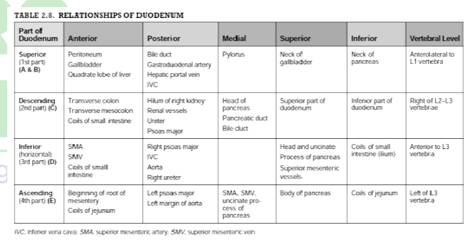

### 126. Answer: B — Lesser sciatic notch

*Radiology · PDF p.26*

Ref: Moore’s Anatomy 7th Edition, Page No: 328 • The concavity between the ischial spine and the ischial tuberosity is the lesser sciatic notch. • The larger concavity, the greater sciatic notch, is superior to the ischial spine and is formed in part by the ilium.

### 127. Answer: B — Left fifth intercostal space in the midclavicular line

*Anatomy · PDF p.26*

Ref: Gray’s Anatomy for Students, 117-180 • During pericardiocentesis, the needle is inserted below the xiphoid process, or in the left fifth intercostal space in the midclavicular line. The most effective way of draining the pericardium is by penetrating the thoracic wall at its lowest point anatomically, hence the third intercostal space would be too cranial in position. The sixth and seventh intercostal spaces are locations that are not used clinically because of the increased likelihood of injury to the pleura or lungs and other complications.

### 128. Answer: C — Splenorenal ligament

*Anatomy · PDF p.27*

Ref: Gray’s Anatomy for Students, 329 • The splenorenal ligament is the attachment of the spleen to the left kidney and is the only ligament that contains the major branches of the splenic artery to the spleen and greater curvature of the stomach. • The coronary ligament is the peritoneal reflection from the diaphragmatic surface of the liver onto the diaphragm that encloses the bare area of liver; it is not attached to the spleen. • The gastrocolic ligament contains branches of the gastroomental vessels but should not be a factor in the splenectomy.

### 129. Answer: C — Popliteal

*Anatomy · PDF p.27*

Ref: Moore’s Anatomy 7th Edition, Page No: 535 The small saphenous vein arises on the lateral side of the foot from the union of the dorsal vein of the little toe with the dorsal venous arch. The small saphenous vein: • Ascends posterior to the lateral malleolus as a continuation of the lateral marginal vein. • Passes along the lateral border of the calcaneal tendon. • Inclines to the midline of the fibula and penetrates the deep fascia. • Ascends between the heads of the gastrocnemius muscle. • Empties into the popliteal vein in the popliteal fossa. The great saphenous vein is formed by the union of the dorsal vein of the great toe and the dorsal venous arch of the foot. The great saphenous vein: • Ascends anterior to the medial malleolus. • Passes posterior to the medial condyle of the femur (about a hand’s breadth posterior to the medial border of the patella). • Anastomoses freely with the small saphenous vein. • Traverses the saphenous opening in the fascia lata. • Empties into the femoral vein.

### 130. Answer: C — Nucleolus

*Anatomy · PDF p.27*

Molecules of rRNA are synthesized in a specialized region of the cell nucleus called the nucleolus, which appears as a dense area within the nucleus and contains the genes that encode rRNA. • rRNA 9 ribosomal 9 rRNA + protein = ribosome 9 most abundant of all RNA types 9 clinical importance 9 shiga- and verotoxins bind to 28S rRNA 9 inhibit eukaryotic protein synthesis • tRNA 9 transfer 9 covalently attached to amino acids 9 provides link between genetic code and a particular amino acid • mRNA 9 messenger 9 carries DNA message from chromosome to translation by ribosome • hnRNA or pre-mRNA 9 heteronuclear 9 present only in eukaryotes 9 mRNA transcript prior to splicing 9 contains introns and exons • snRNA 9 small nuclear 9 present only in eukaryotes 9 functions in splicing of mRNA in the nucleus • Ribozymes 9 present in eukaryotes and prokaryotes 9 have intrinsic enzymatic activity • miRNA 9 micro 9 ↓ translation by binding to 3’-UTR of target mRNA • double-stranded RNA signals for degradation 9 uses Dicer and RISC enzymes in processing 9 often coded for in intron segments 9 RNAi is a synthetic lab technique that takes advantage of miRNA pathway

### 131. Answer: A — Increase osmolality

*Anatomy · PDF p.27*

Ref: Guyton and Hall Textbook of Medical Physiology, Elsevier; 13th Edition, Page No: 48, 308, 405 • The normal pH of arterial blood is 7.4, whereas the pH of venous blood and interstitial fluids is about 7.35 because of the extra amounts of carbon dioxide (CO2) released from the tissues to form H2CO3 in these fluids. • Intracellular pH usually is slightly lower than plasma pH because the metabolism of the cells produces acid, especially H2CO3. Depending on the type of cells, the pH of intracellular fluid has been estimated to range between 6.0 and 7.4. Hypoxia of the tissues and poor blood flow to the tissues can cause acid accumulation and decreased intracellular pH.

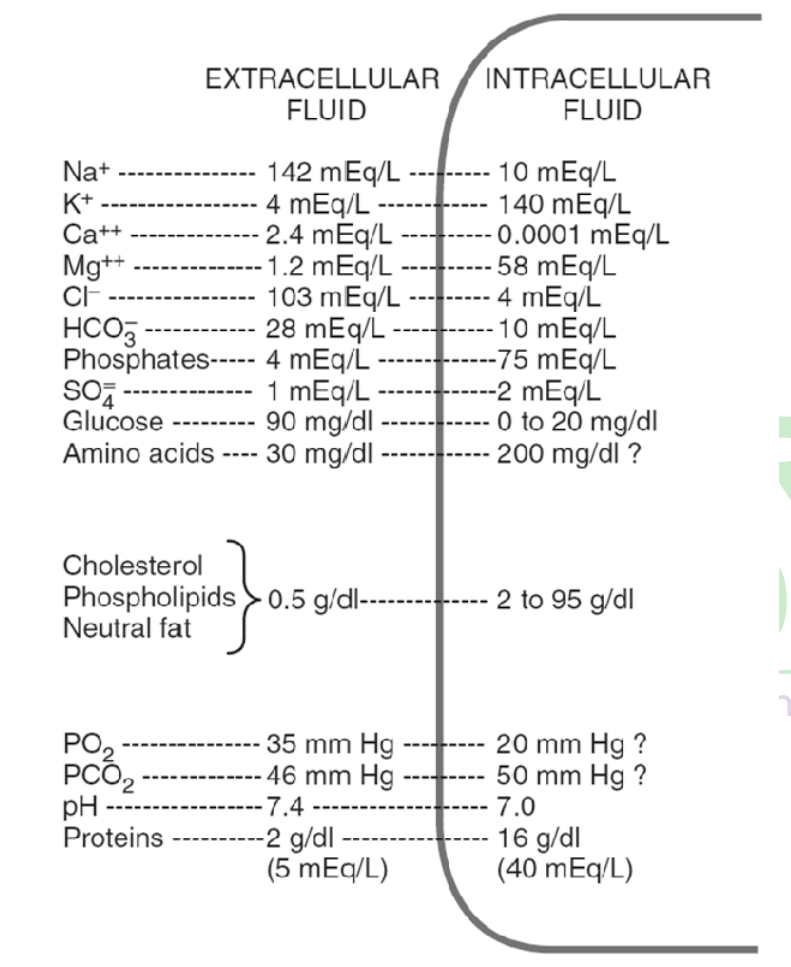

### 132. Answer: C — N2 breath test

*Anatomy · PDF p.28*

• Nitrogen washout (or Fowler’s method) is a test for measuring anatomic dead space in the lung during a respiratory cycle, as well as some parameters related to the closure of airways.

### 133. Answer: C — 125 ml/min

*Anatomy · PDF p.28*

Ref: Guyton and Hall Textbook of Medical Physiology, Elsevier; 13th Edition, Page No: 335 • The GFR is determined by (1) the balance of hydrostatic and colloid osmotic forces acting across the capillary membrane and (2) the capillary filtration coefficient (Kf), the product of the permeability and filtering surface area of the capillaries. The glomerular capillaries have a much higher rate of filtration than most other capillaries because of a high glomerular hydrostatic pressure and a large Kf. • In the average adult human, the GFR is about 125 ml/ min, or 180 L/day. The fraction of the renal plasma flow that is filtered (the filtration fraction) averages about 0.2, which means that about 20 percent of the plasma flowing through the kidney is filtered through the glomerular capillaries. The filtration fraction is calculated as follows: Filtration fraction = GFR / Renal plasma flow

### 134. Answer: D — Vagus

*Anatomy · PDF p.28*

Ref: Vagus Nerve Stimulation (VNS) and Treatment of Depression: To the Brainstem and Beyond by John P. O’Reardon et al. • Neuromodulation appears to be emerging gradually as a new therapeutic field in psychiatric treatment. It encompasses neuropsychiatric medical devices, such as vagus nerve stimulation (VNS), transcranial magnetic stimulation (TMS), deep brain stimulation (DBS), and electroconvulsive therapy (ECT). • VNS is an implanted device that has established efficacy in pharmaco-resistant epilepsy. It was approved by the FDA for the treatment of severe, recurrent unipolar and bipolar depression in July of 2005. • VNS adopts a bottom-up approach to modulating the neural circuitry of depression by stimulating vagal afferent fibers in the neck, which carry impulses to the brain stem to target there the locus ceruleus and dorsal raphe nucleus. • Now that VNS has moved beyond the experimental phase and into the clinic, psychiatrists are faced with deciding who is an appropriate patient for this surgical implant and how to integrate VNS into existing treatment in order to optimize both efficacy and safety.

### 135. Answer: C — Increased H+

*Anatomy · PDF p.28*

Ref: USMLE Step 1 First Aid 2020, Page No: 666 • Oxygen-hemoglobin dissociation curve (ODC) has sigmoidal shape due to positive cooperativity (ie, tetrameric Hb molecule can bind 4 O2 molecules and has higher affinity for each subsequent O2 molecule bound). Myoglobin is monomeric and thus does not show positive cooperativity; curve lacks sigmoidal appearance.

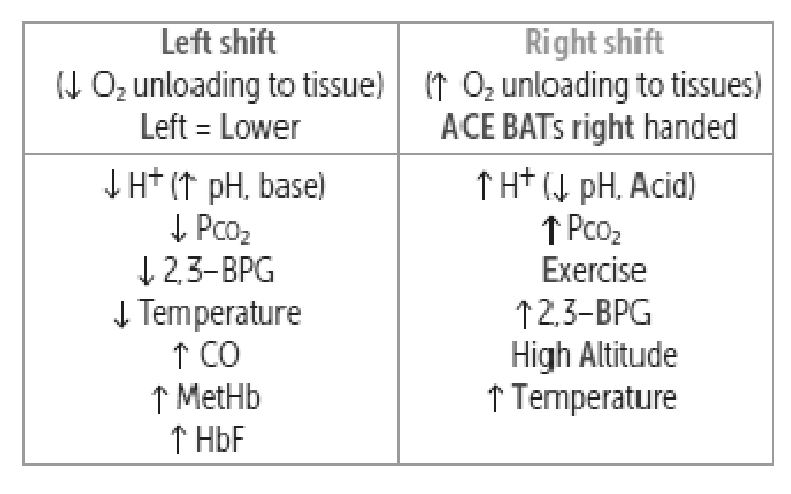

### 136. Answer: B — Two heavy chains and four light chains

*Anatomy · PDF p.29*

Ref: Guyton & Hall Physiology, 13th edition, page 78 - 79 • The myosin molecule is composed of six polypeptide chains—two heavy chains, each with a molecular weight of about 200,000, and four light chains with molecular weights of about 20,000 each. • The two heavy chains wrap spirally around each other to form a double helix, which is called the tail of the myosin molecule. One end of each of these chains is folded bilaterally into a globular polypeptide structure called a myosin head. Thus, there are two free heads at one end of the double-helix myosin molecule. The four light chains are also part of the myosin head, two to each head. These light chains help control the function of the head during muscle contraction. • The myosin filament is made up of 200 or more individual myosin molecules.

### 137. Answer: A — Factor III

*Anatomy · PDF p.29*

Ref: Guyton & Hall Physiology, 13th edition, page 487 – 488 • Tissue factor (Factor III) is released from traumatized tissue and initiates extrinsic pathway of clotting.

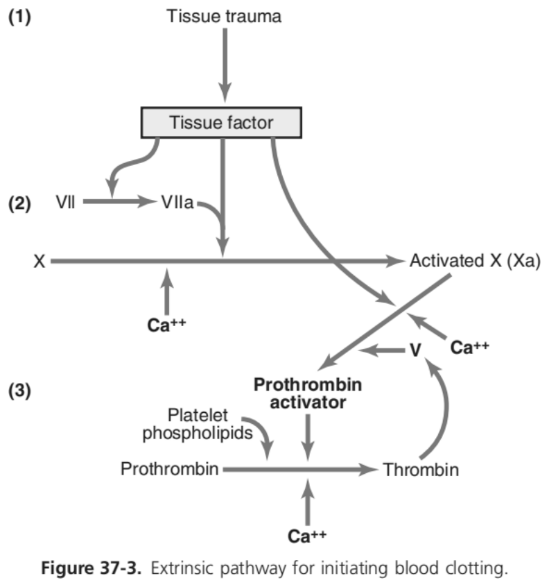

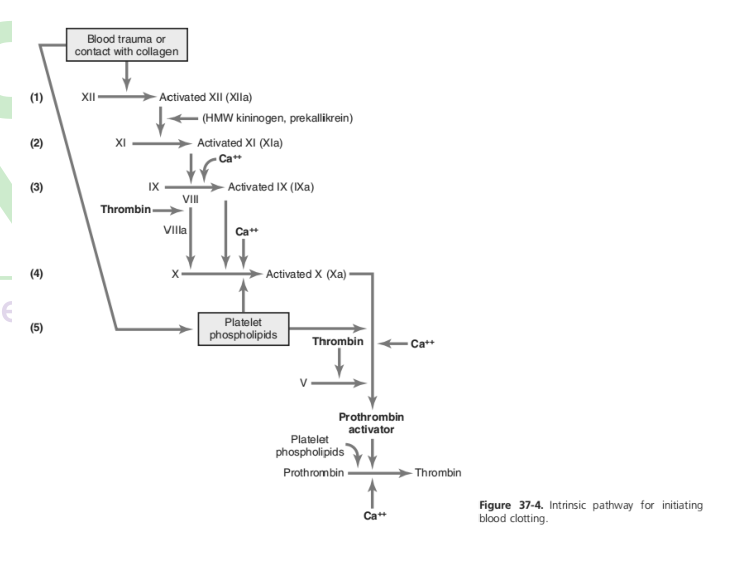

### 138. Answer: A — Aα

*Anatomy · PDF p.29*

Ref: Berneand Levy physiology; 7th edition; Page No: 79 Table: Correlation Of Axon Groups, As Revealed By Compound Action Potential Recordings, With Their Functional Properties

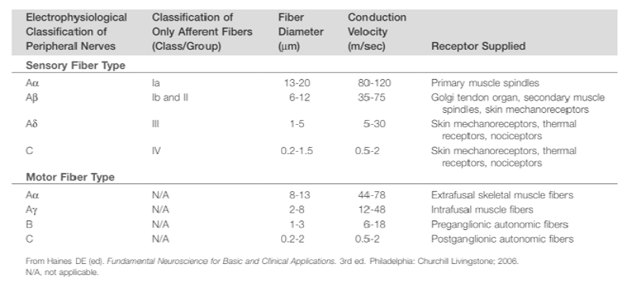

### 139. Answer: D — Crude touch

*Anatomy · PDF p.30*

Ref: Guyton and Hall Textbook of Medical Physiology, Elsevier; 13th Edition, Page No: 609 Dorsal Column–Medial Lemniscal System • Touch sensations requiring a high degree of localization of the stimulus • Touch sensations requiring transmission of fine gradations of intensity • Phasic sensations, such as vibratory sensations • Sensations that signal movement against the skin • Position sensations from the joints • Pressure sensations related to fine degrees of judgment of pressure intensity Anterolateral System • Pain • Thermal sensations, including both warmth and cold sensations • Crude touch and pressure sensations capable only of crude localizing ability on the surface of the body • Tickle and itch sensations • Sexual sensations

### 140. Answer: B — Hypothermia shifts curve to left

*Anatomy · PDF p.30*

Ref: Berne and Levy physiology; 7th edition; Page No: 483 • Hgb is the major transport molecule for O2. The Hgb molecule is a protein with two major components: four nonprotein heme groups, each containing iron in the reduced ferric (Fe+++) form, which is the site of O2 binding, and a globin portion consisting of four polypeptide chains. • Normal adults have two α-globin chains and two β-globin chains (HgbA), whereas children younger than 6 months of age have predominantly fetal Hgb (HgbF), which consists of two α chains and two γ chains. This difference in the structure of HgbF increases its affinity for O2(shifts 02 -Hb curve to Left) and aids in the transport of O2 across the placenta. In addition, HgbF is not inhibited by 2, 3-diphosphoglycerate (2,3DPG), a product of glycolysis; thus O2 uptake is further enhanced.

### 141. Answer: B — dV/dP

*Anatomy · PDF p.30*

Ref: Ganong Review of Medical Physiology, Lange; 25th Edition, Page No: 654-657 • The change in lung volume per unit change in the airway pressure (dV/dP) is the stretchability ( Compliance) of the lungs and chest wall. It is in pulmonary edema, pneumonia and pulmonary fibrosis. Increased in emphysema and normal aging.

### 142. Answer: A — Bronchial asthma

*Physiology · PDF p.30*

Creola bodies are clusters of ciliated epithelial cells sometimes seen in sputum samples of patients with asthma. 3 C’s of sputum findings in asthma • Charcot Leyden crystals • Curschmann spirals • Creola bodies

### 143. Answer: D — Bridging fibrosis

*Physiology · PDF p.30*

9 In NCPF, fibrosis is seen only in portal and periportal region.

### 144. Answer: D — Granuloma formation

*Physiology · PDF p.30*

• Granuloma formation is characteristic of chronic granulomatous inflammation and is not seen in acute inflammation.

### 145. Answer: B — alpha 1 antitrypsin deficiency

*Physiology · PDF p.30*

• In alpha 1 antitrypsin deficiency, non functional protein is stored in hepatocytes which leads to apoptosis. • In cystic fibrosis, there is loss of CFTR (Cystic Fibrosis Transmembrane conductance Regulator) which causes defect in chloride transport. • In Tay-Sachs disease, there is lack of lysosomal enzyme which causes storage of GM2 gangliosides in neurons. • Familial hypercholesterolemia is characterized by loss of LDL receptor which results in hypercholesterolemia.

### 146. Answer: A — Ependymoma

*Physiology · PDF p.30*

• Ependymoma is a glial tumor. • It is derived from ependymal cells of the ventricles.

### 147. Answer: D — Arteries, veins and nerves

*Physiology · PDF p.31*

Ref: Robbins Basic Pathology 10th Edition, Page No: 389 | Ref: Bailey and Love’s Short Practice of Surgery 27th Edition, Page No: 967 Thromboangiitis obliterans (Buerger disease) is characterized by segmental, thrombosing, acute and chronic inflammation of medium- and small-sized arteries, principally the tibial and radial arteries, with occasional secondary extension into the veins and nerves of the extremities. Thromboangiitis obliterans (Buerger’s disease) This is characterised by occlusive disease of small- and medium-sized arteries (plantar, tibial, radial, etc.), thrombophlebitis of the superficial or deep veins and Raynaud’s syndrome; • It occurs in male smokers, usually under the age of 30 years. • Often, only one or two of the three manifestations are present. • Histologically, there are inflammatory changes in the walls of arteries and veins, leading to thrombosis. Treatment is total abstinence from smoking, which arrests, but does not reverse, the disease. Established arterial occlusions are treated as for atheromatous disease, but amputations may eventually be required.

### 148. Answer: D — Cell-mediated hypersensitivity

*Physiology · PDF p.31*

Ref: Robbins Basic Pathology 10th Edition, Page No: 135

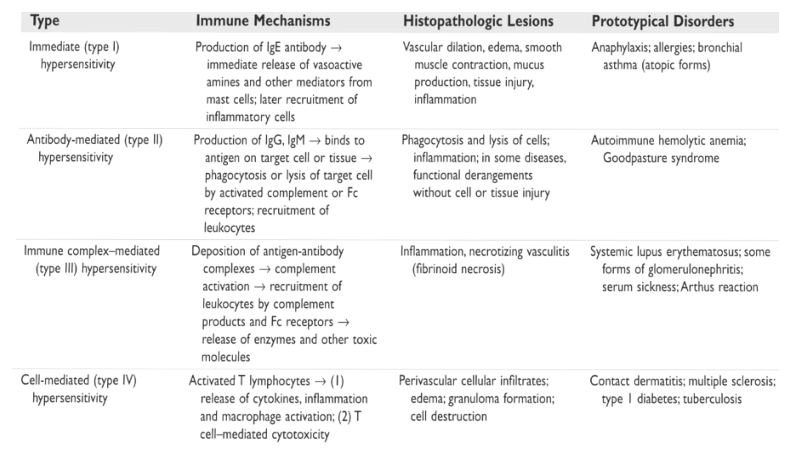

### 149. Answer: D — Benign Nephrosclerosis

*Physiology · PDF p.31*

Ref: Robbins Basic Pathology 10th Edition, Page No: 570 • The kidney may be normal in size or shrunken, depending on the duration and severity of the hypertensive disease. Small, pinpoint petechial hemorrhages may appear on the cortical surface from rupture of arterioles or glomerular capillaries, giving the kidney a peculiar, flea-bitten appearance.

### 150. Answer: A — Normal ciliated epithelium is replaced by stratified squamous epithelium

*Physiology · PDF p.31*

Ref: Robbins Basic Pathology 10th Edition, Page No: 51 • Epithelial metaplasia is exemplified by the change that occurs in the respiratory epithelium of habitual cigarette smokers, in whom the normal ciliated columnar epithelial cells of the trachea and bronchi often are replaced by stratified squamous epithelial cells. • The rugged stratified squamous epithelium may be able to survive the noxious chemicals in cigarette smoke that the more fragile specialized epithelium would not tolerate. • Although the metaplastic squamous epithelium has survival advantages, important protective mechanisms are lost, such as mucus secretion and ciliary clearance of particulate matter. Epithelial metaplasia is therefore a double-edged sword.

### 151. Answer: B — GpIb

*Physiology · PDF p.31*

Ref: Robbins Basic Pathology 10th Edition, Page No: 103 • GpIb deficiency-Bernard-soulier syndrome • GpIIb/IIIa deficiency-Glanzmann thrombasthenia • von Willebrand factor deficiency-von Willebrand disease

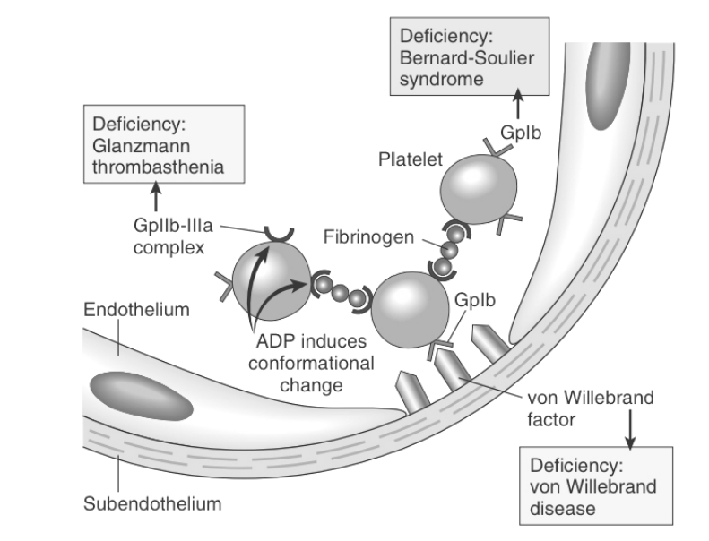

### 152. Answer: D — There is ipsilateral loss of pain and temperature below the level of the lesion

*Physiology · PDF p.32*

Ref: Harrison’s Principles of Internal Medicine; 19th Edition, Page No: 2652 • Brown-Sequard Hemicord Syndrome: This consists of ipsilateral weakness (corticospinal tract) and loss of joint position and vibratory sense (posterior column), with contralateral loss of pain and temperature sense (spinothalamic tract) one or two levels below the lesion. Segmental signs, such as radicular pain, muscle atrophy, or loss of a deep tendon reflex, are unilateral. Partial forms are more common than the fully developed syndrome. • Central Cord Syndrome: This syndrome results from selective damage to the gray matter nerve cells and crossing spinothalamic tracts surrounding the central canal. In the cervical cord, the central cord syndrome produces arm weakness out of proportion to leg weakness and a “dissociated” sensory loss, meaning loss of pain and temperature sensations over the shoulders, lower neck, and upper trunk (cape distribution), in contrast to preservation of light touch, joint position, and vibration sense in these regions. Spinal trauma, syringomyelia, and intrinsic cord tumors are the main causes. • Anterior Spinal Artery Syndrome: Infarction of the cord is generally the result of occlusion or diminished flow in this artery. The result is bilateral tissue destruction at several contiguous levels that spares the posterior columns. All spinal cord functions—motor, sensory, and autonomic—are lost below the level of the lesion, with the striking exception of retained vibration and position sensation.

### 153. Answer: B — More common amongst female

*Physiology · PDF p.32*

Ref: Robbins Basic Pathology 9th Edition, Page No: 714 The WHO estimates that 25% of lung cancer worldwide occurs in never smokers. These cancers occur more commonly in women and most are adenocarcinomas. Adenocarcinoma is now the most common form of lung cancer in women and, in many studies, men as well. Compared with squamous cell cancers, the lesions are usually more peripherally located and tend to be smaller. The relative proportions of the major categories of lung carcinoma are: • Adenocarcinoma (38%) • Squamous cell carcinoma (20%) • Small cell carcinoma (14%) • Large cell carcinoma (3%) • Other (25%)

### 154. Answer: A — Decreasing ADP mediated cAMP activation

*Pathology · PDF p.32*

Ref: KDT Pharmacology 7th Edition, Page No: 630 Ticlopidine • It is the first thienopyridine which alters surface receptors on platelets and inhibits ADP as well as fibrinogen- induced platelet aggregation. • The Gi coupled P2Y12 (also labeled P2YAC) type of purinergic receptors which mediate adenylyl cyclase inhibition due to ADP are blocked irreversibly by the active metabolite of ticlopidine. • As a result, activation of platelets is interfered. • Fibrinogen binding to platelets is prevented without modification of GPIIb/IIIa receptor. • There is no effect on platelet TXA2, but bleeding time is prolonged and platelet survival in extra-corporeal circulation is increased. • Because of different mechanism of action, it has synergistic effect on platelets with aspirin. Their combination is a potent platelet inhibitor.

### 155. Answer: C — Stimulant purgative

*Pathology · PDF p.32*

Ref: KDT Pharmacology 7th Edition, Page No: 672 Bulk forming • Dietary fibre: Bran, Psyllium (Plantago), Ispaghula, Methylcellulose Stool softener • Docusates (DOSS), Liquid paraffin Stimulant purgatives • Diphenylmethanes: Phenolphthalein, Bisacodyl, Sodium picosulfate • Anthraquinones (Emodins): Senna, Cascara sagrada • 5-HT4 agonist: Prucalopride • Fixed oil: Castor oil Osmotic purgatives: • Magnesium salts: sulfate, hydroxide • Sodium salts: sulfate, phosphate • Sod. pot. tartrate • Lactulose

### 156. Answer: A — Acetylation

*Pathology · PDF p.33*

Ref: Katzung Pharmacology 14th Edition, Page No: 68 • Phase II drug metabolism involves the transfer of chemical groupings (e.g. acetyl, glucuronide, glutathione) to drugs or their metabolites via conjugation reactions involving transferase enzymes. Acetylation reactions are associated with a genetic polymorphism (slow acetylator). These individuals are slow to metabolize drugs via acetylation and are particularly susceptible to drug-induced SLE when taking hydralazine, procainamide, or isoniazid. Both oxidation and reduction are phase I metabolism reactions.

### 157. Answer: A — suppresses excitability in hypoxic areas of the heart

*Pathology · PDF p.33*

Ref: KDT Pharmacology 7th Edition, Page No: 530 Ref: Katzung Pharmacology 14th Edition, Page No: 241 • Lidocaine, a class IB drug, effectively targets ischemic areas of the heart. Its major effect is on sodium channels in fast response fibers such as ventricular muscle. It has no significant effect on the PR or QT intervals.

### 158. Answer: B — Potency

*Pathology · PDF p.33*

Ref: Katzung Pharmacology, 14th edition, page 36 • Potency—Drugs A and B are said to be more potent than drugs C and D because of the relative positions of their dose response curves along the dose axis of Figure 2–15. • Potency refers to the concentration (EC50) or dose (ED50) of a drug required to produce 50% of that drug’s maximal effect. • Thus, the pharmacologic potency of drug A in Figure 2–15 is less than that of drug B, a partial agonist because the EC50 of A is greater than the EC50of B. Potency of a drug depends in part on the affinity (Kd) of receptors for binding the drug and in part on the efficiency with which drug-receptor interaction is coupled to response. Note that some doses of drug A can produce larger effects than any dose of drug B, despite the fact that we describe drug B as pharmacologically more potent. The reason for this is that drug A has a larger maximal efficacy.

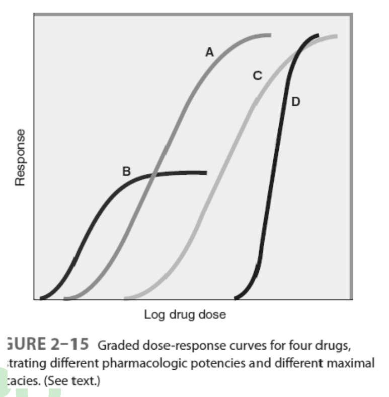

### 159. Answer: C — Methylation

*Pathology · PDF p.33*

Ref: Katzung Pharmacology, 14th edition, page 64

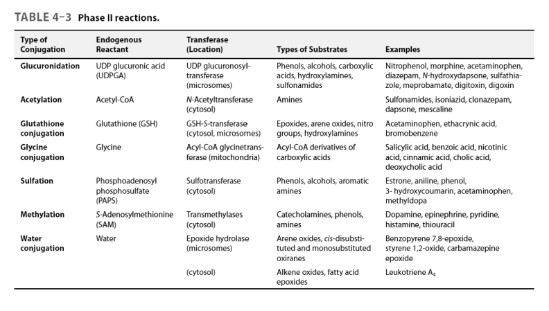

### 160. Answer: D — Midodrine

*Pathology · PDF p.33*

Ref: Katzung Pharmacology, 14th edition, page 149 • Midodrine is a prodrug that is enzymatically hydrolyzed to desglymidodrine,a selective α1-receptor agonist. • Alpha2-selective agonists decrease blood pressure through actions in the CNS that reduce sympathetic tone (“sympatholytics”)even though direct application to a blood vessel may cause vasoconstriction. Such drugs (eg, clonidine, methyldopa, guanfacine, guanabenz) are useful in the treatment of hypertension

### 161. Answer: A — MAO-A

*Pathology · PDF p.34*

Ref: Katzung Pharmacology, 14th edition, page 150 • Tyramine is a normal byproduct of tyrosine metabolism in the body. It is an indirect sympathomimetic, inducing the release of catecholamines from noradrenergic neurons. Tyramine can be produced in high concentrations in protein rich foods by decarboxylation of tyrosine during fermentation but is normally inactive when taken orally because it is readily metabolized by MAO in the liver (ie, low bioavailability because of a very high first-pass effect). • In patients treated with MAO inhibitors—particularly inhibitors of the MAO-A isoform—the sympathomimetic effect of tyramine may be greatly intensified, leading to marked increases in blood pressure. This occurs because of increased bioavailability of tyramine and increased neuronal stores of catecholamines. • Patients taking AO inhibitors should avoid tyramine- containing foods (aged cheese, cured meats, and pickled food). There are differences in the effects of various MAO inhibitors on tyramine bioavailability, and isoform- specific or reversible enzyme antagonists may be safer.

### 162. Answer: A — DNA-dependent RNA polymerase in prokaryotes

*Pathology · PDF p.34*

Ref: USMLE Step 1 First Aid 2020, Page No: 42 • Rifampin inhibits DNA-dependent RNA polymerase in prokaryotes.

### 163. Answer: A — Anticipation

*Pharmacology · PDF p.34*

Ref: USMLE Step 1 First Aid 2020, Page No: 56 • Anticipation: Increased severity or earlier onset of disease in succeeding generations; Trinucleotide repeat diseases (eg, Huntington disease). • Codominance: Both alleles contribute to the phenotype of the heterozygote. • Pleiotropy: One gene contributes to multiple phenotypic effects. • Variable expressivity: Patients with the same genotype have varying phenotypes.

### 164. Answer: C — E

*Pharmacology · PDF p.34*

Ref: USMLE Step 1 First Aid 2020, Page No: 70 Vitamin E • Includes tocopherol, tocotrienol. • Function: Antioxidant (protects RBCs and membranes from free radical damage). • Deficiency: Hemolytic anemia, acanthocytosis, muscle weakness, demyelination of posterior columns (decreased position and vibration sensation) and spinocerebellar tract (ataxia). Neurologic presentation may appear similar to vitamin B12 deficiency, but without megaloblastic anemia, hypersegmented neutrophils, or increased serum methylmalonic acid levels.

### 165. Answer: D — Catalyse carboxylation of drugs

*Pharmacology · PDF p.34*

Ref: Harper Biochemistry 30th Edition, Page No: 118, 119 • Oxygenases can be monooxygenase or dioxygenase • Monooxygenase incorporate 1 atom of Oxygen molecule to the substrate • Dioxygenase incorporate both the atoms of Oxygen molecule to the substrate • Phase 1 Xenobiotic reactions, hydroxylation, catalyzed mainly by members of a class of enzymes referred to as monooxygenases or cytochrome P450s.

### 166. Answer: A — Sucrose

*Pharmacology · PDF p.34*

Benedict’s test is a test for reducing substances in urine. Carbohydrates that give positive Benedict’s test are: • Pentoses, Fructose, Glucose, Galactose • Reducing disaccharides like Lactose, Maltose, Isomaltose Noncarbohydrates that give Benedict’s test positive are: • Homogentisic acid • Glucuronic acid • Salicylates • Ascorbic acid • Uric acid • Glutathione • Creatinine in very high amount Nonreducing disaccharides, like Sucrose and Trehalose do not give positive Benedict’s test. Tests for reducing substances are Benedict’s test and Fehling’s test.

### 167. Answer: A — Phosphoenol pyruvate to pyruvate

*Pharmacology · PDF p.35*

Ref: Harper Biochemistry 30th Edition, Page No: 170, 172 Steps releasing ATP at the level of substrate • 1, 3 Bisphosphoglycerate to 3 Phosphoglycerate (1, 3 Bisphosphoglycerate Kinase) • Phosphoenolpyruvate to Pyruvate. (Pyruvate Kinase) • Succinyl CoA to Succinate (Succinate Thiokinase)

### 168. Answer: D — Glycosylation

*Pharmacology · PDF p.35*

Ref: Harper Biochemistry 29th Edition, Page No: 89 Reversible covalent modifications • Phosphorylation Dephosphorylation • ADP Ribosylation • Methylation • Acetylation. Irreversible Covalent Modification • Zymogen activation/ Partial Proteolysis.

### 169. Answer: A — Catalyse the same reaction

*Pharmacology · PDF p.35*

Ref: Harper Biochemistry 29th Edition, Page No: 63 • Isoenzymes catalyse the same reaction. For example, LDH1-5 all convert Pyruvate to lactate • They have different quaternary structure. For example, the subunits in LDH-1 is different from LDH-2 • Tissue distribution of each isoform is different • Enzyme name and number can be different.

### 170. Answer: B — Beta configuration of anomeric C2

*Pharmacology · PDF p.35*

Ref: Harper Biochemistry 30th Edition, Page No: 156 • Inulin is a polysaccharide of fructose (and hence a fructosan) • Inulin consists of fructose polymer linked β 2 → 1 • Found in tubers and roots of dahlias, artichokes, and dandelions • It is readily soluble in water and is used to determine the glomerular filtration rate • It is not hydrolyzed by intestinal enzymes as mammals lack any enzyme that hydrolyzes the β1→ 4 bonds.

### 171. Answer: D — Proteus

*Pharmacology · PDF p.35*

Ref: Jawetz’s Medical Microbiology; Lange; 27th Edition, Page No: 236 • Proteus species produce infections in humans only when the bacteria leave the intestinal tract. They are found in urinary tract infections and produce bacteremia, pneumonia, and focal lesions in debilitated patients or those receiving contaminated intravenous infusions. • P mirabilis causes urinary tract infections and occasionally other infections. • Proteus vulgaris and M morganii are also important nosocomial pathogens. • Proteus species produce urease, resulting in rapid hydrolysis of urea with liberation of ammonia. Thus, in urinary tract infections with Proteus species, the urine becomes alkaline, promoting stone formation and making acidification virtually impossible. The rapid motility of Proteus may contribute to its invasion of the urinary tract. • Strains of Proteus vary greatly in antibiotic susceptibility. • P mirabilis is often inhibited by penicillins; the most active antibiotics for other members of the group are aminoglycosides and cephalosporins.

### 172. Answer: A — TI medium

*Pharmacology · PDF p.35*

Collection and Transport of Clinical Specimens in Bacterial meningitis • The proper collection and transport of clinical specimens is critical for the isolation, identification, and characterization of agents that cause bacterial meningitis. • Optimally, clinical specimens should be obtained before antimicrobial therapy commences in order to avoid loss of viability of the etiological agents. • Treatment of the patient, however, should not be delayed while awaiting collection of specimens or results from the laboratory and a specimen should be obtained in all suspect cases as bacterial pathogens can still be detected even after antimicrobial therapy has begun. • N. meningitidis, S. pneumoniae, and H. influenzae are fastidious and fragile bacteria. They are more reliably isolated if the clinical specimens are examined as soon as possible after collection. • Cerebrospinal fluid (CSF) should be processed in a microbiology laboratory within 1 hour after collection or inoculated into Trans-Isolate (T-I) medium for transport to the laboratory if processing within 1 hour is not feasible. • Blood specimens should be immediately inoculated into a blood culture bottle and transported to a microbiology laboratory as soon as possible for overnight incubation and growth of bacteria.

### 173. Answer: C — Chlamydia

*Pharmacology · PDF p.36*

Ref: USMLE Step 1 First Aid 2020, Page No: 148 Chlamydiae • Chlamydiae cannot make their own ATP. They are obligate intracellular organisms that cause mucosal infections. 2 forms: • Elementary body (small, dense) is “Infectious” and Enters cell via Endocytosis; transforms into reticulate body. • Reticulate body Replicates in cell by fission; Reorganizes into elementary bodies. • Chlamydia trachomatis causes neonatal and follicular adult conjunctivitis, nongonococcal urethritis, PID, and reactive arthritis. • Chlamydophila pneumoniae and Chlamydophila psittaci cause atypical pneumonia; transmitted by aerosol.

### 174. Answer: B — IGRA – TB

*Pharmacology · PDF p.36*

Interferon-Gamma Release Assays (IGRAs) are whole- blood tests that can aid in diagnosing Mycobacterium tuberculosis infection. They do not help differentiate latent tuberculosis infection (LTBI) from tuberculosis disease. Two IGRAs that have been approved by the U.S. Food and Drug Administration (FDA) are commercially available in the U.S: • QuantiFERON®-TB Gold In-Tube test (QFT-GIT); • T-SPOT®.TB test (T-Spot) IGRAs measure a person’s immune reactivity to M. tuberculosis. White blood cells from most persons that have been infected with M. tuberculosis will release interferon-gamma (IFN-g) when mixed with antigens (substances that can produce an immune response) derived from M. tuberculosis.

### 175. Answer: D — Salk vaccine

*Pharmacology · PDF p.36*

Ref: Ananthanarayan & Paniker Microbiology, 10th edition, page 643 Types of vaccines: Type Example Live attenuated Measles, mumps, rubella, varicella zoster, BCG, rotavirus, oral polio (Sabin) Killed vaccine Rabies, pertussis, cholera, hepatitis A, killed polio (Salk) Recombinant subunit Hepatitis B Toxoid Tetanus, diphtheria Protein conjugated Hib, meningococcal, pneumococcal (13PCV) Polysaccharide Meningococcal and pneumococcal vaccines

### 176. Answer: D — Lipopolysaccharide

*Pharmacology · PDF p.36*

Ref: Ananthanarayan & Paniker Microbiology, 10th edition, page 16 • Lipopolysaccharide (LPS) present on the cell wall of gram negative bacteria account for their endotoxic activity and O- antigen specificity. They were formerly known as Boivin antigen. The LPS consists of three regions: • Region I is the O polysaccharide portion determining O antigen specificity. • Region II is the core polysaccharide. • Region III is the glycolipid portion (lipid A) and is responsible for the endotoxic activities, that is, pyrogenicity, lethal effect, tissue necrosis, anticomplimentary activity, B cell mitogenicity, immunoadjuvant property and antitumour activity.

### 177. Answer: C — Severe recurrent pyogenic infections

*Pharmacology · PDF p.36*

Ref: Ananthanarayan & Paniker Microbiology, 10th edition, page 128 Clinical syndromes associated with genetic deficiencies of complement components: Group Deficiency Syndromes I Cl inhibitor Hereditary angioneurotic edema II Early components of classical pathway Cl, C2, C4 SLE and other collagen vascular diseases III C3 and its regulatory protein C3b inactivator Severe recurrent pyogenic infections IV C5 to C8 Bacteremia, mainly with Gram- negative diplococci, toxoplasmosis V C9 No particular disease

### 178. Answer: A — Fibroblasts

*Forensic Medicine · PDF p.37*

Ref: Ananthanarayan & Paniker Microbiology, 10th edition, page 455 Based on antigenic character, cell of origin and other properties, interferons have been classified into three types: alpha, beta and gamma. • Alpha interferon (IFN-α), formerly known as leucocyte interferon, is produced by leucoc tes following induction by suitable viruses. It is a non-glycosylated protein. At least 16 antigenic subtypes have been identified. • Beta interferon (IFN-β), formerly known as ‘fibroblast interferon, is produced by fibroblasts and epithelial cells following stimulation by viruses or polynucleotides. It is a glycoprotein. • Gamma interferon (IFN-γ), formerly known as immune interferon, is produced by T lymphocytes on stimulation by antigens or mitogens. It is a glycoprotein. It is more concerned with immunomodulatory and anti- proliferative functions than with antiviral defense. It also differs from alpha and beta interferons in having a separate cell receptor. 178. Study of physical, social and cultural history of man is known as: a. Sociology b. Anthropology c. Social psychology d. Acculturation Ans: b Ref: Park’s Textbook of Preventive and Social Medicine; 23rd Edition; Page No: 670, 672 SOCIOLOGY • Sociology deals with the study of human relationships and of human behaviour for a better understanding of the pattern of human life. It is also concerned with the effects on the individual of the ways in which other individuals think and act. SOCIAL PSYCHOLOGY • This discipline sprang from psychology. It is concerned with the psychology of individuals living in human society or groups. The emphasis is on understanding the basis of perception, thought, opinion, attitudes, general motivation and learning in individuals and how these vary in human societies and groups. In other words, it deals with the effect of social environment on persons, their attitudes and motivations. ANTHROPOLOGY • The word anthropology is derived from the root words, anthropo meaning man and logos meaning science. It is the study of the physical, social and cultural history of man. The study of human evolution, racial differences, and inheritance of bodily traits, growth and decay of the human organism is called physical anthropology. The study of the development and various types of social life is called social anthropology. The study of the total way of life of contemporary primitive man, his ways of thinking, feeling and action is called cultural anthropology (4). Of all the sciences, which study various aspects of man, anthropology is one which comes nearest to being a total study of man. Medical anthropology, deals with the cultural component in the ecology of health and disease. ACCULTURATION • Acculturation means “culture contact.” When there is contact. Between two people with different types of culture, there is diffusion of culture both ways. There are various ways by which culture contact takes place (10). (1) trade and commerce, (2) industrialization, (3) propagation of religion, (4) education, and (5) conquest. It is because of culture contact, which has both good and bad aspects. The introduction of scientific medicine is through culture contact. The changes in food habits of people are brought about through culture contact; many orthodox Brahmins in Nepal today eat meat. The widespread use of tobacco all over the world is because of culture contact. The radio, the television, the cinema have been important factors in shaping the cultural- behaviour patterns of people.

### 179. Answer: A — Numerator is component of denominator

*Forensic Medicine · PDF p.37*

Ref: Park’s Textbook of Preventive and Social Medicine; 23rd Edition; Page No: 55 Ratio • Measure of disease frequency is a ratio. It expresses a relation in size between two random quantities. The numerator is not a component of the denominator. The numerator and denominator may involve an interval of time or may be instantaneous in time. Broadly, ratio is the result of dividing one quantity by another. It is expressed in the form of: X/y Or, X:y PROPORTION • A proportion is a ratio which indicates the relation in magnitude of a part of the whole. The numerator is always included in the denominator. A proportion is usually expressed as a percentage.

### 180. Answer: C — Positive predictive value

*Forensic Medicine · PDF p.37*

Ref: Park’s Textbook of Preventive and Social Medicine; 23rd Edition; Page No: 139 Test result Person with disease Person without disease Total Positive A(True positive) B(False positive) A+B Negative C(False negative) D(True negative) C+D Sensitivity =True Positive /True Positive +False negative Specificity =True negative/True negative +False positive Positive predictive value=True Positive /True Positive +False positive Negative predictive value=True negative /True negative +False negative Now, A/A+B Or, True positive/True positive +False positive This is the formula of positive predictive value.

### 181. Answer: C — Used as basis for treatment

*Forensic Medicine · PDF p.38*

Ref: Park’s Textbook of Preventive and Social Medicine; 24th Edition; Page No: 135 Screening test Diagnostic test Done on apparently healthy Applied to groups Test results are arbitrary and final Based on one criterion or cut-off point Less accurate Less expensive Not a basis for treatment The initiative comes from the investigator or agency providing care Done on those with indications or sick. Applied to single patients, all diseases are considered. Diagnosis is not final but modified in light of new evidence, diagnosis is the sum of all evidence. Based on evaluation of a number of symptoms, signs (e.g., diabetes) and laboratory findings. More accurate. More expensive. Used as a basis for treatment. The initiative comes from a patient with a complaint.

### 182. Answer: B — Rejecting a null hypothesis when true

*Forensic Medicine · PDF p.38*

Ref: Simple Biostatistics by Indrayan & Indrayan; 1st Edition; Page No: 156 P-value: • Is the ‘Probability of Type I error’ (Null hypothesis is true but rejected) • Significance (a) level: is the maximum tolerable probability of Type I error • P- value is calculated (on basis of data while Alpha is fixed in advance: by the choice of level of significance employed in the test • P value calculated can be less than, equal to or greater than alpha (a) • Keep Type I error to be minimum (P < a): Then results are declared statistically significant.

### 183. Answer: B — Duration more than one incubation period

*Microbiology · PDF p.38*

Ref: Park’s Textbook of Preventive and Social Medicine; 23rd Edition; Page No: 64 • Common-source, continuous or repeated exposure: Sometimes the exposure from the same source may be prolonged - continuous, repeated or intermittent – not necessarily at the same time or place. • This outbreak, as in other outbreaks of this type, continued beyond the range of one incubation period. There was no evidence of secondary cases among persons who had contact with ill persons

### 184. Answer: C — Secondary prevention

*Microbiology · PDF p.38*

Ref: Park’s Textbook of Preventive and Social Medicine; 23rd Edition; Page No: 42 Secondary Level of Prevention • It halts the progress of disease at its incipient stage and prevents complications • Modes of Intervention: • Early Diagnosis: Detection of disturbances while biochemical, functional and morphological changes are still reversible or prior to occurrence of manifest signs and symptoms 9 Examples: Sputum smear exam for AFB, P/S for MP 9 Treatment: Shortens period of communicability, reduces mortality and prevents occurrence of further cases (secondary cases) or any long term disability  Example: DOTS, MDT • Secondary level of prevention is applied when disease has possibly set in: It attempts to arrest the disease process, seek unrecognized disease and treat it before irreversibility and reverse communicability of infectious diseases • National Health Programmes by Govt. of India mostly operate at Secondary level of prevention • Secondary prevention is an imperfect tool in control of transmission of disease: It is more expensive and less effective than primary prevention • It is an important level of prevention for diseases like Tuberculosis, Leprosy and STDs

### 185. Answer: D — Regional removal of disease agent

*Microbiology · PDF p.38*

Ref: Park’s Textbook of Preventive and Social Medicine; 23rd Edition; Page No: 40 Disease elimination: • Between control and eradication, an intermediate goal has been described, called “regional elimination”. The term “elimination” is used to describe interruption of transmission of disease, as for example, elimination of measles, polio and diphtheria from large geographic regions or areas. Regional elimination is now seen as an important precursor of eradication.

### 186. Answer: B — Pre-pathogenesis period

*Microbiology · PDF p.39*

Ref: Park’s Textbook of Preventive and Social Medicine; 23rd Edition; Page No: 35 Fig: Natural history of disease PREPATHOGENESIS PHASE OF DISEASE • Is period before onset of disease in man (man at risk) • Epidemiological triad: Interaction between agent, host and environment • Primary level of prevention is possible PATHOGENESIS PHASE OF DISEASE • Begins with ‘Entry of organism’ in susceptible host • Multiplication of organism, disease initiation and progression • Final outcome may be recovery, disability or death • Host may become a clinical case, subclinical case or carrier • Secondary and tertiary levels of prevention are possible • Screening of disease may improve prognosis and increase survival

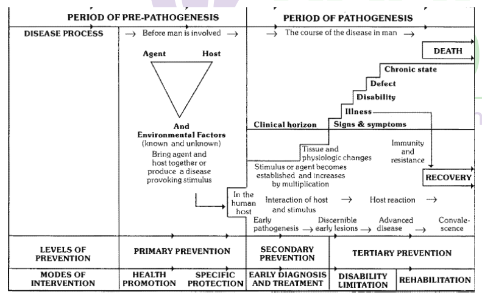

### 187. Answer: C — Measures life expectancy adjusted without disability or free of disability

*Microbiology · PDF p.39*

• Disability-free life expectancy (Syn: active life expectancy): Disability-free life expectancy {DFLE) is the average number of years an individual is expected to live free of disability if current pattern of mortality and disability continue to apply.

### 188. Answer: C — Thrombus

*Microbiology · PDF p.39*

Ref: Gautam Biswas Forensic Medicine, 3rdEdition, Page No: 301 • Pulmonary embolism is a complication of venous thromboembolism, most commonly deep venous thrombosis (DVT) of the legs. • Less common causes include air, fat droplets, amniotic fluid, clumps of parasites or tumor cells and talc in drugs of IV drug abusers. • It is present in 60–80% of patients with DVT. • As a cause of sudden death, it is 2nd only to sudden cardiac death. Most patients die within the first few hours of the event.

### 189. Answer: B — Locard exchange principle

*Biochemistry · PDF p.39*

Ref: Gautam Biswas Forensic Medicine, 3rdEdition, Page No: 380 • Based on Locard’s exchange principle ‘every contact leaves a trace’; evidence is collected during and soon after the examination is completed

### 190. Answer: A — Eye

*Biochemistry · PDF p.39*

Ref: Gautam Biswas Forensic Medicine, 3rdEdition, Page No: 137 Tache noire (French, black line): • If the eyelids remain open for 3–4 h after death, there is formation of two yellow triangles (base on the limbus, apex at the lateral or medial canthus and sides are formed by the margins of the upper and lower eyelids) on the sclera at each side of the iris, which become brown and then black.

### 191. Answer: B — Greenish discoloration over right iliac fossa

*Biochemistry · PDF p.39*

Ref: Gautam Biswas Forensic Medicine, 3rdEdition, Page No: 147 • The first external sign of decomposition is usually a greenish discoloration over the right iliac fossa over the region of the cecum which lies superficially, and the contents of the bowel are more fluid and full of bacteria. C. welchii are most abundant at the iliocecal zone of the intestinal tract.

### 192. Answer: B — Graze abrasions

*Community Medicine · PDF p.40*

Ref: Gautam Biswas Forensic Medicine, 3rdEdition, Page No: 189, 190 • Grazes (gravel rash) are caused by horizontal or tangential friction between the skin and the hard rough surface. They show uneven, longitudinal parallel lines, which indicate the direction in which the force was applied (epidermis being heaped up at the opposite end). • Most common type of abrasion, and commonly seen in road traffic accidents. Particles of glass, gravel or dirt may be embedded in such wounds.

### 193. Answer: D — C. difficile

*Community Medicine · PDF p.40*

Ref: Nelson pediatrics, 20th Edition, Page No: 1260 • The most important tool in any infection control program is good hand hygiene. Although much attention is directed at the type of cleansing agent employed, the most important aspect of hand washing is placing the hands under water and using friction with or without soap. Studies show that a 15 sec scrub removes the majority of transient flora but does not alter hand permanent flora. A variety of hand gels and rubs can be used in place of hand washing. • Waterless hand hygiene products increase hand hygiene compliance and save time; these agents are the preferred agents for routine hand hygiene when hands are not visibly soiled. These products are effective in killing most microbes but do not remove dirt or debris. However, they are ineffective against C. difficile spores, requiring the use of other cleansing products during hospital C. difficile outbreaks. Hands should be cleaned before and after every patient encounter. In hospital hand washing compliance studies, physicians are usually the least- compliant group studied, and compliance programs must pay special attention to this group of caregivers.

### 194. Answer: D — All are correct

*Community Medicine · PDF p.40*

Ref: Official WHO website Myth busters: • 5G mobile networks DO NOT spread COVID-19 • Exposing yourself to the sun or to temperatures higher than 25C degrees DOES NOT prevent the coronavirus disease (COVID-19) • You can recover from the coronavirus disease (COVID-19). Catching the new coronavirus DOES NOT mean you will have it for life. • Being able to hold your breath for 10 seconds or more without coughing or feeling discomfort DOES NOT mean you are free from the coronavirus disease (COVID-19) or any other lung disease. • Drinking alcohol does not protect you against COVID-19 and can be dangerous. • COVID-19 virus can be transmitted in areas with hot and humid climates. • Cold weather and snow CANNOT kill the new coronavirus. • Taking a hot bath does not prevent the new coronavirus disease. • The new coronavirus CANNOT be transmitted through mosquito bites.

### 195. Answer: B — CAB

*Community Medicine · PDF p.40*

In its full, standard form, cardiopulmonary resuscitation (CPR) comprises 3 steps: chest compressions, airway, and breathing (CAB), to be performed in that order in accordance with the 2010 American Heart Association (AHA) guidelines. The AHA 2010 guidelines revised the initial CPR sequence of steps from ABC (airway, breathing, chest compressions) to CAB (chest compressions, airway, breathing); this was reaffirmed in the 2015 update, which also offered the following revised recommendations for performance of CPR: • Chest compressions should be performed at a rate of 100-120/min (class I) • During manual CPR, chest compressions should be at a depth of at least 2 inches for an average adult, while avoiding excessive chest compression depths (>2.4 inches) (class I) • Total preshock and postshock pauses in chest compressions should be as short as possible (class I) • For adults in cardiac arrest receiving CPR without an advanced airway, it is reasonable to pause compressions for less than 10 seconds to deliver two breaths (class IIa) • In adult cardiac arrest with an unprotected airway, it may be reasonable to perform CPR, in which case, the chest compression target fraction should still be as high as possible (at least 60%) (class IIb)

### 196. Answer: C — 90 minutes

*Community Medicine · PDF p.41*

For STEMI and high-risk non-STEMI ACS, adjunctive therapies should begin as indicated. For STEMI with symptom onset 12 or fewer hours ago, reperfusion should not be delayed. Selection of therapy is defined by patient and center criteria, with the following door-to- treatment goals: • Percutaneous coronary intervention (PCI): 90 minutes • Fibrinolysis: 30 minutes

### 197. Answer: B — Airway maintenance

*Community Medicine · PDF p.41*

Ref: Miller’s Anesthesia, 8th Edition, Page No: 3194

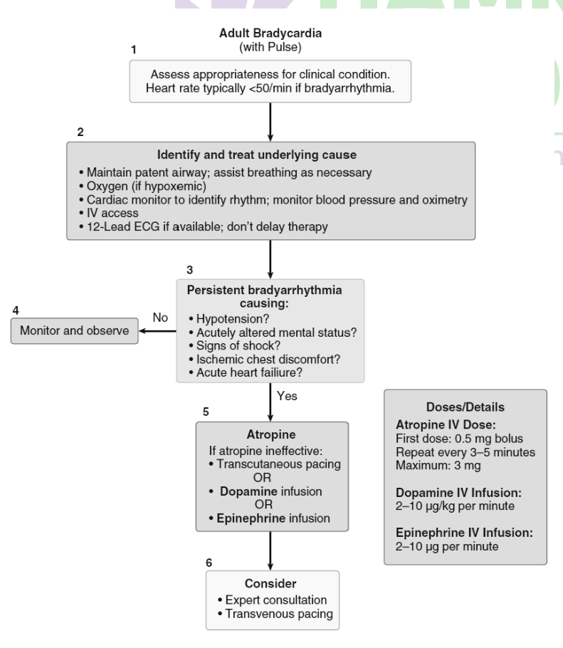

### 198. Answer: B — Empathy

*Community Medicine · PDF p.41*

• Sympathy is feeling compassion, sorrow, or pity for the hardships that another person encounters. • Empathy is putting yourself in the shoes of another, which is why actors often talk about it.

### 199. Answer: A — Drug safety

*Community Medicine · PDF p.41*

• Pharmacovigilance, also known as drug safety, is the pharmacological science relating to the collection, detection, assessment, monitoring, and prevention of adverse effects with pharmaceutical products.

### 200. Answer: A — Hand hygiene and social distancing

*Community Medicine · PDF p.41*

Way to Biratnagar Buspark W S N E Way to Thulomill Way to Itahari Kanchanbari Chowk Ghadi Chowk Sangam Chowk 50 Meter 150 Meter Airport Mode Biratnagar Airport Oil Nigam Hotel Global Chaubiskoti D Mama Restaurant Way to COMS Hotel Sky Hanumansthan Vedanta School Baneshwor Banquet New Baneshwor Thapagaun Mandir New Baneshwor Biratnagar Chitwan Our Rapid Review Series New Baneshwor, Ktm 9866576080 Jalpa Road, Pokhara 9765944139 Bharatpur, Chitwan 9841694953 Kanchanbari, Biratnagar 9806357053 CEE MD/MS NMCLE MBBS LOKSEWA 8TH LEVEL

---

## Blueprint

| Subject | Questions | Share |
| --- | --- | --- |
| Medicine | 19 | 9.5% |
| Surgery | 15 | 7.5% |
| Pediatrics | 7 | 3.5% |
| Obstetrics & Gynecology | 20 | 10.0% |
| Orthopedics | 16 | 8.0% |
| ENT | 13 | 6.5% |
| Ophthalmology | 10 | 5.0% |
| Anesthesia | 10 | 5.0% |
| Psychiatry | 8 | 4.0% |
| Radiology | 8 | 4.0% |
| Anatomy | 15 | 7.5% |
| Physiology | 12 | 6.0% |
| Pathology | 9 | 4.5% |
| Pharmacology | 15 | 7.5% |
| Forensic Medicine | 5 | 2.5% |
| Microbiology | 6 | 3.0% |
| Biochemistry | 3 | 1.5% |
| Community Medicine | 9 | 4.5% |
| **Total** | **200** | **100%** |

Answer key spread: A 53 · B 55 · C 55 · D 37

Figures: 26 across 23 questions.

---

## Notes on the source

- The source misprints four question numbers: 75 prints as 5, 85 as 5, 87 as 7, and 154 as 54. Numbering here follows the paper's true sequence, not the printed digits.
- The source repeats question number 178 twice. The duplicate marker was dropped, leaving exactly 200 questions.
- No question in this paper duplicates any question in Sets 1 through 5.
- The paper prints no subject headers. Subjects were assigned from the question content and the paper's contiguous subject blocks.
- Figures were mapped to questions using the paper's two-column reading order, so a figure at the top of the right column attaches to the question whose explanation ran off the bottom of the left column.

---

## Files

- `surgery-practice.html` — bank registered as `cee6` under CEE MD/MS
- `cee-img/` — figure crops referenced above
- `CEE Bhadra 27 finalised.pdf` — source paper
